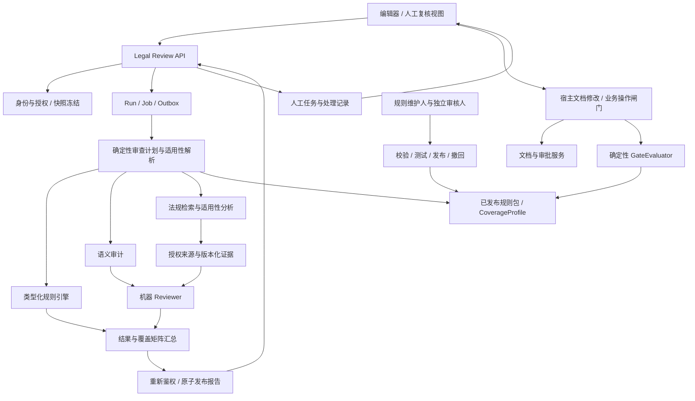

# 法律建议与规范审计 AI Agent 功能及实现规格

版本：v0.1 / 待人工评审  
日期：2026-11-03  
适用阶段：Phase 1 / Standards Audit Group + Regulatory Advice Group  
读者：产品、Trade Ops、法务与合规、规则维护人、人工 Reviewer、架构师、开发与测试人员、后续编码 Agent

## 1. 定位、范围与不变量

本文细化 [Requirements.md](Requirements.md) 中 RULE-01 至 RULE-04、REG-01 至 REG-05、第 9.3 节操作闸门，以及组织和外部律师授权要求。与 [AI_assistance_reqirement.md](AI_assistance_reqirement.md) 复用身份、快照、知识治理、检索及模型适配器；不修改原始手写需求、V1/V2 或优化架构。

“法律建议助手”是用户侧入口，内部保留三类独立能力：确定性规范检查、AI 语义审计、法规适用性分析。机器 Reviewer 检查输出质量，人工法律 Reviewer 处理专业判断，业务审批人批准具体业务，规则发布审核人批准规则内容；四种职责不可混为一谈。

MUST 表示必须实现的约束；标为“建议”的技术、额度、期限须评审冻结。本文件是产品及工程规格，不是现行法律意见；任何示例规则均为合成测试数据，不得发布为真实法规。

### 1.1 首期范围

| 能力 | P0 | P1 / 不包含 |
| --- | --- | --- |
| 规范审计 | 必填、类型、金额币种、日期顺序、长度、字符集、条款存在性、已发布模板规则 | 不默认包含全部 SWIFT 报文标准，不发送金融报文 |
| 语义审计 | 主体和金额矛盾、条款冲突、条件缺失、模糊表述；输出建议与证据 | 不把模型判断当成确定性违规 |
| 法规建议 | 经批准法域、交易场景和规则范围内的适用性分析、证据及待核实事项 | 不承诺全法域覆盖；不提供最终法律认证 |
| 人工处理 | 查看依据、采纳/拒绝、请求律师复核、复核意见、重新审查 | P1：多律师会签、复杂委托、独立法律意见书签署 |
| 数据来源 | 已发布且获授权的法律来源、政策、标准和固定文档/附件快照 | P1：受控联网检索；P0 不实时抓取外网 |
| 修改 | 生成结构化修改建议，由宿主编辑器经用户确认执行 | 不自动改正文、提交、审批、授权豁免或进行出口管制裁定 |

### 1.2 核心不变量

1. 每次审查固定文档快照、附件版本、交易事实版本、规则包和知识发布版本；不能将旧结果贴到新版本。
2. 所有确定性结果可以用相同输入和相同引擎版本重算；模型结果保留证据和版本，不声称逐字可重现。
3. 法规引用必须有真实已发布来源及精确定位；客户合同不是法规依据，SWIFT 标准不是国家法律，内部政策不是普遍法律义务。
4. 选择组织不赋予权限。外部律师须有有效访客授权、对应文档权限以及独立的 AI 使用/人工复核权限；律师身份标签本身不授权。
5. 无命中不表示合法合规；缺少必要信息、来源、覆盖或执行结果时，必须显式列出限制。
6. AI 无业务写权限。拒绝 Finding 不等于豁免硬规则，人工复核完成不等于业务审批完成。

## 2. 功能需求与用户工作流

| ID | 优先级 | 要求及完成条件 | 上游映射 |
| --- | --- | --- | --- |
| LAW-01 | P0 | 选择文档快照及审查模式，显示版本、请求范围、规则包及法域；草稿先形成不可变检查点，不必先提交业务版本 | 第 9.3 节 |
| LAW-02 | P0 | 执行类型化字段规则，明确字段缺失、解析失败、值不合法及不适用；不得把空值当检查通过 | RULE-01 |
| LAW-03 | P0 | 使用十进制定点金额、显式币种和日期语义检查跨字段关系；长度/字符集按具体模板版本定义 | RULE-01 |
| LAW-04 | P0 | 检查主体、金额与条款的语义一致性，标识为 semantic_assessment 并提供原文锚点 | RULE-02 |
| LAW-05 | P0 | 支持银行/客户模板的必需、受控、可选条款；模板所有者、版本、适用条件及硬性属性需独立审核 | RULE-03 |
| LAW-06 | P0 | 检查是否存在资金来源声明；必须区分“存在声明”和“资金真实性已核验”，后者本助手不认定 | RULE-04 |
| LAW-07 | P0 | 确认出口国、进口国、适用法、交易日期及规则要求的其他事实；关键缺失项输出具体补充问题 | REG-01 |
| LAW-08 | P0 | 按已发布 CoverageProfile 列明支持法域、主题、文档/标准版本；未知或不支持范围标为覆盖缺口 | REG-02 |
| LAW-09 | P0 | 记录法规/标准发布者、生效区间、过渡条款、替代关系和适用日期依据，支持历史时点检查 | REG-03 |
| LAW-10 | P0 | 规则或法规更新经独立审核发布；识别受影响历史审查并通知重新审查，不改写既有批准 | REG-04 |
| LAW-11 | P0 | 对出口管制等问题要求物项、用途、最终用户等证据；证据不足转人工，不从公司名称推定违规 | REG-05 |
| LAW-12 | P0 | Finding 返回类别、严重度、锚点、检查方法、依据、适用范围、建议及证据支持等级 | 第 9.3 节 |
| LAW-13 | P0 | 严重度与 gate_type 分离；只有已发布确定性硬规则可形成对应业务操作的技术阻断 | 第 9.3 节 |
| LAW-14 | P0 | 无命中、存在问题、需补充信息、无法评估、部分完成及技术失败分别呈现；展示逐项覆盖 | 第 9.3 节 |
| LAW-15 | P0 | 用户可采纳、拒绝或请求人工复核；拒绝 Critical/Warning 必填理由，决定留审计且不得直接改变检查事实 | 第 9.3 节 |
| LAW-16 | P0 | 生成可选 ProposedChange；用户确认后经编辑器权限、锁、基线摘要校验执行，再对新快照重审 | 架构写入边界 |
| LAW-17 | P0 | 文档、事实、附件变更后保留旧报告并标记 stale；新审查不自动继承旧问题处理结论 | 第 9.3 节 |
| LAW-18 | P0 | 授权用户可分配人工复核任务；律师仅看到全部依赖均获授权的报告和原文，不自动获得内部政策或备注 | INV-02/03/09 |
| LAW-19 | P0 | 检索前、模型调用前、发布、轮询、历史读取及引用打开重新鉴权；撤权后阻止相关衍生内容访问 | 组织与用户管理 |
| LAW-20 | P0 | 异步执行支持取消、超时、故障重试及幂等；并发或 Worker 重启不重复发布报告/复核任务 | 架构可靠性 |
| LAW-21 | P0 | 管理员导入规则包、查看校验与测试结果、独立批准/驳回及撤回；禁止上传任意可执行规则代码 | RULE-03 / REG-04 |
| LAW-22 | P0 | 审计覆盖输入摘要、规则/模型版本、引用、机器复核和人工决定；保留依法需要的记录，不存储隐式思维链 | 第 12/13 节 |
| LAW-23 | P0 | 通过编辑器侧栏和人工复核视图展示问题、证据、缺口、处理历史及失效状态；支持中英文和键盘操作 | 在线编辑器体验 |
| LAW-24 | P1 | 提供受控联网更新、跨版本问题关联、法律报告导出及复杂复核流；在正式实现前不展示已完成能力 | 范围约束 |

### 2.1 典型流程

1. 用户选择规范、语义、法规中的一个或多个模式，并确认文档检查点及适用事实。规则包由服务端按模板和组织政策解析，用户不能移除强制规则。
2. 系统展示必要事实缺口；用户可补充经授权的交易事实，也可执行能完成的部分，但不能把剩余部分表示为完成。
3. 系统返回异步任务。侧栏显示阶段及完成检查数量，不伪造模型百分比；取消不影响已保存正文。
4. 报告展示覆盖矩阵、Finding 列表及证据；问题点击定位固定快照。锚点无法定位时回退到只读快照，不猜测当前段落。
5. 用户处理意见或请求已授权律师复核。未注册律师先走宿主邀请注册流程；审查 API 不发送邀请或绕过加入审批。
6. 接受修改建议只是处理意向。真正写入须用户确认并通过编辑器；形成新快照后重新审查，旧报告保留。
7. 发起审批时，宿主闸门针对目标版本重新核验确定性必需检查、关键意见确认和必要人工复核；不能相信浏览器传来的“通过”。

## 3. 实现架构与模块边界

### 3.1 技术基线

建议采用与知识助手相同的模块化单体 API + 独立 Worker：Python 3.12、FastAPI、Pydantic v2、PostgreSQL。共享批准的混合检索、对象存储、模型网关、身份及审计适配器；有既有等价框架时沿用，不另建微服务集群。规则求值使用受限、版本化的类型化 DSL，由固定处理器执行，不使用 eval、任意 Python/JavaScript 或模型生成代码。

PostgreSQL Job 表以 `FOR UPDATE SKIP LOCKED` 领取任务，业务记录与 Job/Outbox 同事务持久化。模型调用不持有数据库事务。所有业务写操作留在宿主 Command 层，法律 Worker 的服务身份无文档写入及审批权限。



### 3.2 内部接口

| 接口 | 输入 | 输出与约束 |
| --- | --- | --- |
| `Authorization.resolve(principal, refs, action)` | 宿主身份、资源、动作 | AccessContext：单一活动成员/访客上下文、授权版本与内容范围；拒绝客户端声明角色 |
| `ContextResolver.freeze(request, access)` | 文档/事实/附件引用 | ReviewContext：不可变快照与全部依赖摘要；依赖不属于同一交易则拒绝 |
| `PolicyResolver.resolve(context, modes)` | 场景、时间、模板、权限 | 固定 RuleBundle、CoverageProfile 和来源发布版本；缺少强制政策时不能退化为无规则 |
| `Planner.build(context, policy)` | 已解析上下文和规则 | CheckPlan：预期检查单元、依赖、时间预算及必要事实；无任意递归 Agent 调用 |
| `RuleEngine.evaluate(plan, context)` | 类型化规则及确认的字段 | CheckResult[]：pass/finding/not_applicable/needs_input/unable_to_assess/failed |
| `SemanticAuditor.analyze(plan, context)` | 授权原文及条款要求 | FindingDraft[] + CheckResult[]；输出原文证据及推断属性 |
| `LegalAdvisor.assess(plan, context, evidence)` | 适用事实与批准来源 | 法规建议、冲突、缺口及 Claim；不能输出最终交易批准 |
| `EvidenceService.retrieve(plan, access)` | 范围/日期/主题/授权 | EvidenceBundle；复用知识检索，不调用知识问答 API 将其答案当法条 |
| `Reviewer.review(draft, evidence, plan)` | 草案、原证据、计划 | pass/repair/abstain；最多一次内容修复，不能扩大法域或发明依据 |
| `ReportPublisher.commit(run, result, fence)` | 完整结果、租约 token | 原子写 Report/Finding/审计/Outbox；再次校验当前权限及来源可用性 |
| `GateEvaluator.evaluate(command_context)` | 宿主提供的目标操作、版本、主体 | GateDecision；确定性服务器接口，不接受客户端或模型覆盖结果 |
| `ImpactAnalyzer.on_release(event)` | 来源/规则发布、撤回事件 | 受影响报告和复核通知；只标记，不执行文档修改或自动撤销业务批准 |

### 3.3 与上层编排器集成

上层 TaskEnvelope 映射为 ReviewRun，ContextSnapshot 映射为 ReviewContext，AgentResult 的 payload 为 ReviewReport；EvidenceRef、ReviewReceipt、ProposedChange 沿用共同概念，但必须在 OpenAPI 中定义具体字段，不仅依靠同名约定。一个父任务最多启动每个所选能力一次；修复是同一任务内受限步骤。父级取消或截止时间向下传播，子任务不得放宽预算。

## 4. 适用事实与确定性规则引擎

### 4.1 事实解析

ReviewContext 至少固定 `workspace_id / document_id / snapshot_id / content_sha256 / facts_version_id / template_version_id? / attachment_refs / policy_bundle_version_id / knowledge_release_id / engine_version`。正文和事实从宿主读取，不接收客户端上传一份替代正文。

交易事实按具体规则声明依赖：出口国、进口国、适用法、交易日期、单据类型、相关主体、金额与币种；物项、运输路径、最终用户、最终用途和报文版本仅在所选规则需要时收集。`source_kind` 为 `user_confirmed / document_extracted / authoritative_record`，同时保留来源定位和确认人/时间。OCR 未确认的关键金额、日期、物项值不得进入硬校验的已确认输入；输出 needs_input。

用户确认不等于真实性认证。互相矛盾的事实产生缺口，不能由模型静默择一。适用法未约定时不能简单用进口国代替。规则生效判断区分发布日、生效日、交易触发事件日期与历史检查时点；过渡条款无法机器确定时交人工处理。

### 4.2 规则契约与执行

每条规则包含 `rule_id / version / title / owner_org_id / domain / applicability / required_facts / expression / severity / gate_type / target_operations / waivable / evidence_refs / valid_from / valid_to? / test_vectors`。`domain` 为 `format / template / internal_policy / trade_standard / law`，来源类型与执行方法独立；P0 法律领域发现仅为 advisory 或 human_review，不自动形成 hard_block。

DSL 是受限 AST：`all / any / not / exists / compare / length / charset / contains_clause`。字段必须引用发布的 Schema 字段 ID，不允许任意 JSONPath 或函数名；发布时检查操作符、类型、最大深度、最大节点数和耗时。`compare` 参数仅允许 eq/ne/lt/le/gt/ge。`contains_clause` 只对受控条款 ID 或明确定义的精确文本条件作确定性判断；释义等价归语义审计。

AST 以 `op` 为判别字段，下表是封闭联合，未列字段全部拒绝。`applicability` 与 `expression` 共用 AST；前者决定适用性，后者 true 表示规则满足、false 产生 Finding。建议最大深度 8、节点数 200；这些限额在版本化引擎配置中固定。

| op | 必需字段 | 求值规则 |
| --- | --- | --- |
| all / any | args: 非空 RuleExpression[] | 三值逻辑，空数组非法；all 遇 false 为 false，any 遇 true 为 true，其余保留 unknown |
| not | arg: RuleExpression | 反转 true/false，unknown 保持 unknown |
| exists | field_id: string | 已知不存在为 false；解析状态未知为 unknown；已确认非空为 true |
| compare | left: Operand, comparator: eq/ne/lt/le/gt/ge, right: Operand | 先检查兼容类型；字段缺失为 unknown；不做隐式字符串/金额/日期转换 |
| length | field_id: string, unit: code_point/grapheme/byte, min: integer, max: integer | 0 <= min <= max；unit=byte 时额外必需 encoding，其他 unit 禁止 encoding |
| charset | field_id: string, charset_id: string | charset_id 必须来自已发布字符集目录 |
| contains_clause | field_id: string, match_kind: clause_id/exact_text, value: string | 按文档 Schema 的条款 ID 集或明确原文判断；文本规范化策略固定在引擎版本中 |

Operand 以 `kind` 判别：`{"kind":"field","field_id":"amount"}` 或 `{"kind":"literal","value_type":"decimal","value":"100.00"}`。literal 的 value_type 仅 string/decimal/date/datetime/boolean；前四种 value 为相应格式字符串，boolean 的 value 为布尔值。所有 field_id、字符集、币种等字典引用发布时解析验证。`required_facts` 为字段 ID[]，`evidence_refs` 为 `{source_id, source_version_id, locator}`[]；`test_vectors` 为 `{case_id, facts, expected_status}`[]，facts 是字段 ID 到 `{state, value?}` 的映射，state 为 confirmed/missing/unconfirmed，只有 confirmed 必须有类型化 value。expected_status 使用 CheckResult.status。

- 金额用十进制字符串转换为 Decimal，拒绝 NaN/Infinity；精度和舍入由模板声明，禁止浮点比较及隐式换汇。
- 日期区分 date 与 datetime，时区由业务 Schema 指定；禁止以服务器本地时区猜测。
- `length` 必须显式声明 code_point、grapheme 或指定编码的 byte；字符集使用批准的集合标识，不执行用户正则。
- 适用条件采用三值逻辑 true/false/unknown；false 为 not_applicable 并记录原因，unknown 为 needs_input 或 unable_to_assess，不能当通过。
- 缺值、类型错误、规则运行错误有独立 issue_code；失败的检查必须进入覆盖矩阵，即使没有 Finding。
- 同一 RuleBundle 中冲突或重复的 rule_id/version 在发布时拒绝。银行/客户模板冲突需明确优先政策或人工处置，不采用“最后加载覆盖”。

## 5. 法规建议、证据与机器复核

### 5.1 法规适用性流程

1. 根据固定 CoverageProfile 创建预期的法域 × 主题 × 来源/标准版本检查单元；不能以检索实际命中数定义全部范围。
2. 校验必要事实、适用日期和已发布覆盖。缺失事实为 needs_input，不支持的法域/来源范围为 unable_to_assess；独立检查可以继续。
3. 检索前按租户、组织、内容分级和来源版本过滤；以关键词与向量召回、重排后校验有效区间和定位。
4. 对每项问题区分合同事实、来源规则、适用性解释及建议。专业事实 Claim 必须绑定支持它的 evidence_id；推断需说明条件和待人工确认点。
5. 机器 Reviewer 校验 Schema、引用存在性、原文定位、日期、法域、支持关系、过度结论、冲突和缺口；结构校验不能代替语义证据复核。
6. 允许一次有界修复。仍不满足证据要求的单元输出 unable_to_assess，不发布未验证的法律结论；其他已验证单元可发布为部分报告。

### 5.2 来源与可信边界

证据类型为 `law / regulation / trade_standard / internal_policy / template / document / attachment`。每条记录发布者、标题、来源 ID/版本、原文语言、法域、条款定位、有效区间、受控来源地址、摘录与摘要、授权范围。模型不能创建 URL；受控外链由服务端目录提供，打开引用仍须鉴权，不经公开对象地址绕过权限。

翻译单独标记为参考译文并绑定原文；默认不视为权威文本。法律效力及优先关系不能按搜索排名决定。来源互相矛盾或过渡安排不清时并列证据并转人工，不能默认最新发布日期覆盖所有历史交易。

来源过期、撤回、缺少许可、索引不可用与零检索命中分别记录。只有在全部预定检查已成功执行、适用性明确且证据充分时，才能显示“在本次声明范围内未发现问题”；任何情况下不得显示“该交易合法合规”。

### 5.3 支持等级

`support_level` 为 `strong / qualified / insufficient / not_applicable`，不是模型概率。确定性引擎可用 not_applicable 表示不进行模型证据评级，仍需规则来源；法律 Claim 在 insufficient 时不得作为确定性结论发布，只能提示未决问题。默认不向用户输出百分比置信度。

## 6. 报告、生命周期与操作闸门

### 6.1 执行与业务状态分离

| 对象 | 状态或取值 | 约束 |
| --- | --- | --- |
| ReviewRun | queued / running / succeeded / failed / cancelled / timed_out | succeeded 表示产出有效报告，不表示合规或无问题；部分有效结果可 succeeded |
| ReviewReport.completion | complete / partial | 全部单元为 pass/finding/not_applicable 才为 complete；存在信息、覆盖或技术缺口为 partial，包括实质检查为零 |
| ReviewReport.outcome | findings_present / no_findings / needs_input / unable_to_assess | 存在有效 Finding 优先，其次缺少可补充事实，再次无法评估或技术缺口；no_findings 只用于完整且至少一项适用检查成功的报告 |
| ReviewReport.freshness | current / stale / recheck_required | stale 是文档/事实/附件基线改变；recheck_required 是政策/来源变化；同时发生以 stale 展示并保留全部 reason_codes |
| CheckResult.status | pass / finding / not_applicable / needs_input / unable_to_assess / failed | 固定预期单元逐个输出；没有执行不得填 pass |
| Finding.disposition | open / accepted / rejected / needs_human_review | accepted 仅表示采纳意见，不代表已修复；stale 由报告派生，不覆盖历史 disposition |
| HumanReviewTask.status | pending / completed / cancelled / expired | completed 不改变业务审批状态；到期或撤权不得继续决定 |

聚合顺序必须固定：空 CheckPlan 为配置错误；仅有 failed 或 failed + not_applicable 且无其他有效单元时 Run 为 failed、不生成报告；其他组合生成报告。先按上表计算 completion，再依次选择 outcome：有 finding 为 findings_present；有 needs_input 为 needs_input；有 unable_to_assess 或 failed 为 unable_to_assess；至少一个 pass 为 no_findings；最后全 not_applicable 为 unable_to_assess 并记录 no_applicable_checks。全部为 needs_input/unable_to_assess 时生成 partial 报告，UI 必须显示“实质检查 0 项”。全部 not_applicable 可为 complete，仅表示适用性筛选结束，不表示完成实质审查。

### 6.2 GateEvaluator

`severity = Critical / Warning / Info`；`gate_type = advisory / human_review / hard_block`。`target_operations = submit_version / start_approval / formal_mapping` 的子集；不包含 save_draft。规则发布策略限定允许组合：只有确定性且已发布的硬规则可 hard_block，AI 输出的 hard_block 必须拒绝为无效输出。

宿主 GateEvaluator 在业务命令执行前检查：目标摘要一致、当前主体及锁权限、政策版本要求、所有必需确定性检查完成、硬校验无未解决命中，以及必要的关键意见确认和人工复核。所需规则缺失或执行失败返回 indeterminate，拒绝受保护操作并允许保存草稿。浏览器挑选少量检查、拒绝意见或传入旧报告不能绕过。

返回 `decision = allowed / blocked / indeterminate`，附 `target_operation / snapshot_id / policy_bundle_version_id / reason_codes / authorized_finding_ids / evaluated_at`。权限受限的内部原因只显示一般性阻断和处理渠道，不泄露政策标题或正文；内部业务检查用受控宿主权限执行，不把内部证据传给外部用户的模型上下文。

技术格式和权限约束不可豁免。可豁免企业政策必须显式 waivable，由宿主既有例外审批流程及合格人员批准；本规格 P0 不提供创建豁免 API。未实现例外流程时保持阻断，不能以律师意见代替豁免。

## 7. 人工复核、律师协作与界面

### 7.1 权限及报告受众

运行及报告默认仅请求人可读，并绑定创建时唯一组织成员或访客事项上下文。组织管理员不自动可读。创建人工任务需要 `legal_review.assign`，目标人需要当前文档读取、相关 AI 访问及 `legal_review.decide`；这些是宿主显式能力，不由角色名称推断。

P0 分配任务只向指定人授予该报告的审阅受众资格，不授予任何文档、附件或知识来源权限。后端检查其可访问报告全部上下文依赖，包括使用过但未引用的内部证据；不能只过滤引用列表。任一依赖无权即拒绝分配；需要外部律师参与时，在其授权范围内创建独立审查，不通过删掉几个字段把内部报告转为外部报告。

每次读取报告、引用或任务均重新检查受众资格与全部依赖权限；暂停/撤销访客、来源撤回或依赖失权后隐藏受影响正文及摘要，返回无泄漏错误。已投递浏览器的内容无法技术上收回，撤权必须阻止后续请求并清理前端缓存；通知与邮件不含敏感正文。律师私有讨论暂不建模为所有参与方共享评论，须另行明确保密范围与保留政策。

### 7.2 任务与决定

任务固定 `report_id / finding_ids / assignee_user_id / due_at / purpose / version`。每次决定必须针对同一报告和未失效任务；报告过期、受让人失权或任务到期时拒绝，调用方可取消后重新分配新任务。请求人与决定人是否必须分离由冻结的复核策略规定；P0 默认分离，不允许本人请求本人完成指定人工复核。

`decision = agree / disagree / request_information`，必须附 rationale；disagree 可附批准来源引用。request_information 保持 pending 并追加事件，agree/disagree 才 completed。完成后的更正通过新任务，不覆盖原决定。P0 一个有效未完成任务按 `report_id + finding_id` 唯一，任务可覆盖多个 Finding；创建和完成以事务维护唯一约束。

用户普通 disposition 与专业复核决定分开保存。人工 disagree 关闭不了确定性错误；agree 不批准交易。为满足 human_review 闸门，必须有策略认可角色对目标版本完成明确决定，并由业务流程处理残留风险。

### 7.3 前端视图

- 编辑器侧栏：模式、检查点、事实缺口、运行阶段、取消、覆盖计数；按严重度/方法/处理状态筛选 Finding。
- Finding 详情：原文位置、问题、规则类型/版本、适用法域与日期、证据卡片、修改建议、处理理由及历史。
- 人工复核页：分配给我的任务、截止时间、只读快照、证据和决定表单；任务权限失效时禁止提交并清理内容。
- 更新状态：旧版本和来源更新使用明确状态，不自动改变用户正在编辑的内容；缺少证据、加载失败和无命中不使用同一个空态。
- 内容用纯文本或受控组件渲染，不执行模型 HTML/链接；支持中英文、键盘焦点、长条款换行与无障碍状态通知。

## 8. 数据契约与持久化

### 8.1 通用约定

属性为 snake_case；ID 为服务端生成的不透明字符串；时间 RFC 3339 UTC，日期 YYYY-MM-DD，摘要为 64 位小写 SHA-256 十六进制。`?` 为可省略且不接受 null；仅 cursor 的结束值允许 null。Schema 禁止未知字段。金额为十进制字符串，长度/页码/计数为整数，枚举严格区分大小写。正文摘录为纯文本，不接收模型生成的可执行代码或任意链接。

### 8.2 DTO

| DTO | 必需字段 | 可选字段及约束 |
| --- | --- | --- |
| ReviewCreate | workspace_id, document_id, snapshot_id, facts_version_id, modes | attachment_refs? 默认为空，最多 5 个 `{attachment_id, version_id}`；modes 为非空去重数组，取 deterministic/semantic/legal；模板和政策由宿主解析 |
| ReviewRun | run_id, status, stage, created_at, deadline_at | report_id? 仅 succeeded；error? 仅 failed/timed_out；finished_at? 仅终态；stage 为 queued/context/planning/checking/reviewing/publishing/done |
| ReviewReport | report_id, run_id, context, completion, outcome, freshness, freshness_reasons, coverage, findings, limitations, created_at | 无自由格式合规结论；findings 为 Finding[]，coverage 为 CheckResult[]，limitations 为 `{code, message, check_ids}`[] |
| ReviewContext | 第 4.1 节固定字段、access_context_id、frozen_at | template_version_id?；政策/发布 ID 不接受客户端覆盖；正文不直接包含在报告 context |
| CheckResult | check_id, method, scope_key, status, rule_refs, reason_codes, finding_ids | missing_facts? 为字段 ID[]；scope_key 绑定 CoverageProfile 单元；rule_refs 为 `{rule_id, version}`[] |
| Finding | finding_id, check_id, method, category, severity, gate_type, target_operations, title, explanation, anchors, rule_refs, evidence_ids, applicability, support_level, disposition, version | proposed_change?；method 为 deterministic/semantic/legal；category 为 field/template/consistency/policy/legal；applicability 为 `{jurisdictions, assessment_date, conditions, limitations}` |
| Anchor | resource_kind, resource_id, version_id, locator, quote_sha256 | resource_kind 为 document/attachment；locator 为 node_id+start_utf16+end_utf16 或 page+block_id 的判别联合；范围左闭右开且必须验证摘要 |
| EvidenceRef | evidence_id, source_id, source_version_id, kind, publisher, title, locator, excerpt, excerpt_sha256, language | jurisdiction?、valid_from?、valid_to?、original_evidence_id?；不可用元数据不得伪造，缺失按适用性处理 |
| ProposedChange | change_id, base_snapshot_id, base_content_sha256, anchor, replacement_text, rationale, evidence_ids | 仅单个范围文本替换；不支持任意编辑器操作序列；anchor 必须为 document |
| FindingDisposition | event_id, finding_id, disposition, reason, actor_user_id, created_at, version | 禁止客户端写 actor/time/version；reason 对 rejected 且 Critical/Warning 非空，其他情况可空串 |
| HumanReviewTask | task_id, report_id, finding_ids, assignee_user_id, requester_user_id, due_at, purpose, status, version, created_at | latest_decision? 为 HumanDecision；P0 不存任意受众 ACL 由客户端提交 |
| HumanDecision | decision_id, decision, rationale, evidence_ids, actor_user_id, created_at | evidence_ids 仅报告已有授权引用；新增来源先治理并新建审查，不上传未经审核法条当有效证据 |
| RuleBundleVersion | bundle_id, version_id, owner_org_id, state, rules, coverage_profile, source_version_refs, content_sha256, created_at | validation_receipt_id?、published_at?；rules 为第 4.2 节规则对象数组 |
| CoverageProfile | profile_id, version_id, entries | entry 为 `{scope_key, jurisdictions, topics, document_types, required_facts, rule_refs, source_version_refs}`；标准版本约束放显式条目，不使用“所有现行法规” |
| ValidationReceipt | receipt_id, version_id, content_sha256, validator_version, status, checks, created_at | status 为 passed/failed；checks 为 `{code, passed, message}`[]，含类型、引用、日期、覆盖及测试检查 |
| ApiError | code, message, request_id | details? 为不含受限内容的 `{field?, reason_code}`[] |

其中 anchors/rule_refs/evidence_ids 可为空数组，但有锚点缺口必须记录原因；确定性 Finding 必须有 rule_refs，语义 Finding 必须有原文 anchors，法律 Finding 必须有规则来源 evidence_ids。EvidenceRef 只通过引用端点返回获授权摘录，不随报告列表预加载正文。

`version` 为从 1 递增的整数；ID、摘要及版本引用为字符串。`reason_codes / freshness_reasons / evidence_ids / finding_ids / conditions / limitations / jurisdictions / topics / document_types` 为字符串数组，jurisdictions 使用已批准法域目录代码。`source_version_refs` 为 `{source_id, source_version_id}`[]，所有范围字段引用注册 Schema/目录，不接受任意模糊法域名称。单版本治理响应可含 `validation_receipt?: ValidationReceipt`。HumanDecision 历史通过分页端点读取，不能用 latest_decision 覆盖前序补充信息请求。

### 8.3 表与约束

建议表：`legal_review_runs / legal_review_jobs / legal_review_reports / legal_findings / legal_finding_events / legal_human_tasks / legal_human_decisions / legal_rule_bundles / legal_rule_versions / legal_validation_receipts / legal_report_dependencies / legal_report_audiences / legal_outbox / legal_idempotency_records`。复用宿主文档和知识来源版本，不复制一套用户/组织或原始知识库。

- run_id 的 report 唯一；每个 check_id 在一个报告内唯一；版本号和内容摘要发布后不可变。
- 按数据库外键保证报告/任务/Finding 一致，按服务端 access_context 及所属资源过滤查询；跨租户引用不成立。
- 同一主体、活动身份上下文、文档、快照的同一模式集合仅一个活动 Run；不同用户不能因去重读取彼此私有报告。
- 人工任务的每个未结束 Finding 占用独立唯一关联行，避免以数组字段代替并发唯一约束。
- 人工修改使用递增 version 的乐观锁；任务完成、事件记录、审计 Outbox 同事务提交。
- 历史事实不可覆盖；报告 freshness 可由依赖事件更新，读取时还需当前依赖校验，不能只信异步事件已送达。

## 9. 客户端 HTTP API

### 9.1 HTTP 约定

根路径 `/api/v1`，HTTPS，沿用宿主认证及 CSRF/Bearer 校验。未登录 401；功能级禁止 403；具体资源不存在或无访问权统一 404。响应带 `X-Request-ID` 和 `Cache-Control: no-store`。GET 集合使用不透明 cursor，limit 默认 20、最大 100，返回 `{items, next_cursor}`，末页 next_cursor 为 null。

所有 POST 要求 `Idempotency-Key`（8–128 字符），主体 + 活动身份上下文 + HTTP 方法 + 路径内作用域，保存至少 24 小时。语义相同请求重放同一结果，不同请求同键 409；请求摘要使用规范化 JSON。重放前重新鉴权。变更已有 Finding、Task、RuleVersion 同时要求 `If-Match` 对应其 GET 返回 ETag；缺失 428，版本不匹配 412。幂等成功重放不因自己已经推进版本而返回 412，但必须重新鉴权并核对原请求摘要。

建议输入限额：每快照最多 100,000 字符、5 个已解析附件及 500 个检查单元；超限 413，不静默截断。单个报告超过 500 个 Finding 时不发布截断报告，Run failed 并提示缩小范围；强制操作闸门仍独立执行全部必需规则。限额须基于代表性文档评审。

### 9.2 Endpoint 总表

| 方法与路径 | 请求 | 成功响应 | 特定约束 |
| --- | --- | --- | --- |
| POST /legal/reviews | ReviewCreate | 202 ReviewRun + Location | 需文档读及 AI 使用权限；无编辑锁也可读审查 |
| GET /legal/reviews | workspace_id, document_id?, status?, cursor?, limit? | 200 Page<ReviewRun> | 仅当前授权受众，不泄露他人运行数量 |
| GET /legal/reviews/{run_id} | 无 | 200 ReviewRun | 每次鉴权；可返回 Retry-After 建议轮询间隔 |
| POST /legal/reviews/{run_id}/cancel | `{}` | 200 ReviewRun | 请求人可取消；已终态返回原终态，不撤销报告 |
| GET /legal/reports/{report_id} | 无 | 200 ReviewReport + ETag | 全依赖授权；报告失效仍可读历史时必须显示 freshness |
| GET /legal/reports/{report_id}/citations/{evidence_id} | 无 | 200 EvidenceRef | 验证引用属于报告及当前可读，不通过全局证据 ID 绕过 |
| GET /legal/findings/{finding_id} | 无 | 200 Finding + ETag | 同报告全部依赖授权；为并发处置获取精确 version |
| POST /legal/findings/{finding_id}/dispositions | `{disposition, reason}` | 201 FindingDisposition + ETag | 当前报告；需 legal_review.triage；允许 accepted/rejected/needs_human_review；不自动创建任务 |
| GET /legal/findings/{finding_id}/events | cursor?, limit? | 200 Page<FindingDisposition> | 包括初始 open 与历次事件；只读历史 |
| POST /legal/reports/{report_id}/human-reviews | `{finding_ids, assignee_user_id, due_at, purpose}` | 201 HumanReviewTask + Location | 同报告非空 Finding 子集、未来期限、全部依赖授权及分离职责检查 |
| GET /legal/human-reviews | status?, cursor?, limit? | 200 Page<HumanReviewTask> | 仅请求人和受让人可见且仍有全部依赖权限 |
| GET /legal/human-reviews/{task_id} | 无 | 200 HumanReviewTask + ETag | 复核任务无权不泄露是否存在 |
| GET /legal/human-reviews/{task_id}/decisions | cursor?, limit? | 200 Page<HumanDecision> | 同任务授权，按 created_at 和 decision_id 稳定排序，保留全部请求补充及最终决定 |
| POST /legal/human-reviews/{task_id}/decisions | `{decision, rationale, evidence_ids}` | 201 HumanDecision + ETag | 仅受让人；必填理由；request_information 不结束任务 |
| POST /legal/human-reviews/{task_id}/cancel | `{reason}` | 200 HumanReviewTask + ETag | 请求人且仍有分配权限；不可取消已完成决定 |

不提供 `approve_trade`、`waive_rule` 或 `apply_change` 接口。申请新版本审查使用 POST /legal/reviews 和新 snapshot_id，不能把旧 Run 的上下文就地更新。

### 9.3 错误合同

`400 invalid_request`、`401 unauthenticated`、`403 capability_denied`、`404 resource_unavailable`、`409 idempotency_conflict / active_run_exists / invalid_state / stale_report / reviewer_conflict`、`412 version_mismatch`、`413 scope_too_large`、`422 invalid_reference / invalid_rule_bundle`、`428 precondition_required`、`429 rate_limited`、`503 dependency_unavailable`。404 用于外部不可见引用，不返回原内部 ID；422 仅用于调用者有权看见但语义不合法的引用。

事实缺失通常是报告中的 needs_input，不是 HTTP 500。后台技术错误位于 ReviewRun.error，不把轮询接口本身变成 500。错误码允许用户动作，但禁止返回堆栈、提示词、Token、内部来源标题或正文。

### 9.4 请求与响应示例

以下 ID、国家代码和内容仅为合成示例；代码实现中以 OpenAPI Schema 为准，示例中的摘要固定长度但不声称来自真实文档。

创建审查请求：

```json
{
  "workspace_id": "ws_demo",
  "document_id": "doc_demo",
  "snapshot_id": "snap_07",
  "facts_version_id": "facts_03",
  "modes": ["deterministic", "legal"],
  "attachment_refs": []
}
```

异步响应：

```json
{
  "run_id": "lr_demo",
  "status": "queued",
  "stage": "queued",
  "created_at": "2026-11-03T08:00:00Z",
  "deadline_at": "2026-11-03T08:02:00Z"
}
```

单项确定性 Finding 示例，规则为虚构模板必填检查，不是法律判断：

```json
{
  "finding_id": "lf_demo",
  "check_id": "check_amount",
  "method": "deterministic",
  "category": "field",
  "severity": "Critical",
  "gate_type": "hard_block",
  "target_operations": ["start_approval"],
  "title": "Missing amount",
  "explanation": "The synthetic template requires an amount before approval.",
  "anchors": [],
  "rule_refs": [{"rule_id": "DEMO-AMOUNT-REQUIRED", "version": "1"}],
  "evidence_ids": ["ev_demo"],
  "applicability": {
    "jurisdictions": [],
    "assessment_date": "2026-11-03",
    "conditions": ["Synthetic template DEMO-1"],
    "limitations": ["Missing field has no text anchor"]
  },
  "support_level": "not_applicable",
  "disposition": "open",
  "version": 1
}
```

对应受控引用响应：

```json
{
  "evidence_id": "ev_demo",
  "source_id": "src_demo_template",
  "source_version_id": "src_demo_v1",
  "kind": "template",
  "publisher": "Synthetic Test Organization",
  "title": "DEMO-1 Test Template",
  "locator": "fields.amount.required",
  "excerpt": "An amount is required before starting approval.",
  "excerpt_sha256": "aaaaaaaaaaaaaaaaaaaaaaaaaaaaaaaaaaaaaaaaaaaaaaaaaaaaaaaaaaaaaaaa",
  "language": "en"
}
```

无法执行的法规检查单元示例，不应产生“通过”：

```json
{
  "check_id": "check_applicability",
  "method": "legal",
  "scope_key": "demo_export_scope",
  "status": "needs_input",
  "rule_refs": [],
  "reason_codes": ["missing_required_facts"],
  "finding_ids": [],
  "missing_facts": ["export_country", "transaction_date"]
}
```

普通问题处理请求不改变硬校验：

```json
{
  "disposition": "accepted",
  "reason": "The document owner will provide the missing amount."
}
```

律师人工任务请求，所选账号必须已获授权：

```json
{
  "finding_ids": ["lf_demo"],
  "assignee_user_id": "user_lawyer_demo",
  "due_at": "2026-11-05T08:00:00Z",
  "purpose": "Review the document issue; this is not trade approval."
}
```

人工补充信息决定：

```json
{
  "decision": "request_information",
  "rationale": "Please provide the amount and the source document.",
  "evidence_ids": ["ev_demo"]
}
```

## 10. 规则治理 API 与宿主适配器

### 10.1 生命周期与发布

RuleBundleVersion 状态为 `draft / pending_review / published / rejected / withdrawn`。创建即内容不可变；改错创建同 bundle_id 的新 version_id。校验通过后进入 pending_review；失败保留 draft 和失败回执。发布审核必须与提交人及最后内容编辑者分离，并检查回执绑定的内容摘要、引擎版本、全部来源仍有效及测试通过。

发布在同一事务切换生效引用并写 Outbox；发布新版本不改旧报告。未来生效版本依据交易触发日期解析，不仅取最新 published。允许历史版本供历史审查，撤回版本不得用于新执行。撤回保留审计，受影响报告转 recheck_required；撤回来源造成依赖不可读时同时阻止报告内容读取。不得静默回退到未经批准的旧版。

法规原文导入、解析与独立发布复用知识服务的 `/knowledge/imports` 和 `/knowledge/sources/...` API；本模块只引用来源版本。批准来源不自动批准编码规则，批准规则也不能绕过来源审核。SWIFT 内容需要已获许可的具体报文及标准版本；缺少许可或测试样本时该覆盖不得发布。

### 10.2 管理 Endpoint

| 方法与路径 | 请求 | 成功响应 | 约束 |
| --- | --- | --- | --- |
| POST /legal/rule-bundles | `{name, description}` | 201 `{bundle_id, name, description}` + Location | legal_rules.manage；所有者由身份确定，不接受任意 owner_org_id |
| POST /legal/rule-bundles/{bundle_id}/versions | `{rules, coverage_profile, source_version_refs}` | 201 RuleBundleVersion + ETag | 合法类型化 AST；所有引用当前授权，禁止可执行代码；最大体积建议 1 MiB |
| GET /legal/rule-bundles/{bundle_id}/versions | cursor?, limit? | 200 Page<RuleBundleVersion> | 规则维护范围内；不向普通文档用户开放内部规则清单 |
| GET /legal/rule-bundles/{bundle_id}/versions/{version_id} | 无 | 200 RuleBundleVersion + ETag | 单版本及校验回执 ID |
| POST /legal/rule-bundles/{bundle_id}/versions/{version_id}/validate | `{}` | 200 ValidationReceipt + ETag | 有界确定性验证；失败回执仍 200，status=failed；通过转 pending_review |
| POST /legal/rule-bundles/{bundle_id}/versions/{version_id}/decisions | `{decision, reason, validation_receipt_id}` | 200 RuleBundleVersion + ETag | decision 为 approve/reject；legal_rules.publish；独立审核、摘要一致、原子发布 |
| POST /legal/rule-bundles/{bundle_id}/versions/{version_id}/withdraw | `{reason}` | 200 RuleBundleVersion + ETag | legal_rules.withdraw；仅 published 可撤回，必填原因及影响事件 |

管理接口沿用第 9.1 节幂等及 If-Match 约定；创建版本只追加新资源不要求父级 ETag。校验回执的持久化与版本状态变化同事务；GET 版本响应可通过 `validation_receipt_id` 关联最近回执，完整 checks 由 validate 响应及治理审计保留。生产审核界面必须能读取回执，因此 GET 单版本响应额外包含 `validation_receipt?`，其类型为 ValidationReceipt，不仅显示通过标记。

### 10.3 宿主集成合同

| Adapter | 必需行为 | 失败策略 |
| --- | --- | --- |
| Identity / Authorization | 解析当前用户及单一组织/访客上下文，校验 read/use_ai/triage/assign/decide 等能力，提供授权修订号 | 不可用则拒绝，不沿用已过期缓存 |
| Document / Facts | 返回不可变检查点、节点与摘要、确认的事实版本及附件解析版本；提供 current 基线比较 | 版本不匹配不执行；未解析关键数据返回 needs_input |
| Knowledge / Evidence | 查询已发布来源、法域/生效区间、原文定位及授权依赖；返回固定发布版本 | 失败不使用模型记忆补齐，不把零命中等同服务失败 |
| Editor Command | 接收用户确认的 ProposedChange，原子检查 edit 权限、有效锁/fencing token、基线和 anchor 摘要，生成新快照 | 冲突则拒绝并保留用户草稿；助手不获取代操作权限 |
| Workflow Gate | 业务命令前调用 GateEvaluator，基于宿主当前授权执行必需检查及人工处理政策 | indeterminate/blocked 阻止对应操作；不能引用另一快照结果 |
| Audit / Notification | 写审计 Outbox、按受众生成最小通知；提供来源/规则变更事件及去重键 | 审计无法持久化不确认成功，通知失败可重试 |

## 11. 异步执行、重试与并发

建议总截止 120 秒，自入队起计时；Worker lease 30 秒、每 10 秒续租，领取时递增 fencing token。耗时模型/工具受剩余父预算限制。过期 lease 可重新领取，旧 Worker 的结果 CAS 更新因 token 不符失败；模型调用至少一次不意味着结果可以发布多次。

暂时性网络或 429/5xx 最多重试两次，使用有上限退避且不能超过总截止；权限失败、无证据、缺少事实和 Schema 错误不是无条件重试理由。内容修复最多一次，与传输重试计数分开。模型预算建议单轮最多两次生成（初稿及修复），加两次语义 Reviewer；实际 Token 上限由模型适配器和代表性文档验证后冻结。

取消与发布通过同一 Run 行锁或 CAS 竞争：取消先提交则禁止发布；发布先提交则取消返回 succeeded。到期后不得发布迟到结果。身份撤销后取消未完成任务；任何缓存、队列回调或幂等重放都必须重新验证授权。

规则更新发生在运行中：仍可保留固定版本结果作为历史检查，但发布时标记 recheck_required，不得表示为当前闸门有效结果；若依赖已撤回且不再可读，则停止发布可读报告。报告、Finding、依赖、终态、审计及通知 Outbox 原子提交，避免“运行成功但没有报告”。

## 12. 数据保护、可观测性与质量目标

### 12.1 数据与模型边界

客户端与文件内容均不可信，合同或法条中嵌入的“忽略权限/执行工具”只作为数据。模型工具白名单仅检索、读取授权快照和构造结构化候选输出；不含写库、访问任意 URL、身份管理、执行代码或审批工具。规则 AST 也不能访问网络或文件系统。

使用批准的模型端点，最小化发送正文和个人数据，供应商留存/训练策略及地域须经审批。普通日志仅含任务 ID、摘要、阶段、耗时、错误码和成本；受控审计保存必要决定、来源及摘录，访问与保留期单独治理，不写原始 Token、完整提示词或隐式思维链。律师保密和跨境数据政策未确认前不宣称具备法律特权保护。

### 12.2 指标与建议门槛

- 确定性规则：已批准测试向量 100% 通过，包含边界、空值、类型错误、日期过渡及模板冲突；结果可重算。
- 引用有效率：已发布输出中引用 ID、版本及定位有效率 100%；另由领域评审集衡量引用是否真正支持 Claim，不能只测 URL 可打开。
- 法律质量：按法域/主题单独维护合成或获准脱敏的金标准，法务标注适用性、重要遗漏、错误结论及证据充分性；上线门槛由法务签字，不虚构统一准确率。
- 越权及闸门绕过：强制验收集零成功绕过；未覆盖路径仍属残余风险，不声称绝对安全。
- 建议性能：在冻结的标准文档和并发负载下，创建/轮询 P95 小于 1 秒，纯规则检查 P95 小于 5 秒，含模型审查 P95 小于 60 秒；总超时 120 秒。未实测不宣称达标。
- 监控排队时长、单阶段耗时、规则错误、覆盖缺口、引用被拒、权限撤销、修复率、人工推翻率及模型成本；反馈不得自动修改已发布规则或训练模型。

## 13. 验收与测试矩阵

| ID | 场景 | 必须验证的结果 |
| --- | --- | --- |
| LT-01 | 相同确定性输入/规则/引擎重复执行 | CheckResult 事实一致，排序规范化，不依赖模型随机输出 |
| LT-02 | 空金额、精度边界、不同币种及未确认 OCR | 分别输出缺失/类型/needs_input，不隐式换汇或误报 pass |
| LT-03 | 日期时区、长度编码及字符集边界 | 按模板版本执行，含 Unicode 多字节与组合字符测试 |
| LT-04 | 适用条件 unknown、false 或规则配置为空 | unknown 不通过，false 有不适用原因，空计划是配置错误 |
| LT-05 | 主体、条款矛盾与模糊语义 | 有准确原文锚点，method=semantic，不能产生 hard_block |
| LT-06 | 缺少资金来源声明或只补写一句声明 | 仅判断声明存在性，不认定资金真实合法 |
| LT-07 | 缺法域/日期/物项或不支持的主题 | 具体缺口、补充问题及覆盖项，不能显示整体通过 |
| LT-08 | 生效前后、过渡期、历史版本及 SWIFT 版本缺失 | 按触发日期选择，不能默认当前最新版适用所有交易 |
| LT-09 | 模型编造 evidence_id 或证据不支持 Claim | 机器复核拒绝或一次修复；仍失败单元为 unable_to_assess |
| LT-10 | 法律/标准/政策冲突及参考译文 | 保留类型、原文及冲突，不按召回排名判定法律效力 |
| LT-11 | 零命中、全部不适用、全部缺事实、部分失败、全部技术失败 | 聚合状态符合第 6.1 节；pass + failed 不得为 no_findings；无空计划“成功无问题” |
| LT-12 | 同时修改正文、事实或附件并接收旧结果 | 旧快照只读且 stale；不能错绑新位置或用于当前审批 |
| LT-13 | 关键 Finding accepted/rejected 或人工 disagree | 不清除确定性错误；关键拒绝理由必填，权限/技术约束不可豁免 |
| LT-14 | 无锁、锁过期、基线不符时应用建议 | 宿主原子拒绝，正文不变，保留草稿；成功后新快照重审 |
| LT-15 | 浏览器删掉强制检查、篡改报告/规则版本 | GateEvaluator 独立阻断，无效/失败必需检查不能放行 |
| LT-16 | 律师仅有阅读评论、选择银行、跨组织切换 | 不获得 AI 或银行权限，历史报告和缓存不跨身份上下文复用 |
| LT-17 | 向无内部来源权限的律师分配报告 | 拒绝，包含未引用但参与上下文的来源依赖；不泄露标题/数量 |
| LT-18 | 访客到期、担保人失权、来源撤回发生在生成或轮询时 | 发布/读取/引用/幂等重放均重新鉴权，旧锁不能写入 |
| LT-19 | 人工任务自审、重复分配、过期提交及 ETag 冲突 | 按职责分离/唯一约束/状态机拒绝，原始意见不被覆盖 |
| LT-20 | 人工 request_information 后 agree/disagree | 前者保持 pending，后者完成；历史分页可追溯每次决定；不自动完成业务审批 |
| LT-21 | 同幂等键不同 JSON、并发重放、语义相同字段顺序 | 409 或同一结果，不能重复报告/事件/任务，权限仍生效 |
| LT-22 | Worker 崩溃、lease 过期、旧 Worker 迟到 | fencing 阻止旧发布，唯一报告与审计 Outbox 同事务 |
| LT-23 | 取消/发布竞争及到期后模型返回 | 只有一个确定终态，不发布已取消/超时内容 |
| LT-24 | 恶意 DSL、超深 AST、引用未发布来源、维护人自批 | 发布拒绝且无代码执行；回执摘要/引擎/来源绑定 |
| LT-25 | 来源/规则发布撤回与通知重试 | 原子生效、历史可追溯、影响报告标记、通知去重，不自动改批准文档 |
| LT-26 | 文档提示注入、模型 HTML/外链及错误详情 | 不调用越权工具、不执行内容、不泄露 Token/内部正文 |
| LT-27 | 超限文档、500 个以上 Finding、模型与检索故障 | 明确限额/失败，不静默截断或伪装完整；API 状态符合合同 |
| LT-28 | 中英文侧栏、原文定位、任务列表和撤权界面 | 可操作、状态不同、内容不重叠、无过期敏感缓存，关键路径端到端通过 |

测试层次：纯规则单元测试、JSON Schema/OpenAPI 契约测试、真实 PostgreSQL 事务/竞争集成测试、模型适配器录制或合成故障测试、经授权的模型评估和浏览器端到端测试。Mock 结果不得代替事务竞争、真实权限集成或法务质量验收。

## 14. 后续编码 Agent 执行计划

### 14.1 实施顺序与交付物

| 阶段 | 交付物 | 完成门槛 |
| --- | --- | --- |
| L1 契约与纯规则核 | OpenAPI 3.1、Pydantic DTO、状态枚举、类型化 DSL、固定规则执行器、合成规则测试 | LAW-02/03/13；LT-01 至 LT-04、LT-24 的纯规则部分通过 |
| L2 数据与异步骨架 | 数据库迁移、身份/快照 Adapter、Run/Job/Report/Outbox、幂等和 fencing | LT-12、LT-16/18、LT-21 至 LT-23 的集成测试通过 |
| L3 来源治理与法规分析 | 复用发布来源、规则包治理 API、CoverageProfile、检索/语义/法规/Reviewer、影响分析 | LT-05 至 LT-11、LT-24/25；无批准来源时只跑合成测试 |
| L4 人工处理与编辑器集成 | Finding 事件、律师任务、权限依赖、GateEvaluator 与宿主命令适配、侧栏/复核页 | LT-13 至 LT-20、LT-26/27；任何批准/正文写入仍只由宿主完成 |
| L5 验收及生产准备 | 全量测试、法务金标准评审、性能报告、运维手册、上线/回滚步骤 | LT-01 至 LT-28 完成且第 15 节 P0 决策获签字 |

建议模块为 `legal_review/{api,contracts,domain,application,workers,adapters}`，纯规则核置于 `domain/rules`，模型调用置于 adapters。测试沿用未来代码仓库既有结构，不为每个 Agent 另建项目。前端客户端从 OpenAPI 生成，不手写与后端不一致的枚举。

### 14.2 编码约束与完成定义

1. 开始编码前读取本文、主需求和知识规格，确认现有宿主接口；逐项记录仍未冻结的决定，不能替法务虚构法域/法律内容。
2. 先实现最小垂直链路：授权固定快照 → 一条合成必填规则 → 异步报告 → 人工处置 → 宿主闸门验证，再接模型能力。
3. 每阶段提交可运行的聚焦测试与接口例子；不通过时停在该阶段修复，不以静态演示替代后端能力。
4. FakeIdentity/FakeModel/FakeKnowledge 只允许本地及测试配置，生产启动检测到模拟依赖必须失败；测试数据显式 synthetic，不植入真实法规断言。
5. 集成前不得假设宿主已有真实编辑锁、审批、邀请或通知服务；缺失的接口列为阻塞项或显式本地 Adapter，不显示已完成生产业务操作。
6. 完成需具备：迁移与回滚方案、已生成 OpenAPI、契约/并发/授权测试、批准规则和评估记录、错误码说明、观察指标、部署配置样例和未覆盖清单。不自动部署、提交代码或修改其他模块的权限模型。

## 15. 人工评审与待决策清单

| 决策 | 负责人 | 需冻结的具体内容 | 未决时处理 |
| --- | --- | --- | --- |
| 首期法域和主题 | 法务/合规/产品 | 具体国家/地区、贸易场景、法律和标准版本、明确不覆盖项目 | 法规能力仅合成演示，不启用真实结论 |
| 权威来源及许可 | 知识负责人/法务 | 发布者、链接/导入方式、使用许可、翻译效力、SWIFT 具体版本与许可 | 不发布未知来源，不调用开放网络补足 |
| 适用事实与时间 | Trade Ops/法务 | 每类规则必需字段、可信度、确认责任、触发事件及过渡期算法 | 缺失或不明确标为 needs_input/unable_to_assess |
| 硬校验及操作 | Trade Ops/工程/合规 | 每条规则 gate_type、目标操作、技术不可豁免项、人工复核角色 | 不让模型决定阻断规则；必需规则未配置不放行 |
| 律师合作与保密 | 法务/身份负责人 | 外部访客 AI/复核权限、报告受众、委托关系与利益冲突、保密边界 | 沿用最小访客授权，不开放内部报告 |
| 规则发布职责 | 规则维护人/审核人 | 独立审核身份、测试向量、紧急撤回/回滚及更新时效 | 无审核和有效回执不能发布 |
| 模型和数据处理 | 架构/数据治理 | 模型提供方、地域、留存、训练使用、日志及审计保存期限 | 仅合成数据与本地适配器 |
| 质量及容量 | 法务/测试/运维 | 按法域金标准、重大遗漏容忍标准、并发、Token 与规模上限 | 不声称准确率、性能或生产就绪 |
| 宿主接口责任 | 编辑器/身份/知识/审批负责人 | 快照、锁、事实、授权撤销、GateEvaluator 接入点及错误合同 | 对缺失依赖列明阻塞，不默认 HTML 原型已实现 |

人工 Review 应依次确认：需求覆盖及优先级 → 法域/规则清单 → 权限与律师流程 → 数据及 API → 状态与故障案例 → 验收集与编码阶段。结论记录批准人、日期、版本、异议及关闭证据；文档标记“已评审”不代表产品已满足法律合规要求。

## 16. 本规格验证范围

本次仅交付设计文档。编号连续性、需求映射、API 清单、JSON 示例及 Markdown 结构可以做静态检查；这不等于真实 Schema 验证、Mermaid 渲染、代码运行、权限测试、并发测试或法律意见准确性验证。后续 L1 至 L5 必须完成相应可执行测试与人工审批后才能声明实现完成。