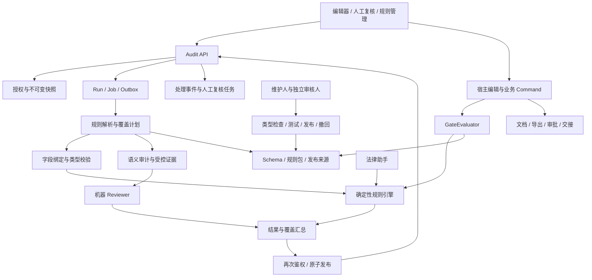

# 规则审计 Agent 功能与实现规格

版本：v0.1 / 待人工评审  
日期：2026-11-03  
适用阶段：Phase 1 / Standards Audit Group  
读者：产品、Trade Ops、模板及规则负责人、合规与人工 Reviewer、架构师、开发与测试人员、后续编码 Agent

## 1. 文档定位与职责

本文件细化 [Requirements.md](Requirements.md) 的 RULE-01 至 RULE-04、第 9.3 节以及 AUTO-02 至 AUTO-06 涉及的变量校验。参考 [AI-Law_agent_reqirement.md](AI-Law_agent_reqirement.md) 与 [AI_assistance_reqirement.md](AI_assistance_reqirement.md)，保留原始手写需求、V1/V2 和现有文档，不将审计助手扩展为通用法律判断或业务审批系统。

MUST 表示必须满足的工程约束；技术选型、额度和性能指标为建议，评审后冻结。本文规则及示例均为合成设计，不代表银行或 SWIFT 的真实生产规则。

### 1.1 能力边界与共享所有权

| 能力 | 规则审计 Agent | 相邻能力及边界 |
| --- | --- | --- |
| 字段、金额、日期、字符集 | 使用已发布 Schema 和确定性规则，给出可重算结果 | 自动化助手负责提取候选值，审计不猜值或代用户确认 |
| 模板条款、内部流程 | 检查受控条款、必需声明及有来源的政策条件 | 法规适用性、法域解释和出口管制判断属于法律助手 |
| 语义一致性 | 检查主体/金额矛盾、条件缺失、模糊及冲突，明确模型判断 | 知识助手负责解释规则；不能以知识问答答案替代规则执行 |
| 规则治理 | 维护类型化规则、测试、独立发布、撤回与影响分析 | 法律原文和政策原文复用知识来源发布，不另建知识库 |
| 人工处理 | 采纳/拒绝、专业复核、处理历史 | 人工复核不是业务批准，拒绝 Finding 不是规则豁免 |
| 写入及操作 | 提供建议和确定性 GateEvaluator | 编辑、版本提交、审批、导出、交接只由宿主 Command 层执行 |

**实现归属：**RuleEngine、字段 Schema、RuleBundleRegistry、CoveragePlanner、GateEvaluator 由共享规则审计模块提供；法律助手通过内部接口调用同一实现，不复制引擎、规则库或硬校验。通用 Run、Finding、EvidenceRef、人工任务和审计组件也共享类型与基础设施，各能力保留自己的私有运行上下文。

本文是上述规则审计内核的细化基线；法律规格继续负责法规检索及适用性分析。两份规格已有重叠的 `/legal/rule-bundles` 接口，在联合实现时是本文件 `/audit/rule-bundles` 的兼容门面，使用相同资源 ID、状态、数据库事务及授权策略，不生成第二套规则数据。实现前统一 OpenAPI，不能把两个前缀当独立治理服务。

本文件按主需求 AUTO-04 将共享操作枚举补全为 `submit_version / start_approval / formal_export / handoff / formal_mapping`，是对法律规格较小枚举的明确补充；正式导出和交接不能遗漏。联合实现时所有消费者必须从统一 Schema 生成枚举。API 目前尚未实现，不需要虚构线上迁移。

### 1.2 首期范围

P0：模板/字段规范、单字段与跨字段检查、重复表格字段、变量所有出现位置、受控条款、有限语义一致性、人工处理、发布治理、异步运行、权限隔离及宿主闸门集成。P1：增量审计、自动生成规则草案、用户正则、复杂委托、多方会签和统计学习；P0 不接受用户可执行代码、不自动修文、不发报、不验证资金真实性。

## 2. 功能需求与可追溯性

| ID | 优先级 | 要求及完成条件 | 上游映射 |
| --- | --- | --- | --- |
| AUD-01 | P0 | 用户按固定检查点发起审计，显示文档、事实、模板、规则及字段 Schema 版本 | 第 9.3 节 |
| AUD-02 | P0 | 必填规则区分已知缺失、未确认、解析失败、类型不合法；不能将缺值当通过或一律跳过 | RULE-01 |
| AUD-03 | P0 | 按 Schema 校验字符串、布尔、Decimal、日期、时间、币种及标准枚举，保留原值和来源 | RULE-01 |
| AUD-04 | P0 | 校验金额精度、正负范围、同币种小计与总额；禁止浮点误差或未授权自动换汇 | RULE-01 |
| AUD-05 | P0 | 校验日期先后、期限及条件组合，时间依据固定；不得用运行当天隐式替代业务日期 | RULE-01 |
| AUD-06 | P0 | 按指定编码、字符集与长度单位检查；显式选择报文类型/版本后才执行相应标准规则 | RULE-01 |
| AUD-07 | P0 | 同一变量的每个出现位置绑定同一变量 ID；未解析占位符、引用失联、显示值冲突可定位 | AUTO-02/03/04 |
| AUD-08 | P0 | 模板支持必需、受控、可选条款，精确条款判断与语义等价判断分开；不得按关键词简单宣称含义一致 | RULE-03 |
| AUD-09 | P0 | 执行银行、公司、部门模板/政策组合并检测冲突；客户端不能移除强制规则，冲突不以加载顺序解决 | RULE-03 |
| AUD-10 | P0 | 检查主体不一致、金额前后矛盾、条件缺失、模糊措辞，提供相关多处原文及 semantic 方法标记 | RULE-02 |
| AUD-11 | P0 | 内部流程检查只判断声明、字段或受控流程记录是否存在且满足条件，不推断资金真实合法 | RULE-04 |
| AUD-12 | P0 | 由预期检查单元计算覆盖；不适用、信息不足、无法评估、执行失败分别返回，不能把无 Finding 当完整通过 | 第 9.3 节 |
| AUD-13 | P0 | Finding 包含快照、规则、定位、严重度、gate_type、依据、建议及处理状态；锚点失效不猜当前位置 | 第 9.3 节 |
| AUD-14 | P0 | 已发布确定性硬规则按目标操作拦截；语义结果默认建议或人工复核，不阻止草稿保存 | 第 9.3 节 |
| AUD-15 | P0 | 讨论用版本允许政策规定的未填项；审批、正式导出、交接前校验最终填充快照，草稿导出显示未填项 | AUTO-04 |
| AUD-16 | P0 | 支持采纳、拒绝、人工复核及完整事件历史；拒绝关键意见必填原因，采纳不代表已修复 | 第 9.3 节 |
| AUD-17 | P0 | 修改建议由编辑器授权、有效锁和基线校验后应用；修改产生新快照，再审计，不迁移旧通过结论 | AUTO-05/06 |
| AUD-18 | P0 | 支持组织/访客范围内的审计和人工任务，外部律师不能自动获得 AI、内部规则、银行批准或编辑权限 | INV-02/03/09 |
| AUD-19 | P0 | 生成、发布、读取、引用、复核及幂等重放均检查当前权限；报告依赖失权后阻止衍生结果读取 | 组织权限要求 |
| AUD-20 | P0 | 规则导入校验、测试、独立发布、撤回和影响分析均版本化，可回溯且不能自审自批 | RULE-03 |
| AUD-21 | P0 | 异步任务支持幂等、取消、超时、租约及故障恢复；重复运行不重复发布报告或人工决定 | 架构可靠性 |
| AUD-22 | P0 | 保留审计及必要证据，不保存模型隐式思维链；审查可重算，模型解释不保证逐字一致 | 第 12/13 节 |
| AUD-23 | P0 | 提供侧栏、字段缺口、覆盖明细、原文定位、复核任务及规则管理页，区分错误/空态/过期状态 | 编辑器体验 |
| AUD-24 | P1 | 支持经验证的增量检查及规则草案辅助，必须证明依赖未变且仍符合发布治理；P0 始终完整重查 | 范围约束 |

### 2.1 典型工作流

1. 用户选择文档检查点与 deterministic/semantic 模式；服务端从模板、组织和目标文档确定强制规则，返回实际覆盖范围。
2. 确定性检查先运行，语义检查仅使用获授权原文及批准条款准则；不以模型生成规则替代已发布规则。
3. 侧栏显示排队、检查、机器复核、完成/部分完成；逐项展示 pass/finding 等状态及信息缺口。
4. 点击问题定位只读快照，用户处理或请求合格人工 Reviewer。若涉及法域适用性则返回转交建议，不自动创建法律业务任务。
5. 应用建议经宿主 Command 执行。最终变量填充、重新确认字段或附件变化后均新建检查点和审计任务。
6. 发起受保护操作时，宿主针对真正将被提交、导出或交接的版本重新检查政策和覆盖；用户侧审计报告仅为可复用输入，不是放行凭据。

## 3. 架构与组件

### 3.1 技术基线

建议复用知识/法律规格的 Python 3.12、FastAPI、Pydantic v2、PostgreSQL、模块化单体 API 与独立 Worker。没有必要为每个 Agent 建一个服务。规则运算为无网络、无模型依赖的纯函数内核；语义分析通过批准的模型 Adapter。复用对象存储、OCR、结构化 Diff、身份、来源发布及 Outbox。



### 3.2 内部接口

| 接口 | 输入 | 输出及必须满足的约束 |
| --- | --- | --- |
| Authorization.resolve | principal, resource_refs, action | AccessContext，单一组织成员/访客上下文与当前授权版本，不接受客户端角色 |
| SnapshotResolver.freeze | ReviewCreate, access | AuditContext，固定正文、变量、事实、模板和附件版本及摘要 |
| RuleRegistry.resolve | context, operation? | ResolvedPolicy，强制/可选规则、来源版本、Schema、优先政策及适用基准日期 |
| CoveragePlanner.build | context, policy, modes | CheckPlan，执行前列明检查单元及依赖；不能按实际成功数反推覆盖 |
| FieldBinder.bind | snapshot, schema, variables | FieldValue[]，保留来源状态、确认记录和所有出现位置，禁止静默确认 OCR |
| RuleEngine.evaluate | compiled_rules, typed_fields, context | CheckResult[]，纯函数且有明确引擎版本，无网络或副作用 |
| SemanticAuditor.analyze | check_plan, authorized_text, criteria | SemanticDraft，Claim、原文锚点、支持关系、缺口，不得产生 hard_block |
| Reviewer.review | draft, evidence, plan | pass/repair/abstain，最多一次内容修复，返回原因码而非隐式思维链 |
| ReportPublisher.commit | run, results, lease_token | 原子发布报告、问题、依赖、终态、审计及 Outbox |
| HumanReviewService.decide | task, authorized_actor, decision, version | 追加不可覆盖决定，检查职责分离、快照新鲜度及全部依赖权限 |
| GateEvaluator.evaluate | CommandContext | GateDecision，仅可信宿主调用，校验最终候选快照及必需规则 |
| ImpactAnalyzer.on_change | source/rule/schema/authorization event | 过期原因和待重审通知，不修改已批准文档 |

上层 Orchestrator 用一个 TaskEnvelope 创建一次审计运行；TaskEnvelope/ContextSnapshot/AgentResult 分别映射 ReviewCreate/AuditContext/AuditReport。法律助手调用共享引擎时，结果放入其原运行，不再通过 Audit API 创建重复审计任务。共享库相同不意味着两个主体的报告可共享。

## 4. 快照、字段与覆盖计划

### 4.1 审计基线

AuditContext 固定 `workspace_id / document_id / snapshot_id / content_sha256 / facts_version_id / variables_version_id / template_version_id / schema_version_id / rule_bundle_version_ids / source_release_id / attachment_refs / engine_version / access_context_id / frozen_at / assessment_date`。所有版本由宿主解析，客户端仅提交资源引用，不能覆盖政策版本、授权或已提取事实。

编辑中的正文先保存不可变检查点，检查点不等于正式业务版本。不同文档版本、事实确认、变量填充、附件解析版本或模板变化均改变基线。语义审计、字段检查及操作闸门必须使用同一基线；若要检查填充后内容，先物化最终候选快照再审计。

### 4.2 字段 Schema 与 FieldValue

FieldDefinition 包含 `field_id / value_type / scope / normalization_profile_id / allowed_values? / precision? / scale? / currency_field_id? / date_basis? / length_unit? / encoding?`。value_type 为 string/decimal/date/datetime/boolean/clause_set；scope 为 document 或具名重复表格区。Schema 和规范化策略与模板关联、不可变且经过发布审核。

FieldValue 包含 `field_id / instance_id / state / anchors / provenance`，state 为 confirmed/missing/unconfirmed/invalid。confirmed 必须有符合 Schema 的 value；missing 不含 value；unconfirmed 可有 candidate_value；invalid 含原值及 issue_code，但不能传入类型化比较器。provenance 包含 source_kind、资源版本、确认人/时间（适用时），来源类型为 user_confirmed/document_extracted/authoritative_record。

- 必填、可选与条件必填是规则，不因 optional 字段缺少而自动失败。已知空白是否算缺失由规范化策略规定并保留原值，不全局删除空格或大小写。
- 缺失与未知必须分开：确定不存在的金额可产生必填 Finding；OCR 未确认或解析未完成则 needs_input，不能以必填失败假装已识别正文。
- invalid 产生绑定 Schema 版本的确定性类型 Finding；依赖该字段的后续比较输出 needs_input，避免解析异常被当作比较成功。
- 每个变量 ID 映射全部原文出现位置；普通文本同名不视为变量引用。变量缺少绑定、未解析占位符和多个显示值需分别记录原因。
- 重复表格行使用固定 snapshot 内稳定的 instance_id；规则以 rule_id/version + instance_id 展开独立检查单元，不能只检查第一行。
- 无表格行不等于行内规则全部通过。行数要求有独立规则；零行时行实例检查记 not_applicable，仍保留模板要求的预期范围。

### 4.3 规则选择与完整性

ResolvedPolicy 由基础 Schema/模板、交易适用的银行规则、客户规则、部门规则及指定输出标准组成。每个包记录所有者、版本、有效区间、来源和适用条件。冲突必须由批准的组合政策明确解决，不能默认银行总优先或最后加载覆盖；未解决冲突使相关检查 unable_to_assess，受保护操作不能放行。

CheckPlan 在执行前枚举 Schema 内置检查、确定性规则实例和语义检查准则；总数按这一集合计算。每个 CheckUnit 包含 check_id、method、scope_key、rule_ref、instance_id、依赖字段及是否受保护操作必需。未运行/超时单元不得省略，规则缺包不是空集合通过。用户请求纯 deterministic 只代表本次范围，不免除进入审批时配置要求的语义或人工复核。

## 5. 确定性规则契约与执行

### 5.1 RuleDefinition

RuleDefinition 必填 `rule_id / version / title / owner_org_id / domain / applicability / required_facts / expression / severity / gate_type / target_operations / waivable / evidence_refs / valid_from / test_vectors`；`valid_to?` 可省略表示开放结束区间。domain 为 format/template/internal_policy/trade_standard；law 不属于审计发布范围，转法律治理。有效期使用 `[valid_from, valid_to)`，按规则指定的业务日期适用，不仅按发布日。

`required_facts` 仅指判定适用性必需的上下文，如文档类型和交易日期；**不得将被检查的必填字段先作为 required_facts 拦住**，否则 amount 缺失永远无法产生必填 Finding。执行顺序为：Schema 绑定 → 上下文可用性 → applicability → expression → CheckResult。

applicability 和 expression 共用 RuleExpression：true/false/unknown 三值逻辑；适用性 false 为 not_applicable，unknown 按原因输出 needs_input 或 unable_to_assess。适用性 true 后，表达式 true 为 pass、false 为 finding、unknown 为 needs_input/unable_to_assess；运行异常为 failed。任何 unknown 都不是 pass。

### 5.2 封闭类型化 DSL

采用 `op` 判别联合，禁止额外属性、任意函数、脚本、SQL、JSONPath、用户正则及网络调用。建议最大深度 8、200 节点，每条规则有明确执行预算；不允许循环或递归引用规则。

| op | 字段 | 语义 |
| --- | --- | --- |
| all / any | args: 非空 RuleExpression[] | all 遇 false 为 false，any 遇 true 为 true；否则存在 unknown 则保留 unknown，禁止空数组 |
| not | arg: RuleExpression | true/false 取反，unknown 不变 |
| exists | field_id: string | confirmed 非空为 true，missing 为 false，unconfirmed/invalid 为 unknown |
| compare | left: Operand, comparator: eq/ne/lt/le/gt/ge, right: Operand | 两侧类型兼容才比较；缺失或不确定为 unknown，不隐式转换 |
| length | field_id, unit: code_point/grapheme/byte, min, max | min/max 为非负整数且 min<=max；byte 必需 encoding，其余禁止 encoding |
| charset | field_id, charset_id | 引用批准字符集目录；不是用户正则 |
| contains_clause | field_id, match_kind: clause_id/exact_text, value | clause_id 对 clause_set；exact_text 对 string；文字规范化固定，不声称语义等价 |

Operand 为 `{"kind":"field","field_id":"amount"}` 或 `{"kind":"literal","value_type":"decimal","value":"100.00"}`。literal 的 value_type 为 string/decimal/date/datetime/boolean；除 boolean 的 JSON 布尔值外，其余为格式化字符串。引用字段必须在固定 Schema 中存在。

Schema 内置检查通过注册的固定处理器实现，也生成可追溯 rule_ref，例如 `SCHEMA:amount:type` 加 schema_version_id；用户规则不能覆盖。小计求和等派生值采用已注册、版本化的纯投影，例如 sum_decimal，不开放新脚本操作符。投影需声明全部输入字段、同币种、精度、空集合和缺值策略；默认任一依赖未确认则投影未确认，不能把空值算成零。缺少所需投影实现时返回明确不支持，不能让模型代算后标为确定性结果。

### 5.3 数值、时间及条款

- Decimal 输入为十进制字符串，拒绝科学计数法、NaN/Infinity、超过精度/小数位的值；必要舍入必须在宿主字段确认时显式进行，不由审计悄悄舍入。格式语法建议 `-?(0|[1-9][0-9]*)(\.[0-9]+)?`，以完整字符串匹配。
- 金额比较需要相同且已确认的币种；总额投影对每一行的确认值计算。币种位数依据版本化目录，不假定所有币种都是两位小数。
- date 使用 YYYY-MM-DD 并验证真实日历；datetime 使用 RFC 3339 UTC。期限计算的时区、自然日/工作日、节假日日历须显式版本化，不支持的工作日规则输出 unable_to_assess。
- 字符长度必须明确 code point、grapheme 或特定编码字节数；编码失败不是长度零。Unicode 规范化不能破坏编号、金额、姓名等原始意义。
- 必需条款存在、受控条款精确一致是确定性检查；替换措辞是否等价是语义检查。新增义务或法域解释只能建议人工或法律助手处理。

## 6. 语义审计与机器 Reviewer

SemanticCriterion 为 `criterion_id / version / category / scope_fields / scope_sections / instruction_template_id / source_refs / severity / gate_type / test_case_refs`，由治理后的模板准则提供。category 为 party_consistency/amount_consistency/clause_conflict/missing_condition/ambiguity；gate_type 只允许 advisory/human_review。P0 准则随规则包版本固定，不接受用户自由提示直接变成组织标准。

语义流程：冻结授权上下文 → 按批准准则组织原文 → 生成结构化 Claim 和锚点 → 机器复核 Schema、来源、引用支持关系、过度结论及范围 → 最多一次修复 → 发布或 abstain。长文若需分块，CheckPlan 必须覆盖所有相关分块及跨段关系；不能只取前半篇后声称全文检查。

模型只引用提供的 evidence_id、字段和原文锚点，不能构造 URL、规则版本、置信百分比或硬阻断。对于主体/金额矛盾至少定位涉及的两处文本；条件缺失需给出被审计范围及要求该条件的准则来源。证据不足时输出 unable_to_assess，不硬凑 Finding。

`support_level = strong / qualified / insufficient / not_applicable`，不是概率。确定性结果用 not_applicable 表示不使用模型支持评级，并保留规则依据；语义充分性用原文和准则说明。模型文案不能修改确定性事实，合并器只关联相关问题，保留每个检查及来源，不按相似文本合并掉硬校验。

## 7. 状态、聚合与操作闸门

### 7.1 运行及结果状态

| 对象 | 状态 | 约束 |
| --- | --- | --- |
| AuditRun.status | queued/running/succeeded/failed/cancelled/timed_out | succeeded 只表示报告可用，不表示全部无问题 |
| CheckResult.status | pass/finding/not_applicable/needs_input/unable_to_assess/failed | 每个预期单元都有状态和原因 |
| AuditReport.completion | complete/partial | 全部为 pass/finding/not_applicable 才 complete；其余有缺口则 partial |
| AuditReport.outcome | findings_present/no_findings/needs_input/unable_to_assess | 必须结合 coverage 阅读，不能直接显示合规认证 |
| AuditReport.freshness | current/stale/recheck_required | 基线变化为 stale，政策/来源变化为 recheck_required，同时发生以 stale 展示并保留全部原因 |
| Finding.disposition | open/accepted/rejected/needs_human_review | accepted 不代表修复，stale 从报告派生而不覆盖历史 disposition |
| HumanReviewTask.status | pending/completed/cancelled/expired | completed 不等于业务批准 |

聚合算法：空 CheckPlan 为配置失败；仅 failed 或 failed+not_applicable 时 Run failed，不发布报告。其他组合发布报告：有 finding 优先为 findings_present；否则有 needs_input 为 needs_input；否则有 unable_to_assess/failed 为 unable_to_assess；否则有 pass 为 no_findings；全 not_applicable 为 unable_to_assess，原因 no_applicable_checks。全 needs_input/unable_to_assess 为 partial 且显示实质检查 0 项。pass+failed 绝不能为 no_findings。

计数对象含 planned、pass、finding、not_applicable、needs_input、unable_to_assess、failed，六类状态数量之和必须等于 planned。完整性是检查覆盖而非法律结论；全 not_applicable 虽 complete，也只能显示适用性筛选结束。

### 7.2 严重度与操作策略

`severity = Critical / Warning / Info` 与 `gate_type = advisory / human_review / hard_block` 独立。严重度本身不阻断操作；只有已发布确定性规则及 Schema 技术校验可 hard_block。AI 输出 hard_block 是合同错误，不接受为结果。

| 操作 | 默认策略 | 必须检查 |
| --- | --- | --- |
| save_draft | 不经过内容合规硬闸门 | 正常身份/编辑权限和锁仍生效，不表示任意人可保存 |
| submit_version | 允许讨论版本保留经政策许可的未填项 | 明确标记缺口；仅已批准规则配置的硬约束阻断，不能等同审批 |
| start_approval | 完成所有必填及确定性校验 | 目标快照、全部必需规则、关键意见处理与指定人工复核 |
| formal_export | 完成必填及确定性校验，输出绑定最终快照 | 对应输出格式与导出权限；不能以草稿导出参数冒充正式输出 |
| handoff | 绑定已批准版本及接收方 | 完整必填校验、批准状态和当前政策；检查通过不代替交接执行 |
| formal_mapping | 仅启用指定报文映射时使用 | 明确报文类型和版本；缺少标准包不能静默跳过 |

草稿导出是宿主独立输出模式，显式标识未填项，不能携带正式批准或交接状态。内部政策缺少有效规则、必需单元 failed/needs_input/unable_to_assess、关键人工任务未完成时，GateDecision 为 indeterminate 或 blocked，不放行对应受保护操作；草稿保存仍可进行。

### 7.3 最终候选与一致性

GateEvaluator 只接受可信宿主构造的 CommandContext：`command_id / actor / access_context_id / operation / document_id / candidate_snapshot_id / candidate_content_sha256 / expected_document_revision / expected_policy_revision`。它自行解析当前规则、权限、有效人工决定及候选事实，不相信浏览器的 rule_ids、status、report_id 或模型结论。

检查顺序：物化变量与派生字段 → 固定最终候选快照 → 解析当前适用政策 → 执行/复用精确依赖匹配的确定性结果 → 检查人工要求 → 形成 GateDecision → 宿主提交命令。模型调用不在业务数据库事务内等待。

放行结果不是通用 Token。宿主提交时原子核对候选摘要、文档修订、政策修订、授权修订、必要锁/业务状态与 command_id 幂等记录；任一变化拒绝并重查。不能先检查旧正文，填充变量后直接提交。跨服务条件下必须有宿主权威的条件提交/串行协调接口；没有该能力时属于上线阻塞，不用普通先 GET 后 POST 假装原子性。

正式导出异步 Worker 必须读取固定候选快照，执行前及下载时重新鉴权；不能排队后导出最新可变草稿。交接若新政策要求更正已批准版本，保留旧批准记录，要求新版本重新审批，不静默改正文或自动撤销历史批准。

GateDecision 为 `decision: allowed/blocked/indeterminate` 加 `operation / candidate_snapshot_id / candidate_content_sha256 / policy_revision / evaluated_at / reason_codes / authorized_finding_ids`。不向无权用户返回内部规则标题、数量或证据；必要内部硬检查由受控宿主权限执行，外部报告只显示允许披露的处理提示。

## 8. 人工处理与组织授权

### 8.1 报告与任务权限

报告默认请求人私有，绑定创建时单一活动组织或访客事项，组织管理员不自动可读。使用助手需要文档 read 与独立 use_ai；外部律师默认仅阅读评论，不自动具备本模块能力。权限复用宿主 `legal_review.triage / legal_review.assign / legal_review.decide` 和 `legal_rules.manage / legal_rules.publish / legal_rules.withdraw`，作为跨法律/审计的共享能力代码，不再创建第二套角色。身份提供方按资源和组织授予这些能力，不因名字含 legal 就赋予法律资格。

人工分配需要 assign，受让人需要相关文档读取、AI 访问及 decide，任务指定报告和 Finding 集合。受众资格只增加该报告访问资格，不授予其依赖资源权限。必须验证报告全部上下文依赖，包括未最终引用的内部政策、附件和历史输入；仅过滤 citations 不足以对外分享报告。缺少任一权限则拒绝分配，需在对方合法可读范围内另建审计。

检索前、模型调用前、发布、轮询、历史读取、引用、决定及幂等重放都再次鉴权。访客到期、邀请担保人失权、成员停用或来源撤回导致依赖失权时阻止衍生内容访问；通知不泄露正文，前端清除缓存。已展示给用户的内容无法保证收回，应明确此限制。

### 8.2 问题处理与人工复核

普通 disposition 支持 accepted/rejected/needs_human_review，关键 Critical/Warning 拒绝必填 reason；决定均追加事件而非删除原发现。needs_human_review 只是状态，必须另建有效任务才能满足“已分配复核”。同一快照缺陷是否消失只能由新快照重审确定；拒绝硬规则不能改变引擎结果。

任务绑定 report_id、finding_ids、assignee_user_id、requester_user_id、due_at、purpose、version。默认请求人与决定人分离，策略可要求特定合格角色；一条 Finding 同时最多一个未结束任务。request_information 追加决定但保持 pending；agree/disagree 才 completed，必填 rationale；过期/撤权/旧报告不得提交决定。后续更正新建任务，不覆盖已完成历史。

权限和技术格式约束不可豁免。可豁免企业政策需已发布 waivable 标记及宿主独立例外审批流程；本模块 P0 不提供豁免创建/批准 API。人工 disagree 不是豁免，AI 不能批准例外。

## 9. 数据契约与存储

### 9.1 通用约定

JSON 使用 snake_case，不透明字符串 ID，RFC 3339 UTC 时间、YYYY-MM-DD 日期、64 位小写 SHA-256。字段 `?` 可省略且不得 null，分页 next_cursor 末页为 null 除外。禁止额外属性；所有枚举固定；正文与引用为纯文本。revision 及 Finding/FindingDisposition/HumanReviewTask 的并发 version 为正整数；RuleDefinition、SemanticCriterion、CoverageProfile 及其引用的内容 version 为非空字符串；version_id 为不透明字符串。DTO 分别定义类型，不将规则版本当作并发计数器。

Anchor 为判别联合：document 含 resource_id、version_id、node_id、start_utf16、end_utf16、quote_sha256；attachment 含 resource_id、version_id、page、block_id、quote_sha256。offset 为非负整数、左闭右开；page 从 1 开始。前端与 TipTap 适配器验证定位及摘要，不将 UTF-16 偏移误作字节数。缺失字段可以没有原文锚点，但必须给 field_id/instance_id 和缺失原因。

### 9.2 核心 DTO

| DTO | 必需字段 | 可选字段与规则 |
| --- | --- | --- |
| ReviewCreate | workspace_id, document_id, snapshot_id, facts_version_id, modes | attachment_refs? 默认为 []，最多 5 个 `{attachment_id, version_id}`；modes 为非空去重 deterministic/semantic 数组 |
| AuditRun | run_id, status, stage, created_at, deadline_at | report_id? 仅 succeeded；error? 仅 failed/timed_out；finished_at? 终态；stage 为 queued/context/planning/checking/reviewing/publishing/done |
| AuditReport | report_id, run_id, context, completion, outcome, freshness, freshness_reasons, counts, coverage, findings, limitations, created_at | context 为 AuditContext；coverage 为 CheckResult[]；limitations 为 `{code, message, check_ids}`[] |
| CheckResult | check_id, method, scope_key, rule_ref, instance_id, status, reason_codes, finding_ids | missing_fields? 为字段 ID[]；method 为 deterministic/semantic，rule_ref 为 `{rule_id, version}` |
| Finding | finding_id, check_id, method, category, severity, gate_type, target_operations, title, explanation, field_refs, anchors, rule_refs, evidence_ids, support_level, disposition, version | proposed_change?；category 为 field/variable/consistency/template/policy；field_refs 为 `{field_id, instance_id}`[] |
| EvidenceRef | evidence_id, source_id, source_version_id, kind, publisher, title, locator, excerpt, excerpt_sha256, language | kind 为 schema/template/internal_policy/trade_standard/document/attachment；目录持有真实来源地址，模型不输出 URL |
| ProposedChange | change_id, base_snapshot_id, base_content_sha256, anchor, replacement_text, rationale, evidence_ids | P0 单段文本替换；不能变成任意编辑器命令或自动更新变量集合 |
| FindingDisposition | event_id, finding_id, disposition, reason, actor_user_id, created_at, version | actor/time 由服务端生成；非关键拒绝允许 reason 空串 |
| HumanReviewTask | task_id, report_id, finding_ids, assignee_user_id, requester_user_id, due_at, purpose, status, version, created_at | latest_decision? 为 HumanDecision，完整历史另有分页端点 |
| HumanDecision | decision_id, decision, rationale, evidence_ids, actor_user_id, created_at | decision 为 agree/disagree/request_information，证据必须属于报告且当前授权 |
| GatePreviewCreate | workspace_id, document_id, snapshot_id, operation | 不接受 report_id、policy_revision、身份声明；operation 取第 7.2 节受保护枚举 |
| GatePreview | decision, operation, candidate_snapshot_id, candidate_content_sha256, policy_revision, evaluated_at, reason_codes, authorized_finding_ids, advisory_only | advisory_only 固定 true，不是执行命令或可消费通行凭证 |
| RuleBundleVersion | bundle_id, version_id, owner_org_id, state, schema_version_id, rules, semantic_criteria, coverage_profile, source_version_refs, content_sha256, created_at | validation_receipt?、published_at?；Schema 必须来自宿主已发布模板，不在此 API 编辑 |
| CoverageProfile | profile_id, version_id, entries | 每个 entry 为 `{scope_key, document_types, rule_refs, criterion_refs, required_context_fields}`；scope 映射模板/标准目录 |
| ValidationReceipt | receipt_id, version_id, content_sha256, validator_version, status, checks, created_at | status 为 passed/failed，checks 为 `{code, passed, message}`[] |
| ApiError | code, message, request_id | details? 为 `{field?, reason_code}`[]，不得泄露内部 ID/正文 |

rule_refs/criterion_refs 为 `{rule_id, version}`[] / `{criterion_id, version}`[]，source_version_refs 为 `{source_id, source_version_id}`[]；evidence_refs/source_refs 为带 locator 的来源版本引用。FieldDefinition、FieldValue、RuleDefinition、SemanticCriterion 见第 4 至 6 节；所有字段在统一 OpenAPI 中展开，不能只生成空 object。一个 Finding 属于一个 CheckResult；确定性 Finding 必需规则引用，语义 Finding 必需原文锚点及准则来源。

### 9.3 持久化与兼容

建议使用共享 `review_runs / review_jobs / review_reports / findings / finding_events / human_review_tasks / human_review_decisions / report_dependencies / report_audiences / rule_bundles / rule_bundle_versions / validation_receipts / idempotency_records / outbox`，以 capability 标识 audit/legal；已有等价表时复用迁移。不能让两份规格各自动创建重复治理表。

唯一约束：每 run 一个 report；每 report 一个 check_id；每主体+活动身份+快照+模式集合最多一个活动运行；每未结束任务的 Finding 有唯一占用关联行；version_id 内容不可修改。报告和规则始终按服务端资源所有权及受众过滤；不能用全局 ID 查询跳过授权。

兼容门面共享相同资源、回执和权限；幂等请求先规范化到同一 canonical operation/path，避免通过 /legal 与 /audit 双前缀重复发布。法律 DTO 到共享 DTO 的字段投影须显式映射并经过契约测试：例如审计的单 rule_ref 转法律 CheckResult.rule_refs 单元素数组，schema 类型证据保持真实来源分类，新增字段不靠 unknown-field 容忍机制掩盖。法律治理旧请求若缺少所需 Schema 或准则信息，仅在可从宿主唯一解析时补齐，否则 422 并要求完整请求；不猜测版本。

## 10. 客户端 API

### 10.1 HTTP 与并发约定

根路径 `/api/v1`，HTTPS，认证、CSRF 或 Bearer 校验复用宿主。401 未登录；403 功能级禁止；具体资源不存在/无权统一 404。响应带 `X-Request-ID`、`Cache-Control: no-store`。GET 集合使用 cursor，limit 默认 20、最大 100，响应 `{items, next_cursor}`，按 created_at+ID 稳定排序并绑定授权筛选。

所有 POST 使用 `Idempotency-Key`，8–128 字符，主体+活动身份+规范化方法/路径内有效，保存至少 24 小时。语义相同 JSON 重放同一结果，不同请求同键 409；重放必须重新鉴权。取消、disposition、人工决定及规则版本状态变更要求 `If-Match`，缺失 428，不匹配 412；对应 GET 返回 ETag。成功幂等重放先验证原请求摘要，不因首次成功推进版本而误报 412。

建议上限：100,000 字符快照、5 个已解析附件、500 个展开检查单元、500 个 Finding；超限 413 或后台 scope_too_large，禁止静默截断。强制规则过多不能通过缩小用户选区绕过，只能优化配置/受控提高容量后重试。P0 不提供只审选区却声称全文完成的参数。

### 10.2 Endpoint

| 方法与路径 | 请求 | 成功响应 | 约束 |
| --- | --- | --- | --- |
| POST /audit/reviews | ReviewCreate | 202 AuditRun + Location | read + use_ai；读审计不要求编辑锁 |
| GET /audit/reviews | workspace_id, document_id?, status?, cursor?, limit? | 200 Page<AuditRun> | 只返回当前授权运行，不泄露他人任务计数 |
| GET /audit/reviews/{run_id} | 无 | 200 AuditRun + ETag | 同授权；可返回 Retry-After |
| POST /audit/reviews/{run_id}/cancel | `{}` | 200 AuditRun + ETag | 仅请求人；已终态返回原终态 |
| GET /audit/reports/{report_id} | 无 | 200 AuditReport + ETag | 所有依赖鉴权；历史可读也要标示 freshness |
| GET /audit/reports/{report_id}/citations/{evidence_id} | 无 | 200 EvidenceRef | 引用必须属于该报告且来源当前可读 |
| GET /audit/findings/{finding_id} | 无 | 200 Finding + ETag | 精确版本用于并发处理 |
| GET /audit/findings/{finding_id}/events | cursor?, limit? | 200 Page<FindingDisposition> | 含初始 open 和全部处理事件 |
| POST /audit/findings/{finding_id}/dispositions | `{disposition, reason}` | 201 FindingDisposition + ETag | 当前报告、triage 权限；不自动修改正文/创建任务 |
| POST /audit/reports/{report_id}/human-reviews | `{finding_ids, assignee_user_id, due_at, purpose}` | 201 HumanReviewTask + Location | 非空同报告问题子集；分配授权、独立复核、未来期限 |
| GET /audit/human-reviews | status?, cursor?, limit? | 200 Page<HumanReviewTask> | 当前授权的请求人/受让人任务 |
| GET /audit/human-reviews/{task_id} | 无 | 200 HumanReviewTask + ETag | 校验报告全部依赖 |
| GET /audit/human-reviews/{task_id}/decisions | cursor?, limit? | 200 Page<HumanDecision> | 包含补充信息请求和最终决定，不只返回 latest |
| POST /audit/human-reviews/{task_id}/decisions | `{decision, rationale, evidence_ids}` | 201 HumanDecision + ETag | 仅有效受让人，当前未过期任务 |
| POST /audit/human-reviews/{task_id}/cancel | `{reason}` | 200 HumanReviewTask + ETag | 请求人且仍有分配权；已完成任务不能取消 |
| POST /audit/gate-previews | GatePreviewCreate | 200 GatePreview | 只读解释当前就绪情况，不修改业务；预算内无法确认返回 indeterminate |

gate-preview 不启动法律模型或正式业务命令，不生成后台运行；仅受控确定性重查和已存在人工记录在有界预算内求值。缺少新审计或人工决定时提示先完成，不在请求线程无界等待。缓存预览或幂等重放预览不保证当前仍可执行，实际 Command 必须重查。

### 10.3 错误

400 invalid_request；401 unauthenticated；403 capability_denied；404 resource_unavailable；409 idempotency_conflict/active_run_exists/stale_report/invalid_state/assignment_conflict/policy_conflict；412 version_mismatch；413 scope_too_large；422 invalid_reference/invalid_rule_bundle；428 precondition_required；429 rate_limited；503 dependency_unavailable。422 只用于调用者可见但不合法的引用，无权引用仍 404。

业务发现不是 HTTP 500；事实缺失写 needs_input，运行技术失败写 AuditRun.error。错误不包含堆栈、Token、内部政策标题、原文或模型提示。正文修改、豁免、业务审批、正式导出及交接不由上述 API 执行。

## 11. 规则治理与管理 API

### 11.1 生命周期

RuleBundleVersion 状态为 draft/pending_review/published/rejected/withdrawn。版本创建后内容不可变，修改建立新版本。validate 运行 Schema、引用、类型、有效期、组合冲突、预算和测试向量检查；通过进入 pending_review，失败留 draft 并返回失败回执。

规则测试向量为 `{case_id, facts, expected_status}`；facts 为字段 ID 到 `{state, value?}` 的映射，类型由 Schema 决定。至少覆盖每条规则的 pass、finding、unknown、not_applicable（适用时）及边界。语义准则使用独立人工标注评估集，不声称确定性单元测试证明模型准确。发布回执必须绑定内容摘要、Schema/引擎版本、来源发布状态和测试结果；没有完整依赖或语义质量批准记录不能发布对应能力。

独立审核人不能是创建人或内容贡献者，approve/reject 必填理由；发布原子切换生效索引并写 Outbox。包内不能重复 rule_id/version，不能引用失效 Schema 或未发布来源。跨包冲突由适用组合政策解析，无法验证任意两个组织的政策都兼容时，在运行解析阶段显式拒绝冲突，而非承诺发布时全局证明。

新发布版本按业务适用日期解析，不覆盖历史版本；撤回版本保留审计但不再用于新执行。来源/Schema/规则变更关联所有受影响报告，标记 recheck_required 并通知，不自动改写或撤销业务批准。无有效版本时受保护操作保持不可放行，不擅自退回未经批准版本。回滚通过独立批准的后继版本重新发布，不改历史记录。

### 11.2 管理 Endpoint

| 方法与路径 | 请求 | 成功响应 | 约束 |
| --- | --- | --- | --- |
| POST /audit/rule-bundles | `{name, description}` | 201 `{bundle_id, name, description}` + Location | manage 权限；所有者由当前身份确定 |
| POST /audit/rule-bundles/{bundle_id}/versions | `{schema_version_id, rules, semantic_criteria, coverage_profile, source_version_refs}` | 201 RuleBundleVersion + ETag | 内容建议最多 1 MiB；全部来源/Schema 授权有效 |
| GET /audit/rule-bundles/{bundle_id}/versions | cursor?, limit? | 200 Page<RuleBundleVersion> | 组织规则维护范围内，不开放内部清单给普通访客 |
| GET /audit/rule-bundles/{bundle_id}/versions/{version_id} | 无 | 200 RuleBundleVersion + ETag | 包含完整 validation_receipt?，供人工核对失败与通过项 |
| POST /audit/rule-bundles/{bundle_id}/versions/{version_id}/validate | `{}` | 200 ValidationReceipt + ETag | 有界本地校验；校验失败仍 200/status=failed，非发布成功 |
| POST /audit/rule-bundles/{bundle_id}/versions/{version_id}/decisions | `{decision, reason, validation_receipt_id}` | 200 RuleBundleVersion + ETag | approve/reject，独立 publish 权限，CAS 和有效回执 |
| POST /audit/rule-bundles/{bundle_id}/versions/{version_id}/withdraw | `{reason}` | 200 RuleBundleVersion + ETag | withdraw 权限，仅 published 可撤回，影响事件留痕 |

创建版本不修改父包无需 If-Match；版本 validate/decisions/withdraw 要求 If-Match。生产语义评估在发布前单独完成，validate 只验证其已批准回执，不在同步管理 API 内运行无界模型评估。Schema 和政策原文分别复用宿主模板治理与知识来源治理 API，编码前必须确认真实接口，未提供时列为阻塞项而不是自造已存在接口。

## 12. 请求与响应示例

以下全部是合成数据，摘要为固定长度占位值；接口返回的生产摘要必须由服务端真实计算。JSON 示例可以做语法检查，完整合同以统一 OpenAPI 3.1 为准。

创建检查：

```json
{
  "workspace_id": "ws_demo",
  "document_id": "doc_demo",
  "snapshot_id": "snap_08",
  "facts_version_id": "facts_03",
  "modes": ["deterministic", "semantic"],
  "attachment_refs": []
}
```

异步响应：

```json
{
  "run_id": "audit_demo",
  "status": "queued",
  "stage": "queued",
  "created_at": "2026-11-03T09:00:00Z",
  "deadline_at": "2026-11-03T09:02:00Z"
}
```

合成必填规则，amount 不放入 required_facts：

```json
{
  "rule_id": "DEMO-AMOUNT-REQUIRED",
  "version": "1",
  "title": "Synthetic amount requirement",
  "owner_org_id": "org_demo",
  "domain": "template",
  "applicability": {
    "op": "compare",
    "left": {"kind": "field", "field_id": "document_type"},
    "comparator": "eq",
    "right": {"kind": "literal", "value_type": "string", "value": "demo_guarantee"}
  },
  "required_facts": ["document_type"],
  "expression": {"op": "exists", "field_id": "amount"},
  "severity": "Critical",
  "gate_type": "hard_block",
  "target_operations": ["start_approval", "formal_export", "handoff"],
  "waivable": false,
  "evidence_refs": [{"source_id": "src_demo", "source_version_id": "src_demo_v1", "locator": "fields.amount.required"}],
  "valid_from": "2026-11-01",
  "test_vectors": [
    {"case_id": "missing", "facts": {"document_type": {"state": "confirmed", "value": "demo_guarantee"}, "amount": {"state": "missing"}}, "expected_status": "finding"},
    {"case_id": "present", "facts": {"document_type": {"state": "confirmed", "value": "demo_guarantee"}, "amount": {"state": "confirmed", "value": "100.00"}}, "expected_status": "pass"},
    {"case_id": "unconfirmed", "facts": {"document_type": {"state": "confirmed", "value": "demo_guarantee"}, "amount": {"state": "unconfirmed"}}, "expected_status": "needs_input"},
    {"case_id": "not_applicable", "facts": {"document_type": {"state": "confirmed", "value": "other_document"}, "amount": {"state": "missing"}}, "expected_status": "not_applicable"}
  ]
}
```

确定性结果单元：

```json
{
  "check_id": "check_amount",
  "method": "deterministic",
  "scope_key": "demo_template_fields",
  "rule_ref": {"rule_id": "DEMO-AMOUNT-REQUIRED", "version": "1"},
  "instance_id": "document",
  "status": "finding",
  "reason_codes": ["required_field_missing"],
  "finding_ids": ["finding_amount"]
}
```

问题处理请求，采纳不表示已修复：

```json
{
  "disposition": "accepted",
  "reason": "The owner will confirm the amount before starting approval."
}
```

人工任务请求：

```json
{
  "finding_ids": ["finding_amount"],
  "assignee_user_id": "reviewer_demo",
  "due_at": "2026-11-05T09:00:00Z",
  "purpose": "Confirm the required information; this is not business approval."
}
```

复核要求补充信息：

```json
{
  "decision": "request_information",
  "rationale": "Please confirm the amount against the authorized source document.",
  "evidence_ids": []
}
```

闸门预览响应，不能作为正式操作凭证：

```json
{
  "decision": "blocked",
  "operation": "start_approval",
  "candidate_snapshot_id": "snap_08",
  "candidate_content_sha256": "aaaaaaaaaaaaaaaaaaaaaaaaaaaaaaaaaaaaaaaaaaaaaaaaaaaaaaaaaaaaaaaa",
  "policy_revision": 3,
  "evaluated_at": "2026-11-03T09:00:05Z",
  "reason_codes": ["required_field_missing"],
  "authorized_finding_ids": ["finding_amount"],
  "advisory_only": true
}
```

## 13. 运行可靠性、数据保护与可观测性

### 13.1 任务与事务

建议总截止 120 秒（从入队计时），Worker lease 30 秒，每 10 秒续约并使用单调递增 fencing token。PostgreSQL `FOR UPDATE SKIP LOCKED` 领取持久化任务；领取/续约事务短暂，不持锁调用模型。父级取消和剩余预算向下传播，过期 Worker 的发布 CAS 必须失败。

暂时网络/429/5xx 最多两次传输重试，在剩余截止内退避；无证据、权限失败、非法输入不是重试理由。内容修复最多一次，独立于传输重试计数。超时前已有完整子项结果且可发布时可生成 partial；总截止后不再发布迟到结果，Run timed_out。取消与发布通过 Run 行锁/CAS 竞争，取消先成功则不能发布，发布先成功则取消返回原 succeeded。

报告、Finding、依赖、运行终态、审计 Outbox 同事务；人工事件及唯一任务关联也同事务。只有通知发送可后续重试，不允许在审计写入失败时报告操作成功。新规则在运行中发布，历史固定版本可保留但须标 recheck_required；依赖已失权或不可读时不发布可读内容。读取仍校验当前版本和授权，不能仅依赖异步失效事件准时到达。

### 13.2 数据与工具边界

规则 AST 和模型文档都当数据，不执行其中指令。模型工具白名单只允许授权读取与结构化候选输出，无数据库写、任意 URL、Shell、身份管理或业务审批。服务身份不具正文写入及例外批准权限。

使用批准模型端点、区域和留存政策，最小化正文/个人数据；未批准提供方前只用合成数据。常规日志含 request/run ID、摘要、版本、阶段、耗时、错误及成本，不含完整合同、Token、原始提示或隐式思维链。受控审计单独管理必要摘录、决定及保留期。任何导出的审查内容沿用当前权限，P0 不提供独立审计报告导出能力。

### 13.3 建议服务目标

在冻结规模和并发负载下：创建/轮询 P95 小于 1 秒，纯确定性审计 P95 小于 5 秒，含语义 P95 小于 60 秒；总截止 120 秒。运行前验证容量，不把这些设计目标描述成已测结果。

确定性批准测试向量通过率 100%；同输入/版本重算结果一致。语义评估按类别记录误报、漏报、证据支持及人工推翻率，尤其关键遗漏由业务负责人设门槛。监控覆盖缺口、失效规则、任务积压、重试、引用拒绝、闸门 indeterminate 和成本；用户反馈不自动训练模型或修改已发布规则。

## 14. 验收与测试矩阵

| ID | 场景 | 必须验证 |
| --- | --- | --- |
| AT-01 | 固定字段、规则和引擎重复检查 | 规范化结果一致，确定性内核无模型依赖 |
| AT-02 | 必填字段 missing 与 unconfirmed | missing 得 finding，unconfirmed 得 needs_input，不能被 required_facts 预先吞掉 |
| AT-03 | 已确认但非法类型、空白、解析失败 | 按 Schema 独立类型结果和明确原因；依赖比较不抛异常或通过 |
| AT-04 | Decimal 精度、负值、不同币种及明细缺值 | 精确比较、同币种投影、未知不算零、禁止静默舍入 |
| AT-05 | 日期边界、时区、过渡期及工作日目录缺失 | 按业务日期与版本执行，缺目录不能猜 |
| AT-06 | Unicode、字符编码、组合字符和不可编码字符 | code_point/grapheme/byte 分别正确，编码失败不算长度零 |
| AT-07 | 同变量多处引用、普通同名文本、失联占位符 | 检查所有绑定位置，不全文替换或遗漏后续位置 |
| AT-08 | 多行表格、空表格、总额与小计 | 实例逐行覆盖，空表检查行数，不因零实例宣称必需明细满足 |
| AT-09 | 条款 ID、精确文本、相似但含义不同文本 | 确定性存在性与语义判断分开，未做等价判定不声称等价 |
| AT-10 | 银行/公司模板冲突、缺失强制包、客户端删规则 | 解析冲突可见且受保护操作不能放行，不采用最后加载覆盖 |
| AT-11 | 资金来源声明存在与缺失 | 只判断声明/流程证据，不认定资金真实性 |
| AT-12 | 主体或金额两处矛盾、跨段冲突 | 语义 Finding 定位双方，完整覆盖，无 hard_block 输出 |
| AT-13 | 伪证据、模型 HTML、注入指令及低支持结论 | 拒绝/修复/abstain，禁止越权工具和编造规则 |
| AT-14 | pass+failed、全缺事实、全不适用、空计划 | 按第 7.1 节聚合，计数守恒，不能掩盖部分失败 |
| AT-15 | 草稿保存、讨论提交、正式导出、交接 | 各自策略独立，正式输出必填校验齐全，草稿标注未填项 |
| AT-16 | 变量填充后内容变化、预览后并发改文档/政策 | 最终候选绑定，宿主条件提交拒绝旧快照/旧政策放行 |
| AT-17 | 审计过程中改事实/附件/模板、旧锚点定位 | 结果保持旧快照并 stale；不得沿用旧通过或猜锚点 |
| AT-18 | 用户 rejected/accepted 或人工 disagree | 不清除硬规则；关键拒绝理由必填，业务批准不自动发生 |
| AT-19 | 应用修改时无锁、锁过期、摘要不符 | 宿主拒绝，草稿保留；成功后新快照再审 |
| AT-20 | 律师仅阅读、跨组织、管理员查看他人报告 | read 不等于 use_ai，管理员不自动可见，受众及依赖校验生效 |
| AT-21 | 分配报告含未引用内部来源，访客到期/担保人失权 | 全上下文依赖鉴权；生成/读取/引用/幂等重放均阻止越权 |
| AT-22 | 自审、重复任务、过期决定、ETag 冲突 | 职责分离、唯一占用、状态机和 CAS 均正确 |
| AT-23 | request_information 再 agree/disagree | 前者 pending、后者 completed，全部历史可分页读取 |
| AT-24 | 同键不同请求、并发重放、双前缀规则发布 | 409 或同一结果，canonical 操作不重复发布及创建副作用 |
| AT-25 | Worker 重启、租约过期、旧 Worker 迟到 | fencing 和唯一报告生效，审计/Outbox 原子一致 |
| AT-26 | 取消/发布竞争、截止到期、模型和检索故障 | 一个终态，迟到不发布，部分结果与技术失败不混淆 |
| AT-27 | 恶意/超深 DSL、未发布来源、自批及伪造回执 | 无执行代码，发布被拒，回执绑定内容/Schema/引擎 |
| AT-28 | 规则撤回、Schema 更新、通知重试、旧批准文档 | 标识重审、通知去重，不静默改批准或回退未授权版本 |
| AT-29 | 超范围全文、超过检查/Finding 限额 | 明确失败，不截断伪装完整；预览不等于执行能力 |
| AT-30 | 中英文侧栏、管理页、复核页及原文定位 | 键盘可用、长文本无重叠、状态准确、撤权清缓存、真实 API 贯通 |

测试分层：纯规则与三值逻辑单元测试、JSON Schema/OpenAPI 契约测试、真实 PostgreSQL 并发/事务测试、宿主授权/条件提交集成测试、模型故障与领域评估、浏览器端到端测试。内存 Mock 不能替代租约、事务或原子提交证明。

## 15. 后续编码 Agent 执行计划

| 阶段 | 实现交付 | 验证门槛 |
| --- | --- | --- |
| A1 契约与纯规则核 | 统一 OpenAPI 3.1、DTO、字段 Schema Adapter、DSL 编译/求值、覆盖聚合、合成规则集 | AT-01 至 AT-09、AT-14；示例必填规则四种状态可执行 |
| A2 授权与持久化运行 | 迁移、Run/Job/Report、依赖/受众、幂等、租约、审计 Outbox | AT-17、AT-20/21、AT-24 至 AT-26；真实 PostgreSQL 测试 |
| A3 治理及语义能力 | 规则治理 API、回执、来源适配、冲突解析、语义审计/Reviewer、更新影响 | AT-10 至 AT-13、AT-27/28；来源和质量批准前只用合成数据 |
| A4 人工与业务命令集成 | 处理事件、任务历史、侧栏/管理页、GateEvaluator、最终候选条件提交 | AT-15/16、AT-18/19、AT-22/23；禁止客户端报告直接放行 |
| A5 联合验收 | 法律兼容门面、端到端、领域评估、容量测试、运行/回滚手册 | AT-01 至 AT-30 全部完成、主需求追溯及人工签字 |

建议模块 `audit/{api,contracts,domain,application,workers,adapters}`；纯规则放 domain，模型和宿主接口放 adapters。已有仓库结构时沿用，不创建重复框架。测试文件按现有惯例集中复用，前端枚举/客户端从统一 OpenAPI 生成。

编码执行规则：

1. 先确认宿主身份、快照、变量、Schema、知识发布和 Command 的真实合同；缺失的条件提交能力列为阻塞，不推断 HTML 原型已有后端。
2. 最小垂直链路先实现“固定快照 → 合成必填规则 → 报告 → 用户处理 → 正式操作闸门”，再扩展复杂规则及模型。
3. 每阶段提供可运行命令、聚焦测试、API 示例和完成/未完成清单；测试失败先修当前阶段，不用静态 UI 代替功能。
4. FakeIdentity/FakeModel/FakeSources 只用于本地/测试，生产检测到模拟适配器必须拒绝启动。合成规则显式标记 synthetic，不能伪装真实标准。
5. 无批准模型/来源时不调用真实客户数据。不能让编码 Agent 自行决定法律内容、银行规则、职责分离例外或正式导出政策。
6. 完成定义包括迁移与回滚、统一 Schema、契约/授权/并发/端到端测试、审核规则、领域评估、运维指标及明确覆盖缺口；不得未经请求部署、提交代码或重构无关模块。

## 16. 人工 Review 与验证范围

| 决策项 | 负责人 | 需确认内容 | 未确认时默认 |
| --- | --- | --- | --- |
| 首期文档与规则集 | 产品/Trade Ops/规则维护人 | 模板、字段、标准/报文具体版本、强制检查及不覆盖项 | 只跑合成样例，不声称生产可用 |
| 字段与派生事实 | 编辑器/自动化负责人 | Schema、OCR 确认、变量绑定、表格实例、金额精度及投影 | 未确认不进入硬规则确定值 |
| 组织规则组合 | 银行/客户/合规 | 所有者、优先政策、冲突处置、生效时间 | 冲突或缺强制包不放行 |
| 操作闸门 | 编辑器/审批/导出负责人 | 讨论提交与正式审批/导出/交接差异，条件提交协议及权限 | 无最终候选原子校验则不上线受保护操作 |
| 人工复核与豁免 | 合规/法务/身份负责人 | 合格角色、分离职责、访客范围及既有例外审批 | 最小权限，技术约束不豁免 |
| 共享架构与兼容 | 架构/API 负责人 | 审计内核归属、/legal 门面映射、统一操作枚举与治理存储 | 不开发两套独立规则库 |
| 来源与数据治理 | 知识/数据负责人 | 标准许可、模型地域/留存、审计保存与删除要求 | 未批准来源不发布、只用合成数据 |
| 质量及容量 | 测试/运维/业务 Reviewer | 语义关键漏报门槛、确定性边界集、吞吐及执行预算 | 设计目标不能视为已测结果 |

建议 Review 顺序：需求与范围 → 合成规则/边界向量 → 字段及 DSL → 权限/最终候选/闸门 → API 与状态机 → 治理与故障 → 验收和实施阶段。每项记录批准人、版本、日期、异议及关闭依据。

本次交付仅为规格。可进行编号、引用、JSON 和状态逻辑静态检查；不等于完整 Schema 验证、Mermaid 渲染、生产规则核验、业务代码运行或安全/并发/性能测试。后续 A1 至 A5 完成并获批准后才能声明实现完成。