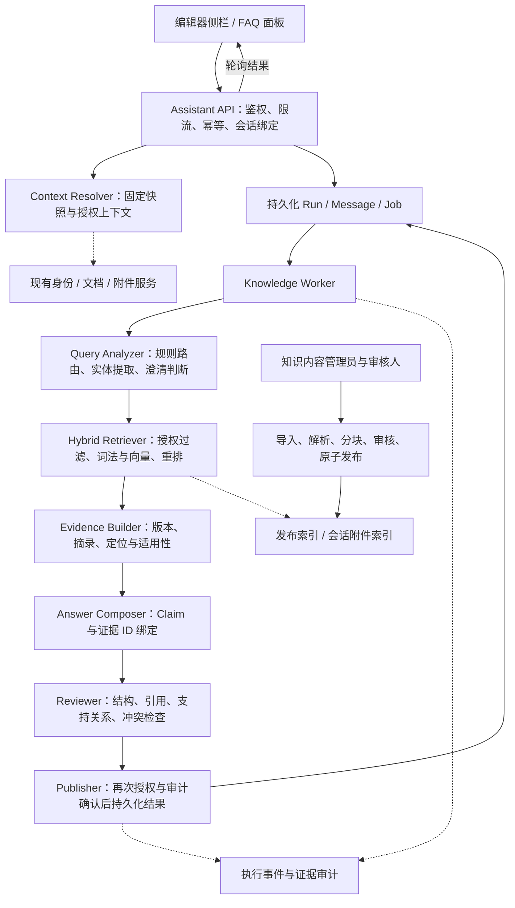
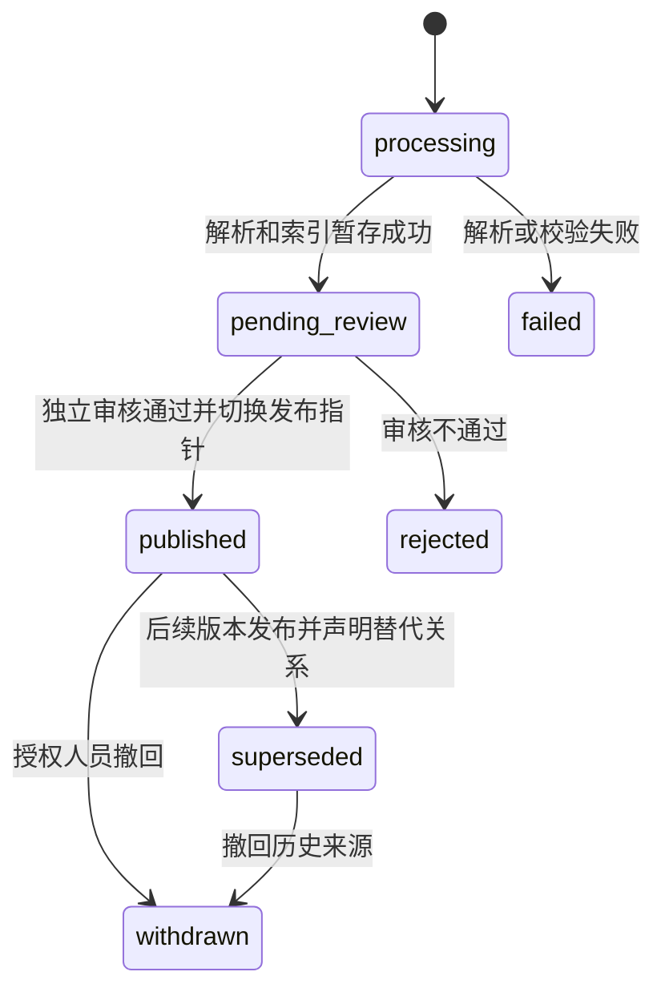

# 知识助手 Agent 功能与实现规格

版本：v0.1 / 待评审  
日期：2026-11-03  
适用阶段：Phase 1 / Knowledge Assistant Group  
读者：产品、Trade Ops、知识库负责人、人工 Reviewer、开发与测试人员、后续编码 Agent

## 1. 文档定位与约束

本文件细化 [Requirements.md](Requirements.md) 中 KNOW-01 至 KNOW-06，以及基础层级设计中的知识助手组。原始手写需求、V1/V2 和优化设计均保留，不以本文件替代。本文中的 Reviewer Agent 指机器质量复核；“人工 Reviewer”指评审本规格、验证内容或处理升级任务的人员，两者都不自动等于业务审批人。

本规格分为业务要求、实现基线、API 合同、验收与编码计划。标为 MUST 的要求是本方案的实现约束；技术栈、阈值及服务目标为建议默认值，评审后冻结。未批准生产身份、模型或数据来源之前，只允许使用合成数据和显式模拟适配器运行本地验证，不能声称具备生产能力。

**核心不变量：**任何回答只能使用请求人当前有权访问的证据；任何专业结论必须能追溯到支持它的证据；知识助手不能直接修改正文、提交版本、批准业务或扩大自身权限。

### 1.1 首期范围

| 范围 | P0 | P1 / 不包含 |
| --- | --- | --- |
| 操作知识 | 产品 FAQ、编辑锁、提交与审批等产品流程解释 | 不代替用户点击业务操作 |
| 专业知识 | 已发布知识库内的贸易规则解释、术语解释、条款含义及来源定位 | 不出具“该交易合法/可开立”的结论 |
| 文档问答 | 对授权文档快照、选中文本和已解析附件进行解释与证据定位 | 修改、填充及润色由自动化助手承接 |
| 输入 | 文字、文档选区、附件引用，中英文问题 | P1：语音、截图圈选；复用统一解析服务 |
| 输出 | 中文或英文的结构化回答、引用、适用范围、风险提示、澄清问题 | P1：语音播放、问答记录 PDF/DOCX 导出；正文导出仍属编辑器 |
| 检索 | 已审核知识库和请求范围内的文档/附件 | P1：受控联网检索；P0 默认关闭 |
| 治理 | 来源版本、生效时间、权限过滤、质量复核、反馈及审计 | 不通过用户点赞自动发布知识或训练模型 |

### 1.2 与其他能力组的边界

- “某规则是什么意思、出处在哪里”：知识助手回答，必要时请求适用日期或规则版本。
- “请把失效条款改成……”：返回 `needs_handoff`，建议转自动化助手，用户确认后由上层编排器创建独立任务。
- “全文检查哪些字段违规”：转规范审计组；“是否满足某国出口要求”：转法规建议组。
- 跨组任务由上层 Orchestrator 调度；知识助手内部的 Query Analyzer 不重复创建跨组编排系统。
- 对“先解释，再修改”这类混合请求，P0 先澄清本轮执行目标，不自动执行多个具有副作用的步骤。

## 2. 用户场景与功能需求

| ID | 优先级 | 场景及要求 | 上游映射 |
| --- | --- | --- | --- |
| KA-01 | P0 | 用户问操作问题，返回与已发布产品版本一致的步骤及出处；不臆测用户已获取锁或已完成审批 | KNOW-01 |
| KA-02 | P0 | 用户询问规则，识别规则名称、版本、法域和适用日期；缺失且会影响答案时先澄清 | KNOW-01/02 |
| KA-03 | P0 | 对当前快照选区进行解释，引用具体节点及位置；不将客户文本当作权威法规 | KNOW-01/03 |
| KA-04 | P0 | 引用授权附件，显示文件、页码和解析来源；未确认 OCR 的关键值须提示原件核对 | KNOW-01/03 |
| KA-05 | P0 | 每个专业事实性 Claim 绑定一个或多个真实证据；非证据支持的推断单独标记，不生成来源 URL | KNOW-02/03 |
| KA-06 | P0 | 区分产品说明、规则原文、内部政策、客户文档和模型解释；来源冲突时展示冲突及范围 | KNOW-03/04 |
| KA-07 | P0 | 无证据、适用范围不足、知识版本过期和技术失败分别呈现，不以固定回答或高置信度替代 | KNOW-03/04 |
| KA-08 | P0 | 会话绑定用户、交易及固定文档快照；跨文档或跨版本切换新会话，不隐式复用原上下文 | KNOW-05 |
| KA-09 | P0 | 检索、生成前、结果发布、历史读取和引用打开均重新授权；权限撤销后衍生回答同样不可读 | KNOW-02/05 |
| KA-10 | P0 | 只返回问答与路由建议，修改正文及正式业务操作不在知识助手 API/工具白名单内 | 架构职责边界 |
| KA-11 | P0 | 展示排队、处理阶段、复核、完成、失败和取消；支持幂等重试且不重复生成消息 | 异步任务要求 |
| KA-12 | P0 | 用户可反馈不准确、引用错误、已过时或不相关；反馈关联具体回答，进入人工内容治理流程 | KNOW-03 |
| KA-13 | P0 | 知识来源需经过解析、校验、独立审核后发布；支持失效、替代及撤回 | KNOW-02、第 12 节 |
| KA-14 | P0 | 保存可追踪执行记录与证据版本，支持人工复核过程；不存储模型隐式思维链 | 审计要求 |
| KA-15 | P1 | 经批准的来源联网检索，实际记录访问时间；不发送客户正文或个人数据，不把联网失败说成检索成功 | KNOW-06 |
| KA-16 | P1 | 语音转写与截图识别先转为可确认输入；语音及导出结果沿用同一回答版本和权限 | 原始手写需求 |

### 2.1 典型交互

1. 用户在文档侧栏打开助手，界面显示当前文档编号和快照版本；首次创建绑定该快照的私有会话。
2. 输入问题，按需选择正文选区或已获授权的附件；附件正文不直接拼到浏览器请求中。
3. 系统返回异步运行 ID，界面按运行状态轮询；等待期间用户可取消或继续浏览文档。
4. 完成后显示回答、结论边界、证据支持等级和来源卡片；点击引用显示授权摘录及来源定位。
5. 用户补充澄清信息时创建下一轮消息；助手仅使用仍有权访问的会话历史。
6. 文档更新时提示“回答基于旧版本”，可查看历史回答，也可基于新快照新建会话；不静默迁移锚点。

前端 MUST 支持键盘操作、可访问状态通知和长问题换行；生成中的文本不作为已确认答案显示。内部来源只在授权内部用户界面出现，不给外部用户显示其标题、数量或存在性。

## 3. 实现架构

### 3.1 建议技术基线

采用模块化单体 API 加独立任务 Worker，暂不拆分多个 Agent 微服务。无现有后端约束时建议 Python 3.12、FastAPI、Pydantic v2、PostgreSQL；由 OpenAPI 生成前端客户端。向量与词法检索通过可替换适配器接入批准的搜索服务；小规模本地验证可用 PostgreSQL + pgvector 配合多语言词法实现，不能把简单英文分词视为中文检索已满足。

P0 可使用 PostgreSQL 持久化 Job 表和 `FOR UPDATE SKIP LOCKED` 领取任务；业务数据和入队事件同事务写入，避免引入没有必要的队列基础设施。模型、嵌入、重排、对象存储、身份和审计均经 Adapter 隔离，生产提供方待确认。已有项目有成熟等价框架时优先沿用，并记录决策，不为本规格另建一套后端。



### 3.2 模块接口与职责

以下为内部 Python 接口形状，异步调用均返回显式 DTO，不返回未经验证的模型原文。

| 接口 | 输入 | 输出及约束 |
| --- | --- | --- |
| `Authorization.resolve(principal, resource_refs)` | 身份及资源引用 | `AccessContext`；服务端计算组织、角色、授权版本及内容分级，不接受客户端声明角色 |
| `ContextResolver.freeze(session, selection)` | 会话、可选选区 | `ContextSnapshot`；含源资源版本、正文摘要与许可范围，不写原始正文到常规日志 |
| `QueryAnalyzer.analyze(question, history, context)` | 问题及最小上下文 | `QueryPlan`；意图、实体、检索词、过滤条件、澄清问题或转交目标 |
| `Retriever.search(plan, access, context)` | 检索计划及授权上下文 | `EvidenceCandidate[]`；在向量/词法召回前过滤权限，重排前再次验证 |
| `EvidenceBuilder.build(candidates, plan)` | 候选来源与适用条件 | `EvidenceBundle`；稳定证据 ID、来源版本、获准摘录、定位、冲突与缺口 |
| `Composer.compose(plan, bundle)` | 计划及证据包 | `AnswerDraft`；只能引用本包提供的 ID，不能构造来源或执行工具 |
| `Reviewer.review(draft, bundle)` | 草案与原始证据 | `ReviewResult`；`pass / repair / abstain`、问题代码及受影响 Claim |
| `Publisher.commit(run, result, dependencies)` | 结构化结果及来源依赖 | 原子写 Answer、Citation、完成事件；重查权限、来源撤回及 Worker 令牌 |
| `ModelGateway.generate(task, schema, input)` | 已批准任务和输出 Schema | 校验后的结构化结果、模型版本、用量；禁止任意工具、任意 URL 和无限循环 |

独立 Reviewer Agent 由平台复用；组内复核先检查事实与领域引用，统一 Reviewer 再做最终输出一致性检查。P0 可由一个 Reviewer 服务执行两个阶段，分别记录阶段，不需重复创建两个 LLM 实例。

## 4. 问答执行管线

### 4.1 固定执行步骤

1. 校验 Session、请求人、幂等键、消息长度、活跃 Run 限额，持久化用户消息和 Run。
2. 领取任务后重新授权，获取固定快照和经过授权裁剪的历史，检查附件解析是否完成。
3. 明确 UI 动作及产品 FAQ 优先使用确定性路由；模糊意图才调用 LLM。分类结果必须属于预定义枚举。
4. 规则版本、法域或适用日期不足且会影响答案时返回澄清；不能默认为用户所在地区或把当前日期当作交易日期。
5. 在同一权限及适用性过滤条件下执行词法/向量召回、融合、去重、重排和上下文预算控制。
6. 构建证据包；没有足够证据时直接返回不足，不要求模型编造完整回答。
7. 生成带 Claim 和证据引用的结构化回答；生成器没有数据库、网络或文档写入能力。
8. 复核 Schema、引用存在性、摘录一致性、Claim 支持关系和适用范围；最多修复一次，不无限自我反思。
9. 重新检查来源状态和权限；记录运行摘要及审计事件后发布最终结果。轮询阶段只返回进度，不返回未复核内容。

`QueryPlan.intent` 为 `product_faq | trade_rule_explanation | document_explanation | out_of_scope`。混合/模糊问题通过 `clarification_questions` 表达，不能凭分类置信度自动执行编辑。

### 4.2 检索默认参数

以下为配置初值，不是质量保证：词法 Top 20、向量 Top 20，使用 RRF 合并，按 `chunk_id` 去重后最多重排 20 条，最终证据最多 8 条。RRF 常数初值 60；检索模型分数不能直接展示为回答置信度。

- 分块按章节/条款/页码和表格边界，建议 300–800 tokens，保留标题路径；表格不能拆散字段和对应值。
- 中文与英文查询须保留标准编号、公司名、金额等精确信息；查询扩展只能扩展语言表达，不改变法域和规则版本。
- 来源过滤包括 `published`、请求范围、授权级别、显式标准版本及适用日期。生效区间使用 `[effective_from, effective_to)`；无截止日为开放区间。
- 查询“最新”时显式采用服务端当前日期，回答中返回该日期；查询历史规则时仅使用所选历史有效版本，并标明不是当前版本。
- 不适用或缺少适用性元数据的来源不能支持适用性结论；可以用于解释其自身内容，但须返回 `unable_to_assess` 或范围限制。
- 规则原文、内部政策和客户文档不设置一条通用优先级后自动覆盖。内部要求更严格不代表取代法律，来源冲突必须保留并转人工确认。
- 检索预算建议证据 6,000 tokens、历史 2,000 tokens、问题/文档上下文 4,000 tokens；以目标模型 tokenizer 计数。超预算优先缩减旧历史和低相关证据，不截断条款关键条件后作结论。

### 4.3 证据支持等级

`support_level` 使用 `strong | qualified | insufficient | not_applicable`，表示证据状况，不是正确率概率。

| 等级 | 判定条件 |
| --- | --- |
| strong | 所有事实 Claim 均有经核验的直接支持，来源版本和适用范围明确，无未解决冲突 |
| qualified | 核心解释有支持，但存在已明示范围限制或解释性推断；不能掩盖无依据的事实 Claim |
| insufficient | 缺少必要证据、核心 Claim 无法验证或来源冲突影响结论；不能发布肯定性业务结论 |
| not_applicable | 纯澄清、转交或操作失败，不对证据充分程度评分 |

仅“引用 ID 存在”不足以判定通过；须验证引用内容是否支持 Claim。关键规则条文引用及确定性数据检查用代码完成；语义支持可调用复核模型，无法确认时降级/弃答。复核输出是结论和问题代码，不记录隐藏思维链。

## 5. 会话、版本与权限模型

### 5.1 会话绑定

Session 默认私有，绑定 `owner_user_id + workspace_id + document_id? + snapshot_id? + attachment_ids`。同一 Session 的绑定不可修改；无文档的 FAQ 会话仍须绑定交易工作区。`document_id` 与 `snapshot_id` 必须同时出现或同时省略。

- Session 可有多轮问答，但每轮只允许一个活跃 Run；后续消息在上一轮终止后提交。
- 已提交版本或服务器持久化的私有草稿快照均可作为输入；草稿必须是请求人有权读取的独立不可变快照，不读取实时共享 Y.Doc。
- 草稿编辑锁不是问答的前置条件；读取草稿的权限仍需验证。知识助手不获取、续租或释放编辑锁。
- 文档版本更新不使旧回答消失，但接口标记 `context_stale: true`；发起新版本问题时创建新 Session。
- 附件只在创建 Session 时绑定，数量最多 5；变更附件集合时新建 Session。未通过文件扫描或解析未完成时拒绝绑定。
- 用户消息、回答及会话摘要均记录其上下文依赖；P0 不持久化自动历史摘要，避免绕过撤权检查。

### 5.2 撤权与衍生内容

身份与组织信息来自批准的认证上下文，不信任请求体、可篡改 Header 或模型输出。公开来源也只对已登录的本系统用户开放问答，不隐式开放匿名 API。

每条回答记录读取过的所有资源依赖，不仅是最终引用的资源。任一依赖被撤回、失权或删除时，P0 保守隐藏整条回答及相关上下文消息，不尝试逐句脱敏；历史列表仅返回 `redacted` 占位，不包含正文、来源名称或摘要。生成下一轮历史时使用同样过滤。

数据库、向量索引和对象存储均使用服务端 ACL；不能依赖向量 Top K 后再过滤作为唯一隔离。发布前和打开引用时重新授权；已发送到用户设备的内容无法技术上追回，界面不应宣称撤权能回收已下载副本。

P0 禁止跨用户回答缓存。需要查询缓存时，键必须包含主体、授权版本、会话快照、知识发布版本和检索配置版本；未能及时获知授权变化时关闭缓存或回源校验，不能仅依赖 TTL。

## 6. 知识来源与发布流程

### 6.1 来源分类

`source_type`：`product_manual | trade_rule | internal_policy | document_snapshot | attachment | approved_web`。前三类通过知识治理流程发布；文档快照和附件是会话资源，不自动进入共享知识库；`approved_web` 仅 P1 启用。

知识内容管理员可提交导入，独立知识审核人批准发布；内容提交人不能批准同一版本。配置管理员不默认获得银行内部原文权限。第三方规则全文及摘录使用须受许可限制，引用只返回获准长度，禁止复制未获授权的标准全文。

### 6.2 状态及发布原子性



业务正文、来源元数据和分块发布后不可原位修改；更正须提交新版本。访问授权可以单独变更并立即影响检索与历史读取。`superseded` 版本仅供明确历史问题或旧引用且仍有权限时访问，不能参与默认当前知识召回；`withdrawn` 不可检索和打开。

导入先写暂存索引，所有块完成并审核通过才切换 `active_release_id`；读取端必须同时验证发布清单，不能因搜索索引尚未删除而读到撤回来源。审计事件与发布决策事务化落库。导入失败保留错误摘要，重新导入创建新 Job，不自动发布部分内容。

每个来源版本必须包含：标题、类型、发布者、版本标签、语言、适用范围、许可声明、所属组织及内容级别、文件摘要、原文件引用、提交人与审核人。法规/政策还需生效日期及适用法域；不适用字段显式为 null，并记录原因。来源链接是已验证元数据，不能由模型生成。

## 7. 核心数据合同

### 7.1 通用约定

- JSON 属性采用 `snake_case`，ID 为服务端生成的不透明字符串，客户端不得从 ID 推断租户或排序。
- 时间为 RFC 3339 UTC，日期为 `YYYY-MM-DD`；API 禁止不在 Schema 中的额外属性，字段不能同时混用 null、空串和缺省表达同一状态。
- 正文及摘录使用纯文本；UI 使用文本节点渲染，P0 不接收模型 HTML、任意 Markdown 链接或可执行代码。
- 请求中的引用由后端解析为实体；问题里的指令、文件里的提示和检索片段均是数据，不是系统权限。
- 表中 `?` 表示可省略；除明确说明外不接受 null。所有枚举大小写固定。

### 7.2 对象定义

| 对象 | 必需字段与类型 | 可选字段与约束 |
| --- | --- | --- |
| Session | `id:string, workspace_id:string, owner_user_id:string, attachment_ids:string[], locale:zh-CN或en, status:active或archived, created_at:timestamp` | `document_id?, snapshot_id?` 成对出现；附加只读 `context_stale:boolean` |
| Selection | `node_id:string, start_offset:integer, end_offset:integer, selected_text:string` | 偏移为源快照节点纯文本的 Unicode code point 半开区间；`0 <= start < end`；后端校验切片完全匹配 |
| Run | `id, session_id, user_message_id:string, status, stage:string, created_at, deadline_at:timestamp, attempt:integer` | `started_at?, finished_at?, assistant_message_id?, result?:Answer, error?:ErrorBody`；仅 succeeded 有 result，失败/超时有 error |
| Message | `id, session_id, run_id:string, role:user或assistant, visibility:visible或redacted, created_at:timestamp` | visible 用户消息含 `question:string`，visible 助手消息含 `answer:Answer`；redacted 不含正文或引用 |
| Claim | `id:string, text:string, kind:fact或interpretation, citation_ids:string[]` | fact 至少一个引用；interpretation 如基于证据也需引用，不能替代无证据事实 |
| Answer | `schema_version:1.0, outcome, language, support_level, claims:Claim[], citations:Citation[], limitations:string[], clarification_questions:string[], context_stale:boolean` | `handoff_target?` 仅 needs_handoff 允许且必需；除澄清/转交模板外不增加无引用的自由文本结论字段 |
| Citation | `id:string, source_type, title:string, source_version:string, locator:object` | ID 在本 Answer 内唯一；locator 只含已授权的 `page?:integer, section?:string, node_id?:string`；不返回对象存储地址 |
| EvidenceDetail | `citation_id, source_type, title, source_version, excerpt:string, locator:object` | `effective_from?, effective_to?, retrieved_at?`；未知或不适用的生效日期返回 null；联网来源须有真实 retrieved_at |
| ReviewResult | `decision:pass或repair或abstain, issues:object[]` | issue 含 `code:string, claim_id?:string, explanation:string`；解释为简短可审阅理由，不是思维链 |
| Feedback | `id, message_id:string, rating:helpful或not_helpful, categories:string[], created_at:timestamp` | `comment?:string` 最多 1,000 字符；类别固定见 API |

`Answer.outcome`：`answered | needs_clarification | insufficient_evidence | unable_to_assess | needs_handoff`。技术失败在 Run.error 中，不伪装成知识不足。

- `answered` 至少一个 Claim，support_level 只能 strong 或 qualified；所有 fact Claim 引用必须存在。
- `needs_clarification` 的 clarification_questions 为 1–3 条，其余 outcomes 该数组为空；support_level 为 not_applicable。
- `needs_handoff` 必须指定 `automation | standards_audit | regulatory_advice`，support_level 为 not_applicable；不产生后续业务副作用。
- `insufficient_evidence / unable_to_assess` 使用 insufficient，limitations 至少一条；不包含未核实的肯定性 Claim。
- 所有非 answered 结果在 P0 的 claims 为空；citations 可保留已核实的背景来源，也可为空。

### 7.3 数据持久化

| 表 / 存储 | 关键约束 |
| --- | --- |
| `assistant_sessions` | 工作区、所有者及不可变快照关联；列表按所有者和授权筛选 |
| `assistant_messages` | 用户和助手消息分开；每个 Run 最多一条助手消息，唯一约束兜底 |
| `assistant_runs` | 状态、阶段、截止时间、Worker 租约/令牌、尝试次数；每 Session 只允许一个 queued/running Run |
| `assistant_dependencies` | 消息/Run 与所有上下文、历史和证据依赖关联；含资源版本与授权检查信息 |
| `assistant_citations` | message_id + citation_id 唯一，绑定证据快照与原文位置 |
| `assistant_feedback` | user_id + message_id 唯一，后续 PUT 替换反馈并保留审计历史 |
| `knowledge_sources / knowledge_versions / knowledge_chunks` | 不可变正文版本，来源状态、发布指针、分块来源和 ACL；嵌入不是事实权威 |
| `knowledge_jobs / review_decisions` | 导入过程、审核人及决定；禁止同人提交与审核 |
| `idempotency_records / outbox_events` | 请求摘要、响应对象 ID 和待投递事件；关键状态转换同事务写入 |

可删除数据与必须保全数据按批准的保留策略分别处理；本规格不默认永久保留客户问答。模拟运行也不得写入真实客户数据。

## 8. 客户端 API

### 8.1 HTTP 约定

根路径：`/api/v1`；所有接口使用 HTTPS，认证沿用宿主应用。Cookie 会话须校验 CSRF；机器访问使用批准的 Bearer Token 校验方案。不存在与无权访问的具体资源统一返回 404，避免枚举；未登录为 401，功能级禁止为 403。

POST 创建类接口及取消请求要求 `Idempotency-Key`。键长 8–128，作用域为主体 + HTTP 方法 + 路径，记录保存至少 24 小时；相同键及相同 JSON 语义请求返回同一资源/决定，相同键不同请求返回 409。比较使用规范化 JSON 的摘要，不能依赖属性顺序。重放前重新授权，不能把缓存响应当作权限凭据。

所有响应带 `X-Request-ID`，数据响应带 `Cache-Control: no-store`。列表使用不透明 cursor，`limit` 默认 20、最大 100，返回 `{items, next_cursor}`，无下一页为 null。身份范围不能通过分页参数改变。

### 8.2 Endpoint 总表

| 方法与路径 | 请求 | 成功响应 | 特殊规则 |
| --- | --- | --- | --- |
| POST `/assistant/sessions` | CreateSession | 201 Session | 校验全部引用、扫描与解析状态；相同文档可建多个会话 |
| GET `/assistant/sessions` | `workspace_id` 必需，`cursor?, limit?` | 200 SessionPage | 仅本人会话及仍可访问工作区；不泄漏其他用户数量 |
| GET `/assistant/sessions/{session_id}` | 无 | 200 Session | 每次重算 context_stale，检查绑定资源权限 |
| POST `/assistant/sessions/{session_id}/runs` | CreateRun | 202 RunAccepted | 创建一条用户消息和一个 Run；返回 Location 指向 Run URL |
| GET `/assistant/runs/{run_id}` | 无 | 200 Run | 活跃 Run 不含 result；成功 Run 携带 result；撤权后 404 |
| POST `/assistant/runs/{run_id}/cancel` | `{}` | 200 CancelDecision | 可取消 queued/running；已完成返回 409，已取消返回同一成功决定 |
| GET `/assistant/sessions/{session_id}/messages` | `cursor?, limit?` | 200 MessagePage | 创建时间升序；有权读会话但消息依赖失权时返回 redacted 占位 |
| GET `/assistant/messages/{message_id}/citations/{citation_id}` | 无 | 200 EvidenceDetail | 检查消息和证据权限、来源撤回、许可摘录范围；不公开签名原文件 URL |
| PUT `/assistant/messages/{message_id}/feedback` | FeedbackInput | 200 Feedback | 仅回答所有者且仍有权读取该回答；不得给用户消息反馈 |

P0 不提供删除会话、共享会话、实时 Token 流或正文写入 Endpoint。归档及删除由获批数据生命周期服务处理；P1 若增加 SSE，必须发送经复核内容，不能绕过结果发布授权。

### 8.3 CreateSession

必需：`workspace_id:string, locale:zh-CN或en`。可选：`document_id:string, snapshot_id:string, attachment_ids:string[]`；attachment_ids 默认空数组，最多 5 个且不重复。客户端不能指定 owner_user_id、组织、角色、内部层权限或授权版本。

```json
{
  "workspace_id": "ws_demo_01",
  "document_id": "doc_demo_01",
  "snapshot_id": "snap_demo_v3",
  "attachment_ids": [],
  "locale": "zh-CN"
}
```

201 示例，以下及后文全部 ID、来源和内容均为合成示例：

```json
{
  "id": "session_demo_01",
  "workspace_id": "ws_demo_01",
  "owner_user_id": "user_demo_01",
  "document_id": "doc_demo_01",
  "snapshot_id": "snap_demo_v3",
  "attachment_ids": [],
  "locale": "zh-CN",
  "status": "active",
  "context_stale": false,
  "created_at": "2026-11-03T08:00:00Z"
}
```

### 8.4 CreateRun

必需：`question:string`，去首尾空白后 1–4,000 Unicode code points。可选：`selection:Selection, applicable_on:date, jurisdiction_codes:string[], rule_version:string`；国家/地区代码使用部署配置批准的代码集合，不能视为授权参数。rule_version 最多 120 字符。P0 不接受 model、system_prompt、tools、source_url、raw_document 或 web_enabled 参数。

客户端 JavaScript 以 `Array.from(text)` 计算 code point 选区偏移，不用 UTF-16 下标直接冒充；宿主 Adapter 返回节点纯文本作为唯一定位基准。selected_text 最多 8,000 code points；选择区间不符返回 409 `ANCHOR_MISMATCH`，不静默改为最近匹配文本。

```json
{
  "question": "提交文档后是否自动释放编辑锁？"
}
```

202 RunAccepted 示例：

```json
{
  "id": "run_demo_01",
  "session_id": "session_demo_01",
  "user_message_id": "message_user_01",
  "status": "queued",
  "stage": "queued",
  "attempt": 0,
  "created_at": "2026-11-03T08:01:00Z",
  "deadline_at": "2026-11-03T08:03:00Z",
  "poll_after_ms": 1000
}
```

RunAccepted 为 Run 的排队响应，额外含 `poll_after_ms:integer`。GET Run 可返回同字段建议轮询间隔；客户端前台按 1–3 秒、失败时指数退避到 10 秒轮询，尊重 429 的 Retry-After，终态停止。离开页面停止轮询不等于取消任务。

### 8.5 最终回答与引用

GET Run 的 succeeded 示例：

```json
{
  "id": "run_demo_01",
  "session_id": "session_demo_01",
  "user_message_id": "message_user_01",
  "assistant_message_id": "message_assistant_01",
  "status": "succeeded",
  "stage": "completed",
  "attempt": 1,
  "created_at": "2026-11-03T08:01:00Z",
  "started_at": "2026-11-03T08:01:01Z",
  "deadline_at": "2026-11-03T08:03:00Z",
  "finished_at": "2026-11-03T08:01:08Z",
  "result": {
    "schema_version": "1.0",
    "outcome": "answered",
    "language": "zh-CN",
    "support_level": "strong",
    "claims": [
      {
        "id": "claim_01",
        "text": "按本演示产品手册，成功提交版本后会释放编辑锁；提交失败不视为锁已释放。",
        "kind": "fact",
        "citation_ids": ["cite_01"]
      }
    ],
    "citations": [
      {
        "id": "cite_01",
        "source_type": "product_manual",
        "title": "合成测试手册：版本提交",
        "source_version": "demo-1",
        "locator": {"section": "提交与锁"}
      }
    ],
    "limitations": ["本回答解释产品流程，不表示当前文档已提交。"],
    "clarification_questions": [],
    "context_stale": false
  }
}
```

引用详情响应示例：

```json
{
  "citation_id": "cite_01",
  "source_type": "product_manual",
  "title": "合成测试手册：版本提交",
  "source_version": "demo-1",
  "excerpt": "成功提交时生成新版本并释放编辑锁；提交失败不完成上述状态转换。",
  "locator": {"section": "提交与锁"},
  "effective_from": null,
  "effective_to": null
}
```

来源摘要、证据 ID、对象路径等后台字段不直接透传。引用详情通过本系统接口获取，前端根据 message_id/citation_id 构造固定路由，不接受模型生成的 href。

### 8.6 澄清、转交、反馈及取消

澄清是一次成功完成的问答，不是长时间占用 Worker 的等待状态。用户回复后用同 Session 创建新 Run；需更换版本/附件时新建 Session。

```json
{
  "schema_version": "1.0",
  "outcome": "needs_clarification",
  "language": "zh-CN",
  "support_level": "not_applicable",
  "claims": [],
  "citations": [],
  "limitations": ["缺少适用规则信息，暂不能判断该审单期限。"],
  "clarification_questions": ["请确认文档适用的规则名称及版本。"],
  "context_stale": false
}
```

转交返回同一 Answer 结构，outcome 为 needs_handoff，补充 handoff_target，limitations 说明转交原因，clarification_questions 为空。前端显示确认动作；确认后调用宿主编排器，不自动发起编辑。

FeedbackInput 为 `{rating, categories, comment?}`；categories 最多 5 项且不重复，允许 `incorrect | wrong_citation | outdated | irrelevant | unclear`，helpful 时可为空。comment 仅作为反馈数据，不能影响权限或自动更新知识索引。

CancelDecision 为 `{run_id:string, status:"cancelled", cancelled_at:timestamp}`。取消后不生成助手回答；保留原用户消息及取消运行记录，下一轮历史不把它视为已解决问题。

### 8.7 错误合同

```json
{
  "error": {
    "code": "SESSION_BUSY",
    "message": "当前会话仍有正在处理的问题。",
    "request_id": "request_demo_01",
    "retryable": true
  }
}
```

`ErrorBody` 为上例 error 内的对象，Run.error 直接使用 ErrorBody，不能再套一层 error。可选 `field_errors:[{field, code}]` 仅用于字段格式，不包含未授权资源名称或内部服务详情。

| HTTP 状态 | code 示例 | 行为 |
| --- | --- | --- |
| 400 | `INVALID_REQUEST` | 无效 JSON 或请求封装 |
| 401 | `UNAUTHENTICATED` | 重新认证，不透露资源状态 |
| 403 | `FEATURE_FORBIDDEN` | 已知功能不可用，不用于具体文档是否存在的探测 |
| 404 | `RESOURCE_NOT_FOUND` | 不存在、非所有者或失权，使用一致响应 |
| 409 | `IDEMPOTENCY_CONFLICT`, `SESSION_BUSY`, `ANCHOR_MISMATCH`, `CONTEXT_NOT_READY`, `RUN_TERMINAL`, `STATE_CONFLICT` | 同键异请求、活动任务、选区不匹配、附件未就绪或非法状态转换 |
| 413 | `PAYLOAD_TOO_LARGE` | 超过 HTTP Body 上限，建议 P0 64 KB |
| 422 | `VALIDATION_ERROR` | 字段长度、未知属性、日期/枚举、成对字段不合法 |
| 429 | `RATE_LIMITED` | 返回 Retry-After；不以重复键绕过额度 |
| 503 | `DEPENDENCY_UNAVAILABLE` | 入队或必要控制服务不可用，请求未成功受理 |

受理后的依赖失败通过 GET Run 返回 HTTP 200 + status failed + ErrorBody，例如 `MODEL_UNAVAILABLE`、`RETRIEVAL_UNAVAILABLE`、`REVIEW_FAILED`、`AUDIT_UNAVAILABLE`；超时为 status timed_out + `RUN_TIMEOUT`。已受理的失败不再次写同一用户消息；用户显式重试用新幂等键创建新 Run。

## 9. 知识管理 API 与宿主集成

### 9.1 管理端 API

这些是知识内容管理接口，不暴露给普通客户或模型。沿用第 8 节认证、幂等、错误及分页约定；元数据查询也须验证内容管理权限。

| 方法与路径 | 请求与响应 | 约束 |
| --- | --- | --- |
| POST `/knowledge/imports` | `{file_id, metadata}` → 202 `{job_id, source_id, version_id, status:"processing"}` | file_id 来自已批准上传服务，必须有权限且已扫描；不支持任意 URL 或对象存储路径 |
| GET `/knowledge/imports/{job_id}` | 200 `{job_id, source_id, version_id, status, created_at, error?}` | status 为 processing / pending_review / failed；审核后的来源状态另查版本接口 |
| GET `/knowledge/sources/{source_id}/versions` | 200 `{items:KnowledgeVersion[], next_cursor}` | 只列授权范围；供审核人与内容管理员查看 |
| POST `/knowledge/sources/{source_id}/versions/{version_id}/decisions` | `{decision:"publish"或"reject", reason:string}` → 200 `{decision_id, source_id, version_id, status, decided_at}` | 仅 pending_review；独立审核，reason 1–1,000 字符；重复不同决定 409 |
| POST `/knowledge/sources/{source_id}/versions/{version_id}/withdraw` | `{reason:string}` → 200 `{source_id, version_id, status:"withdrawn", withdrawn_at}` | 仅已发布/被替代来源；撤回立即限制检索和衍生回答 |

Import metadata 必需：`title:string(1..200), source_type, publisher:string(1..200), version_label:string(1..120), language:zh-CN或en, scope:shared或organization或bank_internal, license_reference:string(1..500), jurisdiction_codes:string[], effective_from:date或null, effective_to:date或null`。

可选：`source_id`（添加已有来源的新版本）、`supersedes_version_id`、`canonical_url`（只作经校验的来源元数据，不触发抓取）、`date_not_applicable_reason`。空生效日期须说明原因，trade_rule/internal_policy 未明确适用性时不允许发布为可支持适用性结论的来源。组织归属由后端推导，scope 发布权限须单独检查。

`KnowledgeVersion` 返回 `source_id, version_id, title, source_type, version_label, status, submitted_by, submitted_at, metadata`，审核后另有 `reviewed_by?, reviewed_at?`；不包含原文件密钥。创建新版本时必须与已有来源类型及所属组织一致，supersedes_version_id 必须属于该来源，不允许通过导入换租户。

### 9.2 必需宿主接口

以下是 Adapter 合同，不要求宿主照搬 URL；未接通时本地用合成数据桩，生产缺失必须失败关闭。

| 能力 | 请求 / 输出合同 |
| --- | --- |
| 身份解析 | 验证后的 principal、组织成员关系、角色、授权版本；禁止开发 Header 在 production 生效 |
| 快照读取 | 输入 principal、workspace_id、document_id、snapshot_id；返回不可变 `nodes:[{id, plain_text}]`、content_sha256、版本标签、内容级别及是否当前版本 |
| 附件读取 | 输入 principal、attachment_id；返回工作区归属、扫描/解析状态、文件版本、页码块、OCR 待确认标记及授权级别 |
| 授权重验 | 输入主体与资源依赖列表；批量返回当前允许/拒绝及授权版本，用于发布和历史读取 |
| 审计追加 | 输入 request_id、run_id、事件类型、版本/证据引用、操作者和结果；返回持久化确认；不得依赖 Worker 日志替代 |
| 显式转交 | 用户确认后由宿主向目标能力组提交原任务引用和最小授权上下文；知识助手只提供目标建议，不持有调用权限 |

snapshot 摘要由宿主对其定义的规范化快照生成并作为版本指纹；助手不自行重新规范化正文后声称摘要相同。选区匹配使用宿主 nodes 中的原始 plain_text，不能在匹配前替换换行或标点。

## 10. 任务状态、并发与故障处理

Run.status：`queued | running | succeeded | failed | cancelled | timed_out`。stage：`queued | resolving_context | analyzing | retrieving | composing | reviewing | publishing | completed | failed | cancelled | timed_out`；终态对应同名 stage，succeeded 对应 completed。

| 转换 | 条件与动作 |
| --- | --- |
| queued → running | Worker 获得租约及递增 fencing token，记录 started_at 和 attempt |
| queued/running → cancelled | 用户取消事务先落状态；Worker 尽力取消外部调用，不能承诺供应商停止计费 |
| queued/running → timed_out | 超过自创建起 120 秒的总截止时间；排队耗时也计入 |
| running → succeeded | 复核和发布授权通过，结果、唯一助手消息及审计事件同事务确认 |
| running → failed | 不可恢复错误或有限重试耗尽；保存可诊断错误代码，不保存模型未经复核输出给客户端 |
| running → queued | Worker 租约失效且未达 deadline，有限重新入队，旧 token 失效 |

终态不可被迟到结果覆盖。取消与发布、超时与发布使用 compare-and-set/行锁竞争，只能有一个成功；重复 Worker 执行由 token 和唯一约束阻止重复回答。

外部只读调用对 429/可重试 5xx 最多重试两次，指数退避及抖动，并受总 deadline 约束；模型格式修复最多一次。任务 attempt 上限建议 3，业务副作用不得随模型重试重复执行。授权查询不可用时不发布；已持久化本地审计 Outbox 的事件可异步转交审计平台，未持久化不得报告完成。

默认限流建议每用户每分钟 10 次新 Run、同时最多 2 个 Run，每个 Session 最多 1 个；按工作区设置独立总预算。幂等重放不重复占生成额度，身份与参数校验仍执行。

## 11. 安全、观测与质量目标

### 11.1 MUST 控制

- 文档、附件和检索片段中的“忽略指令、读取内部资料”等内容不改变系统权限；Agent 工具在代码层白名单化，P0 Composer 无工具调用能力。
- 仅向批准模型发送最小必要上下文；禁止将客户数据用于训练，遵循批准的驻留、日志和数据保留政策。
- 向量、重排、模型 Provider 也属于数据接收方，须与主模型一样审查，不能因其是中间环节而跳过批准。
- 输入、日志、反馈和审计内容按敏感级别处理；日志只含 ID、用量、耗时、错误码，必要调试正文须额外审批与脱敏。
- 来源元数据不得包含未验证的可执行链接；P1 抓取由专用出口代理做白名单、重定向和私网地址防护，不能让 LLM 任意抓取 URL。
- 处理反馈不立即修改系统提示或训练集；内容发布、提示词升级、检索配置和模型切换必须版本化并跑回归集。

### 11.2 建议验收指标

以下目标基于合成与获准测试集，需评审冻结，不是当前已实现的结果。

| 指标 | 建议门槛 |
| --- | --- |
| API 响应 | 创建/查询接口在 100 活跃用户基线下 P95 ≤ 1 秒，不含问答生成；模型并发额度单独记录 |
| 问答时延 | 20,000 字符以内上下文、已发布索引正常时端到端 P95 ≤ 30 秒，120 秒明确超时 |
| 证据标识完整性 | 所有展示引用均对应真实授权证据；伪造引用 ID 为零容忍 |
| Claim 支持精确率 | 专家标注集事实 Claim 中被证据支持比例 ≥ 95%；不允许通过全部弃答满足该目标 |
| 可回答覆盖率 | 专家判定可回答问题中，正确给出有证据回答的比例 ≥ 85%，与弃答率一起报告 |
| 无依据问题弃答率 | 标注为无证据/范围缺失的问题中正确弃答或澄清比例 ≥ 95% |
| 权限隔离 | 跨用户、跨交易、内部层泄漏及撤权后读取均为零容忍；失败阻断上线 |
| 人工可审阅性 | 所有专业答案可查看源版本、定位与限制；不得只给模型置信度数字 |

运行指标：按 run_id/request_id 串联队列等待、检索、重排、生成、复核、发布耗时，模型/提示词/索引版本、Token 用量、估算成本、弃答原因和错误码。不使用客户问题文本作为 metrics label。

## 12. 测试与需求追踪

P0 测试集至少覆盖中文/英文、产品 FAQ、规则解释、文档与附件问答、旧版本、无依据、冲突与权限变化。使用合成规则和已许可内容；不能把 HTML 固定法律问答当作真值。专家标注需记录允许答案、证据段、适用条件及应澄清/弃答原因。

| Test ID | 输入 / 操作 | 必须断言 | 需求 |
| --- | --- | --- | --- |
| KT-01 | 操作 FAQ 问题 | 正确版本的产品手册被引用，不声称已执行操作 | KA-01/05 |
| KT-02 | 未说明规则版本且会改变答案 | needs_clarification；不猜法域和标准版本 | KA-02/07 |
| KT-03 | 合法选区及含 emoji 的偏移 | 定位与 code point 区间一致；错误选区返回 ANCHOR_MISMATCH | KA-03 |
| KT-04 | 未解析附件或待确认 OCR 金额 | 未就绪绑定失败；可读取的待确认值附人工核对限制 | KA-04 |
| KT-05 | 模型返回不存在的引用 ID | 不发布伪造引用，修复一次后仍失败则 REVIEW_FAILED | KA-05/11 |
| KT-06 | 引用存在但不支持 Claim | 复核拦截该肯定性结论，弃答或删除无依据 Claim | KA-05/07 |
| KT-07 | 两个来源有适用范围冲突 | unable_to_assess 及限制；不自动选择“更像正确”的来源 | KA-06 |
| KT-08 | A 用户访问 B Session/Run/引用 | GET/POST 均 404，不透露标题与内容 | KA-08/09 |
| KT-09 | 原文修改及版本切换 | 旧会话固定快照且 context_stale；新会话没有旧上下文污染 | KA-03/08 |
| KT-10 | 入队后撤权或发布前撤回来源 | 不发布回答；后续对象查询按失权规则拒绝 | KA-09 |
| KT-11 | 已回答后撤回某个上下文依赖 | 历史消息 redacted，引用不可读，新一轮不复用依赖内容 | KA-09/13 |
| KT-12 | 问题/文档包含恶意指令 | 不扩大检索范围，不调用网络或正文写入工具 | KA-09/10 |
| KT-13 | 用户要求润色或完整合规审查 | needs_handoff；未确认前没有跨组任务或正文变更 | KA-10 |
| KT-14 | 同键重试、同键异请求、双 Worker | 一个用户消息、一个 Run、最多一个回答；异请求 409 | KA-11 |
| KT-15 | 取消/超时与发布并发 | 单一终态，迟到回答不落库；新 Run 可正常提交 | KA-11 |
| KT-16 | 检索无命中 vs 搜索服务故障 | 前者 insufficient_evidence，后者 failed + 错误码 | KA-07/11 |
| KT-17 | 提交人自审、部分索引失败、来源撤回 | 禁止自审，未完成版本不可召回，撤回立即生效 | KA-13 |
| KT-18 | 更新反馈及提交注入文本 | PUT 幂等替换并审计，不改变知识/提示词或业务状态 | KA-12 |
| KT-19 | 审计写入失败/模型失败重试 | 不虚报成功；有限重试，总 deadline 不延长 | KA-11/14 |
| KT-20 | 专业问答回归与并发负载 | 达到质量门槛及 P95，记录覆盖率和弃答率 | KA-01 至 KA-14 |
| KT-21 | P0 请求联网/语音/截图输出 | 明确功能未启用，不返回伪造抓取时间或声称已执行 | KA-15/16 |

测试层级：纯函数和 Pydantic Schema 单元测试、使用真实 PostgreSQL 的事务/并发测试、Adapter 合同测试、固定模型桩的端到端测试、获准模型上的离线质量评测，以及浏览器问答/引用/取消交互测试。模拟 Provider 测试不能替代真实模型质量评测。

## 13. 编码 Agent 执行指引

### 13.1 开始实现前

1. 阅读本规格及父需求，确认当前任务属于 P0 哪个增量；不得修改或删除手写需求和历史设计。
2. 先检查已有后端、身份、文档快照、数据库迁移和测试规范，复用已有模块，不自动创建新云资源或部署。
3. 没有宿主集成时先实现显式 FakeAdapter 和合成 Fixture；启动模式为 local/test，production 检测到 FakeAdapter 必须拒绝启动。
4. 将本文对象合同落为 Pydantic Schema，额外字段禁止；导出 OpenAPI 3.1 作为后续客户端/合同测试的唯一机器接口产物。示例不是完整 Schema，必须同时实现表格和跨字段约束。

### 13.2 建议代码职责

以下为未来实现时的逻辑目录，不表示当前仓库已有这些文件；已有项目可采用等价路径。

```text
knowledge_assistant/
  api/             sessions, runs, messages, citations, feedback, knowledge_admin
  schemas/         request, response, answer, evidence, error
  application/     query_pipeline, publishing, ingestion, feedback
  domain/          state_machine, applicability, claim_validation, limits
  ports/           identity, document, retrieval, model, storage, audit
  adapters/        approved providers and explicit local fakes
  persistence/     repositories, migrations, idempotency, outbox
  workers/         run_worker, ingestion_worker, timeout_recovery
tests/
  unit/
  contract/
  integration/
  e2e/
  evaluation/
```

### 13.3 按增量交付

| 增量 | 实现产物 | 完成闸门 |
| --- | --- | --- |
| I1：合同与数据 | Schema、OpenAPI、迁移、状态机、错误合同、授权 Port | KT-03/08/14；所有 JSON 示例可由 Schema 验证，未接模型也可运行测试 |
| I2：异步问答骨架 | Session/Run/消息、幂等、Worker、取消/超时、模拟结果、轮询 UI | KT-09/14/15/19；重复任务不产生重复回答 |
| I3：知识治理与检索 | 导入、审核、版本与撤回、词法/向量适配器、证据定位 | KT-04/07/10/11/17；未发布内容无法召回 |
| I4：问答与复核 | 路由、澄清、证据化生成、Reviewer、转交建议 | KT-01/02/05/06/12/13/16；禁止无证据事实发布 |
| I5：交互与准入 | 引用卡片、反馈、撤权 UI、观测、回归和性能测试 | KT-18/20/21 及全部 P0 回归；人工 Reviewer 批准评测结果 |

每个增量完成后给出修改清单、迁移影响、测试证据、模拟依赖和未完成项。不得用硬编码高置信度、随机引用 ID、固定审查结果或隐藏前端元素冒充真实功能；演示 Fixture 必须与生产路径隔离。

Definition of Done：父需求可追踪、API 与 Schema 一致、状态转换及权限在服务端执行、失败流程有测试、没有正文副作用、知识发布和撤回闭环、引用可核验、观察指标与错误码可用。P1 不因 UI 出现入口而算已完成。

## 14. 人工评审与待决策

| 决策 | 当前建议 | 负责人 / 对实现的影响 |
| --- | --- | --- |
| 试点问题与专业范围 | 先覆盖产品 FAQ 和批准的保函规则解释 | 产品 / Trade Ops；决定评测集与知识清单 |
| 首期语言与法域 | 中英文；法域清单未冻结则不能给适用性结论 | 法务 / 合规；决定有效时间和澄清条件 |
| 知识与许可 | 明确规则原文许可、可展示摘录长度及更新负责人 | 知识负责人；未批准来源不得发布 |
| 模型及检索服务 | 接口可替换，生产只启用批准的 Provider | 技术 / 数据治理；决定成本、驻留及中文能力 |
| 宿主身份和快照 | 使用现有权限体系和不可变快照 Adapter | 平台团队；是正式集成的前置依赖 |
| 私有会话及撤权规则 | 默认私有，依赖失效后整体隐藏衍生消息 | 产品 / 数据负责人；确认保守策略是否满足业务 |
| 质量门槛与 SLA | 采用第 11 节建议值建立基线后冻结 | 产品 / 运维 / 专家 Reviewer |
| 保留与审计 | 分别定义会话、证据、运行和反馈保留期 | 数据治理 / 合规；生产前必须给出具体值 |
| 联网与多模态 | P1，默认关闭；专用适配器接入，不复用任意工具权限 | 产品 / 合规；不阻塞 P0 本地实现 |

人工评审至少确认：问题是否在知识助手职责内、证据是否支持每条结论、来源版本和适用范围是否明确、客户文本是否被误当法规、失权后是否还能读到衍生信息、模拟与真实能力是否清楚区分。未解决事项应保留为决策记录，不由编码 Agent 静默扩展业务范围。