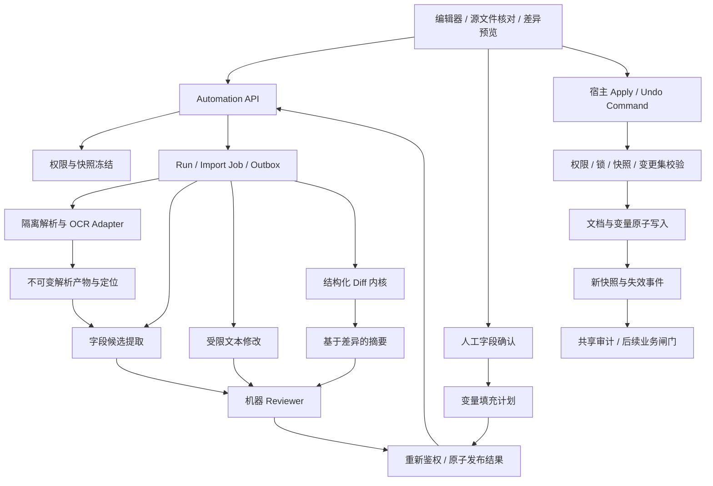

# AI 自动化文本 Agent 组功能与实现规格

版本：v0.3 / 待人工评审
日期：2026-11-03  
适用阶段：Phase 1 / Automation Assistant Group  
读者：产品、Trade Ops、文档与模板负责人、人工 Reviewer、架构师、开发与测试人员、后续编码 Agent

## 1. 定位与实现边界

本文细化 [Requirements.md](Requirements.md) 的 AUTO-01 至 AUTO-06，以及 ED-01 至 ED-09、COL-01 至 COL-06、VER-01 至 VER-06 中与自动化有关的部分。与 [AI_assistance_reqirement.md](AI_assistance_reqirement.md)、[AI-audit_reqirement.md](AI-audit_reqirement.md)、[AI-Law_agent_reqirement.md](AI-Law_agent_reqirement.md) 共同使用，保留全部现有需求、草稿和原型。

本组负责解析结果消费、信息提取、变量填充、措辞与条款修改建议、结构化版本比较及差异摘要，以及原始需求新增的外部 API 模板全文映射和语音定位/编辑/受控动作调用。不是另一个文档编辑器、身份服务、规则引擎或法律判断系统；生成映射及 payload 草稿不等于调用外部 API，语音指令不等于正文写入授权。

MUST 为必须实现的约束；技术、额度及性能数值是建议默认值，评审后冻结。本文所有规则、主体、金额及示例来源均为合成设计，不代表真实交易事实或法律意见。

### 1.1 组件归属

| 能力 | 本组责任 | 复用或移交 |
| --- | --- | --- |
| 文件导入与 OCR | 编排解析、呈现损失清单、保留来源定位 | 复用宿主文件接入、扫描、对象存储和解析服务；不执行文件内宏/脚本 |
| 字段提取 | 给出一个或多个候选及证据、冲突和缺口 | 人工确认后才进入可填充集合，不代替真实性核验 |
| 变量 | 提议定义、绑定、赋值及所有出现位置预览 | 变量定义和文档存储由宿主所有；发布 Schema 与规则由模板/审计治理所有 |
| 文本修改 | 有边界的润色、条款替换、原文翻译辅助、导入正文建议 | 不能自行决定金额、义务、签署日期、适用法或最终业务结果 |
| 版本比较 | 确定性结构 Diff、真实统计、可选证据绑定摘要 | 复用共同 Diff 内核；不把模型自由描述当作真实差异 |
| 外部 API 映射 | 按已发布目标 Schema 全文匹配、解释枚举候选、人工确认并生成待复核 payload | 复用模板治理和共享校验；真正对外交付由宿主控制，P0 不执行外部业务 API |
| 实际写入 | 只发布不可变 ChangeProposal | 由有权用户调用宿主 Document Command，经锁、基线和政策校验应用 |
| 后续审查 | 发布变更事件并建议重新审计 | 硬校验调用共享 RuleEngine/GateEvaluator，法律适用性交给法律组 |

### 1.2 核心不变量

1. Agent 和模型工具没有文档写入、提交、审批、授权或豁免权限；用户点击“采纳意见”也不是已经写入。
2. 所有输出绑定源文档快照、变量/事实版本、附件解析版本、模板及授权上下文；相同正文的新快照也不能自动复用旧提案。
3. 金额、币种、日期、主体、用途等事实必须有来源；信息缺失、歧义或冲突时请求确认，不用模型常识补齐交易值。
4. 用户确认是可追溯的业务确认，不表示系统已证明事实真实合法。
5. 正文、变量绑定和显示值作为一个变更集原子应用；同名普通文本不能被全文字符串替换。
6. 历史快照和已批准版本不可修改；恢复旧内容产生新草稿，任何实质修改均要求新快照及必要重审。

## 2. 功能需求

| ID | 优先级 | 要求及完成条件 | 上游映射 |
| --- | --- | --- | --- |
| AUT-01 | P0 | 支持从空白、已发布模板及上传文件开始，固定模板/Schema 版本并记录起点 | ED-01 |
| AUT-02 | P0 | 接收已授权 DOCX/PDF/JPG/PNG 文件引用，显示解析进度、结果、损失及失败；保留可核对原件 | ED-03/04 |
| AUT-03 | P0 | 区分完整解析、部分解析、加密、损坏、格式不支持及超限；不以部分正文冒充全量输入 | ED-03/05 |
| AUT-04 | P0 | 提取主体、金额、币种、日期、编号、地址等字段，返回原值、规范化候选和来源页/区域 | AUTO-01 |
| AUT-05 | P0 | 同字段多来源保留多候选，标明冲突；不得静默覆盖已确认字段或选择最大金额/最新日期 | AUTO-06 |
| AUT-06 | P0 | 支持候选接受、纠正、拒绝及手工录入确认，记录确认人、时间、来源和理由 | AUTO-01/06 |
| AUT-07 | P0 | 支持文档局部变量定义及正文节点绑定；类型、标签、来源和出现位置可查，不把自定义变量变成组织标准 | AUTO-02 |
| AUT-08 | P0 | 填充前展示每个变量、旧值/新值及全部绑定位置；更新变量和显示文本为同一原子变更集 | AUTO-03 |
| AUT-09 | P0 | 金额用 Decimal 及显式币种，日期用无歧义格式；OCR 未确认值不得自动成为已确认值 | AUTO-03/06 |
| AUT-10 | P0 | 草稿可含明确标记的占位符；审批、正式导出、交接前检查最终物化快照，不用填充前审计放行 | AUTO-04 |
| AUT-11 | P0 | 支持选区/段落润色、格式清理和条款替换，默认保护主体、数值、币种、日期、义务及法律引用 | AUTO-05/06 |
| AUT-12 | P0 | 修改建议展示真实前后差异、范围、原因、来源及风险；整段替换不能伪装成细小拼写修正 | AUTO-05 |
| AUT-13 | P0 | 单轮任务目标明确；“解释并自动改写并提交”须拆分或澄清，不能隐式串联副作用 | 编排架构 |
| AUT-14 | P0 | 应用建议要求用户明确确认、当前权限、有效会话锁、fencing token、基线和锚点摘要一致 | COL-01/02、AUTO-05 |
| AUT-15 | P0 | 支持撤销最近一次已应用自动化变更；检查当前头版本及依赖，不覆盖后续人工修改 | ED-02、AUTO-05 |
| AUT-16 | P0 | 按稳定节点和结构对齐任意两个授权快照，突出文本、金额、条款、变量及表格差异 | VER-04 |
| AUT-17 | P0 | 差异统计由确定性 Diff 计算；AI 摘要逐项绑定 diff_hunk_id，允许无法摘要而保留准确差异 | VER-05 |
| AUT-18 | P0 | 从历史版本恢复为新草稿，不修改历史或继承旧批准；表格/条款无法对齐时标明不确定 | VER-06 |
| AUT-19 | P0 | 所有解析、提取、生成、读取、引用、确认和应用检查当前权限，包含未最终引用的输入依赖 | 组织权限 |
| AUT-20 | P0 | 外部律师读取、附件、AI、字段确认和编辑能力分别校验；受邀身份不能看到内部材料或自动再邀请 | INV-02/03/09 |
| AUT-21 | P0 | 异步任务支持取消、超时、幂等、阶段及可解释失败；过期 Worker 不能重复发布或写入 | 架构可靠性 |
| AUT-22 | P0 | 审计涵盖源摘要、模板/模型/解析器版本、候选确认、提案决定及应用回执，不保存隐式思维链 | 第 12/13 节 |
| AUT-23 | P0 | 机器 Reviewer 校验结构、事实保留、证据、锚点和风险，最多一次修复；不合格输出不成为可应用提案 | Reviewer 架构 |
| AUT-24 | P0 | 界面提供源文档核对、字段确认、差异预览、冲突恢复、应用/撤销状态及错误空态 | 编辑器体验 |
| AUT-25 | P1 | 翻译、语音/截图输入及多版本演变复用来源和权限；译文不等于权威法律文本 | ED-10、VER-07 |
| AUT-26 | P1 | 批量多文档自动化、复杂表格重构和自动建议触发须另行评审，不隐式扩大 P0 操作范围 | 范围约束 |
| AUT-27 | P0 建议 | 选择获授权且已发布的外部 API 模板版本，按目标操作的字段 Schema 通读固定文档快照并生成映射候选 | 原始自动化助手第 3 点 |
| AUT-28 | P0 建议 | 对 application_type 等枚举给出模板允许的候选代码、业务含义、原文依据及冲突；不能凭标题或关键词直接确定 guarantee/standby_dc | 原始自动化助手第 3 点 |
| AUT-29 | P0 建议 | 模板映射覆盖必填、类型、枚举、嵌套对象、数组、条件分支及缺口；模板默认值不能当成文档事实 | 原始自动化助手第 3 点 |
| AUT-30 | P0 建议 | 映射结果逐字段人工确认或纠正后，确定性生成符合固定目标 Schema 的待复核 payload；关键事实不猜值，映射不修改正文 | 原始自动化助手第 3 点 |
| AUT-31 | P0 建议 | API 模板、枚举释义和映射策略版本化，独立校验/审核/发布/撤回；更新使相关映射和 payload 要求重审 | 模板治理与版本约束 |
| AUT-32 | P0 建议 | 外部 payload 生成与调用外部系统分离，数据对外释放须独立授权和宿主流程；P0 不开立、提交外部申请或发送 SWIFT | 第 1 节实现边界 |

以上 P0 建议限于已批准试点模板的映射与预览，需业务评审冻结；识别出 standby_dc 不代表扩展 Phase 1 的信用证业务范围。

新增第四点沿用主需求 ED-10 的 P1 定位，不擅自将语音能力整体提升为 P0。以下是可独立验收的语音增强范围，原 AUT-25 的语音输入概述以此细化：

| ID | 优先级 | 要求及完成条件 | 上游映射 |
| --- | --- | --- | --- |
| AUT-33 | P1 | 用户主动开启麦克风，显示录音、实时转写和停止状态；区分临时转写与最终转写，不因临时文本直接执行命令 | 原始自动化助手第 4 点、ED-10 |
| AUT-34 | P1 | 支持语音查找、选择、插入、删除和修改的意图解析；“选择当前页面第几行到几行”先解析为可见布局范围再映射稳定文档锚点 | 原始自动化助手第 4 点 |
| AUT-35 | P1 | 实时显示候选选区及所选文本摘要，模糊、多命中、跨表格或布局过期时澄清；不凭模型编造行号或坐标 | 原始自动化助手第 4 点 |
| AUT-36 | P1 | 支持“选择这段 → 改成… / 删除它 / 在后面插入…”的多轮流程，指代只绑定同一会话内已确认且仍有效的选区 | 原始自动化助手第 4 点 |
| AUT-37 | P1 | 语音增删改生成 ChangeProposal 和差异预览，实际应用仍须当前持锁用户显式调用宿主 Command；删除可追溯且可按既有规则撤销 | AUTO-05/06、原始第 4 点 |
| AUT-38 | P1 | 语音调用应用功能仅使用批准动作目录，初期支持打开助手和运行规则审计；每次重新鉴权并固定快照，不自由调用任意工具/API | 原始自动化助手第 4 点 |
| AUT-39 | P1 | 转写纠正、语音确认、业务事实确认、选区确认和实际应用各自独立；金额、日期、主体、否定语义等不能以 ASR 高置信度自动确认 | ED-10、事实保护 |
| AUT-40 | P1 | 切换身份/文档、失权、布局变化、断线及停止录音有明确取消/失效规则，迟到转写或重复消息不能触发旧命令 | 权限与并发 |
| AUT-41 | P1 | 麦克风不可用时可用文字命令及鼠标/键盘完成等价流程；显示范围、差异、权限和执行状态，提供受控评估样本 | 可访问性与验收 |

## 3. 用户工作流与操作语义

### 3.1 导入、提取与填充

1. 用户在当前文档选择已上传文件，宿主先完成类型/大小/扫描与访问检查；Automation 创建解析作业，不覆盖正文。
2. 解析完成后显示逐页状态、原件定位和不支持元素。未解析页保留为缺口，用户可重试、补充文件或改为手工输入。
3. extract 任务按固定 Schema 返回候选。用户逐字段核对并生成 ConfirmationReceipt；未确认候选与 confirmed 字段分开保存。
4. fill 任务选择当前有效确认回执，生成变量赋值及绑定节点的差异预览。若原值已确认且新值不同，必须明确选择覆盖并说明原因，不直接应用。
5. 用户持锁确认应用变更集；宿主原子更新变量与正文并形成新检查点，旧审计、建议及审批有效性按依赖失效。
6. 发起审批、正式导出或交接时，GateEvaluator 校验最终物化快照；本组不执行这些业务命令。

### 3.2 文本与版本工作流

rewrite 针对明确选区和动作；默认是“保留事实及约束的措辞调整”。无法保持事实、涉及新义务或法律效果时返回 needs_clarification/needs_handoff，不擅自生成可直接执行条款。

compare 固定两个版本，先计算真实 Diff，再生成可选摘要。新段落插入不得导致后续全部按行号错配。恢复旧内容仍经过新提案/草稿流程。

界面与 API MUST 区分四种动作：`confirm_candidate` 是确认来源值；`accept_proposal` 是记录处理意向；`apply_proposal` 是宿主实际写入；`submit_version` 是宿主发布共享版本。四者不能共用一个模糊“接受”状态。

### 3.3 外部 API 模板映射工作流

1. 用户选择目标系统、目标操作和已发布模板版本，例如“业务申请草稿 / application_type”；服务端校验目标目录授权，不接受用户提供的任意 URL。
2. 系统固定全文快照、结构化变量、已确认事实、授权附件及模板摘要，先列出预期段落/表格与目标字段，再通篇分析。超限、正文不可见部分或解析失败均为覆盖缺口，不能只查标题或前几页后宣布完成。
3. Mapper 识别目标字段的业务含义与类型，结合全文生成候选：例如 application_type 候选 guarantee 或 standby_dc，并给出支持及相反证据、待澄清问题。
4. 界面按目标 API 字段展示文档原文、候选代码/标签、来源、缺失/冲突和格式检查；人工选择或纠正。默认值与从文档提取的事实单独标记。
5. 用户确认后生成不可变、符合目标 Schema 的 payload 草稿，并绑定所有确认记录、源快照、模板版本及摘要；未确认必填字段、冲突或未知条件分支不得生成“就绪”payload。
6. 原文、事实、权限、映射决定或模板生效版本变化后旧 payload 失效。真正导出或向外部系统交付由宿主经过独立授权和审批重新核验；本组不调用外部业务 API，也不反向修改文档。

### 3.4 语音定位与连续编辑

1. 用户主动打开语音面板并授权麦克风，界面显示当前文档/快照、语言、处理区域和录音状态；未授权不采集。浏览器麦克风授权不等于文档权限或音频处理同意。
2. 用户说“选择当前页面第 3 行到第 5 行”。临时转写仅可驱动可撤销的虚线候选框；最终转写到达后，按当前 LayoutSnapshot 查实际文本范围，不由模型计算像素或行号。
3. 显示范围名称、首尾文本及高亮。若多处匹配、定位不完整或没有可靠行号，要求用户点击候选或改说原文短语；用户确认后获得 VoiceSelectionReceipt。选区确认不意味着确认内容真实或允许修改。
4. 用户继续说“把这段改成……”或“删除刚才选中的文本”。最终转写经核对后生成 VoiceCommandPlan，引用仍有效的 selection_id，不凭聊天历史猜“这段”。连续指令分步骤显示，不批量静默执行。
5. 对增删改显示目标、原文和新文的 Diff，校验保护事实/变量/义务及 Reviewer；用户再通过鼠标或键盘显式应用，复用 ApplyRequest、编辑锁、fencing、原子回执及 Undo。初期不把一句“好的/确认”当成正文提交授权。
6. 用户说“运行规范审计助手”，生成固定 action_id=audit.run_rules 的调用预览。用户确认后由宿主动作路由调用规则审计合同，回到审计面板显示任务状态；不会因此通过审查、发起审批或修改规则。

例：选择第 3–5 行 → 高亮并确认选区 → “删除它” → 生成删除提案 → 显式应用 → 新检查点。若任一步之前发生正文、选区或布局变化，要求重新定位/确认，而不是沿用旧屏幕坐标删除其他文本。

## 4. 架构与内部接口

### 4.1 建议实现基线

复用 Python 3.12、FastAPI、Pydantic v2、PostgreSQL 的模块化单体 API + 独立 Worker。解析器在隔离 Worker 中运行；推荐优先接入批准的成熟 DOCX/PDF/OCR 服务或库，不手写二进制解析器、OCR、CRDT 或 Diff 算法。TipTap + Yjs 管编辑结构，宿主独占锁及服务端条件写入管业务权限。

文档修改必须经宿主 Document Command；Automation Worker 的服务身份仅能读取授权输入和写自己的运行/候选/提案数据，不能持用户编辑锁替用户写正文。



### 4.2 模块合同

| 接口 | 输入 | 输出与约束 |
| --- | --- | --- |
| Authorization.resolve | principal, resource_refs, action | 唯一活动成员/访客 AccessContext；服务端派生用户、组织与权限 |
| ContextResolver.freeze | task_request, access | AutomationContext，全部版本/摘要及依赖，任务途中不跟随“最新” |
| ImportAdapter.parse | immutable_file_version, options | ParseArtifact，页/块、规范化结构、原件定位、损失及失败 |
| Extractor.extract | schema, artifacts, context | ExtractionResult，多候选及冲突；不产生已确认字段 |
| ConfirmationService.record | candidate/manual_input, actor, context | 不可变 ConfirmationReceipt；不修改文档或全局事实 |
| VariablePlanner.plan | definitions, receipts, context | ChangeProposal，赋值与绑定位置的原子操作集 |
| TextTransformer.propose | anchored_scope, intent, protected_facts | TextDraft，只有受限结构和来源，不含可执行 HTML |
| StructuredDiff.compare | before_snapshot, after_snapshot | ComparisonResult，稳定节点/表格对齐、Hunk 及真实统计 |
| SummaryComposer.summarize | verified_hunks | SummaryClaim[]，每条绑定真实 hunk_ids，无法支持则弃答 |
| Reviewer.review | draft, source_bundle, context | pass/repair/abstain；结构/事实/证据/锚点校验，最多一次修复 |
| ResultPublisher.commit | run, validated_result, lease_token | 原子写结果、提案、依赖、终态与审计 Outbox |
| DocumentCommand.apply | principal, proposal, preconditions | ApplyReceipt；这是宿主接口，不是 Agent 工具 |

上层 Orchestrator 将 TaskEnvelope 映射 AutomationRun，ContextSnapshot 映射 AutomationContext，AgentResult 的 payload 为 ExtractionResult/ChangeProposal/ComparisonResult/ApiMappingResult/VoiceCommandPlan 或第 10.1 节的 OutcomeDetails。组内不另建可递归调度的自由 Agent 系统。父任务预算和取消向下传播；生成建议不授予下一步写权限。

### 4.3 外部模板映射组件

复用现有 ContextResolver、解析、字段提取、Reviewer、运行库与治理服务，增加以下逻辑接口，不新建独立微服务：

| 接口 | 输入 | 输出与约束 |
| --- | --- | --- |
| ApiTemplateRegistry.resolve | target_system_id, operation_id, template_version_id, access | 已发布 ExternalApiTemplateVersion，验证当前适用性、授权、内容摘要及依赖；不解析成可执行网络调用 |
| MappingPlanner.build | context, template | MappingPlan：全文节点/表格覆盖、全部目标路径及条件依赖，拒绝静默截断 |
| DocumentApiMapper.map | plan, authorized_document, confirmed_facts | ApiMappingResult：逐字段候选、原文/反向证据、缺口，不生成未经校验的任意 JSON |
| MappingValidator.validate | candidates, fixed_schema, coverage | 确定性类型/枚举/条件/引用检查；缺事实不选默认分支 |
| MappingDecisionService.record | mapping, field_decisions, actor, revision | MappingDecisionReceipt，绑定候选及基线，不复用普通字段确认回执冒充 API 映射确认 |
| PayloadBuilder.build | current_mapping, confirmed_decisions, template | ApiPayloadArtifact，按目标 Schema 序列化并计算摘要，不发送 HTTP 请求 |

调用链为 Registry → Planner → Mapper → 现有 Reviewer → MappingValidator → ResultPublisher；人工确认后调用 PayloadBuilder。map_api 结果映射上层 AgentResult 的候选建议类型，payload 为 ApiMappingResult。外部模板配置是受控数据，不是模型系统指令或授权来源。

### 4.4 语音通道与动作编排

语音是 Automation 的输入通道，不新建能自由控制编辑器的 Agent。复用现有身份、ContextResolver、TaskEnvelope、ChangeProposal、Reviewer、Document Command 和审计服务，增加以下边界：

| 组件 | 输入与输出 | 权限与责任 |
| --- | --- | --- |
| AudioInput / ASRAdapter | 经同意的麦克风音频 → interim/final TranscriptSegment | 采用批准的成熟语音识别服务/引擎，不自行实现 ASR；禁止默认浏览器服务绕过数据区域政策 |
| VoiceIntentResolver | final transcript、上下文、动作目录 → VoiceCommandPlan | 只生成类型化动作与参数；转写文本不是工具权限或系统指令 |
| LayoutSelectionAdapter | LayoutSnapshot、文字/行范围 → Anchor[] 与候选框 | 编辑器适配器确定性计算坐标与节点偏移，服务端验证实际原文和摘要 |
| VoiceSessionCoordinator | utterance、plan、selection、revision | 维护单用户/单文档会话，去重、顺序、失效和澄清，不把整段会话无限附加到提示 |
| HostActionDispatcher | 已确认计划、当前身份、幂等键 → VoiceDispatchReceipt | 只路由登记动作；编辑动作生成现有提案，实际应用仍走宿主；审计复用 audit API |

ASR 输出、正文引用、背景声音均不可信。网页文字/音频中的工具调用、隐藏指令、URL 或“忽略权限”不能扩展动作目录。语音开销归入父运行预算，禁止模型通过连续自调用延长任务。

## 5. 导入、解析与字段提取

### 5.1 文件接入

API 只接收宿主上传服务返回的 file_id/version_id，不接受任意 URL、操作系统路径或模型提供的下载地址。宿主负责上传授权、类型嗅探、扫描隔离和不可变原件；扩展名不足以证明文件类型。

建议 P0 每文件 20 MiB、最多 100 页，单任务最多 5 个附件；压缩展开大小、像素数、嵌套对象和解析耗时另设有界预算。密码文件返回 password_protected，不在聊天输入或日志收集密码；引导用户通过批准流程提供可解析副本。不执行 DOCX 宏、外链抓取、PDF JavaScript 或嵌入对象。

### 5.2 ParseArtifact

产物固定 parser_version、ocr_model_version（适用时）、file_sha256、pages、blocks、normalized_document、unsupported_elements、coverage 和依赖。PDF/图片 locator 使用页号与归一化矩形 [x,y,width,height]，取值 0–1；DOCX 使用 part_id、paragraph_id 或 table_id/row_id/cell_id，不能伪造没有真实分页依据的页码。

PDF 原生文本提取优先；扫描页用 OCR，混合文档逐页判定。保留原件与规范化文本的映射；阅读顺序、跨页表格、合并单元格无法可靠恢复时标为不支持或待核对。图片、页眉页脚及复杂排版损失在生成导入提案前必须可见。

ParseArtifact.completion 为 complete/partial；逐页 status 为 parsed/failed/unsupported。完整失败无可用产物时 Job failed；部分产物可以完成作业，但页面和字段覆盖不能标全量完成。用户承认损失仅允许导入已识别内容，不等于满足后续必需规则。

### 5.3 候选与冲突

ExtractionResult 对请求的每个字段返回 found/missing/ambiguous/unable_to_extract 之一；仅因处理页没有命中不能认定整个文件 missing。存在未处理相关范围时用 unable_to_extract，说明 coverage_gap。

FieldCandidate 保留 raw_text、normalization_status、normalized_value?、value_type、source_refs、support_level、normalization_steps 和 warnings；normalization_status 为 normalized/unresolved，只有 normalized 才必须包含类型正确的 normalized_value，unresolved 禁止该字段，不能用空串或 null 假装已解析。support_level 为 strong/qualified/insufficient，不是概率；多个币种、日期格式如 03/04/2026、多主体同名及 OCR 字符混淆都不得静默选择。解析器概率若提供只作为来源指标并注明提供方，不等于业务正确概率。

金额规范化可去除已验证的分组符，但必须显示原文/变化依据；金额小数点、单位倍率、币种或日期解释不确定时要求人工纠正。不得自动换汇、四舍五入、猜签署日、公司身份或交易用途。

## 6. 字段确认与变量填充

### 6.1 ConfirmationReceipt

候选确认独立于文档写入，可在未持锁时进行，但要求文档读取、候选依赖读取、use_ai 及 `document.confirm_fields` 能力。该能力由宿主显式授予，不由律师/银行角色名称推定。确认仅形成对指定基线的个人回执，不立即更新共享事实或标记正文已完成。

receipt 包含字段 ID、类型化值、原候选/手工来源、确认人、时间、原因、基线快照和候选摘要。纠正候选、覆盖已确认值或手工录入关键事实必须填写 reason。新回执不覆盖旧回执；后续使用必须与提案当前基线、候选版本和授权依赖一致。已撤回来源的旧回执不能通过复制值绕过。

### 6.2 变量定义和绑定

变量来自已发布 FieldDefinition 或宿主文档局部定义。定义至少含 variable_id、field_id、label、value_type、scope、format_profile_id；required/条件必填由已批准模板/规则控制。客户端不能通过把 required 改 false 或删除变量定义移除强制义务。

variable_id 是稳定标识，显示名可重复但不能用于寻址。重复表格以 instance_id 区分；出现位置以 occurrence_id 和 Anchor 标识。同一变量所有出现位置使用同一类型化值和版本化显示格式；如果需不同含义，应定义不同变量，不复用标签制造歧义。

新增变量、插入占位符或给值均生成受控 ChangeProposal，由宿主统一应用。`set_variable` 只修改指定变量，宿主枚举并校验全部绑定位置。使用者须在预览看到全部将受影响的位置；任何未预览或新增绑定使提案过期。

### 6.3 原子填充

fill 输入选定确认回执或已确认宿主字段版本，不直接提交一组无来源的 JSON 值。Planner 校验 field_id/type、值格式、币种依赖及源摘要。若一个字段有多个有效候选但用户未选择，返回 needs_clarification。

首次填充与覆盖原确认值都显示 before/after；覆盖需 `overwrite_confirmed=true` 和理由，仍不能覆盖另一版本上的新值。P0 一个变更集全量应用，不支持浏览器任意勾选操作子集。需要部分采纳时重新生成包含闭合依赖的较小提案。

格式化由确定性 Formatter 执行，数字/日期采用共享 Schema 与审计内核；不得用模型自由文本替换显示值。确认回执不代替最终 GateEvaluator 的完整校验。

### 6.4 外部 API 模板的结构与治理

“API template 文件”是目标请求的数据契约与映射说明，不是合同模板、法规、工具权限或可直接执行的 HTTP 请求。P0 推荐内部统一 ExternalApiTemplate 格式，以 JSON Schema 2020-12 描述请求体，附业务字段含义、枚举语义、映射策略及测试样本；经批准的 OpenAPI 3.1 文件可通过 Adapter 提取指定 operation_id 的 requestBody Schema。其他版本或未支持关键字必须明确拒绝，不能猜测转换。

模板至少含 template_id、version_id、target_system_id、operation_id、owner_org_id、schema_dialect、request_schema、field_mappings、valid_from、valid_to?、content_sha256、state。target_system_id 来自受控目录；模板不保存密码、Token、真实 Authorization 头或可任意更换的 endpoint。原件和转换后 Schema 都保留摘要及转换器版本。

field_mappings 每项包含 mapping_field_id、target_path、business_meaning、mapping_mode、required_confirmation、source_constraints；枚举另含 enum_definitions。target_path 使用结构化 PathSegment[]：`{kind: property, name}` 或 `{kind: each_item, collection_id}`，不使用模糊点路径或任意 JSONPath；每个数组行在结果中解析为稳定 item_id 和具体 RFC 6901 JSON Pointer。

mapping_mode 为 extract/classify/derive/constant：extract 引用原文候选；classify 仅在允许枚举中分类；derive 使用注册的纯函数及版本化依赖；constant 仅用于批准的非业务事实常量，例如 schema_version。不得用 constant 或 JSON Schema default 确定 application_type、金额、主体或签署日。Schema default 只可显示为“模板建议，尚未确认”，不会填充 payload。

state 为 draft/pending_review/published/rejected/withdrawn。创建版本后内容不可变，编辑产生新版本；类型/引用/枚举释义、条件分支、重复目标路径、转换测试和样例验证通过后进入 pending_review。发布者必须独立于导入/编辑者，绑定有效校验回执和内容摘要；撤回不删除历史。复用模板治理授权及 Outbox，不重复建设规则审计的 DSL 引擎。

导入只接收宿主已准入的文件版本，不下载外部 $ref；只允许包内/本地引用，循环/递归、超深 Schema、超量枚举和过大文件在预算内拒绝。YAML 如支持必须使用安全解析器并限制别名展开；不执行厂商扩展、脚本或模板指令。发布时明确支持的 JSON Schema 关键字清单，校验器不能忽略未支持约束。

### 6.5 全文分类、枚举与证据

application_type 的示例允许值为 guarantee / standby_dc；示例代码不是任何真实外部系统的保证值，实际代码必须取固定模板。分类同时检查文档目的、主体角色、付款/索赔机制、相关条款与标题；文件名、单个关键词、URDG/ISP/UCP 字样都不能单独决定产品类型。术语“standby DC”可映射到模板已批准的同义标签，但标准枚举值不能由模型创造。

- 原文明确一致时返回 matched 候选及 evidence_ids，仍需人工确认后用于业务 payload。
- 同时出现支持保函与备用信用证的内容时返回 ambiguous 和多个候选，展示 supporting_evidence_ids 与 contradicting_evidence_ids，不按模型最高概率强选。
- 没有足够依据为 missing 或 unable_to_map；未读完整文档、附件缺失或解析失败只能作为 coverage_gap，不能断言全文不存在该信息。
- 模板没有适当枚举为 unsupported，不自动输出 other、空串、第一个枚举或默认值。需要更新模板则走新版本审批。
- 人工改选必须使用允许代码，说明理由，并引用可读的原文依据；无法提供依据的关键分类保持未解决。输出 standby_dc 时如超出试点产品范围，标记 out_of_pilot_scope、requires_handoff，即使 Schema 合法也不能标为业务就绪。

“通篇阅读”通过 CoveragePlan 证明：列出固定快照全部授权节点、表格和必要附件，分别记录 processed/failed/unavailable；长文分块后有一次跨段一致性汇总。向量 top-k 检索不能代替全范围覆盖。正文存在用户无权访问的必需内容时不提升权限，返回缺口并建议有权人员处理；不泄露隐藏段落标题或数量。

### 6.6 映射确认与 Payload

目标字段 status 为 matched/ambiguous/missing/invalid/unsupported/not_applicable。matched 只表示有可校验候选，不等于 confirmed。required/条件分支由固定 Schema 求值；依赖未知时条件保持 unresolved，不能默认 optional。枚举代码、null 语义、数组元素与嵌套字段都由目标 Schema 决定，不混用缺省、空串和 null。

MappingDecision 只处理当前 mapping_id/revision 的字段候选；每次修改决定递增 revision。支持 confirm/correct/reject，绑定 candidate_id（适用时）、目标字段、item_id、值、依据和理由。权限需要 use_ai、原文/模板访问及 `document.confirm_fields`，但不需要文档编辑锁，因为确认映射不写正文。高风险产品类型和覆盖原判断必填理由。

PayloadBuilder 仅使用显式已确认值及批准的非事实常量；所有必填字段、适用分支和业务范围必须解决，拒绝未知属性和冲突目标路径。任何仍有候选值但未解决的字段会阻止构建，不能静默丢弃；已明确可选且无内容的字段允许省略，记录 omitted_fields。必须先验证完整 request_schema，再持久化 payload 与确认版本摘要。

目标类型为 number 时使用支持任意精度的确定性 JSON 序列化器；不能为规避浮点问题把 API 所需 number 擅自变成 string。无法保留目标精度则 invalid，要求模板或适配器明确处理。禁止科学计数/舍入/币种转换的策略与目标 Schema 一并冻结。

映射评估可 partial；payload 构建不可部分成功。mapping_ready 仅表示匹配报告完成；payload 的 ready_for_review 仅表示当前确认及 Schema 校验满足，不等于审批、业务可受理或已发送。不会创建 Document ApplyReceipt、修改正文、提交申请或开立保函。

源快照、事实/变量版本、映射决定 revision、模板生效版本或授权依赖变更后 payload 标 stale/unavailable。读取和每次导出/交付都重新核验，不能把生成时的权限检查视为长期授权。P0 提供受控预览，不新增 send/execute 外部接口；后续集成需单独审批数据释放、目标认证、幂等交易、回执和失败恢复。

## 7. 文本修改与结构化版本比较

### 7.1 受限文本修改

rewrite.intent 为 polish/clarify/replace_clause/normalize_format，以及 P1 增强的 insert_text/delete_text/replace_text。输入为固定选区 Anchor 或明确插入位置，附 instruction；instruction 是用户意图，不是执行权限。新增意图按第 7.3 节及第 10.1 节的判别联合校验。whole_document 范围首期不用于无差别自由改写，避免有限预算下遗漏大量事实。

保护集合从正文、变量和已确认事实解析：主体名称、金额/币种、日期、百分比、编号、义务词、否定、例外条件及规则引用。机器校验前后差异；默认只发布不改变事实和义务的建议。若用户明确要求实质条款替换，必须给出获授权的替换来源/确认事实，并以 substantive 标记，强制人工逐项确认，必要时转法律组。

未知事实用 needs_clarification，不填虚构占位值伪装完成。提示润色不能自动引入免责条款、付款期限、管辖法或公司名称。文档中的“忽略之前指令”等只作为文档数据。

输出受限 EditorNode[] 或类型化操作；节点类型仅 paragraph/heading/text/bullet_list/ordered_list/list_item/table/row/cell/variable_reference。禁止脚本、外部媒体、原始 HTML、任意样式和未知节点属性。标准编辑器内部 Schema 才能接受这些节点。

### 7.2 版本比较与摘要

compare 固定同一文档的 before_snapshot_id 和 after_snapshot_id，默认不比较不同交易。分别校验两个快照的权限和全部引用，任何不可读内容不进入模型。

对齐优先级：稳定 node_id/variable_id/row_id → 模板结构与父子关系 → 确定性文本相似候选。置信不足的对齐标为 unmatched/ambiguous，并保留原文供人工选择；不能用同一行号直接对齐所有段落。采用成熟 Diff 库并记录 algorithm_version、分词和规范化策略；中文分词与 UTF-16 锚点需要独立测试。

DiffHunk.operation 为 insert/delete/replace/move/variable_update/format_change；只在可证明移动关系时使用 move，不确定则 insert+delete。保留原始文本/结构和格式变化；statistics 包含 changed_blocks、added_characters、removed_characters、variable_changes、format_changes 五个非负整数及 character_unit=code_point。按不同块 ID 去重计算 changed_blocks，字符统计不包含纯移动或纯格式变化；样式变化单独统计，不能伪装正文变更。

SummaryClaim 只能引用已验证的 hunk_ids；凡“金额增加”“删除条件”等描述必须可由对应差异支持。摘要失败时 ComparisonResult 可 partial，保留成功的确定性 Diff 并标明 summary_status=unavailable。无变化时返回真正空差异和 no_changes，不编造业务含义。

### 7.3 语音意图与批准动作目录

VoiceCommandPlan.intent 为 select/find/insert/delete/replace/open_assistant/run_audit/cancel。单轮只解析一个可确认动作；“删除这一段再运行审计”必须拆成两轮或显示待逐步确认的两个计划，不能让第二步引用第一步之前的快照。

| 语音意图 | 建议动作及结果 | 不允许的隐式行为 |
| --- | --- | --- |
| 查找“某段原文” | document.find → VoiceFindResult，列举匹配及可读上下文 | 不将全文多命中当成唯一选区，不默认替换全部 |
| 选择第 N–M 行 / 这句话 | document.select → VoiceSelectionPreview | 不生成修改，不移动业务审批状态 |
| 在前/后插入内容 | automation.propose_insert → ChangeProposal | 在已解析的块内插入文字可复用 replace_text；块级插入仅在合法容器内复用 replace_block，不向根节点猜插入位置 |
| 删除 / 修改已选文字 | automation.propose_delete / automation.propose_replace → ChangeProposal | 删除必须明确 before 与空 replacement，禁止空选区、跨保护变量或未确认的批量删除 |
| 打开知识/自动化/规则/法律助手 | assistant.open → 宿主 UI 导航回执 | 导航不自动运行，也不额外获取他组数据 |
| 调用规范审计 | audit.run_rules → 对应现有 audit review_id | 不等于审批、豁免、发布规则或执行法律判断 |
| 停止 / 取消当前语音操作 | voice.cancel → 停止采集并取消未执行计划 | 已提交宿主应用不可伪装成取消成功，撤销仍调用原 Undo |

新增 rewrite.intent=insert_text/delete_text/replace_text，用于受限选区编辑；保留已有 polish/clarify/replace_clause/normalize_format。insert_text 必须提供合法 insertion_anchor 和 position=before/after；delete_text 只接受非空已确认 Anchor[]；replace_text 必须提供 replacement_text。不新增可任意执行 JavaScript、SQL、浏览器点击坐标或 HTTP 的通用操作。

同一能力也可由文字命令触发。文字输入拥有自己的 confirmed_text 输入来源，不伪造 ASR 置信度或音频凭据；同样需选区和修改确认。高风险操作（提交版本、审批、导出、交接、发送 payload、授权、邀请、发布规则）不在初期语音动作目录；只可导航到相关界面，不能语音执行。

### 7.4 行号、可见选区与锚点

行号属于渲染布局，不是持久文档身份。LayoutSnapshot 至少记录 layout_id/revision、snapshot_id、content_sha256、layout_mode、page_id?、viewport、zoom、字体/分页器版本及本地 line_map。line_map 将可见行号映射到稳定 node_id + 文本偏移和可见矩形；模型只输出“第 3–5 行”等意图，不生成 line_map。

layout_mode=document_page 仅适用于有可靠分页/行号的编辑器，并限定“当前页”确切 page_id；连续流布局使用 viewport，界面显示“当前视窗行号”，不能假装为 DOCX/PDF 的固定页码。没有 line_map 时使用文本短语查找或鼠标选择回退，不支持的定位返回 unsupported_locator。

行号从 1 开始、首尾行均包含；定位在同一固定布局上解析。正文在浏览器中的字体、宽度、缩放、滚动、表格布局、分页或协同更新变化，立即废弃行定位预览并重新获取 layout_revision；不能凭旧矩形应用更改。全文锚点仍按宿主统一偏移单位验证，前端 UTF-16、字素边界和服务端偏移通过 Editor Adapter 转换，不切断代理对、组合字符或变量节点。

虚线框表示 interim 定位，实线高亮表示已解析但待确认范围，确认后显示选区标记和首尾摘录；颜色不是唯一区分方式。预览不改变正文或浏览器原生输入焦点。P1 初期只支持一个连续文本范围或同一合法容器内可原子处理的范围；跨表格单元、正文/页眉混选、不连续范围等返回 needs_clarification/unsupported_selection。

客户端上传的 line_map/坐标不是可信授权依据。服务端重验 snapshot、Anchor、原文摘要、范围权限和操作合法性；客户端必须展示服务端接受的相同文本。SelectionReceipt 绑定 preview_id、session_id、snapshot_id、content_sha256、layout_revision、anchors、selected_text_sha256、actor 与 confirmed_at。确认后重排也保守要求重新显示/确认，不承诺 P1 自动重映射。

### 7.5 连续对话、转写纠正与误操作控制

interim TranscriptSegment 可反复替换，不能成为业务事实、确认回执或可派发命令；final 固定 utterance_id/revision。用户核对转写后生成 TranscriptReceipt，纠正生成新 revision，旧计划/选区依赖失效。确认“录到的是一百万”只确认转写文本，不等于确认保函金额；实际金额仍需第 6 节事实确认。

“这段/它/刚才选的”只绑定该会话最新的 confirmed 且 current SelectionReceipt，不使用其他身份、文档、历史窗口或临时高亮。没有选区、多选歧义、先后收到多个 final 或预览尚未确认时，请求澄清，禁止回退到全文。数字、日期、主体、否定和删除范围需在确认区突出显示，ASR 置信度只作识别提示。

修改命令的生成与应用分开：语音可生成待审提案，用户仍须显式核对并应用。声纹不作为身份认证，“是/好的”不作为全局确认；初期转写、选区、动作调用及应用以按钮/键盘确认。后续纯语音确认须另行评审唯一待确认项、口令回读、超时、误触/重放防护与可访问性，不默认已支持。

### 7.6 麦克风与实时状态

建议首期中文/英文、单说话者、按住说话或点击开始/停止；不做后台常驻唤醒。录音指示、转写、目标范围、当前计划、取消入口同时可见；来电/设备移除/浏览器拒绝/标签页隐藏立即停止采集并释放麦克风。麦克风拒绝时降级文字命令，不循环弹授权请求。

建议单次发言最长 60 秒、会话最长 15 分钟、空闲 60 秒关闭；音频格式/采样率由批准 Adapter 协商，限制逐帧及累计字节、并发会话和 ASR 预算。原始音频默认仅在内存流处理，终止后清理缓冲，不保存到 localStorage、普通日志或默认对象存储；供应商留存策略须冻结，产品明确同意不替代组织的数据政策批准。

停止按钮先本地关闭 track 并阻止后续帧，再关闭服务端会话和未派发计划；不能因网络中断仍继续采集。正常一句话结束用 audio.end 结束当前 utterance，可继续下一轮；关闭会话后迟到 final 仅丢弃，不自动恢复麦克风或重放动作。

## 8. 提案应用、撤销与一致性

### 8.1 ChangeProposal

Proposal 内容不可变，基线统一放在 context.snapshot_id、context.content_sha256、context.variables_version_id、context.template_version_id、context.schema_version_id 与 context.dependency_refs；不再复制另一套 base_* 字段。另包含 operations、preview、risk_flags、review_receipt 和 expires_at。建议有效期不超过 24 小时，且任何依赖变化可提前失效。

operation 是带 op 的封闭联合：

| op | 必需字段 | 限制 |
| --- | --- | --- |
| replace_text | anchor, expected_text_sha256, replacement_text | 仅普通文本范围，不跨 variable_reference 或结构边界 |
| replace_block | node_id, expected_node_sha256, replacement_nodes | 受限 EditorNode[]；受控条款标 substantive，不能移除强制变量 |
| insert_variable | definition, insertion_anchor, expected_parent_sha256 | 仅宿主允许的文档局部定义，引用发布字段不改组织 Schema |
| set_variable | variable_id, expected_value_sha256, confirmation_id, occurrence_ids | 值由不可变回执解析，全部出现位置与预览一致 |
| import_document | parse_artifact_id, loss_acknowledgement_ids, expected_root_sha256 | 使用固定解析结构；只允许新草稿/显式整文替换，不能附带未识别内容 |

操作不可重叠；相同字段的多次赋值、删除父块同时改子块、未闭合变量依赖在发布前拒绝。operation_id 在提案内唯一，执行顺序与摘要固定，客户端不能修改 operations 后沿用 proposal_id。

### 8.2 宿主 Apply Command

用户确认后由宿主端点读取完整提案，不接受浏览器传回一份修改后的正文。原子检查：当前主体/组织、正文及依赖权限、提案受众、有效期、当前 draft_id/revision、基线快照/正文/变量摘要、模板/Schema 政策、锁拥有者/会话、lease、fencing token、全部锚点和确认回执。

检查通过后在同一事务更新编辑文档和变量、记录新 draft_revision 与 checkpoint_id、消费提案、写 ApplyReceipt 及审计 Outbox。不能只先改变量再异步改正文；失败不得留下部分字段。模型不在写事务中运行。

Yjs/编辑器状态的提交必须由宿主权威服务生成或验证，提交成功后再向客户端同步更新。客户端乐观预览不是已保存。跨服务场景需要宿主条件提交/协调协议；若只有“先 GET、后 PUT”，不能声称消除竞态，视为上线阻塞。

即使正文摘要相同，快照 ID 或变量/授权版本已变也拒绝旧提案；P0 不自动 rebase。冲突返回当前可见基线引用和原因，保留用户草稿；用户基于新检查点重新生成，不丢弃其人工修改。

### 8.3 撤销与后续业务

P0 只支持撤销当前草稿最近一次成功且未被后续修改的自动化 Command。必须仍有写权限/锁，且当前 revision 等于 receipt.new_revision。使用服务端持久化的逆操作恢复正文与变量，生成新 revision 和撤销回执，不删除审计。

若发生后续人工编辑、另一自动化应用或共享提交，撤销返回 undo_conflict，不直接覆盖；用户可比较历史并提出新修订。撤销也不恢复旧审计/审批的 current 状态，仍需重新检查。

提交共享版本、开始审批、正式导出、handoff、formal_mapping 属于宿主后续操作，沿用审计规格的最终候选物化及 GateEvaluator。自动化 apply 成功不意味着这些动作已发生或已满足全部业务约束。

## 9. 状态与结果合同

### 9.1 生命周期

| 对象 | 状态 | 语义 |
| --- | --- | --- |
| ImportJob / AutomationRun | queued/running/succeeded/failed/cancelled/timed_out | succeeded 表示产出有效结果，不表示确认或已写正文 |
| AutomationResult.completion | complete/partial | 按预先确定的页/字段/操作范围评估，不静默忽略失败部分 |
| AutomationResult.outcome | candidates_ready/proposal_ready/comparison_ready/mapping_ready/voice_plan_ready/no_changes/needs_clarification/insufficient_evidence/needs_handoff/unable_to_process | 与任务类型兼容，不能用 proposal_ready 包装未通过 Reviewer 的内容；mapping_ready 不等于已发送，voice_plan_ready 不等于已派发或已修改正文 |
| Candidate.review_state | proposed/confirmed/rejected | 由确认/拒绝事件派生；每条回执仍是不可变记录 |
| Proposal.disposition | open/accepted/rejected | 人工意向，不是应用状态 |
| Proposal.applicability | current/stale/expired/unavailable | 按当前依赖、时间、授权派生；任何非 current 不可应用 |
| Proposal.application_status | not_applied/applied/undone | 来自宿主回执，不由模型或客户端自行设置 |
| ParseArtifact.completion | complete/partial | 每页/块覆盖可查；全部失败不生成有效结构产物 |

业务信息不足可返回 succeeded + needs_clarification；全部技术步骤失败则 Run failed，无“成功空结果”。extract 中有字段缺口时 partial；compare 的 Diff 成功而摘要失败时 partial；rewrite/fill/import 的单个变更集不可部分成功，任一必需操作无法验证则不发布可应用 Proposal。

取消与发布竞争：取消先原子提交则禁止发布，发布先提交则取消返回已有终态。proposal accepted 后仍可 stale；applied 后若 undo 成功变 undone，不能重新应用同一 proposal_id，重新使用必须基于新快照生成新提案。

task_type=map_api 的正常报告 outcome=mapping_ready，其 payload 为 ApiMappingResult，不是 ChangeProposal。映射阶段有歧义/缺口时仍可完成任务并返回 partial 的 ApiMappingResult；仅技术失败且无有效报告时 Run failed，业务上无法映射也必须给出缺口而非假装技术失败。报告覆盖有缺口时仍可显示已匹配字段，但不可构建 payload。

### 9.2 通用数据约定

snake_case；不透明字符串 ID；UTC RFC 3339 时间；YYYY-MM-DD 日期；64 位小写 SHA-256。? 表示可省略，除末页 next_cursor=null 外不接受 null；未知字段拒绝。并发 revision 为正整数，内容 version_id 为字符串。Decimal 值为规范化十进制字符串，禁止 NaN/Infinity/隐式换汇；语法、精度及日期验证复用审计 Schema。

Anchor 为判别联合：document 包含 snapshot_id/node_id/start_utf16/end_utf16/quote_sha256；attachment 包含 artifact_id 和第 5.2 节 Locator。所有范围左闭右开，UTF-16 与 code_point/byte 不得混用；节点文本需规范化规则固定后生成摘要。

### 9.3 语音状态与结果

| 对象 | 状态 / 结果 | 约束 |
| --- | --- | --- |
| VoiceSession | open/closed/expired/failed | closed/expired/failed 不可恢复；重开生成新 session_id 和 capture_epoch |
| 麦克风 UI | off/requesting/listening/paused/error | 独立于服务端会话；页面隐藏和关闭必须结束 track，paused 不在后台采集 |
| TranscriptSegment | interim/final | 每 utterance 的 seq/revision 单调递增；final 仍不是确认文本 |
| TranscriptReceipt | confirmed/superseded | 纠正产生新回执，依赖旧 revision 的未执行计划失效 |
| VoiceSelectionPreview | provisional/resolved/ambiguous/unavailable | provisional 只在客户端，不可签发确认回执；resolved 方可人工确认 |
| VoiceSelectionReceipt.applicability | current/stale/unavailable | 不跨布局、快照、会话或权限复用 |
| VoiceCommandPlan | needs_clarification/ready/dispatched/rejected/expired | ready 仅表示计划可供确认，不能直接修改文档 |
| VoiceDispatchReceipt | queued/succeeded/failed/cancelled | 记录目标资源 ID；异步审计/提案任务仍以对应服务终态为准 |

新增 task_type=voice_command 和 outcome=voice_plan_ready，payload=VoiceCommandPlan；澄清/不可评估仍沿用 OutcomeDetails。关闭会话取消未派发计划；已派发的只读异步任务按其服务 cancel 合同尽力取消，查询回执报告真实结果，不声称关闭麦克风就回滚了业务写入。

## 10. DTO 与持久化

| DTO | 必需字段 | 可选项与约束 |
| --- | --- | --- |
| ImportCreate | workspace_id, document_id, file_id, file_version_id | language_hints? 为批准语言代码数组，不能声明 parser 成功 |
| ImportJob | import_id, status, stage, created_at, deadline_at | artifact_id? 成功；error? 失败/超时；stage 为 queued/scanning/parsing/ocr/publishing/done |
| AutomationContext | workspace_id, document_id, snapshot_id, content_sha256, variables_version_id, facts_version_id, template_version_id, schema_version_id, access_context_id, dependency_refs, frozen_at | 无任意客户端身份/组织字段；模板可用已批准 blank 模板代表空白起点 |
| RunCreate | task_type, workspace_id, document_id, snapshot_id, input | input 是第 10.1 节判别联合；客户端不得覆盖模型/政策版本 |
| AutomationRun | run_id, task_type, status, stage, created_at, deadline_at | result_id? 成功；error? 失败/超时；stage 为 queued/context/planning/processing/reviewing/publishing/done |
| AutomationResult | result_id, run_id, context, completion, outcome, payload, limitations, created_at | payload 为下述明确类型之一；limitations 为 `{code, message, affected_ids}`[] |
| ExtractionResult | fields, candidates, coverage | 每字段 `{field_id, status, candidate_ids, reason_codes}`；candidates 为 FieldCandidate[]；coverage 为 `{planned_fields, processed_fields, failed_fields, unprocessed_source_refs}` |
| FieldCandidate | candidate_id, field_id, value_type, raw_text, normalization_status, source_refs, support_level, normalization_steps, warnings, review_state, revision | normalized_value? 按第 5.3 节联合约束为类型化 string/boolean；revision 为并发控制整数 |
| ConfirmationReceipt | confirmation_id, context, field_id, value_type, value, origin, source_refs, actor_user_id, reason, created_at | candidate_id? 仅 candidate origin；origin 为 candidate/manual；关键值缺 reason 则拒绝 |
| ChangeProposal | proposal_id, context, operations, preview, risk_flags, review_receipt, expires_at, disposition, applicability, application_status, revision | 所有基线字段只来自 context；review_receipt 为 `{receipt_id, verdict, validator_version, checked_claim_ids}`，verdict 只能 pass |
| ComparisonResult | before_snapshot_id, after_snapshot_id, algorithm_version, hunks, statistics, summary_status, summary_claims | summary_status 为 ready/not_requested/unavailable；不存在差异时 claims=[] |
| DiffHunk | hunk_id, operation, before_anchors, after_anchors, before_nodes, after_nodes, reason_codes | insert 无 before 内容，delete 无 after 内容；空数组表达，不伪造位置 |
| SummaryClaim | claim_id, text, hunk_ids | 非空 hunk_ids 且全属于本次 ComparisonResult |
| ProposalDecision | event_id, proposal_id, decision, reason, actor_user_id, created_at, revision | decision 为 accepted/rejected；accepted 不创建 ApplyReceipt |
| ApplyRequest | proposal_id, expected_snapshot_id, expected_draft_revision, lock_id, fencing_token, acknowledged_risk_codes | 不接受正文/operation 覆盖；fencing_token 为宿主规定的递增 token，不作授权凭据 |
| ApplyReceipt | receipt_id, command_id, proposal_id, previous_revision, new_revision, new_checkpoint_id, content_sha256, variables_version_id, actor_user_id, applied_at | reversal_of_receipt_id? 撤销回执；是否已提交共享版本另由宿主状态表示 |
| ApiError | code, message, request_id | details? 为不泄密的 `{field?, reason_code}`[] |

### 10.1 RunCreate.input

| task_type | input 字段 | 有效输出 |
| --- | --- | --- |
| extract | artifact_ids: string[], field_ids: string[] | ExtractionResult / 澄清或处理缺口 |
| fill | confirmation_ids: string[], overwrite_confirmed: boolean, overwrite_reason?: string | ChangeProposal；覆盖时理由必填 |
| define_variable | definition: VariableDefinitionInput, insertion_anchor: Anchor | insert_variable ChangeProposal；生成稳定 variable_id，不自行赋值或修改组织规则 |
| rewrite | intent, instruction: string，按意图提供 anchors / insertion_anchor / position / replacement_text，approved_source_refs?: SourceRef[]，selection_id?: string | ChangeProposal / 澄清 / 转交；按下文判别联合校验，不直接修改 |
| compare | before_snapshot_id, after_snapshot_id, include_summary: boolean | ComparisonResult；外层 snapshot_id 必须等于 after_snapshot_id |
| compose_import | artifact_id, loss_acknowledgement_ids: string[] | import_document ChangeProposal；确认损失不允许忽略必需事实 |
| map_api | template_id, template_version_id, artifact_ids?: string[] | ApiMappingResult；固定全文和目标操作，不能传 endpoint、任意枚举或用户挑选的局部 field_ids 冒充完整映射 |
| voice_command | session_id, transcript_receipt_id, selection_id?, layout_id?, layout_revision? | VoiceCommandPlan / OutcomeDetails；仅使用已确认最终转写及当前有效上下文，模型不能填入任意 tool_name |

SourceRef 为 `{source_id, source_version_id, locator}`，资源必须是宿主文档/附件或已发布批准来源；不能接受模型生成 URL。dependency_refs 包含所有实际输入，而非仅最终引文。preview 为 `{before_checkpoint_id, after_document, variable_changes, occurrence_changes, hunks}`，每个变化有明确 before/after；这是提案附属只读候选，不能直接提交为正式文档。

VariableDefinitionInput 包含 label、value_type、scope、format_profile_id 及可选 field_id；提供 field_id 时必须解析为当前已发布字段且类型一致，不提供时只能建立宿主允许的文档局部变量。scope 为 `{kind: document}` 或 `{kind: table_row, table_id, instance_id}`。服务端生成 variable_id/occurrence_id，拒绝客户端 required、rule_id、权限或发布状态属性；格式与类型目录必须已注册。

当 outcome 为 needs_clarification/insufficient_evidence/needs_handoff/unable_to_process 时，payload 为 OutcomeDetails：`{reason_codes, questions, missing_fields, suggested_group?}`，questions 是 `{question_id, text, field_ids}`[]；无提案时不得捏造 proposal_id。no_changes 在 compare 返回空 Hunk 的 ComparisonResult，在 rewrite/fill 返回 OutcomeDetails；不创建可重复应用的空提案。candidates_ready/proposal_ready/comparison_ready/mapping_ready/voice_plan_ready 的 payload 分别为 ExtractionResult、ChangeProposal、ComparisonResult、ApiMappingResult、VoiceCommandPlan。

rewrite 的原有四种意图保持 anchors 非空且 instruction 必填；insert_text 要求 insertion_anchor、position=before/after、非空 replacement_text，禁止同时传 anchors；delete_text 要求非空 anchors，禁止传 replacement_text，由服务端生成空替换；replace_text 要求非空 anchors 与非空 replacement_text（删除请用 delete_text）。新增意图同样要求 instruction。由语音派发时 selection_id 必填，服务端从该回执解析实际锚点和 insertion_anchor；客户端提供的偏移不得覆盖回执范围。普通文字/鼠标编辑继续使用现有锚点路径，不强制创建语音会话。

局部修改风险标记为字符串数组，例如 substantive_change/overwrite_confirmed/parse_loss。实际 Apply 要求 acknowledged_risk_codes 与当前提案必需风险集合一致；不能通过省略风险确认执行高影响修改。

### 10.2 存储与唯一性

建议表：`automation_import_jobs / automation_parse_artifacts / automation_runs / automation_results / automation_candidates / automation_candidate_events / automation_confirmations / automation_proposals / automation_proposal_events / automation_dependencies`；复用共享 `jobs / outbox / idempotency_records`，真实命令及回执保存在宿主文档服务。文件、身份、Schema、规则和源文档不复制为第二套真相。

每 run 一个发布结果；每 proposal 最多一次成功应用；每源候选确认事件以幂等键去重；receipt 及源版本不可变。proposal_id、snapshot_id 与 document_id 以服务端关系约束，跨交易拼接拒绝。并发接受或重复点击不能生成两个文档修订。

所有读查询按活动成员/访客上下文、受众和当前资源权限过滤；组织管理员不自动读取他人私有结果。共享原文可见不等于私人提取候选或改写历史自动共享。

### 10.3 外部模板与映射 DTO

| DTO | 必需字段 | 约束 |
| --- | --- | --- |
| ExternalApiTemplateVersion | 第 6.4 节模板字段、field_mappings、created_at | 有效期 [valid_from,valid_to)；校验回执和发布审核记录可查，原件属于治理依赖 |
| TemplateValidationReceipt | receipt_id, template_version_id, content_sha256, validator_version, checks, status, created_at | status=passed/failed；checks 为 `{code, passed, message}`[]；审核时重新检查当前有效性 |
| ApiMappingResult | mapping_id, result_id, context, template_id, template_version_id, template_sha256, target_system_id, operation_id, fields, coverage, validation, readiness, revision | readiness=needs_confirmation/needs_clarification/ready_for_payload/requires_handoff；revision 正整数；外层 outcome=mapping_ready |
| ApiMappingField | mapping_field_id, target_pointer, required, status, candidates, reason_codes, decision_state | required 为 true/false/unresolved；decision_state 为 pending/confirmed/rejected/omitted；item_id? 仅数组实例 |
| ApiMappingCandidate | candidate_id, value, value_type, supporting_evidence_ids, contradicting_evidence_ids, support_level, derivation | derivation=extracted/classified/derived/template_constant；业务字段至少有原文依据，support_level 不作概率 |
| MappingCoverage | source_units, target_fields | 分别为 `{planned, processed, failed, unavailable}`；未完全覆盖不标 ready_for_payload，source_units 只计可披露范围，受限缺口仅给一般原因 |
| MappingValidation | schema_status, missing_required_paths, invalid_paths, unresolved_conditions, omitted_fields, reason_codes | schema_status=valid/invalid/incomplete；校验必须使用固定目标 Schema |
| MappingDecisionCreate | decisions | 非空 `{mapping_field_id, item_id?, decision, candidate_id?, corrected_value?, evidence_ids, reason}`[]；confirm 必需 candidate_id，correct 必需 corrected_value 与依据，reject 禁止附带新值 |
| MappingDecisionReceipt | receipt_id, mapping_id, revision, decisions, actor_user_id, created_at | 服务端身份；所有字段校验通过才原子记录，旧 revision 不覆盖新决定 |
| ApiPayloadArtifact | payload_id, mapping_id, mapping_revision, context, template_version_id, template_sha256, target_system_id, operation_id, payload, payload_sha256, decision_receipt_ids, omitted_fields, status, generated_at | status=ready_for_review/stale/unavailable；不可变 payload 加动态可用性，绝无 sent 状态 |

ExternalApiTemplate 的 enum_definitions 为 `{value,label,meaning,synonyms}`[]，value 必须与 request_schema 对应属性的 enum 一致。业务事实字段 required_confirmation 必须为 true，发布校验拒绝模板绕过确认。映射输出的业务 null 仅在目标 Schema 明确允许且人工确认时可用，是通用 API 禁止随意 null 的显式例外。

ApiMappingResult.template_version_id、RunCreate.input.template_version_id、ApiPayloadArtifact.template_version_id 专指外部 API 模板；context.template_version_id 保持原义，专指文档模板，不得相互覆盖。服务端在 context.dependency_refs 加入 `{kind: external_api_template, resource_id, version_id, content_sha256}`，并保留所有原始输入依赖。mapping.fields 中的 evidence_ids 必须解析到该 result 的服务端证据注册表与 SourceRef，继续使用 GET /automation/results/{result_id}/evidence/{evidence_id}；原文支持/反向证据都指向实际快照节点或原件位置。

readiness 的优先级为：产品超出范围/不支持业务要求 → requires_handoff；覆盖缺口、未知条件、字段冲突/无效/不支持或必填缺失 → needs_clarification；仍有需要确认的候选 → needs_confirmation；全部确认且完整 Schema 校验通过 → ready_for_payload。status=not_applicable 只用于已确定不适用的条件字段，已确定可选且无值的 missing 字段派生 decision_state=omitted 并记录省略原因。决策拒绝后无有效候选的必填项回到 needs_clarification；不能通过拒绝所有候选获得就绪状态。

建议复用治理注册表，新增或映射 `api_template_versions / automation_mappings / automation_mapping_decisions / automation_payloads`；模板发布及决定、payload 生成和审计同事务，业务正文表没有副作用。mapping_id 可通过原 GET /automation/results/{result_id} 返回，最新决定及派生 readiness 由读取时计算；保持初始候选和全部决定不可变历史。

### 10.4 语音 DTO 与依赖

| DTO | 必需字段 | 可选字段与约束 |
| --- | --- | --- |
| VoiceSessionCreate | workspace_id, document_id, snapshot_id, input_mode, language | input_mode=audio/text；audio 分支必需 audio_processing_consent_id，text 分支禁止该字段且不采集音频 |
| VoiceSession | session_id, context, input_mode, language, status, capture_epoch, created_at, expires_at, revision | 与当前用户/组织绑定；不靠客户端 actor/organization 声明授权 |
| TranscriptSegment | utterance_id, capture_epoch, seq, revision, status, text, language | 音频时间戳 start_ms/end_ms 可选；ASR metrics 不作为业务置信度，text 模式 origin=typed |
| TranscriptReceipt | receipt_id, session_id, utterance_id, transcript_revision, text, text_sha256, origin, actor_user_id, confirmed_at | origin=asr_confirmed/asr_corrected/typed_confirmed；reason?，纠正时必填 |
| VoiceCommandPlan | plan_id, context, session_id, transcript_receipt_id, intent, action_id, arguments, required_confirmations, status, revision, expires_at | selection_id?；action_id 仅限第 7.3 节目录，不携带可执行脚本或任意 API URL |
| LayoutDescriptor | layout_id, revision, snapshot_id, content_sha256, layout_mode, viewport, zoom, renderer_version, font_manifest_version | page_id?；完整 line_map 留在编辑器侧，不上报无关隐藏文本或截图 |
| VoiceSelectionPreview | preview_id, session_id, plan_id, context, layout, anchors, selected_text, selected_text_sha256, status, revision | 服务器验证锚点及摘要；resolved 才能确认；服务端不伪装已验证浏览器像素布局 |
| VoiceSelectionReceipt | selection_id, preview_id, session_id, context, layout_revision, anchors, selected_text_sha256, actor_user_id, confirmed_at | applicability 为读取时派生，不允许客户端传 current=true |
| VoiceFindResult | result_id, context, query, matches, completion | matches 为 `{match_id, anchors, excerpt}`[]，有上限且明确 partial；定位与全文命中不能混淆 |
| VoiceDispatchReceipt | dispatch_id, plan_id, action_id, target_kind, target_id, status, created_at | target_kind=selection_preview/find_result/automation_run/audit_review/ui_navigation/cancellation；导航/cancel 的 target_id 指对应会话内事件，不捏造业务任务 |

VoiceCommandPlan.arguments 为按 action_id 的封闭联合：select 使用 locator（line_range/text_quote/current_selection）；find 使用 query；insert/delete/replace 使用 selection_id、操作文本及必要来源；open_assistant 使用 group=knowledge/automation/audit/legal；run_audit 使用批准的检查 profile_id 和 preview 用途；cancel 使用当前 session_id。未知属性拒绝，模型不得提供 caller 权限、审计豁免或审批决策。

line_range locator 含 layout_mode、start_line、end_line，分页模式必需 page_id；text_quote 含 quote 及可选 before_text/after_text；current_selection 必需 selection_id。整数行号必须大于 0 且 end_line ≥ start_line，并落在已登记的当前 LayoutDescriptor；文字引用仍需查找唯一匹配。insert/replace 参数含非空 text，insert 另含 position=before/after，delete 禁止 text。只有 select/find/read-only 导航可不依赖已确认选区，不允许删除命令以 missing selection 自动转成当前全文。

统一上下文的 dependency_refs 纳入 TranscriptReceipt、SelectionReceipt、LayoutDescriptor revision 与动作目录版本；持久记录计划及决定所需的最小文本与摘要，按正文敏感级别保护、保留和撤权。完整音频、临时转写、逐帧屏幕坐标不默认成为永久审计数据。父运行/dispatch/宿主回执通过 ID 关联，不另建第二套文档修改流水。

## 11. Automation API

### 11.1 HTTP 约定

根路径 `/api/v1`，HTTPS、宿主批准身份，Cookie 会话校验 CSRF；Bearer 校验签发者、受众与有效期。401 未登录，403 功能禁止，具体资源不存在或无权统一 404。所有响应带 X-Request-ID，数据响应 `Cache-Control: no-store`。

所有 POST 要求 Idempotency-Key，8–128 字符，主体+活动身份+方法+规范化路径作用域，保留至少 24 小时。同键同规范化 JSON 返回原结果，不同请求 409；重放前重新鉴权。取消、候选处理及提案决定要求 If-Match，对应 GET 返回 ETag，缺失 428、版本过期 412。成功幂等重放不因自身已推进 revision 而失败，但不绕过当前权限。

集合 cursor 默认 limit=20、最大 100，返回 `{items,next_cursor}`；游标绑定权限筛选与稳定排序。建议问题/指令 4,000 字符、选区最多 10,000 字符、单提案 100 个操作、全文上下文 100,000 字符；超限 413，不静默截断。正文更大时要求缩小明确任务或受控解析，不声称已处理全文。

### 11.2 Endpoint 总表

| 方法与路径 | 请求 | 成功响应 | 约束 |
| --- | --- | --- | --- |
| POST /automation/imports | ImportCreate | 202 ImportJob + Location | read/use_ai/附件权限及文件准入；不覆盖正文 |
| GET /automation/imports/{import_id} | 无 | 200 ImportJob + ETag | 原件及任务依赖授权 |
| POST /automation/imports/{import_id}/cancel | `{}` | 200 ImportJob + ETag | 请求人取消，终态不倒退 |
| GET /automation/artifacts/{artifact_id} | cursor?, limit? | 200 `{artifact_id, completion, coverage, unsupported_elements, items, next_cursor}` | items 为解析页/块，正常分页不等于解析 partial |
| POST /automation/runs | RunCreate | 202 AutomationRun + Location | 原文 read/use_ai，compare 检查两个快照 |
| GET /automation/runs | workspace_id, document_id?, status?, cursor?, limit? | 200 Page<AutomationRun> | 只返回本身份当前可读运行 |
| GET /automation/runs/{run_id} | 无 | 200 AutomationRun + ETag | 发布结果前仍展示阶段，不返回未验证模型流 |
| POST /automation/runs/{run_id}/cancel | `{}` | 200 AutomationRun + ETag | 取消与发布原子竞争 |
| GET /automation/results/{result_id} | 无 | 200 AutomationResult | 结果及全输入依赖授权，不可读时隐藏整个衍生结果 |
| GET /automation/results/{result_id}/evidence/{evidence_id} | 无 | 200 `{evidence_id, source_ref, excerpt, excerpt_sha256}` | 引用必须属于此结果；打开原件用宿主受控查看器 |
| POST /automation/results/{result_id}/feedback | `{category, reason}` | 201 `{feedback_id, created_at}` | category 为 inaccurate/missing_source/unhelpful；进入治理，不直接训练模型 |
| GET /automation/candidates/{candidate_id} | 无 | 200 FieldCandidate + ETag | 供核对原值、来源和当前 review_state |
| POST /automation/candidates/{candidate_id}/reject | `{reason}` | 201 `{event_id, candidate_id, review_state, revision}` + ETag | 不删除证据；确认与拒绝冲突需重新读取 |
| POST /automation/confirmations | ConfirmationCreate | 201 ConfirmationReceipt + Location | document.confirm_fields；来源 candidate 时额外 If-Match 候选 ETag |
| GET /automation/confirmations/{confirmation_id} | 无 | 200 ConfirmationReceipt | 不可变且实时依赖授权 |
| GET /automation/proposals/{proposal_id} | 无 | 200 ChangeProposal + ETag | 当前 applicability 动态核验；私有受众不扩权 |
| POST /automation/proposals/{proposal_id}/decisions | `{decision, reason}` | 201 ProposalDecision + ETag | accepted/rejected，记录意向；无任何文档写入 |
| GET /automation/proposals/{proposal_id}/events | cursor?, limit? | 200 Page<ProposalDecision> | 全处理历史，文档写回执由宿主查询 |

ConfirmationCreate 是 origin 判别联合：candidate 包含 candidate_id、snapshot_id、value_type、confirmed_value、reason；manual 包含 workspace_id、document_id、snapshot_id、field_id、value_type、confirmed_value、reason、source_refs。candidate 的 field_id/来源由服务端解析。类型和值须匹配 Schema；确认值与候选不同记 correction，不伪装原始提取命中。双方均不接受 actor、组织、时间或 confirmed=true 的客户端权限声明。

### 11.3 宿主 Document Command API

以下是需要文档服务提供的建议合同，不属于 Agent 工具白名单；已有等价接口可映射，不默认它们已经存在。

| 方法与路径 | 请求 | 成功响应 | 约束 |
| --- | --- | --- | --- |
| POST /documents/{document_id}/drafts/{draft_id}/automation-applications | ApplyRequest | 201 ApplyReceipt + ETag | Idempotency-Key + If-Match 草稿 ETag，宿主原子校验全部前置条件 |
| GET /documents/{document_id}/automation-applications/{receipt_id} | 无 | 200 ApplyReceipt | 当前授权；用于超时后确认是否实际提交 |
| POST /documents/{document_id}/drafts/{draft_id}/automation-applications/{receipt_id}/undo | `{expected_draft_revision, lock_id, fencing_token}` | 201 ApplyReceipt + ETag | 同幂等/If-Match 规则，仅撤销当前头部变更，原子写逆操作 |

Apply 要求提案 disposition=accepted、application_status=not_applied、applicability=current；accepted 后若拒绝则不应用。应用事务须原子检查/消费提案，不能另一服务异步更新一个 applied 标记后声称恰好一次。重复应用同一 proposal_id 不生成第二次修订，按已存在回执返回或 409 already_applied；幂等同请求重放返回原回执。

### 11.4 错误码

400 invalid_request；401 unauthenticated；403 capability_denied；404 resource_unavailable；409 idempotency_conflict/active_run_exists/stale_context/proposal_expired/proposal_rejected/already_applied/lock_conflict/undo_conflict/variable_conflict；412 version_mismatch；413 scope_too_large；415 unsupported_media；422 invalid_reference/invalid_value/overlapping_operations；428 precondition_required；429 rate_limited；503 dependency_unavailable。

锁失效、源版本变化或覆盖已确认字段冲突不能自动重试为写入成功。请求已被服务器接收但客户端超时时，以原幂等键重试或查询回执，不换键重发。证据不足和澄清是业务 outcome，不伪装 HTTP 500；后台技术错误写 Run.error 并保留失败阶段。

### 11.5 API 模板治理与映射接口

映射运行沿用 POST /automation/runs 的 map_api 分支及现有轮询、结果、引用接口，不重复创建运行协议。以下路径同样使用第 11.1 节鉴权、幂等、游标和错误策略；具体资源仍按不存在/无权统一 404。

| 方法与路径 | 请求 | 成功响应 | 约束 |
| --- | --- | --- | --- |
| GET /automation/api-templates | target_system_id?, cursor?, limit? | 200 Page<ExternalApiTemplateVersion> | 普通使用者仅看有权使用的 published 版本，管理员仅看其治理范围，不列隐藏系统 |
| POST /automation/api-templates/imports | `{file_id, file_version_id, target_system_id, operation_id, template_id?}` | 201 ExternalApiTemplateVersion | 仅模板管理权限；最多建议 1 MiB，创建不可变 draft，不从 URL 抓取；template_id? 为已有模板的新版本 |
| GET /automation/api-templates/{template_id}/versions/{version_id} | 无 | 200 ExternalApiTemplateVersion + ETag | 含原始/规范化摘要、完整 validation_receipt? 及审核记录 |
| POST /automation/api-templates/{template_id}/versions/{version_id}/validate | `{}` | 200 TemplateValidationReceipt + ETag | If-Match；有界确定性校验，通过后 pending_review，失败保留 draft |
| POST /automation/api-templates/{template_id}/versions/{version_id}/decisions | `{decision, reason, validation_receipt_id}` | 200 ExternalApiTemplateVersion + ETag | If-Match；approve/reject；独立发布角色，不得自审或忽略失效回执 |
| POST /automation/api-templates/{template_id}/versions/{version_id}/withdraw | `{reason}` | 200 ExternalApiTemplateVersion + ETag | If-Match；published 才可撤回，产生影响事件，不删除历史 |
| POST /automation/mappings/{mapping_id}/decisions | MappingDecisionCreate | 201 MappingDecisionReceipt + ETag | If-Match 映射 revision；逐字段人工确认，不修改正文、不构建 payload |
| POST /automation/mappings/{mapping_id}/payloads | `{expected_mapping_revision}` | 201 ApiPayloadArtifact + Location | If-Match；检查当前依赖、全部决定、业务范围和 Schema，缺口返回 409 mapping_not_ready |
| GET /automation/payloads/{payload_id} | 无 | 200 ApiPayloadArtifact | 当前授权及全部依赖检查；失权隐藏内容，过期但仍可读显示 stale，不可用于交付 |

原 GET /automation/results/{result_id} 对 ApiMappingResult 返回当前映射 ETag；响应同时提供不可变原始候选和追加的 MappingDecisionReceipt 历史，使人工能复核每次纠正。映射决定不改变原运行输入。TemplateVersion 的 ETag 是治理 revision，不把内容版本号当并发计数器。

导入/校验/发布/撤回使用宿主模板治理能力 `api_templates.manage/publish/withdraw`；普通映射需 read/use_ai/模板使用权限，人工决定另需 document.confirm_fields。不存在凭借上传模板即获发布权。新增错误包括 409 mapping_not_ready/template_changed/mapping_revision_conflict、422 unsupported_schema/invalid_enum/invalid_target_path，均不泄露内部配置或认证信息。

payload 创建对 mapping_id + revision + template_version_id +源快照唯一；相同依赖重复请求返回同一产物，不重复审计副作用。并发决定、模板发布/撤回与 payload 生成以事务/条件版本检查竞争，失败重读，不能把一个决定版本和另一份 payload 混合。此 API 只在应用内部预览，不提供外部系统 POST、dispatch、send 或可重放的执行令牌。

### 11.6 语音会话、选区与派发合同

复用第 11.1 节 HTTP 约束和原 /automation/runs，不单设语音写文档接口。以下为 P1 建议合同；宿主若已有等价接口以 Adapter 映射。新增资源同样使用 no-store、每次鉴权、不可见 ID 统一 404、If-Match 428/412 和服务端身份。

| 方法与路径 | 请求 | 成功响应 | 约束 |
| --- | --- | --- | --- |
| POST /automation/voice-sessions | VoiceSessionCreate | 201 VoiceSession + ETag | read/use_ai/音频处理同意及配额检查；text 模式不申请麦克风 |
| GET /automation/voice-sessions/{session_id} | 无 | 200 VoiceSession + ETag | 含有界当前 final transcripts、已确认回执和当前选区引用，历史采用已有游标约定 |
| POST /automation/voice-sessions/{session_id}/close | `{reason}` | 200 VoiceSession | 幂等关闭；不让旧 ETag 阻止停止采集，终态直接返回；本地停 track 不等待网络响应 |
| POST /automation/voice-sessions/{session_id}/utterances/{utterance_id}/confirm | `{expected_transcript_revision, text, correction_reason?}` | 201 TranscriptReceipt | If-Match utterance ETag；只确认 final；text 模式通过同一流的 text.final 先登记 utterance |
| POST /automation/voice-selections | `{plan_id, layout, anchors, selected_text_sha256}` | 201 VoiceSelectionPreview + ETag | 客户端 LayoutAdapter 解析后提交；验证计划、快照、原文、范围与布局描述，不接受裸屏幕坐标作为写入锚点 |
| POST /automation/voice-selections/{preview_id}/confirm | `{expected_layout_revision, selected_text_sha256}` | 201 VoiceSelectionReceipt | If-Match preview ETag；显式用户确认，过期/歧义/原文变化拒绝 |
| POST /automation/voice-plans/{plan_id}/dispatch | `{expected_revision, confirmed_action_id, selection_id?}` | 201 VoiceDispatchReceipt + Location | If-Match plan ETag + Idempotency-Key；重新验证最终转写、当前选区、权限及动作目录，仅分派一次 |
| WS /automation/voice-sessions/{session_id}/stream | 已认证同源连接及序列化帧 | TranscriptSegment / 状态事件 | 不是另一个命令执行通道；query string 不放 token，不接收任意目标主机 |

GET /automation/results/{result_id} 返回 VoiceCommandPlan 及当前 ETag；会话 GET 返回的 final transcripts 各自带 ETag，不能把 session revision 当 transcript revision。计划已派发后重复请求返回同一 dispatch；相同键不同参数 409。选择计划的 dispatch 引用已创建且归属该计划的 preview_id，不重新制作另一份不同选区；insert/delete/replace 的 dispatch 仅创建 rewrite 运行，成功后再取 ChangeProposal。

WebSocket 使用已批准同源会话认证，握手检查 Origin/当前主体/会话权限，使用 Cookie 时沿用宿主跨站防护；连接期间定期重验与事件驱动撤权。客户端 start 声明 `{session_id,capture_epoch,utterance_id,codec,sample_rate}`，音频帧含单调 seq，audio.end 完成一句；text 模式只允许 text.final，不接受音频帧。服务端回 interim/final/error/closed，final 附 revision 和 ETag；客户端不能自行宣告 ASR final。

断线后停止采集并关闭本次 capture_epoch，不自动重连并重放音频；用户明确重开会话后继续。重复 seq 去重，乱序/超限/已关闭 epoch 拒绝，不把相同语音变成第二条命令。voice_session_closed、stale_layout、selection_required、unsupported_locator、unsupported_voice_action、transcript_superseded、microphone_unavailable 均有明确 UI 分支。

布局依赖在语音/文字会话的同源 stream 通过 layout.update(LayoutDescriptor) 登记，服务端验证快照和单调 revision 后回 layout.accepted；voice_command 只引用已接受的 layout_id/revision。该消息只更新会话布局，不执行命令。布局变化立即在客户端清除预览，服务端使旧选择依赖失效；同一计划 revision 最多一个 current preview，新预览替代旧预览时原子失效旧 receipt。任务取消、关闭与派发通过会话 epoch 和计划 revision 条件更新竞争。

派发 audit.run_rules 复用 [AI-audit_reqirement.md](AI-audit_reqirement.md) 的创建 review 合同与相应权限；只创建审查任务，不调用业务门禁放行。具体用途/请求字段由批准的 Adapter 映射，不臆造审计 target_operation 值，也不得从语音参数转成审批/导出授权。编辑派发可在 read/use_ai 权限下生成个人建议，但实际 Apply 仍需 edit/有效锁；外部访客不会因可用语音而自动获得编辑、审计或事实确认能力。

## 12. JSON 示例与契约用例

示例 ID/值均为合成数据，摘要占位值仅表示格式；生产摘要由服务端真实计算。示例语法正确不等于完整 OpenAPI 通过，后续须生成 Schema 与契约测试。

导入已通过宿主准入的文件：

```json
{
  "workspace_id": "ws_demo",
  "document_id": "doc_demo",
  "file_id": "file_demo",
  "file_version_id": "file_v1",
  "language_hints": ["en", "zh"]
}
```

从固定解析产物提取字段：

```json
{
  "task_type": "extract",
  "workspace_id": "ws_demo",
  "document_id": "doc_demo",
  "snapshot_id": "snap_08",
  "input": {
    "artifact_ids": ["artifact_01"],
    "field_ids": ["amount", "currency", "expiry"]
  }
}
```

候选值响应：

```json
{
  "candidate_id": "candidate_amount_01",
  "field_id": "amount",
  "value_type": "decimal",
  "raw_text": "100,000.00",
  "normalization_status": "normalized",
  "normalized_value": "100000.00",
  "source_refs": [{"source_id": "file_demo", "source_version_id": "file_v1", "locator": {"kind": "page_region", "artifact_id": "artifact_01", "page": 1, "rect": [0.15, 0.32, 0.3, 0.05]}}],
  "support_level": "qualified",
  "normalization_steps": ["validated_group_separator_removed"],
  "warnings": ["human_confirmation_required"],
  "review_state": "proposed",
  "revision": 1
}
```

人工确认，不直接写入文档：

```json
{
  "origin": "candidate",
  "candidate_id": "candidate_amount_01",
  "snapshot_id": "snap_08",
  "value_type": "decimal",
  "confirmed_value": "100000.00",
  "reason": "Checked against the synthetic source image."
}
```

使用已生成确认回执创建填充提案：

```json
{
  "task_type": "fill",
  "workspace_id": "ws_demo",
  "document_id": "doc_demo",
  "snapshot_id": "snap_08",
  "input": {
    "confirmation_ids": ["confirmation_01"],
    "overwrite_confirmed": false
  }
}
```

记录采纳意向：

```json
{
  "decision": "accepted",
  "reason": "Reviewed every affected occurrence in the proposal preview."
}
```

用户调用宿主应用命令，请求同时携带 Idempotency-Key 与草稿 If-Match：

```json
{
  "proposal_id": "proposal_01",
  "expected_snapshot_id": "snap_08",
  "expected_draft_revision": 12,
  "lock_id": "lock_demo",
  "fencing_token": 7,
  "acknowledged_risk_codes": []
}
```

宿主成功回执，未提交共享版本：

```json
{
  "receipt_id": "application_01",
  "command_id": "command_01",
  "proposal_id": "proposal_01",
  "previous_revision": 12,
  "new_revision": 13,
  "new_checkpoint_id": "snap_09",
  "content_sha256": "aaaaaaaaaaaaaaaaaaaaaaaaaaaaaaaaaaaaaaaaaaaaaaaaaaaaaaaaaaaaaaaa",
  "variables_version_id": "variables_04",
  "actor_user_id": "user_demo",
  "applied_at": "2026-11-03T10:00:00Z"
}
```

比较固定版本并请求差异摘要：

```json
{
  "task_type": "compare",
  "workspace_id": "ws_demo",
  "document_id": "doc_demo",
  "snapshot_id": "snap_09",
  "input": {
    "before_snapshot_id": "snap_08",
    "after_snapshot_id": "snap_09",
    "include_summary": true
  }
}
```

### 12.1 外部模板匹配示例

合成内部模板文件的业务部分，template_id、版本、owner、摘要和状态由注册表生成。真实外部枚举以对方经批准契约为准：

```json
{
  "target_system_id": "demo_trade_intake",
  "operation_id": "prepare_application",
  "schema_dialect": "https://json-schema.org/draft/2020-12/schema",
  "request_schema": {
    "type": "object",
    "additionalProperties": false,
    "required": ["application_type"],
    "properties": {
      "application_type": {"type": "string", "enum": ["guarantee", "standby_dc"]}
    }
  },
  "field_mappings": [{
    "mapping_field_id": "application_type",
    "target_path": [{"kind": "property", "name": "application_type"}],
    "business_meaning": "Trade application product classification",
    "mapping_mode": "classify",
    "required_confirmation": true,
    "source_constraints": ["full_document", "cited_business_clauses"],
    "enum_definitions": [
      {"value": "guarantee", "label": "Guarantee", "meaning": "Guarantee candidate subject to document evidence and human confirmation", "synonyms": ["demand guarantee"]},
      {"value": "standby_dc", "label": "Standby DC", "meaning": "Standby documentary credit candidate; may be outside the pilot scope", "synonyms": ["standby letter of credit"]}
    ]
  }]
}
```

启动全文映射，不传入目标枚举答案：

```json
{
  "task_type": "map_api",
  "workspace_id": "ws_demo",
  "document_id": "doc_demo",
  "snapshot_id": "snap_09",
  "input": {
    "template_id": "api_template_demo",
    "template_version_id": "api_template_v1",
    "artifact_ids": []
  }
}
```

当已发布映射结果给出 guarantee 候选后，人工决定请求如下。candidate/evidence ID 必须实际属于该次结果，不能由客户端杜撰：

```json
{
  "decisions": [{
    "mapping_field_id": "application_type",
    "decision": "confirm",
    "candidate_id": "map_candidate_guarantee",
    "evidence_ids": ["evidence_undertaking_clause"],
    "reason": "Reviewed the undertaking and demand clauses in the fixed synthetic document."
  }]
}
```

构建产物中的 payload 业务部分如下；外层 ApiPayloadArtifact 还必须包含固定快照、模板/决定版本、摘要和 ready_for_review 状态。此 JSON 未发送到外部系统：

```json
{
  "application_type": "guarantee"
}
```

### 12.2 语音定位与删除的合成示例

麦克风会话创建；consent_id 是宿主已登记同意，不是客户端传 true 即代表有效同意：

```json
{
  "workspace_id": "ws_demo",
  "document_id": "doc_demo",
  "snapshot_id": "snap_09",
  "input_mode": "audio",
  "language": "zh-CN",
  "audio_processing_consent_id": "consent_demo"
}
```

语音“选择当前页第 3 行到第 5 行”的最终转写已核对后，创建解析任务：

```json
{
  "task_type": "voice_command",
  "workspace_id": "ws_demo",
  "document_id": "doc_demo",
  "snapshot_id": "snap_09",
  "input": {
    "session_id": "voice_session_01",
    "transcript_receipt_id": "transcript_select_01",
    "layout_id": "layout_01",
    "layout_revision": 7
  }
}
```

上述任务产生的 plan.arguments 业务部分；仅说明定位意图，不是可直接执行的像素坐标：

```json
{
  "locator": {
    "kind": "line_range",
    "layout_mode": "document_page",
    "page_id": "page_02",
    "start_line": 3,
    "end_line": 5
  }
}
```

编辑器实际定位 → 服务端预览 → 用户核对高亮并确认 selection_01 后，“删除它”的新一轮任务引用该选择，而非复用临时框：

```json
{
  "task_type": "voice_command",
  "workspace_id": "ws_demo",
  "document_id": "doc_demo",
  "snapshot_id": "snap_09",
  "input": {
    "session_id": "voice_session_01",
    "transcript_receipt_id": "transcript_delete_02",
    "selection_id": "selection_01",
    "layout_id": "layout_01",
    "layout_revision": 7
  }
}
```

派发已核对的删除计划，只会生成提案，不直接删除正文：

```json
{
  "expected_revision": 1,
  "confirmed_action_id": "automation.propose_delete",
  "selection_id": "selection_01"
}
```

实际删除最终落为带原文摘要的 replace_text(replacement_text="")；涉及完整节点或变量的范围须由 ProposalValidator 验证，不能把空串通用解释成删除任意结构。用户应用后产生 ApplyReceipt 和新检查点；旧 selection_01 随快照变化失效。

## 13. 异步、权限与数据保护

### 13.1 执行与故障

建议普通生成/比较总截止 120 秒，解析作业独立 300 秒，均从入队计时；大文件超预算返回明确失败/部分产物，不静默无限延长。Worker lease 30 秒、每 10 秒续约、递增 fencing token；模型调用不持数据库行锁。

网络/429/5xx 最多两次传输重试且受剩余预算限制，权限/类型/无证据错误不重试；内容修复最多一次。发布以当前租约 CAS 和唯一 run_result 约束防止重复。截止后禁止迟到结果发布；运行取消不撤销已独立确认的字段回执，更不撤销已成功的宿主应用。

宿主 Apply 的提交确认不能依赖异步通知送达：回执与写入同事务。Automation 可通过 Outbox 更新显示状态，但任何再次应用都必须查询/检查宿主权威记录，不能因本地投影滞后重复写入。

### 13.2 权限与保密

使用单一当前组织成员或访客上下文，结果默认请求人私有。文档/附件读取、use_ai、confirm_fields、edit 各自授权；读取正文不自动授权附件/OCR/下载。生成前、提案发布、历史读取、引用、确认和应用均实时检查依赖。

记录全部实际输入依赖，包括未最终引用的内部说明。来源撤回、访客到期、担保人失权、角色停用时隐藏相应衍生内容，阻止确认和应用；不能只删除引用链接却保留泄漏正文。需要另一人审核提案时，必须由宿主显式受众授权并核对全依赖，P0 不新增任意分享提案 API。

解析/OCR 在隔离、资源有界环境中执行，模型无 Shell、任意 HTTP、SQL 或文件系统工具。上传正文和知识片段均视为数据，不可改变权限或命令白名单。输出按 Editor Schema 验证、文本安全渲染，禁止模型 HTML 和外链。

普通日志仅含 ID、阶段、摘要、版本、错误、耗时及成本；受控审计保留必要决定和证据，保留期由数据治理确认。不记录 Token、完整提示、客户全文或隐式思维链；使用批准模型区域和留存/训练政策。

## 14. UI 映射与服务目标

### 14.1 面向开发的交互视图

| 视图 | 必须呈现 | 可执行动作及边界 |
| --- | --- | --- |
| 文件导入 | 原件、页/块进度、失败、排版损失、覆盖 | 选择、重试、取消、核对；不自动覆盖已有正文 |
| 字段提取 | 原文/候选/来源区域、规范化、冲突、确认状态 | 选择候选、纠正、拒绝、手工确认；确认不等于填充 |
| 变量面板 | 类型、当前值、所有出现位置、旧值与新值 | 预览填充、确认覆盖；只读用户不可应用 |
| 修改建议 | 固定快照、范围、前后 Diff、原因、风险 | 接受/拒绝意向、持锁应用、冲突重新生成 |
| 版本比较 | 任意两个授权版本、结构化 Hunk、真实统计 | 筛选文本/变量/表格变化、跳转来源、查看可选 AI 摘要 |
| 执行回执 | 明确 applying/applied/failed/conflict、检查点与修订号 | 失败查询回执，符合条件才撤销；不自动提交版本 |

对照当前 [HSBC_Nexus_Document_Editor_Mock_Demo.html](HSBC_Nexus_Document_Editor_Mock_Demo.html) 的 automationPanel、字段确认、suggestionModal、合成解析和版本比较入口。原型用于表达交互，不视为真实 OCR、LLM、服务端授权或原子写入实现；后续由以上 DTO 与宿主 Command 替换本地模拟。本文不修改原型。

### 14.2 建议质量与容量门槛

创建/轮询 P95 小于 1 秒；10 页标准文件解析 P95 小于 45 秒；标准文本提案 P95 小于 60 秒；确定性两版本 Diff P95 小于 5 秒。标准文件大小、语言、表格复杂度、并发及提供方需先冻结，未经实测不声称达标。

确定性格式/变量绑定/摘要与 Hunk 关系测试通过率 100%；高风险事实保留按领域金标准评估，关键新增或删除义务必须被标记并人工审阅。字段准确率分别统计原始提取、规范化、冲突检出和人工纠正率，不能把用户纠正后的结果计为模型准确率。

监控提案拒绝/应用/撤销、过期冲突、确认覆盖、解析损失、重复回执、权限拒绝、修复次数与成本。人类反馈不自动修改模板或训练模型。

### 14.3 外部模板映射视图

新增“外部 API 映射”子视图：目标系统/操作/已发布版本选择器 → 全文覆盖进度 → 按目标字段排列的原文、候选、模板默认、类型/枚举与确认状态 → payload 树形/JSON 预览。application_type 的 guarantee/standby_dc 应显示代码与业务标签，同时提供原文定位和反向证据。

可用动作仅为运行匹配、取消、逐字段确认/纠正、重新匹配、生成待复核 payload。模板更新、源版本变化、未确认必填项、部分扫描失败、无枚举匹配和超出试点范围都有独立状态；不提供“匹配成功即发送”按钮。模板管理页展示导入原件、规范化 Schema、验证回执、独立审核与撤回影响，不把维护人批准自己的配置设计成默认流程。

### 14.4 语音交互与服务目标

语音面板包含麦克风按钮/录音指示、临时与最终转写、当前页/视窗行范围、选中文本摘要、候选高亮、转写纠正、动作预览、Diff、显式确认与停止。不得用整页遮罩盖住用户需要核对的选区；鼠标及键盘选择必须同步清除旧候选引用。选区框随有效布局即时绘制，不依赖完成全文模型任务后才显示。

建议受控网络下 interim 转写可见延迟 p95 ≤ 1 秒，已解析锚点的选区绘制 p95 ≤ 100ms，final 到计划 p95 ≤ 3 秒；ASR 完成、模型解析、布局计算分别计时，未达标显示处理中而非提前执行。这些是待实测的目标，不是已承诺性能。

中文/英文、口音、混合金额币种、否定词、删除范围与背景噪声单独评估；报告转写错误率、意图/范围误判率、澄清率及越权/非确认写入事件。业务与 UX 冻结可接受门槛；对高风险操作不以平均准确率抵消误删风险。不得宣称屏幕行号可在所有浏览器、打印版式或移动端保持一致。

## 15. 验收与测试矩阵

| ID | 场景 | 必须验证 |
| --- | --- | --- |
| AX-01 | DOCX/PDF/图片正常导入 | 原件保留、稳定解析产物、来源定位及不支持元素可核对 |
| AX-02 | 加密/损坏/伪扩展名/超大压缩文件 | 明确拒绝或失败，无宏/外链/脚本执行，无无界资源消耗 |
| AX-03 | 部分页 OCR 失败、跨页表格不能对齐 | completion=partial，未知字段不标 missing，不冒充全文成功 |
| AX-04 | 主体、金额、日期多候选和 OCR 混淆 | 保留冲突，要求确认，不静默选择真实事实 |
| AX-05 | Decimal 分组符、精度、币种、歧义日期 | 原值与规范化可追溯，不用浮点换汇或猜日期 |
| AX-06 | 接受/纠正/拒绝候选与手工确认 | 回执独立、原因/来源/确认人真实，尚无正文修改 |
| AX-07 | 并发候选确认与拒绝、旧 ETag | 乐观锁拒绝冲突，幂等不重复回执 |
| AX-08 | 同变量多处、普通同名文本、重复表格实例 | 仅精确 ID 更新全部绑定，同名非变量保持不变 |
| AX-09 | 覆盖已确认值、新增绑定发生在预览后 | 覆盖明确确认；变更依赖后旧提案拒绝 |
| AX-10 | 修改 required、删除强制变量或提交未知定义 | 不能移除批准模板约束或越权发布 Schema |
| AX-11 | 润色改动金额、主体、否定词或义务 | 默认保护校验拒绝/澄清，实质修改需来源及风险确认 |
| AX-12 | 无明确期限、适用法或替换条款来源 | 不编造事实，needs_clarification/needs_handoff |
| AX-13 | 模型 HTML/脚本、未知节点、文档提示注入 | 受限 Schema 拒绝，无工具执行或越权读取 |
| AX-14 | 过期 Anchor、UTF-16 代理对、变量节点跨界 | 正确定位或拒绝，不用模糊匹配写错位置 |
| AX-15 | 重叠操作、父子块冲突、仅采纳半套填充 | 发布/应用拒绝，正文与变量无部分更新 |
| AX-16 | 接受提案但未应用 | 只有 disposition 变化，无新文档 revision |
| AX-17 | 无锁、错用户会话、过期 lease、旧 fencing token | 宿主全部拒绝，无正文修改 |
| AX-18 | 同内容新快照、变量/政策/权限版本变化 | 旧提案 stale 或 unavailable，不凭内容相同放行 |
| AX-19 | Apply 事务在正文/变量写入中途失败 | 全部回滚，无半填充；回执和 Outbox 与写入一致 |
| AX-20 | 并发双击、超时重试、两个幂等键应用同提案 | 至多一个修订，原键返回原回执，新键不能重复应用 |
| AX-21 | 最近变更撤销与其后已有人工作业 | 前者原子逆操作并新建 revision，后者 undo_conflict 保留人工内容 |
| AX-22 | 从旧版本恢复、已批准文档提出新修改 | 新草稿/新审查，不覆盖历史或继承批准 |
| AX-23 | 段落插入、移动、表格增行及中文文本比较 | 结构对齐准确，不因行号偏移把后续全文标修改 |
| AX-24 | 无变化、变量独立变化、样式变化 | 真实统计、no_changes 语义正确，各类变化分别呈现 |
| AX-25 | 摘要引用不存在 Hunk、夸大影响或模型失败 | 不发布无依据摘要；保留确定性 Diff 并标部分能力失败 |
| AX-26 | 外部律师仅 read、无附件/AI/确认/edit 权限 | 分动作拒绝，访客身份不扩权 |
| AX-27 | 未引用内部输入、来源撤回、访客过期 | 全依赖鉴权，历史正文/证据/确认/应用均阻止泄漏 |
| AX-28 | Worker 崩溃、lease 重领、迟到结果 | fencing/唯一发布生效，无重复提案或终态倒退 |
| AX-29 | 取消/发布竞态、截止、部分/全部技术失败 | 状态与范围真实；取消不撤销已独立成功的宿主命令 |
| AX-30 | 填充前已审计、填充后发起审批/导出/交接 | 只检查最终候选快照，旧审计不能放行 |
| AX-31 | 超输入/操作/附件限额及相同键不同正文 | 明确 413/409，无截断执行或不确定重复副作用 |
| AX-32 | 中英文源文件核对、字段/提案/差异及移动端 | 状态区分、长文本可读、键盘可操作、撤权清理缓存、真实 API 链路通过 |
| AX-33 | 选择固定已发布 API 模板并通读全文 | 字段/正文范围可追溯，不能只读标题或 top-k；输出绑定模板摘要和快照 |
| AX-34 | 保函、备用信用证、混合条款、仅标题关键词 | 输出允许枚举及证据/反证；歧义不强选，standby_dc 超出试点时转交 |
| AX-35 | 缺字段、默认值、未知枚举或未处理页 | 缺口与来源区分，不以默认值/第一个枚举补事实，不冒充完整映射 |
| AX-36 | 嵌套对象、数组、多候选、条件必填和精度 | 路径/实例一致、未知条件不当可选；目标 number 精度不丢失，完整 Schema 校验 |
| AX-37 | 人工确认/改选、旧候选 ID、重复/并发决定 | 依据与理由可追溯，If-Match 生效；确认不写正文、不发送外部请求 |
| AX-38 | 未确认字段、可选缺失、未知属性及产品范围外 | payload 不部分成功；仅明确可选无值可省略且记录，其他缺口不标就绪 |
| AX-39 | 模板更新/撤回、正文/事实/决定版本变化或撤权 | 映射/payload stale 或不可读；不能复用旧决定、旧摘要完成交付 |
| AX-40 | 恶意模板、外部 $ref、自审发布、重试构建 | 无抓取/脚本/外部副作用，独立审核与唯一产物有效，日志不含秘密 |

测试分层：类型化纯函数单元、解析适配器受控样例、真实 PostgreSQL 事务/并发、宿主锁与条件提交集成、OpenAPI 契约、领域标注模型评估、浏览器端到端。Mock 不能代替真实事务、解析质量或权限隔离证明。新增外部模板 fixtures 应覆盖 guarantee/standby_dc/ambiguous/unsupported、JSON Schema 条件与数组、多语言同义标签、未识别页和非业务默认值。

### 15.1 语音专项验收

| ID | 场景 | 预期与证据 |
| --- | --- | --- |
| AX-41 | 首次授权、拒绝、无设备、设备断开、隐藏页面 | 未同意不采集；有持续录音指示，停止后 track ended；文字回退可完成同等任务 |
| AX-42 | interim 多次修订、final 重复或乱序 | 仅显示临时候选框，无文档写入/工具派发；final 按 utterance/revision 去重 |
| AX-43 | 当前页第 3–5 行、流式视窗、无行号布局 | 实际 line_map 与首尾原文一致，不编造页码；无能力时返回 unsupported_locator |
| AX-44 | 缩放、滚动、换字体、改窗宽、协同变更 | 旧布局预览/选区失效，重新确认；不按旧矩形删改新文本 |
| AX-45 | 多处同句、跨表格、空选区、中文/emoji/组合字符 | 澄清或拒绝，不错误拼接范围/切断字符/破坏变量，锚点摘要可验证 |
| AX-46 | “选择它 → 删除它 / 插入 / 修改” | 仅绑定当前已确认选区，生成真实 Diff；未持锁不能应用，有效应用可按既有 Undo 撤销 |
| AX-47 | 转写把金额/日期/否定词识别错误、后续纠正 | 原文与转写均可核对；旧计划失效，转写确认不等于业务事实确认 |
| AX-48 | “运行规范审计”与复合指令 | 明确调用预览、当前快照及只读用途；复用 audit API，逐步确认而非任意工具调用 |
| AX-49 | 语音要求提交/审批/发邀请/发 payload/执行脚本 | 不在动作目录则拒绝，无宿主高风险副作用；可导航不等于可执行 |
| AX-50 | 切身份/文档、访客撤权、关闭会话、断线迟到包 | 音频停止且旧会话不可恢复，无旧计划派发/隐藏内容泄露，不重放动作 |
| AX-51 | 重复确认/派发、关闭与派发竞态、音频超限 | 幂等回执与真实目标终态一致；已成功业务写入不伪装回滚，预算有界 |
| AX-52 | 桌面/移动、键盘、读屏及受控延迟评估 | 选区/状态非仅颜色区分，控件不遮挡原文；转写/布局/计划延迟及误判报告可复查 |

## 16. 编码计划与人工评审

### 16.1 编码 Agent 分阶段交付

| 阶段 | 交付物 | 完成门槛 |
| --- | --- | --- |
| M1 契约与确定性内核 | OpenAPI 3.1、Pydantic DTO、状态机、Schema/Formatter、结构 Diff、提案校验 | AX-05/08/10/14/15/23/24 及所有 JSON Schema 测试 |
| M2 持久化运行与解析 | 迁移、原件/解析 Adapter、Run/Artifact、幂等、租约、依赖与审计 | AX-01 至 AX-03、AX-27 至 AX-29、AX-31 |
| M3 候选/确认/提案 | Extractor、ConfirmationService、VariablePlanner、TextTransformer、Reviewer | AX-04/06/07/09/11/12/13/16/25；无真实来源前只用合成数据 |
| M4 宿主应用与 UI | Apply/Undo 条件事务、回执查询、字段核对、Diff 预览、编辑器同步 | AX-17 至 AX-22、AX-26/30；无宿主原子条件写入则阻塞 |
| M5 联合上线验收 | 全量测试、领域评估、容量报告、错误处理、迁移回滚及运维说明 | AX-01 至 AX-40 完成且人工决策签字 |

建议模块 `automation/{api,contracts,domain,application,workers,adapters}`，复用未来代码仓库现有结构。模型在 Adapter，纯变量/格式/Diff 逻辑在 domain；不为每个子 Agent 新建微服务。先完成“一个来源候选 → 人工回执 → 预览 → 宿主原子应用 → 新检查点”垂直链路，再扩展模型及多文件场景。

编码前必须读取主需求和三个相邻规格，确认宿主身份、文件、Schema、锁、快照与 Command 的真实合同。FakeIdentity/FakeParser/FakeModel 只允许本地/测试；生产发现模拟依赖必须启动失败。不得自行决定真实交易值、法律条款、模型区域或生产来源；不自动部署或提交代码。每阶段提供可运行测试命令、完成与未覆盖项，而不是只给静态 UI。

### 16.1.1 外部模板映射实施补充

M1 增加 ExternalApiTemplate/Mapping DTO、Schema Adapter、目标路径/枚举和精度校验；M2 复用运行与治理注册表，增加模板发布和映射依赖；M3 增加全文 MappingPlanner、证据分类及 MappingDecisionService；M4 增加确认/JSON 预览和 PayloadBuilder，不实现外部发送；M5 按扩展后的 AX-01 至 AX-40 完成验收。

最小新增纵向路径：导入一个经审批的合成 application_type 模板 → 全文匹配 → 显示候选和证据 → 人工确认 → 生成 Schema-valid 的内部 payload → 改动源快照后验证 payload 失效。禁止用模板里固定的 guarantee 值代替实际分类能力。

### 16.1.2 语音增强分阶段交付

V1：先以文字命令和固定转写 fixture 打通“短语查找/选择 → 显式选区确认 → insert/delete/replace 提案 → 宿主应用”，验证稳定锚点与保护事实，再接入批准 ASR 的最终转写。V2：增加实时 interim、可靠 LayoutAdapter 和页/视窗行号定位，完成设备/布局/字符边界测试。V3：接入受控动作目录和 audit.run_rules，验证跨组授权、幂等、取消及审计关联。

语音 P1 准入要求 AX-41 至 AX-52 全部通过且已有 AX-01 至 AX-40 不回归；不以文字 fixture 通过替代真实麦克风、ASR、浏览器布局或噪声评估。P0 仍按原 M1–M5 范围交付，语音不能隐式阻塞已批准的 P0 里程碑。

### 16.2 人工 Review 决策

| 决策 | 负责人 | 必须冻结 | 未确认时 |
| --- | --- | --- | --- |
| P0 文档及字段 | 产品/Trade Ops | 文档类型、语言、字段 Schema、表格范围、模板版本 | 合成示例，不宣称全格式覆盖 |
| 解析与原件 | 文档/数据负责人 | 解析器、OCR、损失处理、文件额度、原件保留许可 | 不声称真实解析/OCR 可用 |
| 确认责任 | 业务/身份负责人 | confirm_fields 能力、关键值依据、纠正/覆盖理由、访客限制 | 最小权限，候选不自动确认 |
| 修改边界 | 模板/法务/产品 | 保护事实、实质条款风险、转法律组标准、P0 可用节点/操作 | 默认保留事实和义务，缺依据转人工 |
| 宿主原子写入 | 编辑器/架构负责人 | 锁、fencing、快照/变量条件、幂等消费、回执及撤销协议 | 缺失视为上线阻塞，不用前端模拟代替 |
| 来源与模型 | 数据治理/架构 | 来源授权、模型地域/留存、提示和审计保留政策 | 仅合成数据与本地 Adapter |
| 比较与质量 | 测试/业务 Reviewer | 字符单位、对齐策略、误报/漏报门槛、领域金标准及并发 | 不虚构准确率或性能达标 |

新增评审项：外部系统负责人提供真实且可使用的 API 模板、operation_id、精确枚举含义、默认值与必填规则；业务负责人确认 guarantee/standby_dc 判定样本和试点产品边界；架构/数据治理确认 Schema 支持子集、发布审核权限、payload 数据分类和后续对外释放边界。未确认时只能使用合成模板和内部预览，不声称已对接业务系统。

语音新增决策：产品/UX 冻结 P1 优先级、支持的语言/设备和确认方式；编辑器负责人确认分页/行号是否真实可用及 Anchor 偏移合同；数据治理批准 ASR 供应商、区域、音频及转写留存；业务/法务冻结删除和保护事实的边界；架构/审计负责人批准动作目录与 audit Adapter。缺少任一依赖时对应能力标未接入，不能以浏览器演示冒充生产可用。

人工评审顺序：范围 → 字段来源与确认 → 外部模板/枚举/全文覆盖 → 语音/选区/动作目录 → 提案/写入边界 → API/状态/竞态 → UI 与验收 → 实施阶段。记录批准人、版本、日期、异议及关闭证据。

本次仅交付规格；编号、引用、JSON 和状态逻辑可做静态检查，不等于真实解析、完整 Schema、模型质量、Mermaid 渲染、权限、事务或性能测试。完成后续 M1 至 M5 及人工批准后，才能声明服务实现完成。