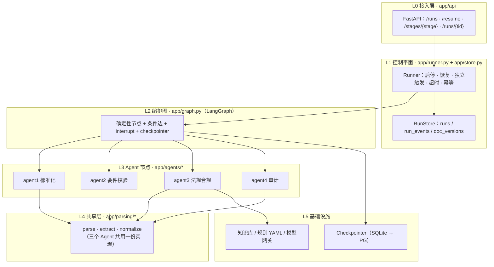
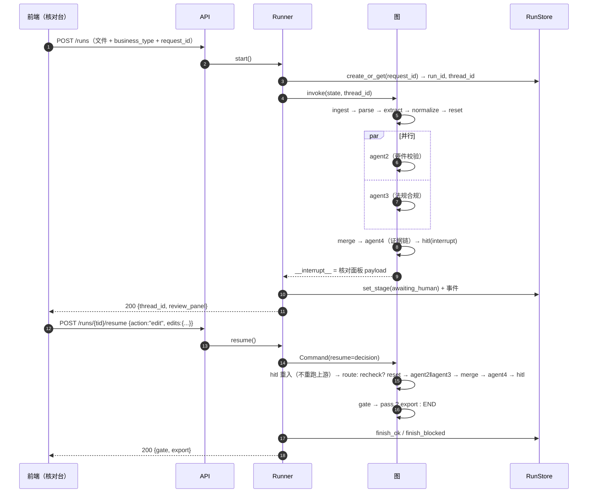

# Orchestrator Agent Layer 实施设计

> 产品：AI 跨境贸易协作工具（Trade Document Collaboration Portal）
> 范围：编排层（Orchestrator）—— 从一次"用户提交材料"到"闸门放行/拦截"的全部调度、状态、留痕、暂停、重跑、导出
> 目标：**M0 结束即可跑通全图并演示**，M3 结束可接产品的控制平面（Job 表 / fencing / 复核凭据）
> 编写基线：2026-11-08

---

## 0. 阅读指引与覆盖关系

本文件不是又一份"方案讨论"，而是**可直接照抄开工的实施文档**：每一节都给出最终文件路径、完整代码、验收断言。

它在既有文档体系中的位置：

| 文档 | 位置 | 本文件与它的关系 |
|---|---|---|
| 《Orchestrator Agent 实施方案》 | `Implements_doc/Orchestrator_Agent_实施方案.md` | **产品级控制平面**（TaskEnvelope / TaskStatus×TaskStage / fencing / PG Job 表 / Outbox）。本文件**不重写它**，只负责把它落到"跨境贸易单据协同"这个具体业务上，并给出 M3 的接入点（见 §19） |
| `poc-skeleton`（OpenSpec change） | `projects/smart-edit/openspec/changes/poc-skeleton/` | **契约真相源**（`EditState` / `Finding` / `StageReport` / `TrailEntry` / 主图）。本文件 §3 的 `app/state.py` 必须与它逐字段一致；不一致以 change 的 `design.md` 为准 |
| `orchestration` / `agent-contract` spec | 同上 `specs/` | 本文件 §4/§9/§10/§11 的每条代码都对应其中一条 Requirement，§18 给出任务映射 |
| 《TradeAI 多智能体方案》 | `design/TradeAI_Multi_Agent_Solution.md` | 定义"控制平面 vs 推理平面"的信任边界。本文件 §1.2 的"0 次模型调用 / 无写入权"即该边界的落地 |

**阅读顺序建议**

1. 只看结论：§1、§2、§18
2. 要动手写代码：§3 → §4 → §5 → §6 → §7（严格按此顺序，后一节依赖前一节）
3. 要接自己的 Agent：§8 + §2.3 读写矩阵 + 附录 A 冻结级别
4. 要做产品化：§12 → §19

---

## 1. 边界：这一层做什么、不做什么

### 1.1 做什么

| 职责 | 具体内容 | 对应代码 |
|---|---|---|
| 状态唯一通道 | 所有节点只通过 `EditState` 交接，禁止自由文本传递 | §3 `app/state.py` |
| 顺序与并行 | `ingest → parse → extract → normalize → reset → (agent2 ‖ agent3) → merge → agent4 → hitl → gate → export` | §7 `app/graph.py` |
| 阶段记账 | 每个阶段写 `StageReport`，使"查过没问题"与"没检查"可区分 | §4 `app/stages.py` |
| 留痕 | 任何对原文的自由操作写 `TrailEntry`，越界操作可被查出 | §5 `app/trail.py` |
| 前置校验 | Agent 声明前置阶段/前置键，缺失时**结构化拒绝**，不返回空结果 | §4.3 `require()` |
| 独立触发 | 只跑某个 Agent 时自动补跑前置阶段，并判定 `input_mode` | §11 |
| 暂停与恢复 | 发布前 `interrupt()` 暂停，同 `thread_id` 恢复且不重跑上游 | §9 |
| 受控重跑 | 只由可判定的 `fail` 触发，带定位与期望，有预算上限 | §10 |
| 闸门判定 | 确定性五分判定，不确定一律 `blocked` | §6.4 |
| 运行可观测 | 按 `thread_id` 回放节点顺序、阶段、留痕 | §12.3 / §15 |

### 1.2 不做什么（并且要写进 code review checklist）

1. **编排层自己不做任何模型调用（0 次）**。模型调用只发生在 `extract`（唯一抽取入口）与各 Agent 内部。编排层的路由是确定性的——否则失败原因无法归因。
2. **编排层无业务写入权**。它只产出 `gate` 判定与标准文件；真正写入业务单据由宿主 Command 层执行，生产环境导出服务必须**独立复核一次**（见 §19.4 `ReviewReceipt`）。
3. **不实现业务规则**。缺什么字段、期限上限多少、什么算阻断，全在 `requirements.yaml` / `fields.yaml`，由 Agent 2 / Agent 4 读取。编排层只读 `blocking` 与 `verdict` 判定结果。
4. **不做跨单据一致性校验**（发票 500k vs 合同 480k）：`fields` 键唯一，属契约级改动，POC 明确不做。
5. **不做多语言/多法域路由**：Agent 3 内部处理，编排层只透传 `coverage`。
6. **不做分布式调度**（M0-M2）。单进程 + SQLite checkpointer 足够；M3 换 PG Job 表（§19）。

### 1.3 一条贯穿全层的判断标准

> 任何"看起来成功了"的路径，都必须能在数据结构上被证伪。

因此：
- 空 `findings` 不等于通过 → 必须配 `StageReport(status="done", produced=0)`
- `score` 低不等于失败 → **分数永不参与判定**
- `gate=pass` 不等于已发布 → 还要导出服务复核
- 阶段被跳过不等于无问题 → `gate` 遇到 `status != "done"` 直接 `blocked`

---

## 2. 架构与运行时

### 2.1 分层



**关键不变式**：L2 只调用 L3；L3 只调用 L4 与自己的规则文件；**L3 之间不得互相调用**（否则并行分支变成隐式串行，且无法独立触发）。

### 2.2 一次完整运行（含暂停与重跑）



### 2.3 职责矩阵：谁写哪个 state 键

> 这张表是**并行安全的唯一依据**。加新键前先在这里登记，否则并行分支会静默覆盖。

| state 键 | 写入者 | reducer | 读取者 |
|---|---|---|---|
| `run_id` | ingest | 无 | 全体 |
| `files` | ingest | 无 | parse / agent3(raw) |
| `business_type` | **normalize**（唯一写入者；ingest 只透传） | 无 | agent2 / agent3 / gate |
| `docs` | parse（共享层） | 无 | extract / agent3 / agent4 |
| `fields` | normalize（共享层） | 无 | agent2 / agent3 / gate / hitl |
| `extra_fields` | normalize（共享层） | 无 | hitl |
| `_candidates` | extract 写 / normalize 清 | 无 | normalize（**临时通道，不进契约**） |
| `findings` | agent1 / agent2 / agent3 | **add** | merge / agent4 / gate / hitl |
| `legal` | agent3 | 无 | agent4 / gate / hitl |
| `retrieved` | agent3 | 无 | agent4 |
| `trail` | 全体 | **add** | agent4 / 回放 |
| `stages` | 全体 | **add** | gate / 独立触发 / 回放 |
| `verification` | agent4 | 无 | gate / hitl |
| `gate` | gate | 无 | export |
| `export` | export | 无 | API |
| `recheck` / `recheck_count` | hitl | 无 | route_after_hitl |
| `repair_count` | repair | 无 | route_after_verifier |
| `requested_stages` | 控制平面写入初始 state | 无 | 独立触发 |

`agent2` 与 `agent3` 在**同一超级步并行**，两者的写集交集只有 `findings` / `trail` / `stages` —— 恰好是三个带 reducer 的键。这不是巧合，是契约设计的结果：**任何新的并行写入键都必须先加 reducer 并三人同意**。

---

## 3. 契约层：`app/state.py`

> 规则：**改这个文件 = 改契约**，需三人同意并重跑 `pytest tests/test_contracts.py`。
> 三个不可违反的约束：① 子结构只增不改，新增字段必须可选；② 只有 `findings`/`trail`/`stages` 用 reducer；③ `【语义】` 注释与字段同等重要。

```python
# file: app/state.py
"""编排层契约。唯一状态通道。与 poc-skeleton/design.md 逐字段一致。"""
from __future__ import annotations

import operator
from typing import Annotated, Literal, NotRequired, TypedDict

try:  # langgraph >= 0.6 / 1.x
    from langgraph.types import Overwrite
except ImportError:  # pragma: no cover - 兼容旧版
    from langgraph.graph.state import Overwrite

# ---------------------------------------------------------------- 枚举常量
# 运行时用常量，避免各处手拼字符串（拼错不报错是这类项目最常见的静默 bug）
AGENT_IDS = ("agent1", "agent2", "agent3", "agent4")
STAGE_STATUS = ("done", "skipped", "partial", "failed")
FINDING_SOURCES = ("normalization", "business", "regulatory")
FINDING_KINDS = (
    "missing", "not_found", "invalid_value", "inconsistent",
    "policy_violation", "regulatory_risk", "trail_violation",
)
SEVERITIES = ("critical", "warn", "info")
TRAIL_OPS = ("read", "llm_call", "transform", "emit", "pass",
             "summarize", "rewrite", "drop")
OVERREACH_OPS = frozenset({"summarize", "rewrite", "drop"})   # 越界信号
FINDING_PREFIX = {"normalization": "N", "business": "B", "regulatory": "R"}

# 共享阶段（parse/extract/normalize）的归属 agent：契约里 StageReport.agent
# 只允许 agent1..4，共享阶段统一记在 agent1 名下，便于回放时归因。
SHARED_STAGE_OWNER = "agent1"

# ---------------------------------------------------------------- 解析产物
class ParsedBlock(TypedDict):
    file_id: str
    page: int | None
    bbox: list[float] | None          # [x0, y0, x1, y1]；纯文本为 None
    text: str                          # 原文，未做任何改写
    kind: Literal["paragraph", "table_cell", "header", "footer"]


class ParsedDoc(TypedDict):
    file_id: str
    filename: str
    mime: str
    form: Literal["pdf_text", "pdf_form", "email", "plain_text"]
    blocks: list[ParsedBlock]
    full_text: str                     # blocks 按序拼接，Agent 3 直接消费
    errors: list[str]                  # 解析失败原因；非空时该文件不参与后续
    # 【语义】新增可选：用于"文件未变化则复用 docs"的判定（接缝二）
    sha256: NotRequired[str | None]


# ---------------------------------------------------------------- 出处
class Source(TypedDict):
    file_id: str
    page: int | None
    bbox: list[float] | None
    span: str                          # 【语义】最小可定位片段，不含"申请人："之类 label
    form_label: str | None             # 表单栏目名；自由文本恒为 None


# ---------------------------------------------------------------- 字段值
class FieldValue(TypedDict):
    key: str                           # 来自 fields.yaml
    value: str | None                  # 【语义】规范化后的值，大小写与拼写照原文
    status: Literal["extracted", "inferred", "missing"]
    confirmed: bool                     # 用户是否已在核对台确认
    edited_by_user: bool               # 用户是否手工改过值
    source: Source | None
    normalized_from: str | None        # 规范化前的原值，原样保留
    label: str | None                  # 原文中该字段的原始称呼
    doc_type: str | None               # invoice / contract / bl / application_form …
    notes: list[str]                   # 歧义、截断等说明，如 "date_ambiguous"（空为 []）


# ---------------------------------------------------------------- 审查结论
class Finding(TypedDict):
    id: str                            # N-001 / B-001 / R-001（各 Agent 内自增）
    source: Literal["normalization", "business", "regulatory"]
    kind: Literal[
        "missing", "not_found", "invalid_value", "inconsistent",
        "policy_violation", "regulatory_risk", "trail_violation",
    ]
    rule_id: str
    severity: Literal["critical", "warn", "info"]
    blocking: bool                     # 由 requirements.yaml 规则声明，不由 severity 推导
    resolved: bool                     # 新产出恒为 False；只有 hitl 可改
    resolution: str | None             # 新产出恒为 None
    field_keys: list[str]              # 【语义】无关联字段时为空列表，不是 None
    message: str
    evidence: str | None               # 必须是原文片段或字段值，不得为空泛描述
    citation: str | None               # chunk_id，仅 regulatory
    suggestion: str | None
    # 【语义】新增可选字段（契约只增不改，故必须可选）：
    #   confidence   —— 同类判定冲突时降权，仅用于展示与排序，不参与阻断
    #   needs_review —— 双判冲突等需要人工看一眼的条目
    confidence: NotRequired[float]
    needs_review: NotRequired[bool]
```

```python
# file: app/state.py（续）

# ---------------------------------------------------------------- Agent 3 输出
class Claim(TypedDict):
    text: str
    chunk_id: str | None               # None = 依据不足
    kind: Literal["applicable_rule", "risk", "condition"]
    support: Literal["supported", "insufficient"]


class ApplicableRule(TypedDict):
    rule_id: str
    title: str
    version: str
    effective_from: str | None
    chunk_id: str


class LegalOpinion(TypedDict):
    input_mode: Literal["enriched", "raw"]   # raw = 没跑 extract，下游不得做 conflict_check
    applicable_rules: list[ApplicableRule]
    claims: list[Claim]
    coverage: dict                     # {jurisdictions, standards, unavailable,
                                       #  business_type_uncertain, notes}
    escalate_to_human: bool
    summary: str


# ---------------------------------------------------------------- 阶段记录
class StageReport(TypedDict):
    stage: str                         # "parse" / "agent2.check_rules" …
    agent: Literal["agent1", "agent2", "agent3", "agent4"]
    status: Literal["done", "skipped", "partial", "failed"]
    reason: str | None                 # skipped/failed/partial 必填
    produced: int                      # 本次产出的条目数
    model_calls: int

# 【语义】produced=0 且 status="done"   = 检查过，没问题
#        produced=0 且 status!="done"  = 没检查（下游不得推断为"未发现问题"）


# ---------------------------------------------------------------- 操作日志
class TrailEntry(TypedDict):
    id: str                            # "agent1.extract#003"，agent 内自增，避免并行冲突
    agent: Literal["agent1", "agent2", "agent3", "agent4"]
    stage: str
    op: Literal[
        "read", "llm_call", "transform", "emit", "pass",
        "summarize", "rewrite", "drop",       # 三个越界值：出现即说明改动了事实
    ]
    before: str | None                 # 原文片段
    after: str | None                  # 产出值
    ref: str | None                    # "file_id/page/span" 或上一条 entry 的 id
    model: str | None
    prompt_hash: str | None
    detail: dict


# ---------------------------------------------------------------- Agent 4 输出
class Issue(TypedDict):
    checker: str
    level: Literal["fail", "warn", "info"]
    finding_ids: list[str]
    detail: str
    location: str | None               # 字段键 / chunk_id / trail entry id


class VerificationReport(TypedDict):
    checks: list[Issue]
    verdict: Literal["pass", "warn", "fail"]
    credibility: dict                  # 全部可复算，见 agent-audit spec
    score: float | None                # 展示用，MUST NOT 参与判定或重跑


# ---------------------------------------------------------------- 输入/检索
class SourceFile(TypedDict):
    file_id: str
    filename: str
    mime: str
    path: str                          # 本地路径或对象存储 key
    sha256: str                        # 复用判定与去重


class Chunk(TypedDict):
    chunk_id: str
    doc_id: str                        # 知识库文档 ID（不是业务材料 file_id）
    title: str
    text: str
    score: float
    source_type: Literal["kb", "web"]


# ---------------------------------------------------------------- 主状态
class EditState(TypedDict, total=False):
    run_id: str
    files: list[SourceFile]
    business_type: str | None

    docs: list[ParsedDoc]                                  # 覆盖，parse 产出
    fields: dict[str, FieldValue]                          # 覆盖
    extra_fields: dict[str, FieldValue]                    # 覆盖，fields.yaml 未定义的
    findings: Annotated[list[Finding], operator.add]        # 仅此键有 reducer
    legal: LegalOpinion | None                             # 覆盖
    retrieved: list[Chunk]                                 # 覆盖

    trail: Annotated[list[TrailEntry], operator.add]        # 追加
    stages: Annotated[list[StageReport], operator.add]      # 追加

    verification: VerificationReport | None                 # 覆盖
    gate: dict | None                                      # 覆盖
    export: dict | None                                    # 覆盖

    recheck_count: int                                     # 用户改字段触发的重跑
    repair_count: int                                      # Agent 4 触发的重跑
    recheck: bool
    requested_stages: list[str]                            # 独立触发时声明要跑到哪
```

### 3.1 两个环境适配点（动手前先确认）

1. **`Overwrite` 的导入路径**在不同 LangGraph 版本里变过。代码里给了 `try/except` 双路径；如果两个都不存在，**不要**自己实现一个同名类（语义会错），而是按当前版本官方文档修正导入位置，并在 PR 里注明版本号。
2. **`NotRequired` 需要 Python ≥ 3.11**（`typing.NotRequired`）。若目标环境是 3.10，改用 `typing_extensions.NotRequired`，其余不动。

### 3.2 设计稿不一致的最终裁决（code review 依据）

| 问题 | 现象 | 裁决 | 理由 |
|---|---|---|---|
| `parse_errors` 无处存放 | `agent-normalize/design.md` 让 `parse()` 返回 `parse_errors`，但 `EditState` 没有这个键 | **不新增 state 键**：错误写进 `ParsedDoc.errors`，另写 `StageReport(status="partial"/"failed", reason=…)` | 加键要三人同意，且会在 `reset` 循环里叠加；`ParsedDoc.errors` 已在冻结契约里，语义相同 |
| `needs_review` / `confidence` 缺失 | `agent-verify` 要求"双判冲突时降低 confidence 并加标记"，但 `Finding` 无此字段 | 在 `Finding` 上加**可选**字段 `NotRequired[float]` / `NotRequired[bool]` | 契约规定"子结构只增不改，新增必须可选"，向后兼容，fixture 无需改写 |
| `retrieved_by_finding` 未定义 | `agent-audit/design.md` 伪码读 `state["retrieved_by_finding"]` | **不新增键**：Agent 4 内部由 `findings[].citation` 现算 | 派生数据不入 state，避免两处真相、两个写入方 |
| `missing` 永远不出现 | 三分类有 `extracted/inferred/missing`，但 normalize 只遍历候选 → 没有候选的字段在 `fields` 里根本不存在 | **必须补占位**：`fields.yaml` 中 `required: true` 且无候选 → `status="missing"`、`value=null`、`notes=["not_in_source"]`，并记一条 `op="pass"` | 否则 `missing` 是死枚举；Agent 2 与闸门无法区分"原文没写"与"没抽出来"；核对台也没法向客户解释这一栏 |
| `max_length` 归属不清 | `fields.yaml` 把 `max_length` 放顶层，`stage` 里只写 `[precision, thousands]` → 截断无人认领 | `max_length` / `charset` / `precision` / `thousands` / `date_order` **一律归 `stage.normalize`**（A）；`required` / `positive` 归 `stage.validate`（B），但 A 可**读** `required` 用于补占位 | 判定方法固定为："违反了是'系统没读懂'还是'业务不允许'"；`required` 只读不判，阻断结论仍由 B 出 `Finding` |
| `business_type` 有两个写入方 | §2.3 原本写 `ingest` 写、`agent-contract` 要求"只由 Agent 1 写" | **ingest 只透传，`normalize` 是唯一写入者** | 谁写的必须唯一可查，否则 Agent 4 无法判断该值出处；Agent 3 在 `raw` 模式推断的类型只写 `legal.coverage` |

> 六条决议都要回写一行到 `poc-skeleton/design.md` 的备注区，否则下一次评审会重新吵一遍（见 §20.1）。

---

## 4. 阶段登记与前置校验：`app/stages.py`

这是**唯一允许声明"我依赖什么"的地方**。任何 Agent 想被独立触发，就必须在这里登记，否则编排层不认。

### 4.1 代码

```python
# file: app/stages.py
"""StageReport 读写 + Agent 前置声明 + 结构化拒绝。"""
from __future__ import annotations

from dataclasses import dataclass, field
from typing import Iterable

from app.state import SHARED_STAGE_OWNER, STAGE_STATUS, StageReport

# ---------------------------------------------------------------- Agent 声明
@dataclass(frozen=True)
class AgentSpec:
    agent_id: str                     # agent1 .. agent4
    requires_stages: tuple[str, ...]  # 必须先 done 的阶段
    requires_keys: tuple[str, ...]    # 必须非空的 state 键
    produces: tuple[str, ...]         # 该 agent 会写哪些键（重跑前据此清理）
    standalone: bool                  # 能否单独触发
    cleared_on_rerun: tuple[str, ...] = field(default=())   # 重跑前要清空的键


AGENT_SPECS: dict[str, AgentSpec] = {
    "agent1": AgentSpec(
        agent_id="agent1",
        requires_stages=(),
        requires_keys=("files",),
        # findings：Agent 1 会产 N- / invalid_value（值截断）。漏了它，clear_previous_outputs
        # 与回放归因都会把 N- 条目当成"别人的产出"。
        produces=("docs", "fields", "extra_fields", "business_type", "findings"),
        standalone=True,
        cleared_on_rerun=("docs", "fields", "extra_fields"),
    ),
    "agent2": AgentSpec(
        agent_id="agent2",
        requires_stages=("normalize",),
        requires_keys=("fields", "business_type"),
        produces=("findings", "stages", "trail"),
        standalone=True,
    ),
    "agent3": AgentSpec(
        agent_id="agent3",
        requires_stages=("parse",),          # raw 模式只需 parse
        requires_keys=("files",),            # enriched 模式在运行时再收紧
        produces=("findings", "legal", "retrieved", "stages", "trail"),
        standalone=True,
    ),
    "agent4": AgentSpec(
        agent_id="agent4",
        requires_stages=("merge",),
        requires_keys=("findings", "stages"),
        produces=("verification", "stages", "trail"),
        standalone=False,                    # 校验对象是别人的输出，不可单独触发
    ),
}

# 独立触发 agent3 且声明 raw 时，只补跑这些阶段
RAW_BACKFILL: tuple[str, ...] = ("parse",)
# enriched 模式下的完整前置链
ENRICHED_CHAIN: tuple[str, ...] = ("parse", "extract", "normalize")

# ---------------------------------------------------------------- 阶段目标
# 【为什么单独一张表】parse/extract/normalize 不是 Agent（StageReport.agent 只允许
# agent1..4），但**必须能作为独立触发的目标**，否则"只跑解析"在 API 上直接
# 409 unknown_stage，agent-normalize 的三档 Scenario 无法验收。
# 用同一张 AGENT_SPECS 只是为了让 require()/plan_standalone() 查一次表：
STAGE_TARGETS: dict[str, AgentSpec] = {
    "parse": AgentSpec(
        agent_id="agent1", requires_stages=(), requires_keys=("files",),
        produces=("docs",), standalone=True),
    "extract": AgentSpec(
        agent_id="agent1", requires_stages=("parse",), requires_keys=("docs",),
        produces=("_candidates",), standalone=True),
    "normalize": AgentSpec(
        agent_id="agent1", requires_stages=("parse", "extract"),
        requires_keys=("_candidates",),
        produces=("fields", "extra_fields", "business_type", "findings"),
        standalone=True,
        cleared_on_rerun=("fields", "extra_fields", "business_type")),
}
AGENT_SPECS.update(STAGE_TARGETS)
```

### 4.2 读写与拒绝

```python
# file: app/stages.py（续）

def stage_report(stage: str, agent: str, status: str, *,
                 reason: str | None = None, produced: int = 0,
                 model_calls: int = 0) -> StageReport:
    """构造一条 StageReport。skipped/failed/partial 必须给 reason。"""
    if status not in STAGE_STATUS:
        raise ValueError(f"非法 status: {status}")
    if status != "done" and not reason:
        raise ValueError(f"status={status} 必须给出 reason")
    return StageReport(stage=stage, agent=agent, status=status, reason=reason,
                       produced=produced, model_calls=model_calls)


def add_stage(stage: str, agent: str, status: str, **kw) -> dict:
    """节点返回值助手：{"stages": [report]}，由 reducer 追加。"""
    return {"stages": [stage_report(stage, agent, status, **kw)]}


def latest_stage(state: dict, stage: str) -> StageReport | None:
    """取该阶段**最后一条**记录（重跑后旧记录仍在 trail 里，最新的一条才是真相）。"""
    for rep in reversed(state.get("stages", [])):
        if rep["stage"] == stage:
            return rep
    return None


def stage_is_done(state: dict, stage: str) -> bool:
    rep = latest_stage(state, stage)
    return rep is not None and rep["status"] == "done"


def stages_done(state: dict) -> set[str]:
    """所有**最后一次**状态为 done 的阶段名。"""
    seen: dict[str, str] = {}
    for rep in state.get("stages", []):
        seen[rep["stage"]] = rep["status"]
    return {s for s, st in seen.items() if st == "done"}


def key_is_present(state: dict, key: str) -> bool:
    val = state.get(key)
    if val is None:
        return False
    if isinstance(val, (list, dict, str)):
        return len(val) > 0
    return True


def refusal(agent_id: str, missing: Iterable[str], *, reason: str = "") -> dict:
    """统一拒绝格式（agent-contract spec: Requirement 前置声明 / Scenario 拒绝格式统一）。"""
    return {"refused": True, "missing": list(missing), "agent": agent_id,
            "reason": reason or "前置条件不满足"}


def require(state: dict, agent_id: str, *,
            need_stages: Iterable[str] | None = None,
            need_keys: Iterable[str] | None = None) -> dict | None:
    """前置校验。返回 None 表示通过，否则返回 refusal 结构（调用方必须原样抛出）。"""
    spec = AGENT_SPECS[agent_id]
    stages = tuple(need_stages if need_stages is not None else spec.requires_stages)
    keys = tuple(need_keys if need_keys is not None else spec.requires_keys)

    done = stages_done(state)
    missing: list[str] = [f"stage:{s}" for s in stages if s not in done]
    missing += [f"key:{k}" for k in keys if not key_is_present(state, k)]

    # Agent 3 enriched 模式额外要求字段表
    if agent_id == "agent3" and "extract" in done:
        for k in ("fields", "business_type"):
            if not key_is_present(state, k):
                missing.append(f"key:{k}")

    if missing:
        return refusal(agent_id, missing)
    return None


def resolve_input_mode(state: dict) -> str:
    """Agent 3 的 input_mode：跑过 extract/normalize 才是 enriched。

    显式判定而不是靠 `legal is None` 推断 —— None 有"没跑/失败/不适用"三种含义。
    """
    return "enriched" if stage_is_done(state, "normalize") else "raw"
```

### 4.3 三条必须遵守的落地细节

1. **拒绝 ≠ 空结果**。拒绝时返回 `{"refused": true, "missing": [...]}`，即使走图内路径也要写一条 `StageReport(status="failed", reason=…)`；**绝不返回 `findings=[]`**，否则前端会显示"未发现问题"。
2. **失败时更新的阶段报告是追加不是覆盖**。重跑后 `stages` 里会有多条同名记录，`latest_stage()` 取最后一条；这也让"用户改了字段之后第二次跑失败了"这件事在回放里看得见。
3. **`normalize` 未 done 时 Agent 2 必须拒绝**，不能"只按 docs 猜" —— 契约允许 Agent 2 在 `docs` 缺失时降级，但**不允许**在 `fields` 缺失时输出零 findings。

---

## 5. 操作日志：`app/trail.py`

> 契约原文：**任何 Agent 对原文的自由操作（抽取、转换、概括、丢弃）都必须写 `TrailEntry`。**
> 这是"只改形式不改事实"唯一可执行的落地方式；否则该约束只是口号。

```python
# file: app/trail.py
"""操作日志。ID 在 agent 内自增，避免并行分支抢全局计数器。"""
from __future__ import annotations

import hashlib

from app.state import OVERREACH_OPS, TrailEntry


def _prefix(agent: str, stage: str) -> str:
    return f"{agent}.{stage}#"


def next_entry_id(state: dict, agent: str, stage: str) -> str:
    """扫描已有 trail，取该 agent.stage 前缀的最大序号 +1。

    【为什么不用全局计数器】agent2 与 agent3 在同一超级步并行，任何全局自增都要加锁；
    按前缀分段后两条分支互不影响，且 ID 本身带有归因信息。
    """
    prefix = _prefix(agent, stage)
    n = 0
    for entry in state.get("trail", []):
        eid = entry.get("id", "")
        if eid.startswith(prefix):
            try:
                n = max(n, int(eid[len(prefix):]))
            except ValueError:
                continue
    return f"{prefix}{n + 1:03d}"


def prompt_hash(text: str) -> str:
    """prompt 指纹：只记哈希不记全文，既能复现又能控体积。"""
    return hashlib.sha256(text.encode("utf-8")).hexdigest()[:12]


def record(state: dict, *, agent: str, stage: str, op: str,
           before: str | None = None, after: str | None = None,
           ref: str | None = None, model: str | None = None,
           prompt_hash_: str | None = None, detail: dict | None = None) -> dict:
    """返回 {"trail": [entry]}，由 reducer 追加。

    用法（节点内）：
        return {**record(state, agent="agent1", stage="extract", op="llm_call",
                         model="gpt-4o", prompt_hash_="a1b2", detail={"candidates": 14}),
                **add_stage("extract", "agent1", "done", produced=14, model_calls=1)}
    """
    entry = TrailEntry(
        id=next_entry_id(state, agent, stage),
        agent=agent, stage=stage, op=op,
        before=before, after=after, ref=ref,
        model=model, prompt_hash=prompt_hash_,
        detail=detail or {},
    )
    return {"trail": [entry]}


def record_many(state: dict, entries: list[dict]) -> dict:
    """纯函数返回一批 entry（如 extract() 的回执）时，一次写回。

    【为什么不传 state 进共享层】共享层必须是纯函数才能无图单测；
    让 extract() 把要记的 entry 作为返回值带出来，由节点合并写回。
    """
    out: list[dict] = []
    for raw in entries:
        out.append(TrailEntry(
            id=next_entry_id({"trail": state.get("trail", []) + out}, raw["agent"], raw["stage"]),
            agent=raw["agent"], stage=raw["stage"], op=raw["op"],
            before=raw.get("before"), after=raw.get("after"), ref=raw.get("ref"),
            model=raw.get("model"), prompt_hash=raw.get("prompt_hash"),
            detail=raw.get("detail") or {},
        ))
    return {"trail": out}


def overreach_entries(state: dict) -> list[TrailEntry]:
    """越界操作清单。Agent 4 的 trail_integrity 检查器直接消费。"""
    return [e for e in state.get("trail", []) if e.get("op") in OVERREACH_OPS]
```

### 5.1 三种 op 的判定口径（写进 prompt 与代码评审）

| 情形 | 正确记法 | 错误记法 | 为什么 |
|---|---|---|---|
| 输入 50 页，只抽与保函相关的 6 页 | `op="pass"` + `detail.reason="仅处理与保函相关页：p1-6"` | `op="drop"` | `drop` 是越界信号，会让 Agent 4 报 fail；合理跳过必须说明理由 |
| 把 `2026-11-08` 改写成 `Nov 8, 2026` | `op="transform"`，`before`/`after` 都记 | `op="rewrite"` | `rewrite` 表示改动事实，`transform` 表示只改形式 |
| 表格跨页，把两段拼成一个值 | `op="transform"` + `detail={"cross_page": true}` + `FieldValue.notes += ["merged_across_pages"]` | 静默合并 | 拼接是否会改变事实需要人工判断，必须留证据给核对台 |

---

## 6. 确定性节点：`app/nodes/`

> 这一节的 8 个节点**不含任何模型调用**（`extract` 除外，它是唯一抽取入口，属于共享层而非编排层）。
> 目录与 `poc-skeleton/design.md` 一致；为阅读连贯，代码按功能分组贴出，文件边界见 `# file:` 注释。

### 6.1 `ingest`：把输入收敛成统一结构

```python
# file: app/nodes/ingest.py
from __future__ import annotations

import hashlib
import os
import uuid

from app.stages import add_stage
from app.state import SourceFile, SHARED_STAGE_OWNER
from app.trail import record

MIME_BY_EXT = {
    ".pdf": "application/pdf",
    ".eml": "message/rfc822",
    ".txt": "text/plain",
    ".md": "text/markdown",
}


def _sha256_file(path: str) -> str:
    h = hashlib.sha256()
    with open(path, "rb") as fh:
        for chunk in iter(lambda: fh.read(1 << 20), b""):
            h.update(chunk)
    return h.hexdigest()


def ingest(state: dict) -> dict:
    """接收文件或文本 → run_id / file_id / sha256。

    【为什么 run_id 在 ingest 里兜底生成】独立触发时状态由调用方给出，
    这里必须幂等：已存在则沿用，绝不重新生成（否则重跑会拆成两条运行记录）。
    """
    run_id = state.get("run_id") or f"RUN-{uuid.uuid4().hex[:12]}"
    files: list[SourceFile] = []

    for raw in state.get("files", []):
        path = raw.get("path", "")
        files.append(SourceFile(
            file_id=raw.get("file_id") or f"F-{uuid.uuid4().hex[:8]}",
            filename=raw.get("filename") or os.path.basename(path),
            mime=raw.get("mime") or MIME_BY_EXT.get(os.path.splitext(path)[1].lower(),
                                                    "application/octet-stream"),
            path=path,
            sha256=raw.get("sha256") or (_sha256_file(path) if path else ""),
        ))

    if not files:
        # 空输入是"没得检查"，不是"检查通过"
        return {
            **record(state, agent=SHARED_STAGE_OWNER, stage="ingest", op="pass",
                     detail={"reason": "未提供任何文件"}),
            **add_stage("ingest", SHARED_STAGE_OWNER, "failed",
                        reason="未提供任何文件"),
            "run_id": run_id,
        }

    return {
        "run_id": run_id,
        "files": files,
        "business_type": state.get("business_type"),
        "recheck_count": state.get("recheck_count", 0),
        "repair_count": state.get("repair_count", 0),
        "recheck": state.get("recheck", False),
        **record(state, agent=SHARED_STAGE_OWNER, stage="ingest", op="read",
                 after=f"{len(files)} files", detail={"file_ids": [f["file_id"] for f in files]}),
        **add_stage("ingest", SHARED_STAGE_OWNER, "done", produced=len(files)),
    }
```

### 6.2 `parse`：共享层 + 复用判定

```python
# file: app/parsing/parse.py  —— 共享层，纯函数，三个 Agent 共用同一份
from __future__ import annotations

import email
from email import policy
from pathlib import Path

import fitz  # pymupdf

from app.state import ParsedBlock, ParsedDoc, SourceFile


def _detect_form(path: Path, mime: str) -> str:
    if mime == "message/rfc822" or path.suffix.lower() == ".eml":
        return "email"
    if mime == "application/pdf" or path.suffix.lower() == ".pdf":
        return "pdf_text"
    return "plain_text"


def parse_file(src: SourceFile) -> ParsedDoc:
    """单文件解析。**任何失败都写 errors，不抛异常**（否则一个坏文件会毁掉整次运行）。"""
    path = Path(src["path"])
    form = _detect_form(path, src["mime"])
    blocks: list[ParsedBlock] = []
    errors: list[str] = []

    try:
        if form in ("pdf_text", "pdf_form"):
            with fitz.open(path) as doc:
                for pno, page in enumerate(doc, start=1):
                    text = page.get_text("text")
                    if not text.strip():
                        continue  # 空白页不产生 block
                    for para in text.split("\n\n"):
                        if para.strip():
                            blocks.append(ParsedBlock(
                                file_id=src["file_id"], page=pno, bbox=None,
                                text=para.strip(), kind="paragraph"))
                if not blocks:
                    errors.append("no_text_layer: 疑似扫描件，需 OCR（POC 不支持）")
        elif form == "email":
            msg = email.message_from_bytes(path.read_bytes(), policy=policy.default)
            body = msg.get_body(preferencelist=("plain",))
            text = (body.get_content() if body else "") or ""
            blocks.append(ParsedBlock(file_id=src["file_id"], page=None, bbox=None,
                                      text=text.strip(), kind="paragraph"))
        else:
            text = path.read_text(encoding="utf-8", errors="replace")
            for para in text.split("\n\n"):
                if para.strip():
                    blocks.append(ParsedBlock(file_id=src["file_id"], page=None, bbox=None,
                                              text=para.strip(), kind="paragraph"))
    except Exception as exc:                      # noqa: BLE001 —— 解析层必须兜住一切
        errors.append(f"parse_failed: {type(exc).__name__}: {exc}")

    return ParsedDoc(
        file_id=src["file_id"], filename=src["filename"], mime=src["mime"],
        form=form, blocks=blocks,
        full_text="\n".join(b["text"] for b in blocks),
        errors=errors, sha256=src.get("sha256"),
    )
```

```python
# file: app/nodes/parse.py
from __future__ import annotations

import asyncio

from app.parsing.parse import parse_file
from app.stages import add_stage
from app.state import SHARED_STAGE_OWNER
from app.trail import record

STAGE, AGENT = "parse", SHARED_STAGE_OWNER


def _docs_are_fresh(state: dict) -> bool:
    """docs 已存在且 files 的 sha256 集合完全一致 → 必须复用，不得重复解析。"""
    docs = state.get("docs") or []
    files = state.get("files") or []
    if not docs or not files:
        return False
    have = {d["file_id"]: d.get("sha256") for d in docs}
    want = {f["file_id"]: f["sha256"] for f in files}
    return have == want


async def parse_node(state: dict) -> dict:
    if _docs_are_fresh(state):
        # 【关键】复用要记 done，不能记 skipped。
        # 记 skipped 会让 require()/gate 认为"parse 没跑"，整条下游被误判为未完成。
        return {
            **record(state, agent=AGENT, stage=STAGE, op="pass",
                     detail={"reuse": True, "reason": "文件未变化，复用已有 docs"}),
            **add_stage(STAGE, AGENT, "done", produced=len(state["docs"]),
                        reason="reused: 文件 sha256 未变化"),
        }

    files = state.get("files") or []
    if not files:
        return {**record(state, agent=AGENT, stage=STAGE, op="pass",
                         detail={"reason": "无文件可解析"}),
                **add_stage(STAGE, AGENT, "failed", reason="无文件可解析")}

    # 单节点内并发解析：把并发收敛在节点内部，避免为 docs 引入 reducer
    docs = await asyncio.gather(*(asyncio.to_thread(parse_file, f) for f in files))

    ok = [d for d in docs if not d["errors"]]
    bad = [d for d in docs if d["errors"]]
    produced = sum(len(d["blocks"]) for d in ok)

    if not ok:
        status, reason = "failed", f"全部文件解析失败: {[d['file_id'] for d in bad]}"
    elif bad:
        status, reason = "partial", (f"{len(bad)}/{len(docs)} 个文件解析失败: "
                                     f"{[d['file_id'] for d in bad]}")
    else:
        status, reason = "done", None

    return {
        "docs": list(docs),
        # 跳过必须在留痕里说明理由（op=pass），不得静默
        **record(state, agent=AGENT, stage=STAGE, op="read",
                 after=f"{len(ok)} docs / {produced} blocks",
                 detail={"failed": [d["file_id"] for d in bad],
                         "reason": "解析失败的文件不参与后续抽取"}),
        **add_stage(STAGE, AGENT, status, produced=produced, reason=reason,
                    model_calls=0),
    }
```

> **两条容易被写错的规则**
> 1. **复用 ≠ 跳过**：`parse` 复用了旧 `docs`，阶段状态必须是 `done`，理由写进 `reason`。写 `skipped` 会让 `gate` 直接 `blocked`，用户看到"解析未完成"却找不到原因。
> 2. **部分失败 ≠ 全部失败**：`status="partial"` + `reason` 里列出失败文件。`gate` 会因为 `partial` 阻断，但核对台能显示"invoice.pdf 是扫描件，需补 PDF 文本层"—— 这才是可行动的信息。

### 6.3 `extract`：唯一模型入口，且共享层保持纯函数

```python
# file: app/parsing/extract.py  —— 共享层，纯函数
#
# 【为什么返回 trail 条目而不是直接写 state】
# 任务书要求"parse/extract/normalize 三个函数均为纯函数，可在无图状态下单测"，
# 但契约要求"抽取必留痕"。解法：纯函数把 entry 作为返回值带出来，
# 由节点用 record_many() 一次写回。既不破坏纯函数，也不漏留痕。
from __future__ import annotations

import json
from dataclasses import dataclass, field

from app.parsing.normalize import normalize_ws   # 与判定 / provenance_check 共用同一个函数
from app.state import ParsedDoc
from app.trail import prompt_hash

EXTRACT_PROMPT = """你是贸易单据字段抽取器。规则：
1. 只允许逐字复制原文片段作为 span，禁止改写、禁止拼接跨段落内容。
2. span 是最小可定位片段，不要包含"申请人："这类栏目标签。
3. value 保持原文大小写与拼写，不要纠正、不要转大写。
4. 找不到的字段不要猜、不要编造，直接不输出。
输出 JSON: {"candidates": [{"key","raw_value","span","label","confidence","doc_type"}]}
"""


@dataclass
class ExtractResult:
    candidates: list[dict] = field(default_factory=list)
    trail_entries: list[dict] = field(default_factory=list)
    model_calls: int = 0
    failed_batches: list[str] = field(default_factory=list)


def extract(docs: list[ParsedDoc], field_keys: list[str], *,
            llm, model: str = "gpt-4o", batch_chars: int = 12000) -> ExtractResult:
    """docs → 候选字段。长文档分批处理，每批记录处理范围。"""
    result = ExtractResult()
    ph = prompt_hash(EXTRACT_PROMPT)
    schema = json_schema_for_candidates()

    for doc in docs:
        if doc["errors"]:
            result.trail_entries.append({
                "agent": "agent1", "stage": "extract", "op": "pass",
                "ref": doc["file_id"],
                "detail": {"reason": "该文件解析失败，未抽取", "errors": doc["errors"]},
            })
            continue

        total = len(doc["full_text"])
        for index, (first, last) in enumerate(batches(doc, batch_chars)):
            batch = "\n".join(b["text"] for b in doc["blocks"][first:last])
            user = json.dumps({"fields": field_keys, "text": batch}, ensure_ascii=False)
            cands: list[dict] = []
            for attempt in (1, 2):           # 输出不合 schema 重试一次
                try:
                    raw = llm.with_structured_output(schema).invoke(
                        [("system", EXTRACT_PROMPT), ("user", user)])
                    cands = raw.get("candidates", []) if isinstance(raw, dict) else []
                    break
                except Exception as exc:      # noqa: BLE001
                    if attempt == 2:
                        result.failed_batches.append(f"{doc['file_id']}#{index}: {exc}")
            result.model_calls += 1

            for c in cands:
                span = c.get("span", "")
                # 【关键】page/bbox 由系统回原文定位，不信模型自报。
                # 恒为 None 的 page 会让核对台"跳回原文"永远落在第一页。
                page, bbox = locate_span(doc, span)
                c["doc_type"] = c.get("doc_type")
                c["_source"] = {"file_id": doc["file_id"], "page": page, "bbox": bbox,
                                "span": span, "form_label": None}
                result.candidates.append(c)

            oversize = (last - first == 1 and len(doc["blocks"][first]["text"]) > batch_chars)
            result.trail_entries.append({
                "agent": "agent1", "stage": "extract", "op": "llm_call",
                "ref": f"{doc['file_id']}#{index}",
                "model": model, "prompt_hash": ph,
                "detail": {"candidates": len(cands), "index": index,
                           "range": [first, last], "blocks": last - first,
                           "oversize_block": oversize, "total_chars": total},
            })
    return result


def batches(doc: ParsedDoc, batch_chars: int) -> list[tuple[int, int]]:
    """把 blocks 切成 [first, last) 区间。**不切断 block**。

    【为什么不按字符切】`full_text[start:start+n]` 会把 `USD 500K` 拆成两批，
    两批各产出一个错误候选，且这两个 span 在原文里都不连续 → 必然不可定位。
    那是"看起来抽到了"与"真能跳回原文"之间最贵的一次偷懒。
    """
    out: list[tuple[int, int]] = []
    start, size = 0, 0
    blocks = doc["blocks"]
    for i, b in enumerate(blocks):
        n = len(b["text"])
        if n > batch_chars:                  # 单块超预算：独占一批，并标记 oversize
            if i > start:
                out.append((start, i))
            out.append((i, i + 1))
            start, size = i + 1, 0
            continue
        if size + n > batch_chars and i > start:
            out.append((start, i))
            start, size = i, 0
        size += n
    if start < len(blocks):
        out.append((start, len(blocks)))
    return out


def locate_span(doc: ParsedDoc, span: str) -> tuple[int | None, list[float] | None]:
    """在 doc.blocks 里定位 span → (page, bbox)；找不到返回 (None, None)。

    只在**单一 block 内**命中才认：跨 block 的 span 属于"跨页/跨行拼接"，
    应在 normalize 里降级为 inferred，绝不在这里猜一个 bbox。
    """
    needle = normalize_ws(span)
    if not needle:
        return None, None
    for b in doc["blocks"]:
        if needle in normalize_ws(b["text"]):
            return b["page"], b["bbox"]
    return None, None


def json_schema_for_candidates() -> dict:
    """schemas/candidates.json 的内联版；正式实现从文件读，便于与三个 Agent 对齐。"""
    return {
        "title": "Candidates", "type": "object",
        "properties": {"candidates": {"type": "array", "items": {
            "type": "object",
            "properties": {
                "key": {"type": "string"}, "raw_value": {"type": "string"},
                "span": {"type": "string"}, "label": {"type": "string"},
                "confidence": {"type": "number"}, "doc_type": {"type": "string"},
            },
            "required": ["key", "raw_value", "span", "confidence"],
        }}},
        "required": ["candidates"],
    }
```

```python
# file: app/nodes/extract.py —— 图节点（薄壳，只做 I/O 与记账）
from __future__ import annotations

from app.parsing.extract import extract
from app.stages import add_stage
from app.state import SHARED_STAGE_OWNER
from app.trail import record_many

STAGE, AGENT = "extract", SHARED_STAGE_OWNER


def make_extract_node(llm, field_keys: list[str]):
    def node(state: dict) -> dict:
        docs = state.get("docs") or []
        if not docs:
            return {**record_many(state, []), **add_stage(STAGE, AGENT, "failed",
                                                          reason="无 docs 可抽取")}

        res = extract(docs, field_keys, llm=llm)
        status = "done" if not res.failed_batches else "partial"
        reason = None if status == "done" else f"{len(res.failed_batches)} 个批次抽取失败"

        return {
            # 候选字段不放 state（契约里没有这个键），交给 normalize 立即消费
            "_candidates": res.candidates,
            **record_many(state, res.trail_entries),
            **add_stage(STAGE, AGENT, status, produced=len(res.candidates),
                        reason=reason, model_calls=res.model_calls),
        }
    return node
```

> `_candidates` 带下划线前缀：它是**节点间的临时通道**，不进契约、不进 checkpoint 长期语义。`normalize` 消费后返回 `{"_candidates": Overwrite([])}` 清掉，避免被 checkpointer 长期保存。若三人认为这会污染状态，可改为闭包/handler 传递 —— 但那样 `extract` 与 `normalize` 就必须合并在一个节点内，权衡见 §20-4。

### 6.4 `normalize`：纯代码、无模型，且归一化函数必须全层唯一

```python
# file: app/parsing/normalize.py —— 共享层，纯函数
#
# 【为什么 normalize_ws 必须只有一份】
# Agent 1 用它判定 status="extracted" 是否成立，
# Agent 4 用（同一个函数）校验 span 能否在原文中定位。
# 两份实现一旦分叉，全部字段会被判为"span 无法定位"，且极难定位原因。
import re
import unicodedata
from dataclasses import dataclass, field
from decimal import Decimal, InvalidOperation

from app.state import FieldValue, ParsedDoc

# 与 agent-audit 的 provenance_check 共用同一常量，不得各写一个数
MAX_SPAN_LEN = 200

# 第 3 步：连字符（NFKC 不会处理 U+2010..U+2015 与 U+2212）
_DASHES = dict.fromkeys(
    map(ord, "\u2010\u2011\u2012\u2013\u2014\u2015\u2212\ufe58\ufe63\uff0d"), "-")
# 第 4 步：引号（弯引号、角引号、书名号）
_SINGLE = dict.fromkeys(map(ord, "\u2018\u2019\u201a\u201b\u2032\u2035"), "'")
_DOUBLE = dict.fromkeys(
    map(ord, "\u201c\u201d\u201e\u201f\u2033\u2036\u00ab\u00bb\u300c\u300d\u300e\u300f"), '"')
# 第 2 步：零宽与方向控制字符（PDF 抽取常见，肉眼不可见）
_INVISIBLE = re.compile("[\u200b-\u200f\u202a-\u202e\ufeff]")
# 第 5 步：所有 Unicode 空白（含 U+3000、U+00A0、换行）折叠成单个半角空格
_WS = re.compile(r"\s+")


def normalize_ws(text: str) -> str:
    """全层唯一的"是否指向同一段原文"判定基准。五步，**顺序不可调换**。

    1) NFKC：全角→半角、兼容字符→标准形（`：`→`:`、`（`→`(`、`１`→`1`）
    2) 剔除零宽 / 方向控制字符
    3) 连字符归一（`‐‑–—`、`−` → `-`）
    4) 引号归一（弯引号 / 角引号 / 书名号 → ASCII）
    5) 空白折叠 + strip（跨行 span 才能匹配）

    【明确不做】大小写折叠、去标点、同义词或单位换算。
    大小写差异意味着模型没有逐字复制，正应判为"不可定位"。
    """
    if not text:
        return ""
    s = unicodedata.normalize("NFKC", text)
    s = _INVISIBLE.sub("", s)
    s = s.translate(_DASHES).translate(_SINGLE).translate(_DOUBLE)
    return _WS.sub(" ", s).strip()


def span_locatable(src: dict, docs: list[ParsedDoc]) -> bool:
    """span 是否能在**它自己声明的那个文件**里定位。

    【为什么限定单一文件】provenance_check 是按 file_id 取全文比对的。
    若这里允许跨文件搜索，Agent 1 会标 extracted、Agent 4 判 fail —— 同一份数据两套结论。
    """
    if not src:
        return False
    text = {d["file_id"]: normalize_ws(d["full_text"]) for d in docs}.get(src.get("file_id", ""))
    needle = normalize_ws(src.get("span", ""))
    return bool(needle) and text is not None and needle in text


def normalize_value(key: str, raw: str, field_def: dict) -> tuple[str | None, list[str]]:
    """值规范化。返回 (规范值, notes)。**不改大小写拼写**，只做形式转换。"""
    notes: list[str] = []
    val = (raw or "").strip()
    typ = field_def.get("type", "string")

    if typ in ("amount", "decimal"):
        # 去币种前缀与千分位，再处理量级后缀（K/M/B）——`USD 500K` 必须得到 500000.00
        body = re.sub(r"[,\s]", "", re.sub(r"^[A-Za-z]{3}\s*", "", val))
        mult = Decimal(1)
        m = re.fullmatch(r"(-?\d+(?:\.\d+)?)([KMB])", body, flags=re.I)
        if m:
            body = m.group(1)
            mult = {"K": Decimal(1000), "M": Decimal(10 ** 6),
                    "B": Decimal(10 ** 9)}[m.group(2).upper()]
        try:
            # 【必须 Decimal】float 会把 0.1+0.2 变成 0.30000000000000004，
            # 那个数字出现在客户面前，比多写一行 Decimal 贵得多。
            amount = (Decimal(body) * mult).quantize(Decimal("0.01"))
        except (InvalidOperation, ValueError):
            notes.append("amount_not_numeric")
            return val, notes          # 保持原值，交给人看，不猜
        if mult != 1:
            notes.append("magnitude_expanded")   # 只改形式，不降级
        return str(amount), notes

    if typ == "integer":
        num = re.sub(r"\s*(DAYS?|MONTHS?|天|日|个月|%|USD|SGD)$", "", val, flags=re.I)
        num = re.sub(r"[,\s]", "", num)
        if re.fullmatch(r"-?\d+", num):
            if num != val:
                notes.append("unit_stripped")
            return num, notes
        notes.append("not_numeric")
        return val, notes

    if typ == "date":
        iso = _to_iso_date(val, field_def.get("date_order"))
        if iso is None:
            notes.append("date_ambiguous")
            return val, notes          # 保持原值，交给人看，不猜
        return iso, notes

    if typ == "currency":
        up = val.upper()
        if not re.fullmatch(r"[A-Z]{3}", up):
            notes.append("currency_not_iso4217")
        return up, notes

    if typ == "country":
        up = val.upper()
        if not re.fullmatch(r"[A-Z]{2}", up):
            notes.append("country_not_iso3166")
        return up, notes

    return val, notes                  # 名称 / 地址 / 条款：只 trim，不动大小写


def _to_iso_date(val: str, date_order: str | None) -> str | None:
    """`YYYY-MM-DD` / `YYYY/MM/DD` 直接转；`DMY`/`MDY` 才解释歧义日期；其余不猜。"""
    m = re.fullmatch(r"(\d{4})[-/](\d{1,2})[-/](\d{1,2})", val)
    if m:
        return f"{m.group(1)}-{int(m.group(2)):02d}-{int(m.group(3)):02d}"
    m = re.fullmatch(r"(\d{1,2})[-/](\d{1,2})[-/](\d{2}|\d{4})", val)
    if m and date_order in ("DMY", "MDY"):
        d, mo, y = m.groups()
        y = f"20{y}" if len(y) == 2 else y
        if date_order == "MDY":
            d, mo = mo, d
        day, month = int(d), int(mo)
        if 1 <= day <= 31 and 1 <= month <= 12:
            return f"{y}-{month:02d}-{day:02d}"
    return None


# 出现任一说明即降级为 inferred：它们都在说"值经过推断或已失真"
DOWNGRADING_NOTES = frozenset({
    "date_ambiguous", "amount_not_numeric", "currency_not_iso4217",
    "country_not_iso3166", "not_numeric", "span_oversize",
    "merged_across_pages", "value_truncated",
})


def classify(value: str | None, locatable: bool, notes: list[str]) -> str:
    """三分类。**只有这三条分支**，想加特例先改 spec。"""
    if value is None or value == "":
        return "missing"
    if locatable and not (DOWNGRADING_NOTES & set(notes)):
        return "extracted"
    return "inferred"


# 业务类型判定词表（顺序即优先级；改动需业务确认）
GUARANTEE_STRONG = ("URDG 758", "独立保函", "见索即付", "BANK GUARANTEE")
GUARANTEE_WEAK = ("保函", "GUARANTEE")
OTHER_TYPES = ("INVOICE", "发票", "CONTRACT", "合同", "BILL OF LADING", "提单")


def detect_business_type(docs: list[ParsedDoc]) -> tuple[str, dict]:
    """判定业务类型。返回 (值, detail)，detail 供节点写 pass 留痕。

    【MUST NOT 臆断】无依据时返回 unsupported，并说明是"类型不支持"还是"无依据"。
    """
    for doc in docs:
        upper = normalize_ws(doc["full_text"]).upper()
        for kw in GUARANTEE_STRONG:
            if kw.upper() in upper:
                return "guarantee", {"reason": "explicit_independence_clause",
                                     "evidence": kw, "file_id": doc["file_id"]}
        for kw in GUARANTEE_WEAK:
            if kw.upper() in upper:
                return "guarantee", {"reason": "explicit_keyword",
                                     "evidence": kw, "file_id": doc["file_id"]}
        for kw in OTHER_TYPES:
            if kw.upper() in upper:
                return "unsupported", {"reason": "business_type_not_supported",
                                       "evidence": kw, "file_id": doc["file_id"]}
    return "unsupported", {"reason": "no_evidence", "evidence": "", "file_id": None}


@dataclass
class NormalizeResult:
    """纯函数回执。findings 是**未编号草稿**，id 由节点分配（见 app/findings.py）。"""
    fields: dict[str, FieldValue] = field(default_factory=dict)
    extra_fields: dict[str, FieldValue] = field(default_factory=dict)
    findings: list[dict] = field(default_factory=list)
    trail_entries: list[dict] = field(default_factory=list)


def _apply_max_length(key: str, value: str | None, fdef: dict,
                      notes: list[str], findings: list[dict]) -> str | None:
    """超长截断 + 记 note + 出 Finding 草稿。三件事缺一不可。"""
    limit = fdef.get("max_length")
    if value is None or not limit or len(value) <= limit:
        return value
    original = value
    notes.append("value_truncated")
    findings.append({
        "source": "normalization", "kind": "invalid_value",
        "rule_id": f"F-{key}-max_length", "severity": "warn",
        "blocking": False,           # blocking 只能由 requirements.yaml 声明
        "resolved": False, "resolution": None,
        "field_keys": [key],
        "message": f"{key} 长度 {len(original)} 超过上限 {limit}，已截断，请人工确认",
        "evidence": original[:80], "citation": None,
        "suggestion": "核对原文该栏是否确实超长，必要时在核对台修正",
    })
    return original[:limit]


def build_fields(candidates: list[dict], fields_yaml: dict,
                 docs: list[ParsedDoc]) -> NormalizeResult:
    """候选 → 字段值 + 隔离字段 + Finding 草稿 + 留痕。三分类判定在此完成。"""
    defs: dict[str, dict] = fields_yaml.get("fields") or {}
    res = NormalizeResult()
    seen: set[str] = set()

    for cand in candidates:
        key = cand["key"]
        src = cand.get("_source") or {}
        locatable = span_locatable(src, docs)
        fdef = defs.get(key)

        if fdef is None:
            # 字典外字段必须隔离到 extra_fields，绝不混进 fields
            res.extra_fields[key] = FieldValue(
                key=key, value=cand.get("raw_value"), status="extracted",
                confirmed=False, edited_by_user=False, source=src or None,
                normalized_from=cand.get("raw_value"), label=cand.get("label"),
                doc_type=cand.get("doc_type"), notes=["not_in_fields_yaml"])
            continue

        seen.add(key)
        value, notes = normalize_value(key, cand.get("raw_value", ""), fdef)
        if not locatable:
            notes.append("span_not_locatable")
        value = _apply_max_length(key, value, fdef, notes, res.findings)
        status = classify(value, locatable, notes)

        res.fields[key] = FieldValue(
            key=key, value=value, status=status,
            confirmed=False, edited_by_user=False,
            source=src or None, normalized_from=cand.get("raw_value"),
            label=cand.get("label"), doc_type=cand.get("doc_type"), notes=notes)
        res.trail_entries.append({
            "agent": "agent1", "stage": "normalize", "op": "transform",
            "before": cand.get("raw_value"), "after": value,
            "ref": f"{src.get('file_id')}/p{src.get('page')}/{(src.get('span') or '')[:40]}",
            "detail": {"key": key, "status": status, "notes": notes}})

    # required 字段缺候选 → missing 占位（否则该枚举永远不出现）
    for key, fdef in defs.items():
        if key in seen or not fdef.get("required"):
            continue
        res.fields[key] = FieldValue(
            key=key, value=None, status="missing", confirmed=False,
            edited_by_user=False, source=None, normalized_from=None,
            label=fdef.get("label"), doc_type=None, notes=["not_in_source"])
        res.trail_entries.append({
            "agent": "agent1", "stage": "normalize", "op": "pass", "ref": key,
            "detail": {"key": key, "reason": "原文未出现该字段，占位为 missing"}})
    return res
```

```python
# file: app/findings.py
"""Finding 编号与 emit 留痕。三个 Agent 共用一份，保证 N-/B-/R- 三套前缀不互相撞号。"""
from __future__ import annotations

from app.state import FINDING_PREFIX, Finding


def materialize_findings(state: dict, drafts: list[dict], *, agent: str,
                         stage: str) -> dict:
    """给草稿编号 + 写 emit 留痕。返回 {"findings": [...], "trail": [...]}。

    【为什么不在纯函数里编号】next id 依赖 state["findings"]，而 build_fields() 是纯函数。
    编号必须放在节点侧（唯一能看到已有 findings 的地方），否则重跑会从 N-001 重新开始，
    两条不同结论共用一个 id，merge 去重与 Answer 定位都会错。
    """
    counters: dict[str, int] = {}
    for f in state.get("findings", []):
        prefix, _, tail = str(f.get("id", "")).partition("-")
        if tail.isdigit():
            counters[prefix] = max(counters.get(prefix, 0), int(tail))

    out_findings: list[Finding] = []
    out_trail: list[dict] = []
    for draft in drafts:
        prefix = FINDING_PREFIX[draft["source"]]
        counters[prefix] = counters.get(prefix, 0) + 1
        fid = f"{prefix}-{counters[prefix]:03d}"
        out_findings.append(Finding(id=fid, **draft))
        out_trail.append({
            "agent": agent, "stage": stage, "op": "emit",
            "after": fid, "ref": ",".join(draft.get("field_keys") or []),
            "detail": {"rule_id": draft["rule_id"], "kind": draft["kind"]},
        })
    return {"findings": out_findings, "trail": out_trail}
```

```python
# file: app/nodes/normalize.py —— 图节点
from __future__ import annotations

from app.findings import materialize_findings
from app.parsing.normalize import build_fields, detect_business_type
from app.stages import add_stage
from app.state import SHARED_STAGE_OWNER, Overwrite
from app.trail import record, record_many

STAGE, AGENT = "normalize", SHARED_STAGE_OWNER


def make_normalize_node(fields_yaml: dict):
    # 启动期校验：缺字典时全部字段会静默进 extra_fields，把配置事故伪装成"材料没写"
    if not (fields_yaml or {}).get("fields"):
        raise ValueError("fields.yaml 不可用：缺少 fields 段")

    def node(state: dict) -> dict:
        docs = state.get("docs") or []
        # business_type 的唯一写入点（ingest 只透传）
        btype, detail = detect_business_type(docs)
        bt_out = {
            "business_type": btype,
            **record(state, agent=AGENT, stage=STAGE, op="pass",
                     after=btype, detail=detail),
        }

        cands = state.get("_candidates") or []
        if not cands:
            return {**bt_out, **record_many(state, []),
                    **add_stage(STAGE, AGENT, "done", produced=0),
                    "_candidates": Overwrite([])}

        res = build_fields(cands, fields_yaml, docs)
        return {
            **bt_out,
            "fields": res.fields,
            "extra_fields": res.extra_fields,
            "_candidates": Overwrite([]),          # 临时通道用后即清
            **materialize_findings(state, res.findings, agent=AGENT, stage=STAGE),
            **record_many(state, res.trail_entries),
            **add_stage(STAGE, AGENT, "done", produced=len(res.fields)),
        }
    return node
```

> `produced=0 + status="done"` 是合法且必要的组合：**抽过，确实一个字段都没有**。这与"没抽"在数据结构上必须可区分 —— 这正是 `StageReport` 存在的唯一理由。

### 6.5 `reset`：唯一需要 `Overwrite` 的地方

```python
# file: app/nodes/reset.py
from __future__ import annotations

from app.stages import add_stage
from app.state import SHARED_STAGE_OWNER, Overwrite
from app.trail import record

STAGE, AGENT = "reset", SHARED_STAGE_OWNER
# 循环内会累加/残留的键。**trail 与 stages 不在其中**：它们是审计历史，只能追加。
LOOP_KEYS = ("findings", "legal", "retrieved", "verification", "gate", "export")


def reset_checks(state: dict) -> dict:
    """清空循环内结果，避免重跑时叠加。

    【为什么只有 findings 用 Overwrite】
    Overwrite 只对"带 reducer 的通道"生效。findings 用 operator.add，
    直接返回 [] 会被**追加**（等于什么都没清）；而 legal/retrieved/verification
    是 LastValue 通道，普通赋值即覆盖 —— 对它们用 Overwrite 反而会写入一个包装对象。
    """
    detail = {
        "cleared": list(LOOP_KEYS),
        "before": {k: (len(state[k]) if isinstance(state.get(k), list) else state.get(k))
                   for k in LOOP_KEYS},
        "recheck_count": state.get("recheck_count", 0),
        "repair_count": state.get("repair_count", 0),
    }
    return {
        "findings": Overwrite([]),     # 有 reducer，必须 Overwrite
        "legal": None,                  # LastValue，普通赋值
        "retrieved": [],
        "verification": None,
        "gate": None,
        "export": None,
        **record(state, agent=AGENT, stage=STAGE, op="pass", detail=detail),
        **add_stage(STAGE, AGENT, "done", produced=0),
    }
```

> `reset` 也写一条 `StageReport`，回放时能看出"第 2 轮从哪里重来"。这条 `produced=0 + done` 的语义是"清空动作已完成"，不是"检查通过"—— 阶段名不同，不会混淆。

### 6.6 `merge`：只排序去重，不重新编号

```python
# file: app/nodes/merge.py
from __future__ import annotations

from app.stages import add_stage
from app.state import FINDING_PREFIX, Overwrite
from app.trail import record

STAGE, AGENT = "merge", "agent4"        # merge 是编排层动作，归因到 agent4 便于回放
SEVERITY_RANK = {"critical": 0, "warn": 1, "info": 2}


def _dedupe_key(f: dict) -> tuple:
    """(source, rule_id, field_keys, evidence) —— 契约规定的去重键。"""
    return (f["source"], f["rule_id"], tuple(sorted(f.get("field_keys") or [])),
            (f.get("evidence") or "").strip())


def merge_findings(state: dict) -> dict:
    seen: set[tuple] = set()
    merged: list[dict] = []
    dropped = 0

    for f in state.get("findings", []):
        k = _dedupe_key(f)
        if k in seen:
            dropped += 1
            continue
        seen.add(k)
        # 各 agent 在自己命名空间内自增；merge 只校验前缀，绝不重新编号
        expected = FINDING_PREFIX[f["source"]]
        if not f["id"].startswith(f"{expected}-"):
            raise ValueError(f"finding id {f['id']} 与 source {f['source']} 不匹配")
        merged.append(f)

    merged.sort(key=lambda f: (SEVERITY_RANK.get(f["severity"], 9),
                               not f.get("blocking", False),
                               f["id"]))

    return {
        "findings": Overwrite(merged),         # 有 reducer → 必须 Overwrite
        **record(state, agent=AGENT, stage=STAGE, op="pass",
                 after=f"{len(merged)} findings",
                 detail={"deduped": dropped,
                         "by_source": {s: sum(1 for f in merged if f["source"] == s)
                                       for s in FINDING_PREFIX}}),
        **add_stage(STAGE, AGENT, "done", produced=len(merged)),
    }
```

> **排序口径**：先 `severity`，再 `blocking`（阻断项前置），最后 `id`。`id` 参与排序不是为了美观，而是让**同一份输入两次运行输出逐字节一致** —— 演示与回归都靠它。

### 6.7 `gate`：五分判定，不确定即阻断

```python
# file: app/nodes/gate.py
from __future__ import annotations

from datetime import datetime, timezone

from app.stages import add_stage, stage_is_done
from app.state import SHARED_STAGE_OWNER
from app.trail import record

STAGE, AGENT = "gate", SHARED_STAGE_OWNER

# 导出前必须全部 done 的阶段。merge 是控制动作（agent4 的前置），不参与判定。
REQUIRED_STAGES = ("ingest", "parse", "extract", "normalize", "agent2", "agent3", "agent4")


def gate(state: dict) -> dict:
    """顺序判定：verdict fail → 未处理阻断项 → 未确认推断值 → 关键阶段未完成 → pass。

    任何一步"无法判定"（缺数据、结构异常）都必须落到 blocked，绝不默认放行。
    """
    reasons: list[dict] = []

    # 1) 证据链失败：只读 verification.verdict（不读 score）
    ver = state.get("verification")
    if not isinstance(ver, dict) or "verdict" not in ver:
        reasons.append({"code": "VERIFICATION_MISSING", "detail": "缺少 verification，无法判定"})
    elif ver["verdict"] == "fail":
        reasons.append({"code": "VERIFICATION_FAIL",
                        "detail": [c["detail"] for c in ver.get("checks", [])
                                   if c["level"] == "fail"]})

    # 2) 未处理的阻断项：只读 findings 里 blocking=true 且 resolved=false
    unresolved = [f["id"] for f in state.get("findings", [])
                  if f.get("blocking") and not f.get("resolved")]
    if unresolved:
        reasons.append({"code": "BLOCKING_UNRESOLVED", "detail": unresolved})

    # 3) 未确认的推断值
    unconfirmed = [k for k, v in (state.get("fields") or {}).items()
                   if v.get("status") == "inferred" and not v.get("confirmed")]
    if unconfirmed:
        reasons.append({"code": "INFERRED_UNCONFIRMED", "detail": unconfirmed})

    # 4) 关键阶段未完成（"没检查" ≠ "没问题"）
    not_done = [s for s in REQUIRED_STAGES if not stage_is_done(state, s)]
    if not_done:
        reasons.append({"code": "STAGE_NOT_DONE", "detail": not_done})

    # 5) Agent 3 要求人工 / 检索不可用 → 不得放行
    legal = state.get("legal") or {}
    if legal.get("escalate_to_human"):
        reasons.append({"code": "LEGAL_ESCALATED", "detail": legal.get("coverage", {})})
    if (legal.get("coverage") or {}).get("unavailable"):
        reasons.append({"code": "COVERAGE_UNAVAILABLE", "detail": "法规检索不可用，结论不完整"})

    verdict = "pass" if not reasons else "blocked"
    gate_out = {
        "verdict": verdict,                        # pass | blocked
        "reasons": reasons,
        "decided_at": datetime.now(timezone.utc).isoformat(timespec="seconds"),
        "required_stages": list(REQUIRED_STAGES),
        "score": (ver or {}).get("score"),         # 仅展示，不参与判定
    }
    return {
        "gate": gate_out,
        **record(state, agent=AGENT, stage=STAGE, op="pass", after=verdict,
                 detail={"reasons": [r["code"] for r in reasons]}),
        **add_stage(STAGE, AGENT, "done", produced=1),
    }
```

**判定顺序不能调换**。原因：用户最先要看到的是"为什么不能导出"，`VERIFICATION_FAIL` 与 `BLOCKING_UNRESOLVED` 是直接原因；`STAGE_NOT_DONE` 是系统原因，放在最后才不会被它淹没。所有 reason 都要一次性全部返回（不是短路返回第一条），否则用户改完一条才发现还有三条。

> **`gate` 只产判定，不做导出**。生产环境的导出服务必须独立复核一次 `verification` 与 `findings`，不得直接信任图内结果 —— 这是"编排层无写入权"的最后一道防线。

### 6.8 `export`：只在 `pass` 时产出标准文件

```python
# file: app/nodes/export.py
from __future__ import annotations

from datetime import datetime, timezone

from app.stages import add_stage
from app.state import SHARED_STAGE_OWNER
from app.storage.doc_versions import write_version
from app.trail import record

STAGE, AGENT = "export", SHARED_STAGE_OWNER


def make_export_node(store, doc_id: str | None = None):
    def export(state: dict) -> dict:
        gate_out = state.get("gate") or {}
        if gate_out.get("verdict") != "pass":
            # 双保险：即使路由写错走到这里，也绝不产出可导入文件
            return {**record(state, agent=AGENT, stage=STAGE, op="pass",
                             detail={"blocked": gate_out.get("reasons")}),
                    **add_stage(STAGE, AGENT, "skipped",
                                reason=f"gate={gate_out.get('verdict')}，不导出")}

        payload = {
            "doc_id": doc_id or state.get("run_id"),
            "snapshot_id": f"SNP-{state.get('run_id')}",
            "run_id": state.get("run_id"),
            "business_type": state.get("business_type"),
            "fields": {k: v["value"] for k, v in (state.get("fields") or {}).items()},
            "verification": state.get("verification"),
            "gate": gate_out,
            "exported_at": datetime.now(timezone.utc).isoformat(timespec="seconds"),
        }
        version_no = write_version(store, doc_id=payload["doc_id"], run_id=payload["run_id"],
                                   snapshot_id=payload["snapshot_id"], payload=payload)
        payload["version_no"] = version_no
        return {
            "export": payload,
            **record(state, agent=AGENT, stage=STAGE, op="emit",
                     after=f"v{version_no}", detail={"doc_id": payload["doc_id"]}),
            **add_stage(STAGE, AGENT, "done", produced=1),
        }
    return export
```

```python
# file: app/storage/doc_versions.py
from __future__ import annotations

import hashlib
import json


def write_version(store, *, doc_id: str, run_id: str, snapshot_id: str,
                  payload: dict) -> int:
    """写一条不可变版本记录。版本号在库内自增，调用方无法指定。"""
    body = json.dumps(payload, ensure_ascii=False, sort_keys=True)
    sha = hashlib.sha256(body.encode("utf-8")).hexdigest()
    return store.insert_doc_version(doc_id=doc_id, run_id=run_id,
                                    snapshot_id=snapshot_id, sha256=sha, body=body)
```

---

## 7. 主图：`app/graph.py`

### 7.1 节点与边（最终版）

```python
# file: app/graph.py
from __future__ import annotations

from langgraph.graph import END, START, StateGraph

from app.nodes.export import make_export_node
from app.nodes.extract import make_extract_node
from app.nodes.gate import gate
from app.nodes.hitl import make_hitl_node
from app.nodes.ingest import ingest
from app.nodes.merge import merge_findings
from app.nodes.normalize import make_normalize_node
from app.nodes.parse import parse_node
from app.nodes.repair import UNREPAIRABLE, make_repair_node, route_after_repair
from app.nodes.reset import reset_checks
from app.state import EditState


# ---------------------------------------------------------------- 条件边
def route_after_verifier(state: dict) -> str:
    """agent4 → repair | hitl。只有 verdict=fail 且预算未用尽且失败项可修复才重跑。"""
    ver = state.get("verification") or {}
    if ver.get("verdict") != "fail":
        return "hitl"
    if state.get("repair_count", 0) >= 1:              # 契约：repair_count < 1 才允许重跑
        return "hitl"
    failing = [c for c in ver.get("checks", []) if c["level"] == "fail"]
    if not failing:
        return "hitl"
    if any(c["checker"] in UNREPAIRABLE for c in failing):   # 输入类失败不可重试
        return "hitl"
    # 进 repair 后若确实找不到可重跑分支，route_after_repair 会降级到 hitl
    return "repair"


def route_after_hitl(state: dict) -> str:
    """用户改字段要求重跑 → reset；否则 → gate。上限 3 次。"""
    if state.get("recheck") and state.get("recheck_count", 0) < 3:
        return "reset"
    return "gate"


def route_after_gate(state: dict) -> str:
    return "export" if (state.get("gate") or {}).get("verdict") == "pass" else "end"


# ---------------------------------------------------------------- 建图
def build_graph(*, llm, fields_yaml: dict, field_keys: list[str],
                store, agent2_node, agent3_node, agent4_node,
                checkpointer=None):
    g = StateGraph(EditState)

    g.add_node("ingest", ingest)
    g.add_node("parse", parse_node)
    g.add_node("extract", make_extract_node(llm, field_keys))
    g.add_node("normalize", make_normalize_node(fields_yaml))
    g.add_node("reset", reset_checks)
    g.add_node("agent2", agent2_node)      # 占位 subgraph 或真实现，签名一致
    g.add_node("agent3", agent3_node)
    g.add_node("merge", merge_findings)
    g.add_node("agent4", agent4_node)
    g.add_node("hitl", make_hitl_node(store))
    g.add_node("repair", make_repair_node(store))
    g.add_node("gate", gate)
    g.add_node("export", make_export_node(store))

    g.add_edge(START, "ingest")
    g.add_edge("ingest", "parse")
    g.add_edge("parse", "extract")
    g.add_edge("extract", "normalize")
    g.add_edge("normalize", "reset")

    # 并行：同一超级步内 agent2 与 agent3 同时执行
    g.add_edge("reset", "agent2")
    g.add_edge("reset", "agent3")
    # 汇合：等本超级步内被调度的分支全部完成（repair 只重跑一条分支时也不会卡住）
    g.add_edge(["agent2", "agent3"], "merge")

    g.add_edge("merge", "agent4")
    g.add_conditional_edges("agent4", route_after_verifier,
                            {"repair": "repair", "hitl": "hitl"})
    # repair 可能只重跑一条分支，也可能找不到可修复项而降级人工复核
    g.add_conditional_edges("repair", route_after_repair,
                            {"agent2": "agent2", "agent3": "agent3", "hitl": "hitl"})
    g.add_conditional_edges("hitl", route_after_hitl,
                            {"reset": "reset", "gate": "gate"})
    g.add_conditional_edges("gate", route_after_gate,
                            {"export": "export", "end": END})
    g.add_edge("export", END)

    return g.compile(checkpointer=checkpointer)
```

### 7.2 五个必须解释清楚的设计点

**(1) 并行用普通边，不用 `Send`。**

`reset` 同时连到 `agent2` 与 `agent3`，LangGraph 会在同一超级步内并发执行两个节点，结果按各自 reducer 合并。这正是契约允许的"两个分支并行"。

**`Send` 只用于"按输入规模动态扇出"**，而本图里唯一的扇出（多文件解析）已经被收敛进 `parse` 节点内部（`asyncio.gather`）。原因：`Send` 扇出会要求每个分支写同一个键（如 `docs`），而 `docs` **没有 reducer**，加 reducer 就违反契约。**把并发关在节点内部，是这里唯一不破坏契约的做法。**

**(2) 汇合边的写法。**

`g.add_edge(["agent2", "agent3"], "merge")` 是"等待式"边：只等本超级步**被调度到**的分支。所以：
- 首次运行：两条都跑 → `merge` 等两条；
- repair 只重跑 `agent2`：`merge` 只等 `agent2`，不会因为 `agent3` 本轮没跑而死等。

如果升级 LangGraph 后发现该版本对"部分触发的汇合"行为不同，退化方案是给 `merge` 加一个人工屏障：在 state 里维护 `pending_branches: list[str]`（普通键），`merge` 判断 `set(pending) ⊆ stages_done`，否则返回 `{}` 空更新等待下一轮。**不要**为了汇合去给 `docs`/`legal` 加 reducer。

**(3) `reset` 在首次运行也要跑。**

它不是"清空历史"而是"保证本轮起点干净"。首次运行时 `findings` 为空，`Overwrite([])` 是幂等的。这样 `normalize → reset → agent2/3` 是唯一入口，避免"首次运行"和"重跑"走两条不同代码路径 —— 两条路径的分支差异是这类系统最常见的 bug 来源。

**(4) `agent4` 之后没有直接 `gate`。**

`agent4` 有两种失败需要不同处理：可修复的（evidence 与 span 不一致）→ `repair`；不可修复的（原文确实缺数据）→ `hitl` 让用户补件。直接进 `gate` 会丢掉"可以修一次"的机会；而无限重跑又会让演示时间不可控，所以 `repair_count < 1` 是硬上限。

**(5) `gate` 的失败边指向 `END`，不指回 `hitl`。**

契约明确要求"闸门失败不回核对台"。否则用户会在"改又改不对、系统反复弹核对台"的循环里出不来。拦截原因一次性全部返回，用户改完重新发起一次运行。

### 7.3 编译与 checkpointer

```python
# file: app/graph_factory.py
from __future__ import annotations

import sqlite3

from langgraph.checkpoint.memory import MemorySaver
from langgraph.checkpoint.sqlite import SqliteSaver

from app.graph import build_graph


def make_checkpointer(db_path: str = "data/checkpoints.sqlite"):
    """跨进程恢复的前提。InMemorySaver 会在服务重启时丢掉暂停中的会话。"""
    conn = sqlite3.connect(db_path, check_same_thread=False)
    return SqliteSaver(conn)


def make_compiled_graph(settings, store, checkpointer, *,
                        llm=None, agents=None):
    """返回 (compiled_graph, nodes)。

    nodes 供独立触发使用（按阶段名取节点），必须与主图用的是**同一批函数对象**，
    否则独立触发会跑一份不同的解析实现 —— 这正是要避免的事。
    """
    llm = llm or make_llm(settings)
    fields_yaml = load_fields_yaml(settings.fields_path)
    agent2, agent3, agent4 = agents or load_agents()

    nodes = {
        "ingest": ingest,
        "parse": parse_node,
        "extract": make_extract_node(llm, list(fields_yaml["fields"])),
        "normalize": make_normalize_node(fields_yaml),
        "agent2": agent2,
        "agent3": agent3,
        "agent4": agent4,
    }
    graph = build_graph(
        llm=llm, fields_yaml=fields_yaml,
        field_keys=list(fields_yaml["fields"]), store=store,
        agent2_node=agent2, agent3_node=agent3, agent4_node=agent4,
        checkpointer=checkpointer,
    )
    return graph, nodes


def studio_graph():
    """`langgraph dev` 用的无参工厂：MemorySaver + 占位 Agent，不影响 API 路径。"""
    from app.agents.verify.graph import agent2_node
    from app.agents.regulatory.graph import agent3_node
    from app.verifier.registry import agent4_node

    graph, _ = make_compiled_graph(load_settings(), store=None,
                                   checkpointer=MemorySaver(),
                                   agents=(agent2_node, agent3_node, agent4_node))
    return graph
```

> `SqliteSaver` 的 `conn` 必须 `check_same_thread=False`：FastAPI 会把请求分发到不同线程，而图执行可能跨线程。
> SQLite 写锁是全局的，**同一时刻只允许一条运行在执行节点**。POC 阶段用 `asyncio.Lock` 串行化写路径（§12.4）；到 M3 换 Postgres checkpointer + Job 表即可并行。

---

## 8. Agent 接入缝：`app/agents/_adapter.py`

三个 Agent 由 A/B/C 各自实现，**编排层只认一个签名**。适配器负责四件事：前置校验、超时、异常分类、阶段记账 —— 这样三个 Agent 内部怎么改都不会影响编排层，也不需要各自复制这四段逻辑。

```python
# file: app/agents/_adapter.py
from __future__ import annotations

import asyncio
import time
from typing import Awaitable, Callable

from app.stages import add_stage, require
from app.state import EditState
from app.trail import record


def wrap_agent(
    agent_id: str,
    impl: Callable[[EditState], Awaitable[dict]],
    *,
    store=None,
    timeout_s: float = 90.0,
):
    """把 Agent 实现包装成图节点。

    impl 只需返回它自己负责的键（如 {"findings": [...], "legal": {...}}），
    不许返回 stages/trail —— 由适配器统一写，保证格式一致、必然留痕。
    """
    async def node(state: EditState) -> dict:
        # 1) 前置校验：缺失就写 skipped 阶段 + 留痕，绝不返回空 findings
        #    注意：**不往 state 里写 refusal 键**（契约没有这个键，写了 LangGraph 会报
        #    invalid update）。拒绝信息落在 StageReport.reason 与 trail.detail 里，
        #    独立触发的同步路径则由 API 直接返回 409 + refusal 结构（§11/§13）。
        ref = require(state, agent_id)
        if ref is not None:
            return {
                **record(state, agent=agent_id, stage=agent_id, op="pass",
                         detail={"refused": True, "missing": ref["missing"]}),
                **add_stage(agent_id, agent_id, "skipped",
                            reason=f"前置缺失: {ref['missing']}"),
            }

        # 2) 执行 + 超时
        t0 = time.monotonic()
        try:
            out = await asyncio.wait_for(impl(state), timeout=timeout_s)
            status, reason = "done", None
        except asyncio.TimeoutError:
            out, status, reason = {}, "failed", f"超时 {timeout_s}s"
        except AgentInputError as exc:
            out, status, reason = {}, "failed", f"输入不可用: {exc}"
        except Exception as exc:                     # noqa: BLE001
            out, status, reason = {}, "failed", f"{type(exc).__name__}: {exc}"

        elapsed = round(time.monotonic() - t0, 3)
        produced = _count_produced(agent_id, out)

        merged: dict = dict(out)
        # impl 自己写的 trail 不能被覆盖：把它与适配器的记录**拼接**（都是追加语义）
        impl_trail = merged.pop("trail", []) or []
        merged.update(add_stage(agent_id, agent_id, status, produced=produced,
                                reason=reason,
                                model_calls=merged.pop("_model_calls", 0)))

        # 3) 留痕兜底：契约要求"任一 Agent 完成执行，trail 必须非空"
        detail = {"elapsed_s": elapsed}
        if not impl_trail:
            detail["reason"] = "适配器兜底记录：impl 未返回任何 trail"
        merged["trail"] = impl_trail + record(
            state, agent=agent_id, stage=agent_id, op="pass",
            after=f"{produced} items", detail=detail)["trail"]
        return merged

    node.__name__ = f"{agent_id}_node"
    return node


class AgentInputError(Exception):
    """输入类失败：不可重试，直接降级人工复核（见 §10）。"""


def _count_produced(agent_id: str, out: dict) -> int:
    if agent_id == "agent1":
        return len(out.get("fields") or {})
    if agent_id in ("agent2", "agent3"):
        return len(out.get("findings") or [])
    if agent_id == "agent4":
        return len((out.get("verification") or {}).get("checks") or [])
    return 0


def _has_trail_for(state: EditState, agent_id: str) -> bool:
    """impl 是否已经自己写了留痕（用于诊断，不参与控制流）。"""
    return any(e["agent"] == agent_id for e in state.get("trail", []))


def wrap_standalone(agent_id: str):
    """独立触发路径复用同一个 impl，但把 refusal 直接抛给 API（HTTP 409）。"""
    async def check(state: EditState) -> dict | None:
        return require(state, agent_id)
    return check
```

### 8.1 三个占位 subgraph（D1 交付物，A/B/C 各自替换）

```python
# file: app/agents/verify/graph.py  —— TODO(owner=B)：替换为真实要件校验
from __future__ import annotations

from app.agents._adapter import wrap_agent
from app.state import EditState
from app.trail import record


async def _placeholder(state: EditState) -> dict:
    """返回结构正确、内容固定的假数据。绝不返回空 findings。"""
    finding = {
        "id": "B-001",
        "source": "business",
        "kind": "policy_violation",
        "rule_id": "R-TENOR-001",
        "severity": "critical",
        "blocking": True,
        "resolved": False,
        "resolution": None,
        "field_keys": ["tenor_days"],
        "message": "保函期限 720 天，超过业务参数上限 365 天",
        "evidence": "720 DAYS",
        "citation": None,
        "suggestion": "将期限调整为 365 天以内，或走例外审批",
    }
    return {
        "findings": [finding],
        "_model_calls": 0,
        # 占位也必须留痕：用 record() 生成合规 id（不要手写 "id": ""）
        **record(state, agent="agent2", stage="agent2", op="emit",
                 before="720 DAYS", after=finding["id"], ref="fields.tenor_days",
                 detail={"rule_id": finding["rule_id"], "placeholder": True}),
    }


agent2_node = wrap_agent("agent2", _placeholder)
```

> 占位实现必须**写一条 trail**（契约：占位同样至少一条）。`wrap_agent` 会补一条兜底记录，但占位也要自己写 `emit`，这样 A/B/C 替换时能直接对照格式。
> `agent3` 的占位必须返回 `legal.input_mode`，且该值由 `resolve_input_mode(state)` 决定，**不能硬编码 `enriched`** —— 否则 `raw` 模式独立触发的验收会假通过。

---

## 9. 人工核对：`app/nodes/hitl.py`

### 9.1 一次暂停的完整契约

```python
# file: app/nodes/hitl.py
from __future__ import annotations

from datetime import datetime, timezone

from langgraph.types import interrupt

from app.stages import add_stage, latest_stage
from app.state import SHARED_STAGE_OWNER, Overwrite
from app.trail import record

STAGE, AGENT = "hitl", SHARED_STAGE_OWNER


def build_review_panel(state: dict) -> dict:
    """核对面板 payload。**纯函数**：不调模型、不写库、不读外部服务。

    因为 hitl 节点在 resume 时会从头重新执行，
    interrupt() 之前的一切代码都会**再跑一遍**。任何副作用都会重复发生。
    """
    fields = state.get("fields") or {}
    return {
        "run_id": state.get("run_id"),
        "business_type": state.get("business_type"),
        "fields": [
            {
                "key": v["key"],
                "value": v["value"],
                "status": v["status"],
                "confirmed": v["confirmed"],
                "edited_by_user": v["edited_by_user"],
                "label": v.get("label"),
                "span": (v.get("source") or {}).get("span"),
                "page": (v.get("source") or {}).get("page"),
                "file_id": (v.get("source") or {}).get("file_id"),
                "notes": v.get("notes", []),
            }
            for v in sorted(fields.values(), key=lambda x: x["key"])
        ],
        "extra_fields": sorted((state.get("extra_fields") or {}).keys()),
        "findings": state.get("findings", []),
        "legal": state.get("legal"),
        "verification": state.get("verification"),
        "stages": [{k: r[k] for k in ("stage", "agent", "status", "produced", "reason")}
                   for r in state.get("stages", [])],
        "counters": {"recheck_count": state.get("recheck_count", 0),
                     "repair_count": state.get("repair_count", 0)},
        # 面板强制展示项：让"没检查"在 UI 上不可被忽略
        "warnings": _panel_warnings(state),
    }


def _panel_warnings(state: dict) -> list[str]:
    warns: list[str] = []
    legal = state.get("legal") or {}
    if (legal.get("coverage") or {}).get("unavailable"):
        warns.append("法规检索不可用，本次合规结论不完整（禁止表述为“未发现问题”）")
    if legal.get("escalate_to_human"):
        warns.append("法规 Agent 建议人工复核，请确认后再放行")
    for stage in ("parse", "extract", "normalize", "agent2", "agent3", "agent4"):
        rep = latest_stage(state, stage)
        if rep and rep["status"] != "done":
            warns.append(f"阶段 {stage} 未完成：{rep['status']}（{rep.get('reason')}）")
    return warns


def apply_decision(state: dict, decision: dict) -> dict:
    """把用户决定合并回 state。只允许改 fields / findings.resolved 与两个计数。"""
    action = (decision or {}).get("action", "accept")
    edits: dict = decision.get("edits") or {}
    confirm: list[str] = decision.get("confirm") or []
    resolved: list[str] = decision.get("resolve") or []

    fields = {k: dict(v) for k, v in (state.get("fields") or {}).items()}
    touched: list[str] = []

    for key, new_value in edits.items():
        fv = fields.get(key)
        if fv is None:
            continue                      # 不允许凭空创建字段：字典外字段走 extra_fields
        if fv["value"] != new_value:
            fv["normalized_from"] = fv["value"]
            fv["value"] = new_value
            fv["edited_by_user"] = True
            if fv["status"] == "missing":
                fv["status"] = "extracted"     # 人工补录视为可定位
            touched.append(key)
        fv["confirmed"] = True

    for key in confirm:
        if key in fields:
            fields[key]["confirmed"] = True

    findings = []
    for f in state.get("findings", []):
        if f["id"] in resolved:
            f = {**f, "resolved": True,
                 "resolution": decision.get("resolution") or "user_confirmed"}
        findings.append(f)

    recheck = bool(touched)
    recheck_count = state.get("recheck_count", 0) + (1 if recheck else 0)

    return {
        "fields": fields,
        # findings 带 reducer，必须 Overwrite：直接返回列表会被"追加"，
        # 导致同一条 finding 出现两份、resolved 的新旧版本同时存在。
        "findings": Overwrite(findings),
        "recheck": recheck,
        "recheck_count": recheck_count,
        **record(state, agent=AGENT, stage=STAGE, op="pass",
                 after=f"action={action}",
                 detail={"edited": touched, "confirmed": confirm, "resolved": resolved,
                         "recheck": recheck, "recheck_count": recheck_count}),
        **add_stage(STAGE, AGENT, "done", produced=len(touched)),
    }
```

> 这里的 `Overwrite` 是本节最容易漏的一行。漏了的表现：用户在核对台改了一次字段后，`findings` 数量翻倍，`gate` 报出一堆"重复的未处理阻断项"，而开发在本地怎么都复现不了（本地只 resume 一次）。`tests/test_resume.py::test_edit_triggers_reset_and_reruns_only_agents` 就是锁这一行的。

### 9.2 resume 契约（前后端共同遵守）

请求体：

```json
{
  "action": "edit",
  "edits": {"tenor_days": "360"},
  "confirm": ["applicant_name"],
  "resolve": ["B-001"],
  "resolution": "已与客户确认调整为 360 天",
  "note": "客户同意改期限"
}
```

| 字段 | 必填 | 语义 | 校验 |
|---|---|---|---|
| `action` | 是 | `accept` / `edit` / `reject` | 枚举校验；`reject` 等同于 `gate` 前手动拦截 |
| `edits` | 否 | `{field_key: new_value}` | 只能改 `fields` 里已存在的键；不改 `extra_fields` |
| `confirm` | 否 | 用户"确认无误"的键 | 只对 `status="inferred"` 有意义（`gate` 靠它放行） |
| `resolve` | 否 | 标记为已处理的 finding id | 只有这里能改 `resolved` / `resolution` |
| `resolution` | 否 | 处理说明 | 写进 finding，进导出物 |

**幂等性**：同一 `thread_id` 重复提交 `Command(resume=...)` 时，LangGraph 会让图继续往前走；已恢复过的会话再次 resume 会返回 `409 ALREADY_RESUMED`（由 §12 的 run 状态机拦截），而不是把决定应用两遍。

### 9.3 三条硬约束（违反会导致重复扣费或重复写库）

1. **`interrupt()` 之前不许有副作用**：不调模型、不写库、不发消息。节点在 resume 时从头重跑。
2. **`recheck_count` 只在 `apply_decision` 里自增**，且只在"确实改了值"时自增。否则用户点两次确认就会用光 3 次预算。
3. **暂停不阻塞 worker**：`interrupt()` 之后图挂起、checkpoint 落盘、HTTP 请求返回。等待期间不占用任何线程/连接 —— 这是"暂停可跨进程恢复"的前提。

---

## 10. 受控重跑：`app/nodes/repair.py`

### 10.1 规则表（只有这四行允许重跑）

| 触发条件 | 是否重跑 | 实现 |
|---|---|---|
| `verification.verdict == "fail"` 且有 `level="fail"` 的检查项 | 是（`repair_count < 1`） | `route_after_verifier` |
| `verification.score` 偏低但全部检查通过 | **否** | 分数不参与路由 |
| 失败原因属输入类（原文缺数据、文件不可解析、权限不足） | **否**，直接 `hitl` | `AgentInputError` → `failed` 阶段 |
| `repair_count >= 1` 或总重跑 ≥ 3 | **否**，降级人工复核 | `state["repair_count"]` |

```python
# file: app/nodes/repair.py
from __future__ import annotations

from app.stages import add_stage
from app.state import Overwrite

STAGE, AGENT = "repair", "agent4"

# checker → 谁能修。未列出的检查器默认"只能人工处理"。
FIXABLE_BY = {
    "evidence_locatable": {"agent2", "agent3"},
    "span_locatable": {"agent2", "agent3"},
    "citation_present": {"agent3"},
    "field_key_resolvable": {"agent2"},
}
# 输入类检查器：绝不可重跑
UNREPAIRABLE = {"input_invalid", "source_missing", "coverage_unavailable"}
SOURCE_TO_AGENT = {"business": "agent2", "regulatory": "agent3"}


def _targets(state: dict) -> list[str]:
    """根据失败项的 finding 归属，决定重跑哪条分支。"""
    ver = state.get("verification") or {}
    by_id = {f["id"]: f["source"] for f in state.get("findings", [])}
    targets: set[str] = set()

    for c in ver.get("checks", []):
        if c["level"] != "fail":
            continue
        if c["checker"] in UNREPAIRABLE:
            continue
        allowed = FIXABLE_BY.get(c["checker"], set())
        for fid in c["finding_ids"]:
            agent = SOURCE_TO_AGENT.get(by_id.get(fid, ""))
            if agent and (not allowed or agent in allowed):
                targets.add(agent)
    return sorted(targets)


def make_repair_node(store=None):
    def repair(state: dict) -> dict:
        if state.get("repair_count", 0) >= 1:
            return {**add_stage(STAGE, AGENT, "skipped", reason="repair_count 已达上限")}

        targets = _targets(state)
        if not targets:
            # 无可重跑分支：直接降级人工复核（route_after_repair 会送到 hitl）
            return {**add_stage(STAGE, AGENT, "skipped",
                                reason="失败项不可由 Agent 修复，降级人工复核")}

        drop_sources = {src for src, ag in SOURCE_TO_AGENT.items() if ag in targets}
        kept = [f for f in state.get("findings", []) if f["source"] not in drop_sources]

        # verification 不清空：它就是重跑的**反馈通道**（agent2/agent3 通过
        # repair_feedback_for() 读取），清空会让重跑变成"盲目再猜一次"。
        return {
            "repair_count": state.get("repair_count", 0) + 1,
            "findings": Overwrite(kept),      # 只清重跑分支的结论，避免重复累加
            **add_stage(STAGE, AGENT, "done", produced=len(targets),
                        reason=f"重跑分支：{targets}；反馈项：{len(_feedback(state))}"),
        }
    return repair


def _feedback(state: dict) -> list[dict]:
    """重跑必须带的具体失败项：定位 + 期望。**绝不只传分数。**"""
    ver = state.get("verification") or {}
    return [
        {
            "checker": c["checker"],
            "location": c["location"],         # 字段键 / chunk_id / trail entry id
            "detail": c["detail"],             # 现状
            "expect": EXPECTATION.get(c["checker"], "该检查项必须通过"),
            "finding_ids": c["finding_ids"],
        }
        for c in ver.get("checks", [])
        if c["level"] == "fail" and c["checker"] not in UNREPAIRABLE
    ]


EXPECTATION = {
    "evidence_locatable": "evidence 必须是原文中可逐字定位的片段（按共享 normalize_ws 判定）",
    "span_locatable": "source.span 必须能在原文定位；否则把该 finding 改为 not_found 或降为 inferred",
    "citation_present": "regulatory finding 必须带 citation（chunk_id）",
    "field_key_resolvable": "field_keys 必须是 fields.yaml 中已定义的键，且与 finding 描述一致",
}


def repair_feedback_for(state: dict, source: str) -> list[dict]:
    """Agent 在重跑时读取：只返回与自己的 source 相关的失败项。"""
    if state.get("repair_count", 0) < 1:
        return []
    agent = SOURCE_TO_AGENT.get(source)
    by_id = {f["id"]: f["source"] for f in state.get("findings", [])}
    out = []
    for item in _feedback(state):
        if any(by_id.get(fid) == source for fid in item["finding_ids"]) or agent is None:
            out.append(item)
    return out


def route_after_repair(state: dict) -> list[str]:
    """返回要重跑的分支列表；无可重跑分支时降级 hitl（与 §7.1 的条件边路径表一致）。"""
    targets = _targets(state)
    return targets or ["hitl"]
```

### 10.2 重跑链路为什么这样走

```text
agent4(fail) ──► repair(计数+1，清掉重跑分支的 findings，保留 verification 作反馈)
                     ├─► agent2 ─┐
                     ├─► agent3 ─┴─► merge ──► agent4 ──► hitl   （repair_count=1，不再重跑）
                     └─► hitl                              （无可修复项）
```

三个关键点：

1. **只清被重跑分支的结论**。若不清，重跑后 `findings` 会同时存在旧的失败结论与新的正确结论；若全清，另一条没重跑的分支结论就丢了。
2. **`verification` 留着当反馈**，而不是新增 `repair_feedback` 状态键。这样就**不需要改契约**（§3 的三条裁决之外，这里也不需要新键）。
3. **重跑预算写死在路由里**（`repair_count < 1`），而不是"试到成功"。演示现场最怕的是"系统自己在里面转了 8 次，用户等了 6 分钟"。

---

## 11. 独立触发：只跑一部分阶段

### 11.1 补跑矩阵（唯一权威表）

| 目标 | 声明 | 自动补跑 | `input_mode` | 前置不足时的行为 |
|---|---|---|---|---|
| `parse`（只解析） | `stages=parse` | — | — | 无 `files` → `409 REFUSED` |
| `extract`（跑到抽取） | `stages=extract` | `parse` | — | 无 `files` → `409 REFUSED`；**不写 `fields`** |
| `normalize`（只抽字段） | `stages=normalize` | `parse → extract` | — | 无 `files` → `409 REFUSED` |
| `agent2`（只跑要件校验） | `stages=agent2` | `parse → extract → normalize` | — | `fields`/`business_type` 缺失且无法补 → `409 REFUSED` |
| `agent3`（法规扫描，enriched） | `stages=agent3` | `parse → extract → normalize` | `enriched` | 同上 |
| `agent3`（法规扫描，raw） | `stages=agent3, input_mode=raw` | 仅 `parse` | `raw` | 无 `files` → `409 REFUSED` |
| `agent4` | — | **不允许** | — | `403 NOT_STANDALONE` |

```python
# file: app/standalone.py
from __future__ import annotations

from app.stages import AGENT_SPECS, ENRICHED_CHAIN, RAW_BACKFILL, refusal, stages_done
from app.state import Overwrite

BACKFILL: dict[str, dict[str, tuple[str, ...]]] = {
    "agent1": {"enriched": (), "raw": ()},                      # 它自己就是第一段
    "parse": {"enriched": ()},                                  # 只解析
    "extract": {"enriched": ("parse",)},                        # 解析 + 抽取（不写 fields）
    "normalize": {"enriched": ("parse", "extract")},
    "agent2": {"enriched": ENRICHED_CHAIN},
    "agent3": {"enriched": ENRICHED_CHAIN, "raw": RAW_BACKFILL},
}


def plan_standalone(state: dict, target: str, mode: str = "enriched") -> tuple[list[str], dict | None]:
    """返回 (要执行的阶段序列, refusal)。序列已去掉已 done 的阶段。"""
    spec = AGENT_SPECS.get(target)
    if spec is None:
        return [], refusal(target, [f"unknown_stage:{target}"])
    if not spec.standalone:
        return [], refusal(target, ["standalone_not_allowed"],
                           reason="Agent 4 校验的是其他 Agent 的输出，不可单独触发")

    chain = BACKFILL.get(target, {}).get(mode)
    if chain is None:
        return [], refusal(target, [f"unsupported_mode:{mode}"])

    done = stages_done(state)
    todo = [s for s in chain if s not in done]
    return [*todo, target], None


def clear_previous_outputs(state: dict, target: str) -> dict:
    """独立触发前清掉该 agent 上一轮产出，否则 reducer 会叠加出重复结论。

    stages / trail **不清**：它们是审计历史，重跑痕迹必须保留。
    """
    spec = AGENT_SPECS[target]
    out: dict = {}
    for key in spec.cleared_on_rerun:
        out[key] = Overwrite([]) if key == "findings" else None
    if target in ("agent2", "agent3", "normalize"):
        # 只清"这个目标负责的那一类结论"，别把别人的结论也删掉。
        # normalize 也会产 findings（N- / invalid_value），漏了它重跑就会留下旧 N- 条目。
        owner_source = {"agent2": "business", "agent3": "regulatory",
                        "normalize": "normalization"}[target]
        out["findings"] = Overwrite(
            [f for f in state.get("findings", []) if f["source"] != owner_source])
    if target == "agent3":
        out["legal"] = None
        out["retrieved"] = []
    if target == "agent2":
        out["verification"] = None       # 要件变了，证据链结论作废
    return out
```

### 11.2 独立触发用的线性图

独立触发**不是**在完整图上"跳着走"，而是编译一张只含目标链的线性图。理由：条件边（`route_after_*`）依赖的键在独立触发时大多不存在，硬走全图会进入一堆 `skipped`，回放里全是噪声。

```python
# file: app/standalone.py（续）
from langgraph.graph import END, START, StateGraph

from app.state import EditState


def build_linear_graph(nodes: dict, stage_plan: list[str], *, checkpointer=None):
    """nodes: {"parse": callable, "extract": callable, ...}；stage_plan: 有序阶段名。"""
    g = StateGraph(EditState)
    for name in stage_plan:
        g.add_node(name, nodes[name])
    g.add_edge(START, stage_plan[0])
    for a, b in zip(stage_plan, stage_plan[1:]):
        g.add_edge(a, b)
    g.add_edge(stage_plan[-1], END)
    return g.compile(checkpointer=checkpointer)
```

调用方（`Runner.run_stages`，见 §12.5）负责：

1. `plan_standalone()` 拿阶段序列；为空则直接返回"已完成，无需重跑"。
2. `clear_previous_outputs()` 清掉旧产出（同一事务里合并进初始 state）。
3. `build_linear_graph()` 编译并 `invoke`，checkpoint 落到同一个 `thread_id` 之外的新 thread（独立触发不复用主流程的暂停点）。
4. 返回 `{"thread_id": new_tid, "executed": [...], "state": {...}}`。

> **独立触发必须复用同一个 `parse`/`extract`/`normalize` 实现**（契约硬要求）。如果 A 同学为了快速演示在自己的 Agent 里又写了一份解析，两次触发会切出不同段落、`evidence` 指向不同位置，现场就会出现"同一份 PDF 两次扫描结论不同"且无法解释。这是本次设计里最贵的一个教训，已写进 §18 的验收清单。

---

## 12. 控制平面：`app/store.py` + `app/runner.py`

图负责"怎么算"，控制平面负责"谁在跑、跑到哪、能不能再跑"。两者**不共享事务**：图内 checkpoint 由 checkpointer 负责，业务侧状态由 `runs` 表负责，二者通过 `thread_id` 关联。

### 12.1 表结构（SQLite → M3 换 Postgres，见 §19）

```sql
-- file: app/sql/schema.sqlite.sql
CREATE TABLE IF NOT EXISTS runs (
    run_id         TEXT PRIMARY KEY,
    thread_id      TEXT NOT NULL UNIQUE,
    request_id     TEXT UNIQUE,            -- 幂等键：同一请求重放不新建运行
    doc_id         TEXT,
    business_type  TEXT,
    status         TEXT NOT NULL,          -- queued|running|awaiting_human|resuming|succeeded|blocked|failed|cancelled
    stage          TEXT NOT NULL,          -- 最近完成的阶段（可观测用）
    fencing_token  INTEGER NOT NULL DEFAULT 0,
    worker_id      TEXT,
    lease_until    REAL,
    input_json     TEXT NOT NULL,          -- files / business_type / requested_stages
    gate_verdict   TEXT,
    export_json    TEXT,
    error_code     TEXT,
    error_detail   TEXT,
    created_at     REAL NOT NULL,
    updated_at     REAL NOT NULL
);

CREATE TABLE IF NOT EXISTS run_events (
    seq        INTEGER PRIMARY KEY AUTOINCREMENT,
    run_id     TEXT NOT NULL,
    at         REAL NOT NULL,
    node       TEXT,
    agent      TEXT,
    kind       TEXT NOT NULL,              -- node_start|node_end|interrupt|resume|gate|export|error
    payload    TEXT
);
CREATE INDEX IF NOT EXISTS ix_events_run ON run_events(run_id, seq);

CREATE TABLE IF NOT EXISTS doc_versions (
    version_no     INTEGER PRIMARY KEY AUTOINCREMENT,
    doc_id         TEXT NOT NULL,
    run_id         TEXT NOT NULL,
    snapshot_id    TEXT NOT NULL,
    content_sha256 TEXT NOT NULL,
    body           TEXT NOT NULL,
    created_at     REAL NOT NULL
);
CREATE UNIQUE INDEX IF NOT EXISTS ux_versions ON doc_versions(doc_id, snapshot_id);
```

### 12.2 状态机（POC 收敛版）

```text
queued ──claim──► running ──interrupt──► awaiting_human ──resume──► resuming ──► running
   │                 │                                                             │
   │                 ├─ gate=pass ──► succeeded ──► (终态)
   │                 ├─ gate=blocked ──► blocked ──► (终态，可人工重开为新 run)
   │                 └─ 异常/超时 ──► failed ──► (终态)
   └─ 用户取消 ──► cancelled ──► (终态)
```

**四个不允许的状态转换**（每条都有对应测试）：

| 禁止 | 为什么 | 拦截位置 |
|---|---|---|
| `awaiting_human → awaiting_human` | 重复 resume 会把用户决定应用两遍 | `resume()` 前检查 `status != "resuming"` |
| `succeeded → running` | 同一 run 只能成功一次；改字段应开新 run | `claim()` 的 `WHERE status IN (...)` |
| 过期 worker 写状态 | 会导致"两个 worker 同时推进同一张图" | `fencing_token` CAS |
| `blocked → awaiting_human` | 契约：闸门失败不回核对台 | 图上没有这条边（靠图结构而非约定拦截） |

### 12.3 `RunStore`

```python
# file: app/store.py
from __future__ import annotations

import json
import sqlite3
import time
import uuid
from pathlib import Path

SCHEMA = Path(__file__).with_name("sql") / "schema.sqlite.sql"


class RunStore:
    """运行记录读写。所有方法都是**短事务**，绝不跨模型调用持锁。"""

    def __init__(self, db_path: str):
        self.conn = sqlite3.connect(db_path, check_same_thread=False)
        self.conn.row_factory = sqlite3.Row
        self.conn.execute("PRAGMA journal_mode=WAL")
        self.conn.executescript(SCHEMA.read_text(encoding="utf-8"))
        self.conn.commit()

    # ------------------------------------------------ 生命周期
    def create_or_get(self, *, request_id: str | None, input_payload: dict) -> dict:
        """幂等创建：同一 request_id 重放返回原运行，不新建。"""
        if request_id:
            row = self.conn.execute("SELECT * FROM runs WHERE request_id = ?",
                                    (request_id,)).fetchone()
            if row:
                return dict(row)

        now = time.time()
        run_id, thread_id = f"RUN-{uuid.uuid4().hex[:12]}", f"T-{uuid.uuid4().hex[:12]}"
        self.conn.execute(
            "INSERT INTO runs (run_id, thread_id, request_id, doc_id, business_type,"
            " status, stage, input_json, created_at, updated_at)"
            " VALUES (?,?,?,?,?,?,?,?,?,?)",
            (run_id, thread_id, request_id, input_payload.get("doc_id"),
             input_payload.get("business_type"), "queued", "created",
             json.dumps(input_payload, ensure_ascii=False), now, now))
        self.conn.commit()
        return dict(self.conn.execute("SELECT * FROM runs WHERE run_id = ?",
                                      (run_id,)).fetchone())

    def claim(self, run_id: str, worker_id: str, lease_s: float = 30.0) -> int | None:
        """领取运行：CAS + fencing token 自增。抢占失败返回 None。"""
        now = time.time()
        row = self.conn.execute(
            "UPDATE runs SET worker_id = ?, lease_until = ?,"
            " fencing_token = fencing_token + 1, status = 'running', updated_at = ?"
            " WHERE run_id = ? AND (worker_id IS NULL OR lease_until < ?)"
            "   AND status NOT IN ('succeeded', 'blocked', 'cancelled')"
            " RETURNING fencing_token",
            (worker_id, now + lease_s, now, run_id, now)).fetchone()
        self.conn.commit()
        return row["fencing_token"] if row else None

    def heartbeat(self, run_id: str, fencing_token: int, lease_s: float = 30.0) -> bool:
        now = time.time()
        cur = self.conn.execute(
            "UPDATE runs SET lease_until = ?, updated_at = ?"
            " WHERE run_id = ? AND fencing_token = ?",
            (now + lease_s, now, run_id, fencing_token))
        self.conn.commit()
        return cur.rowcount == 1
```

```python
# file: app/store.py（续）

    def set_status(self, run_id: str, status: str, *, stage: str | None = None,
                   fencing_token: int | None = None) -> bool:
        """状态更新。带 token 时做 CAS：过期 worker 的写入必须失败。"""
        sets, args = ["status = ?"], [status]
        if stage is not None:
            sets.append("stage = ?")
            args.append(stage)
        sets.append("updated_at = ?")
        args.append(time.time())
        sql = f"UPDATE runs SET {', '.join(sets)} WHERE run_id = ?"
        args.append(run_id)
        if fencing_token is not None:
            sql += " AND fencing_token = ?"
            args.append(fencing_token)
        cur = self.conn.execute(sql, args)
        self.conn.commit()
        return cur.rowcount == 1

    def finish(self, run_id: str, *, status: str, gate_verdict: str | None = None,
               export: dict | None = None, error: tuple[str, str] | None = None,
               fencing_token: int | None = None) -> bool:
        now = time.time()
        sql = ("UPDATE runs SET status = ?, gate_verdict = ?, export_json = ?,"
               " error_code = ?, error_detail = ?, worker_id = NULL, lease_until = NULL,"
               " updated_at = ? WHERE run_id = ?")
        args = [status, gate_verdict,
                json.dumps(export, ensure_ascii=False) if export else None,
                error[0] if error else None, error[1] if error else None, now, run_id]
        if fencing_token is not None:
            sql += " AND fencing_token = ?"
            args.append(fencing_token)
        cur = self.conn.execute(sql, args)
        self.conn.commit()
        return cur.rowcount == 1

    # ------------------------------------------------ 事件（可观测 / 回放）
    def event(self, run_id: str, kind: str, *, node: str | None = None,
              agent: str | None = None, payload: dict | None = None) -> None:
        self.conn.execute(
            "INSERT INTO run_events (run_id, at, node, agent, kind, payload)"
            " VALUES (?,?,?,?,?,?)",
            (run_id, time.time(), node, agent, kind,
             json.dumps(payload or {}, ensure_ascii=False, default=str)))
        self.conn.commit()

    def events(self, run_id: str) -> list[dict]:
        rows = self.conn.execute(
            "SELECT * FROM run_events WHERE run_id = ? ORDER BY seq", (run_id,)).fetchall()
        return [{**dict(r), "payload": json.loads(r["payload"] or "{}")} for r in rows]

    # ------------------------------------------------ 版本
    def insert_doc_version(self, *, doc_id: str, run_id: str, snapshot_id: str,
                           sha256: str, body: str) -> int:
        cur = self.conn.execute(
            "INSERT INTO doc_versions (doc_id, run_id, snapshot_id, content_sha256,"
            " body, created_at) VALUES (?,?,?,?,?,?)",
            (doc_id, run_id, snapshot_id, sha256, body, time.time()))
        self.conn.commit()
        return int(cur.lastrowid)

    def get(self, run_id: str) -> dict | None:
        row = self.conn.execute("SELECT * FROM runs WHERE run_id = ?", (run_id,)).fetchone()
        return dict(row) if row else None

    def by_thread(self, thread_id: str) -> dict | None:
        row = self.conn.execute("SELECT * FROM runs WHERE thread_id = ?",
                                (thread_id,)).fetchone()
        return dict(row) if row else None
```

### 12.4 并发：POC 用进程内锁，M3 换行锁

SQLite 的写锁是库级全局锁，**并行运行同一个库上的两张图会互相 `database is locked`**。POC 阶段用一把锁把"图推进"串行化（吞吐不重要，可解释性重要）：

```python
# file: app/runner.py（片段）
import asyncio

_WRITE_LOCK = asyncio.Lock()


async def _advance(graph, input_or_cmd, thread_id: str, store, run_id: str) -> dict:
    """所有会推进图的操作都走这里：串行 + 事件记账。"""
    async with _WRITE_LOCK:
        store.event(run_id, "node_start", payload={"thread_id": thread_id})
        result = await graph.ainvoke(input_or_cmd,
                                     config={"configurable": {"thread_id": thread_id}})
        store.event(run_id, "node_end", payload={"interrupted": "__interrupt__" in result})
        return result
```

> 到 M3：Postgres checkpointer + Job 表 `FOR UPDATE SKIP LOCKED`，锁从"进程内"升级为"行级"，并且用 `fencing_token` 保证过期 worker 写不进去（§19.2）。**接口不变**，只换实现 —— 这是把 `_advance` 抽出来的唯一原因。

### 12.5 `Runner`：三个入口

```python
# file: app/runner.py
from __future__ import annotations

import uuid

from langgraph.types import Command

from app.standalone import (build_linear_graph, clear_previous_outputs,
                            plan_standalone)


class Runner:
    def __init__(self, *, graph, store, nodes: dict, checkpointer):
        self.graph = graph
        self.store = store
        self.nodes = nodes              # 独立触发时按阶段名取节点
        self.checkpointer = checkpointer
        self.worker_id = f"W-{uuid.uuid4().hex[:6]}"

    # ---------------------------------------------- 1) 全量运行
    async def start(self, *, request_id: str | None, payload: dict) -> dict:
        run = self.store.create_or_get(request_id=request_id, input_payload=payload)
        if run["status"] not in ("queued", "failed"):
            return {"run": run, "replayed": True}       # 幂等重放，不重复跑

        token = self.store.claim(run["run_id"], self.worker_id)
        if token is None:
            raise RuntimeError("RUN_BUSY: 运行已被其他 worker 领取")

        init_state = {
            "run_id": run["run_id"],
            "files": payload.get("files", []),
            "business_type": payload.get("business_type"),
            "requested_stages": payload.get("requested_stages", []),
            "findings": [], "trail": [], "stages": [],
        }
        try:
            result = await _advance(self.graph, init_state, run["thread_id"],
                                    self.store, run["run_id"])
        except Exception as exc:                        # noqa: BLE001
            self.store.finish(run["run_id"], status="failed",
                              error=("RUN_EXCEPTION", f"{type(exc).__name__}: {exc}"),
                              fencing_token=token)
            raise
        return self._settle(run["run_id"], run["thread_id"], result, token)

    # ---------------------------------------------- 2) 恢复（人工核对后）
    async def resume(self, *, thread_id: str, decision: dict) -> dict:
        run = self.store.by_thread(thread_id)
        if run is None:
            raise LookupError(f"unknown thread_id: {thread_id}")
        if run["status"] != "awaiting_human":
            # 关键：只有暂停中的运行才能恢复。重复 resume 在这里被拦住。
            raise ValueError(f"ALREADY_RESUMED: status={run['status']}")

        token = self.store.claim(run["run_id"], self.worker_id)
        if token is None:
            raise ValueError("RUN_BUSY: 运行已被其他 worker 领取")
        self.store.set_status(run["run_id"], "resuming", fencing_token=token)
        self.store.event(run["run_id"], "resume", payload={"action": decision.get("action")})

        result = await _advance(self.graph, Command(resume=decision), thread_id,
                                self.store, run["run_id"])
        return self._settle(run["run_id"], thread_id, result, token)
```

```python
# file: app/runner.py（续）

    # ---------------------------------------------- 3) 独立触发
    async def run_stages(self, *, thread_id: str, target: str,
                         mode: str = "enriched") -> dict:
        base = self.store.by_thread(thread_id)
        if base is None:
            raise LookupError(f"unknown thread_id: {thread_id}")

        state = await self._current_state(thread_id)
        plan, ref = plan_standalone(state, target, mode)
        if ref is not None:
            return {"refused": ref}                        # → HTTP 409

        if not plan:
            return {"executed": [], "note": "目标阶段已完成，无需重跑"}

        merged = {**state, **clear_previous_outputs(state, target)}
        new_thread = f"{thread_id}-{target}-{uuid.uuid4().hex[:6]}"
        graph = build_linear_graph(self.nodes, plan, checkpointer=self.checkpointer)

        self.store.event(base["run_id"], "node_start",
                         payload={"standalone": target, "plan": plan})
        result = await graph.ainvoke(merged,
                                     config={"configurable": {"thread_id": new_thread}})
        self.store.event(base["run_id"], "node_end", payload={"standalone": target})
        return {"thread_id": new_thread, "executed": plan, "state": result}

    # ---------------------------------------------- 内部
    async def _current_state(self, thread_id: str) -> dict:
        snap = await self.graph.aget_state({"configurable": {"thread_id": thread_id}})
        return dict(snap.values)

    def _settle(self, run_id: str, thread_id: str, result: dict, token: int) -> dict:
        """把图的结果翻译成控制平面状态。三分类：暂停 / 成功 / 拦截。"""
        if "__interrupt__" in result:
            payload = result["__interrupt__"][0].value
            self.store.set_status(run_id, "awaiting_human", stage="hitl",
                                  fencing_token=token)
            self.store.event(run_id, "interrupt", payload={"keys": list(payload)})
            return {"status": "awaiting_human", "thread_id": thread_id,
                    "review_panel": payload}

        gate = result.get("gate") or {}
        if gate.get("verdict") == "pass":
            export = result.get("export")
            self.store.finish(run_id, status="succeeded", gate_verdict="pass",
                              export=export, fencing_token=token)
            self.store.event(run_id, "export",
                             payload={"version_no": (export or {}).get("version_no")})
            return {"status": "succeeded", "thread_id": thread_id,
                    "gate": gate, "export": export}

        self.store.finish(run_id, status="blocked", gate_verdict="blocked",
                          fencing_token=token)
        self.store.event(run_id, "gate", payload=gate)
        return {"status": "blocked", "thread_id": thread_id, "gate": gate, "export": None}
```

**三个入口的语义差异（不要混用）**

| 入口 | 何时用 | 幂等键 | 结果 |
|---|---|---|---|
| `start()` | 用户提交材料 | `request_id` | 首次返回核对面板；重放返回既有状态 |
| `resume()` | 用户在核对台提交修改/确认 | `thread_id` + 状态机 | 只有 `awaiting_human` 可恢复，否则 `409 ALREADY_RESUMED` |
| `run_stages()` | 用户"只跑要件校验/只扫描合规" | 新 `thread_id` | 自动补前置，返回执行了哪些阶段 |

> `start()` 里 `if run["status"] not in ("queued", "failed")` 这一行是幂等的全部秘密：同一 `request_id` 第二次提交时 `create_or_get` 返回同一条 run，直接从库里取结果。**注意不要把 `failed` 排除在外**——用户修好输入后按原 `request_id` 重试是合理诉求，此时允许重新领取。

### 12.6 事件记账的位置（决定回放质量）

| 事件 | 何时写 | payload |
|---|---|---|
| `node_start` / `node_end` | 每次图推进前后 | `thread_id`、是否 `interrupted` |
| `interrupt` | 图的 `__interrupt__` 出现时 | payload 的键（不存全量，含原文片段太大） |
| `resume` | 用户提交决定时 | `action`（不存 `edits` 明细，已在 trail 里） |
| `gate` | 闸门拦截时 | `{"verdict","reasons"}` |
| `export` | 导出成功时 | `version_no` |
| `error` | 异常时 | `code`、`detail` |

> **不要**把整份 state 写进事件表。回放要的是"节点序 + 阶段 + 留痕"，全量 state 会 10 倍膨胀且没人看。需要全量时从 checkpointer 按 `thread_id` + `checkpoint_id` 取。

---

## 13. API 层：`app/api/main.py`

```python
# file: app/api/main.py
from __future__ import annotations

import base64
import os
import tempfile
from contextlib import asynccontextmanager
from pathlib import Path

from fastapi import FastAPI, HTTPException
from pydantic import BaseModel, Field

from app.graph_factory import make_checkpointer, make_compiled_graph
from app.runner import Runner
from app.store import RunStore


@asynccontextmanager
async def lifespan(app: FastAPI):
    settings = load_settings()
    store = RunStore(settings.db_path)
    checkpointer = make_checkpointer(settings.checkpoint_db)
    graph, nodes = make_compiled_graph(settings, store, checkpointer)
    app.state.runner = Runner(graph=graph, store=store, nodes=nodes,
                              checkpointer=checkpointer)
    app.state.store = store
    yield


app = FastAPI(title="Trade Doc Orchestrator", version="0.1.0", lifespan=lifespan)


# ---------------------------------------------------------------- DTO
class FileIn(BaseModel):
    filename: str
    mime: str | None = None
    content_b64: str | None = None
    path: str | None = None


class StartIn(BaseModel):
    request_id: str | None = None            # 幂等键（前端生成 UUID）
    doc_id: str | None = None
    business_type: str
    files: list[FileIn] = Field(default_factory=list)


class ResumeIn(BaseModel):
    action: str = Field(pattern="^(accept|edit|reject)$")
    edits: dict[str, str] = Field(default_factory=dict)
    confirm: list[str] = Field(default_factory=list)
    resolve: list[str] = Field(default_factory=list)
    resolution: str | None = None
    note: str | None = None


class StageIn(BaseModel):
    target: str
    mode: str = Field(default="enriched", pattern="^(enriched|raw)$")


# ---------------------------------------------------------------- helpers
def _materialize(files: list[FileIn]) -> list[dict]:
    """把 base64 落成临时文件，返回 SourceFile 结构。POC 用本地文件，M3 换对象存储。"""
    out = []
    for f in files:
        if f.path:
            out.append({"filename": f.filename, "mime": f.mime, "path": f.path})
            continue
        if not f.content_b64:
            raise HTTPException(400, {"code": "EMPTY_FILE", "message": f.filename})
        tmp = Path(tempfile.mkdtemp()) / f.filename
        tmp.write_bytes(base64.b64decode(f.content_b64))
        out.append({"filename": f.filename, "mime": f.mime, "path": str(tmp)})
    return out


# ---------------------------------------------------------------- 端点
@app.post("/runs", status_code=201)
async def create_run(body: StartIn):
    """提交材料 → 跑到暂停，返回核对面板。"""
    try:
        result = await app.state.runner.start(
            request_id=body.request_id,
            payload={"doc_id": body.doc_id, "business_type": body.business_type,
                     "files": _materialize(body.files)})
    except RuntimeError as exc:
        raise HTTPException(409, {"code": "RUN_BUSY", "message": str(exc)}) from exc
    return result


@app.post("/runs/{thread_id}/resume")
async def resume_run(thread_id: str, body: ResumeIn):
    """提交核对结果 → 从暂停点继续。"""
    try:
        return await app.state.runner.resume(thread_id=thread_id, decision=body.model_dump())
    except LookupError as exc:
        raise HTTPException(404, {"code": "RUN_NOT_FOUND", "message": str(exc)}) from exc
    except ValueError as exc:
        raise HTTPException(409, {"code": "ALREADY_RESUMED", "message": str(exc)}) from exc
```

```python
# file: app/api/main.py（续）

@app.post("/runs/{thread_id}/stages/{stage}")
async def run_stage(thread_id: str, stage: str, body: StageIn | None = None):
    """独立触发：自动补前置阶段。agent4 返回 403。"""
    mode = body.mode if body else "enriched"
    try:
        result = await app.state.runner.run_stages(thread_id=thread_id,
                                                   target=stage, mode=mode)
    except LookupError as exc:
        raise HTTPException(404, {"code": "RUN_NOT_FOUND", "message": str(exc)}) from exc

    if result.get("refused"):
        ref = result["refused"]
        code = 403 if "standalone_not_allowed" in ref["missing"] else 409
        raise HTTPException(code, ref)
    return result


@app.get("/runs/{thread_id}")
async def get_run(thread_id: str):
    """返回 fields / findings / legal / verification / stages / trail。"""
    store: RunStore = app.state.store
    run = store.by_thread(thread_id)
    if run is None:
        raise HTTPException(404, {"code": "RUN_NOT_FOUND"})

    snap = await app.state.runner.graph.aget_state(
        {"configurable": {"thread_id": thread_id}})
    vals = dict(snap.values)
    return {
        "run": {k: run[k] for k in ("run_id", "thread_id", "status", "stage",
                                    "gate_verdict", "created_at", "updated_at")},
        "business_type": vals.get("business_type"),
        "fields": vals.get("fields", {}),
        "extra_fields": vals.get("extra_fields", {}),
        "findings": vals.get("findings", []),
        "legal": vals.get("legal"),
        "verification": vals.get("verification"),
        "gate": vals.get("gate"),
        "export": vals.get("export"),
        "stages": vals.get("stages", []),
        "trail": vals.get("trail", []),
        # 拒绝信息从 trail 派生，不额外占用 state 键
        "refusals": [e["detail"] for e in vals.get("trail", [])
                     if e.get("detail", {}).get("refused")],
    }


@app.get("/runs/{thread_id}/events")
async def get_events(thread_id: str):
    store: RunStore = app.state.store
    run = store.by_thread(thread_id)
    if run is None:
        raise HTTPException(404, {"code": "RUN_NOT_FOUND"})
    return {"events": store.events(run["run_id"])}


@app.get("/healthz")
async def healthz():
    return {"ok": True, "pid": os.getpid()}
```

### 13.1 错误码表（前端按 `code` 分支，不看 `message`）

| HTTP | `code` | 触发条件 | 前端动作 |
|---|---|---|---|
| 400 | `EMPTY_FILE` | 文件既无 path 也无内容 | 提示重新上传 |
| 403 | `NOT_STANDALONE` | 触发 `agent4` | 隐藏该按钮 |
| 404 | `RUN_NOT_FOUND` | thread_id 不存在 | 提示会话过期 |
| 409 | `REFUSED` | 前置缺失（带 `missing` 列表） | **按 missing 逐项引导补件** |
| 409 | `RUN_BUSY` | 已有 worker 在跑 | 显示"处理中"，轮询 `GET /runs/{tid}` |
| 409 | `ALREADY_RESUMED` | 重复 resume | 直接展示当前状态，不重复提交 |
| 422 | —（pydantic） | 请求体不合法 | 表单校验 |

### 13.2 `/runs/{tid}` 的响应必须包含 `stages`

前端有三处依赖它，缺了会直接导致"系统看起来没检查却说没问题"：

| 前端展示 | 依赖字段 |
|---|---|
| "本次已检查 N 项" | `stages[].produced` 求和 |
| "法规检索不可用，结论不完整" | `legal.coverage.unavailable` + `stages` 里 `agent3` 的 `reason` |
| 为什么不能导出 | `gate.reasons[].code` + `detail` |

**`stages` 是数组而非字典**（追加语义），前端必须自己按 `stage` 取最后一条 —— 这一点要写进 API 文档，否则每个前端都会写一份不同的"取最新"逻辑。

---

## 14. 异常分类与降级

```python
# file: app/errors.py
from __future__ import annotations

# 四类异常 → StageReport.status 与是否可重试。**映射写死在代码里，不做配置化**
# —— 否则运维改一行配置就能让"输入错误"变成"可重试"，导致死循环烧钱。
EXCEPTION_POLICY = {
    "input_invalid": {"status": "failed", "retryable": False, "hitl": True},
    "source_missing": {"status": "failed", "retryable": False, "hitl": True},
    "model_timeout": {"status": "failed", "retryable": True, "hitl": False},
    "model_schema_invalid": {"status": "partial", "retryable": True, "hitl": False},
    "kb_unavailable": {"status": "partial", "retryable": False, "hitl": True},
    "internal_error": {"status": "failed", "retryable": False, "hitl": True},
}


def classify(exc: BaseException) -> str:
    """异常 → 错误码。不要用字符串匹配 message，按类型与前缀。"""
    name = type(exc).__name__
    text = str(exc).lower()
    if name in ("AgentInputError", "FileNotFoundError", "PermissionError"):
        return "input_invalid"
    if name in ("TimeoutError", "ReadTimeout", "ConnectTimeout"):
        return "model_timeout"
    if "schema" in text or "validation" in text:
        return "model_schema_invalid"
    if "connection" in text or "unavailable" in text:
        return "kb_unavailable"
    return "internal_error"
```

| 异常类 | 阶段状态 | 是否重跑 | 用户看到什么 |
|---|---|---|---|
| 解析失败（扫描件） | `failed` / `partial` | 否 | "invoice.pdf 无文本层，请上传可复制文本的版本" |
| 模型超时 | `failed` | 由 `repair` 决定 | "合规检查超时，已自动重试 1 次" |
| 输出不合 schema | `partial` | 是（重试 1 次） | 通常用户看不到（自愈） |
| 知识库不可用 | `partial` | 否 | "法规库暂不可用，结论不完整，禁止表述为未发现问题" |
| 前置缺失 | `skipped` | 否 | 结构化 `missing` 列表，逐项引导 |

> **一条铁律**：任何异常都不允许把 `findings` 写成 `[]`，也不允许把 `status` 写成 `done`。异常路径与正常路径的唯一区别是 `StageReport`，其他结构必须保持一致 —— 这样前端只有一套渲染逻辑。

---

## 15. 可观测性与回放

### 15.1 一次运行的三个视图

| 视图 | 数据源 | 谁看 | 回答什么问题 |
|---|---|---|---|
| 阶段视图 | `state["stages"]` | 业务用户 | "系统检查了什么、哪些没查、为什么没查" |
| 留痕视图 | `state["trail"]` | 合规/审计 | "这个值是从哪段原文来的、有没有被改写" |
| 事件视图 | `run_events` 表 | 工程师 | "哪一步慢、哪一步重试了、暂停了多久" |

### 15.2 回放函数（`GET /runs/{tid}/events` 的消费方）

```python
# file: app/observability.py
from __future__ import annotations

from app.stages import latest_stage


def replay(store, thread_id: str, state: dict) -> dict:
    """按 thread_id 还原"节点顺序 + 阶段 + 留痕"，并给出耗时归因。"""
    run = store.by_thread(thread_id)
    events = store.events(run["run_id"]) if run else []

    # 事件里成对的 node_start/node_end 算耗时
    timeline: list[dict] = []
    open_at: dict[str, float] = {}
    for ev in events:
        if ev["kind"] == "node_start":
            open_at[ev["node"] or "run"] = ev["at"]
        elif ev["kind"] == "node_end":
            key = ev["node"] or "run"
            start = open_at.pop(key, None)
            timeline.append({
                "node": key,
                "at": ev["at"],
                "elapsed_s": round(ev["at"] - start, 3) if start else None,
            })

    stages = state.get("stages", [])
    trail = state.get("trail", [])
    not_done = [s for s in stages if s["status"] != "done"]

    return {
        "run": {k: run[k] for k in ("run_id", "status", "stage", "fencing_token")} if run else None,
        "timeline": timeline,
        "stages": {
            "all": stages,
            "latest": {s: (latest_stage(state, s) or {}) for s in
                       {x["stage"] for x in stages}},
            "not_done": not_done,
        },
        "trail": {
            "total": len(trail),
            "by_agent": _count_by(trail, "agent"),
            "overreach": [e["id"] for e in trail if e["op"] in ("summarize", "rewrite", "drop")],
            "model_calls": [e for e in trail if e["op"] == "llm_call"],
        },
        "counters": {"recheck_count": state.get("recheck_count", 0),
                     "repair_count": state.get("repair_count", 0)},
    }


def _count_by(items: list[dict], key: str) -> dict[str, int]:
    out: dict[str, int] = {}
    for it in items:
        out[it[key]] = out.get(it[key], 0) + 1
    return out
```

### 15.3 五个必须上报的指标

| 指标 | 口径 | 告警阈值 | 为什么是它 |
|---|---|---|---|
| `run.p95_duration_s` | 提交 → 暂停 | > 60s | 演示现场最敏感的数字 |
| `stage.failed_ratio` | `status != done` 的占比（按阶段） | > 5% | 定位是哪一段在退步 |
| `trail.overreach_count` | `op in (summarize,rewrite,drop)` 总数 | > 0 | **任何一次都算事故**，不是告警是缺陷 |
| `gate.blocked_ratio` | `blocked / 总运行` | > 60% | 太高说明规则配错或抽取退化 |
| `resume.conflict_count` | `ALREADY_RESUMED` 次数 | > 0 | 前端重复提交，说明交互有歧义 |

> **不要**把 `verification.score` 做成看板主指标。它不参与任何判定，只是展示；把它做成 KPI 会诱导团队去优化一个不影响结果的数字。

---

## 16. 测试：`tests/`

### 16.1 测试清单（对齐 `poc-skeleton` 的 7 个测试文件）

| 文件 | 断言什么 | 失败意味着 |
|---|---|---|
| `test_contracts.py` | 必填键、枚举值、`field_keys` 为空列表而非 None | 契约被破坏 |
| `test_graph_flow.py` | 全图跑到 `interrupt` 且 payload 结构正确 | 图接错 |
| `test_resume.py` | resume 后 `parse`/`extract` **没有重跑**（用计数器断言） | 重跑导致扣费翻倍 |
| `test_stages.py` | `done+0` 与 `skipped+0` 可区分；前置缺失返回拒绝 | "没检查"被当成"没问题" |
| `test_trail.py` | 越界 op 可被检出 | "不改事实"约束失效 |
| `test_gate.py` | 三分支：pass / blocked(verdict) / blocked(stage) | 闸门漏放 |
| `test_standalone.py` | 独立触发补齐前置、`input_mode` 正确、agent4 被拒 | 独立触发给出错误结论 |
| `test_normalize.py`（A 交付） | `normalize_ws` 五步（全半角/连字符/引号/零宽/空白）、`classify` 三分支含 `missing`、截断产 `N-` Finding、`business_type` 无依据不臆断 | Agent 1 的判定与 Agent 4 的校验分叉，全部字段被判不合规 |
| `test_agent1_standalone.py`（A 交付） | 只跑 `parse` / `parse → extract` 时 `fields` 必须不存在 | 未经三分类的候选被下游当可用数据 |

### 16.2 测试夹具

```python
# file: tests/conftest.py
from __future__ import annotations

import pytest
from langgraph.checkpoint.memory import MemorySaver

from app.graph import build_graph

FIELDS_YAML = {
    "fields": {
        # type 用 normalize_value 认识的取值；required 必须显式写
        # （A 靠它决定是否补 status="missing" 占位，B 靠它判阻断）
        "applicant_name": {"type": "string", "required": True},
        "tenor_days": {"type": "integer", "required": True},
    }
}
DOC_TEXT = "申请人：ABC Trading Pte Ltd\n\n期限：720 DAYS"


class FakeLLM:
    """可计数、可注入的假模型。calls 是"是否重跑"的唯一证据。"""

    def __init__(self, candidates=None):
        self.candidates = candidates if candidates is not None else [
            {"key": "applicant_name", "raw_value": "ABC Trading Pte Ltd",
             "span": "ABC Trading Pte Ltd", "label": "申请人", "confidence": 0.95},
            {"key": "tenor_days", "raw_value": "720", "span": "720 DAYS",
             "label": "期限", "confidence": 0.9},
        ]
        self.calls = 0

    def with_structured_output(self, schema):     # noqa: ARG002
        outer = self

        class _Runner:
            def invoke(self, _messages):
                outer.calls += 1
                return {"candidates": outer.candidates}

        return _Runner()


def make_agents(*, agent3_input_mode="enriched"):
    async def agent2(state):
        return {"findings": [{
            "id": "B-001", "source": "business", "kind": "policy_violation",
            "rule_id": "R-TENOR-001", "severity": "critical", "blocking": True,
            "resolved": False, "resolution": None, "field_keys": ["tenor_days"],
            "message": "期限超限", "evidence": "720 DAYS", "citation": None,
            "suggestion": "改为 365 天以内",
        }], "_model_calls": 1}

    async def agent3(state):
        return {
            "findings": [], "retrieved": [],
            "legal": {"input_mode": agent3_input_mode if state.get("fields") else "raw",
                      "applicable_rules": [], "claims": [],
                      "coverage": {"unavailable": False}, "escalate_to_human": False,
                      "summary": "无适用法规风险"},
            "_model_calls": 1,
        }

    async def agent4(state):
        return {"verification": {"checks": [], "verdict": "pass",
                                 "credibility": {}, "score": 0.9}, "_model_calls": 0}

    return agent2, agent3, agent4


@pytest.fixture
def make_graph(tmp_path):
    def _build(*, verdict="pass", llm=None, agents=None):
        from app.agents._adapter import wrap_agent

        llm = llm or FakeLLM()
        agent2, agent3, agent4 = agents or make_agents()
        if verdict == "fail":
            async def agent4_fail(state):
                return {"verification": {
                    "checks": [{"checker": "evidence_locatable", "level": "fail",
                                "finding_ids": ["B-001"], "detail": "evidence 无法定位",
                                "location": "B-001"}],
                    "verdict": "fail", "credibility": {}, "score": 0.2}}
            agent4 = agent4_fail

        # 【必须】经适配器包装：否则没有 StageReport，gate 一定 blocked，
        # 测试会误以为是 gate 写错了。包装后同时覆盖"留痕兜底"逻辑。
        agent2 = wrap_agent("agent2", agent2)
        agent3 = wrap_agent("agent3", agent3)
        agent4 = wrap_agent("agent4", agent4)

        doc = tmp_path / "invoice.txt"
        doc.write_text(DOC_TEXT, encoding="utf-8")
        graph = build_graph(
            llm=llm, fields_yaml=FIELDS_YAML,
            field_keys=list(FIELDS_YAML["fields"]),
            store=None, agent2_node=agent2, agent3_node=agent3, agent4_node=agent4,
            checkpointer=MemorySaver())
        return graph, doc, llm
    return _build


CONFIG = lambda tid: {"configurable": {"thread_id": tid}}   # noqa: E731
```

### 16.3 四条最关键的测试

```python
# file: tests/test_graph_flow.py
from tests.conftest import CONFIG


def test_full_flow_stops_at_interrupt(make_graph):
    graph, doc, llm = make_graph()
    result = graph.invoke({"files": [{"filename": doc.name, "mime": "text/plain",
                                      "path": str(doc)}],
                           "business_type": "guarantee",
                           "findings": [], "trail": [], "stages": []},
                          CONFIG("t-flow"))

    assert "__interrupt__" in result, "必须停在核对台"
    panel = result["__interrupt__"][0].value
    for key in ("fields", "findings", "legal", "verification", "stages", "warnings"):
        assert key in panel, f"核对面板缺 {key}"

    stages = {s["stage"]: s for s in result["stages"]}
    assert stages["normalize"]["status"] == "done"
    assert stages["agent2"]["status"] == "done"
    assert result["fields"]["applicant_name"]["value"] == "ABC Trading Pte Ltd"


def test_parallel_branches_both_kept(make_graph):
    """agent2 与 agent3 并行写 findings，两条都必须保留（reducer 生效）。"""
    graph, doc, _ = make_graph(agents=_with_agent3_finding())
    result = graph.invoke({"files": [{"filename": doc.name, "mime": "text/plain",
                                      "path": str(doc)}],
                           "business_type": "guarantee",
                           "findings": [], "trail": [], "stages": []},
                          CONFIG("t-par"))
    ids = {f["id"] for f in result["findings"]}
    assert {"B-001", "R-001"} <= ids


def _with_agent3_finding():
    from tests.conftest import make_agents
    a2, a3, a4 = make_agents()

    async def agent3(state):
        out = await a3(state)
        out["findings"] = [{
            "id": "R-001", "source": "regulatory", "kind": "regulatory_risk",
            "rule_id": "UCP600-14", "severity": "warn", "blocking": False,
            "resolved": False, "resolution": None, "field_keys": [],
            "message": "单据描述需与信用证一致", "evidence": "720 DAYS",
            "citation": "KB-UCP600-14", "suggestion": None,
        }]
        return out

    return a2, agent3, a4
```

```python
# file: tests/test_resume.py
from langgraph.types import Command

from tests.conftest import CONFIG


def _count(stages, name):
    return sum(1 for s in stages if s["stage"] == name)


def test_resume_does_not_rerun_upstream(make_graph):
    """resume 后 parse / extract 必须没有第二次记录 —— 这是扣费翻倍的唯一防线。"""
    graph, doc, llm = make_graph()
    init = {"files": [{"filename": doc.name, "mime": "text/plain", "path": str(doc)}],
            "business_type": "guarantee", "findings": [], "trail": [], "stages": []}
    cfg = CONFIG("t-resume")

    first = graph.invoke(init, cfg)
    assert "__interrupt__" in first
    calls_after_first = llm.calls

    state_before = graph.get_state(cfg).values
    assert _count(state_before["stages"], "parse") == 1
    assert _count(state_before["stages"], "extract") == 1

    graph.invoke(Command(resume={"action": "accept"}), cfg)
    state_after = graph.get_state(cfg).values

    # 不接受编辑 → 不重跑 → 模型调用次数不变
    assert llm.calls == calls_after_first, "接受了未修改的结论，不得重新调用模型"
    assert _count(state_after["stages"], "parse") == 1
    assert _count(state_after["stages"], "extract") == 1


def test_edit_triggers_reset_and_reruns_only_agents(make_graph):
    """用户改字段 → 从 reset 重跑 agent2/agent3，但解析与抽取不重跑。"""
    graph, doc, llm = make_graph()
    init = {"files": [{"filename": doc.name, "mime": "text/plain", "path": str(doc)}],
            "business_type": "guarantee", "findings": [], "trail": [], "stages": []}
    cfg = CONFIG("t-resume-edit")
    graph.invoke(init, cfg)
    calls_after_first = llm.calls

    graph.invoke(Command(resume={"action": "edit",
                                 "edits": {"tenor_days": "360"},
                                 "resolve": ["B-001"]}), cfg)
    st = graph.get_state(cfg).values

    assert st["fields"]["tenor_days"]["value"] == "360"
    assert st["fields"]["tenor_days"]["edited_by_user"] is True
    assert st["recheck_count"] == 1
    assert _count(st["stages"], "parse") == 1          # 没重跑
    assert _count(st["stages"], "extract") == 1        # 没重跑
    assert _count(st["stages"], "agent2") >= 2         # 重跑了
    assert llm.calls == calls_after_first              # 模型没被再调用
```

```python
# file: tests/test_stages.py
import pytest

from app.stages import add_stage, latest_stage, require, stage_is_done


def test_done_zero_is_distinguishable_from_skipped_zero():
    state = {"stages": []}
    state["stages"] += add_stage("agent3", "agent3", "done", produced=0)["stages"]
    state["stages"] += add_stage("agent2", "agent2", "skipped", produced=0,
                                 reason="前置缺失")["stages"]

    assert stage_is_done(state, "agent3") is True      # 查过，没问题
    assert stage_is_done(state, "agent2") is False      # 没查
    assert latest_stage(state, "agent2")["reason"] == "前置缺失"


def test_latest_wins_after_rerun():
    state = {"stages": [{"stage": "agent2", "agent": "agent2", "status": "done",
                         "reason": None, "produced": 3, "model_calls": 1},
                        {"stage": "agent2", "agent": "agent2", "status": "failed",
                         "reason": "超时", "produced": 0, "model_calls": 1}]}
    assert stage_is_done(state, "agent2") is False


def test_require_returns_structured_refusal():
    state = {"files": [{"file_id": "F1"}], "stages": [], "fields": {}}
    ref = require(state, "agent2")
    assert ref["refused"] is True
    assert "key:fields" in ref["missing"]
    assert "stage:normalize" in ref["missing"]


def test_invalid_stage_status_rejected():
    with pytest.raises(ValueError):
        add_stage("x", "agent1", "ok")
    with pytest.raises(ValueError):
        add_stage("x", "agent1", "skipped")            # 缺 reason
```

```python
# file: tests/test_gate.py
from app.nodes.gate import gate
from app.stages import add_stage

DONE_STAGES = ["ingest", "parse", "extract", "normalize", "agent2", "agent3", "agent4"]


def _state(**over):
    state = {
        "fields": {}, "findings": [], "trail": [], "stages": [],
        "verification": {"checks": [], "verdict": "pass", "credibility": {}, "score": 0.9},
        "legal": {"coverage": {"unavailable": False}, "escalate_to_human": False},
    }
    for s in DONE_STAGES:
        agent = "agent4" if s == "agent4" else "agent1"
        state["stages"] += add_stage(s, agent, "done", produced=1)["stages"]
    state.update(over)
    return state


def test_pass_when_everything_ok():
    assert gate(_state())["gate"]["verdict"] == "pass"


def test_blocked_on_verification_fail():
    out = gate(_state(verification={
        "checks": [{"checker": "x", "level": "fail", "finding_ids": [],
                    "detail": "evidence 无法定位", "location": None}],
        "verdict": "fail", "credibility": {}, "score": 0.1}))
    assert out["gate"]["verdict"] == "blocked"
    assert out["gate"]["reasons"][0]["code"] == "VERIFICATION_FAIL"


def test_blocked_on_missing_stage_even_with_zero_findings():
    """没检查 ≠ 没问题：agent3 未完成时，即使 findings 为空也必须阻断。"""
    st = _state()
    st["stages"] = [s for s in st["stages"] if s["stage"] != "agent3"]
    out = gate(st)
    assert out["gate"]["verdict"] == "blocked"
    assert "STAGE_NOT_DONE" in [r["code"] for r in out["gate"]["reasons"]]


def test_blocked_on_unconfirmed_inferred_and_unresolved_blocking():
    st = _state()
    st["fields"] = {"tenor_days": {"key": "tenor_days", "value": "720",
                                   "status": "inferred", "confirmed": False}}
    st["findings"] = [{"id": "B-001", "blocking": True, "resolved": False}]
    codes = [r["code"] for r in gate(st)["gate"]["reasons"]]
    assert "BLOCKING_UNRESOLVED" in codes
    assert "INFERRED_UNCONFIRMED" in codes


def test_coverage_unavailable_blocks():
    st = _state(legal={"coverage": {"unavailable": True}, "escalate_to_human": True})
    codes = [r["code"] for r in gate(st)["gate"]["reasons"]]
    assert "COVERAGE_UNAVAILABLE" in codes
    assert "LEGAL_ESCALATED" in codes
```

```python
# file: tests/test_standalone.py
from app.standalone import plan_standalone


def test_agent4_cannot_standalone():
    plan, ref = plan_standalone({}, "agent4")
    assert plan == []
    assert ref["refused"] is True
    assert "standalone_not_allowed" in ref["missing"]


def test_agent3_raw_only_backfills_parse():
    plan, ref = plan_standalone({"files": [{"file_id": "F1"}], "stages": []},
                                "agent3", mode="raw")
    assert ref is None
    assert plan == ["parse", "agent3"]


def test_agent2_backfills_full_chain():
    plan, ref = plan_standalone({"files": [{"file_id": "F1"}], "stages": []}, "agent2")
    assert ref is None
    assert plan == ["parse", "extract", "normalize", "agent2"]


def test_agent2_skips_stages_already_done():
    from app.stages import add_stage
    st = {"files": [{"file_id": "F1"}], "stages": []}
    for s in ("parse", "extract", "normalize"):
        st["stages"] += add_stage(s, "agent1", "done", produced=1)["stages"]
    plan, _ = plan_standalone(st, "agent2")
    assert plan == ["agent2"]


def test_unknown_stage_refused():
    plan, ref = plan_standalone({}, "agent9")
    assert plan == []
    assert ref["refused"] is True
```

```python
# file: tests/test_trail.py
from app.state import OVERREACH_OPS
from app.trail import next_entry_id, overreach_entries, record


def test_ids_increment_per_agent_and_stage():
    state = {"trail": []}
    a = record(state, agent="agent2", stage="check", op="emit")["trail"][0]
    state["trail"].append(a)
    b = record(state, agent="agent2", stage="check", op="emit")["trail"][0]
    state["trail"].append(b)
    c = record(state, agent="agent3", stage="check", op="emit")["trail"][0]

    assert a["id"] == "agent2.check#001"
    assert b["id"] == "agent2.check#002"
    assert c["id"] == "agent3.check#001"      # 命名空间隔离，不冲突


def test_overreach_ops_detected():
    state = {"trail": [
        {"id": "agent1.extract#001", "agent": "agent1", "stage": "extract",
         "op": "llm_call", "before": None, "after": None, "ref": None,
         "model": "gpt-4o", "prompt_hash": "abc", "detail": {}},
        {"id": "agent1.extract#002", "agent": "agent1", "stage": "extract",
         "op": "summarize", "before": "长文", "after": "摘要", "ref": None,
         "model": None, "prompt_hash": None, "detail": {}},
    ]}
    hits = overreach_entries(state)
    assert [h["id"] for h in hits] == ["agent1.extract#002"]
    assert hits[0]["op"] in OVERREACH_OPS


def test_pass_requires_reason_convention():
    """op=pass 必须带 detail.reason —— 靠 review 与 lint 保证，测试兜住格式。"""
    state = {"trail": []}
    e = record(state, agent="agent3", stage="scan", op="pass",
               detail={"reason": "仅处理与保函相关的 6 页"})["trail"][0]
    assert e["detail"]["reason"]
```

---

## 17. 工程初始化

### 17.1 `pyproject.toml`

```toml
# file: pyproject.toml
[project]
name = "smart-edit-orchestrator"
version = "0.1.0"
description = "AI 跨境贸易协作工具 · Orchestrator Agent Layer"
requires-python = ">=3.11"
dependencies = [
    "langgraph>=1.0,<2.0",
    "langgraph-checkpoint-sqlite>=2.0",
    "langchain-core>=0.3",
    "fastapi>=0.115",
    "uvicorn[standard]>=0.30",
    "pydantic>=2.7",
    "pymupdf>=1.24",
    "pyyaml>=6.0",
    "python-multipart>=0.0.9",
]

[project.optional-dependencies]
dev = ["pytest>=8.0", "pytest-asyncio>=0.23", "ruff>=0.5", "httpx>=0.27"]

[tool.pytest.ini_options]
addopts = "-q"
asyncio_mode = "auto"
testpaths = ["tests"]

[tool.ruff]
line-length = 100
target-version = "py311"

[tool.ruff.lint]
select = ["E", "F", "I", "UP", "B", "ARG", "SIM"]
```

```bash
# file: .env.example
LLM_PROVIDER=openai
LLM_MODEL=gpt-4o
OPENAI_API_KEY=sk-...
ORCH_DB_PATH=data/runs.sqlite
ORCH_CHECKPOINT_DB=data/checkpoints.sqlite
ORCH_AGENT_TIMEOUT_S=90
ORCH_MAX_RECHECK=3
ORCH_MAX_REPAIR=1
```

### 17.2 目录落位（与 `poc-skeleton/design.md` 一致）

```text
app/
  state.py  stages.py  trail.py  findings.py  graph.py  graph_factory.py
  runner.py  store.py  standalone.py  observability.py  errors.py
  parsing/    parse.py  extract.py  normalize.py
  nodes/      ingest.py parse.py extract.py normalize.py reset.py
              merge.py gate.py export.py hitl.py repair.py
  agents/     _adapter.py  normalize/  verify/  regulatory/
  verifier/   registry.py  checkers/
  storage/    doc_versions.py
  api/        main.py
  sql/        schema.sqlite.sql
tests/        conftest.py test_contracts.py test_graph_flow.py test_resume.py
              test_stages.py test_trail.py test_gate.py test_standalone.py
fixtures/     seam_a_to_b/ seam_a_to_c/ seam_ac_to_d/ seam_bd_to_gate/
schemas/      candidates.json fields.schema.json findings.schema.json legal.schema.json
eval/         20 个样例（离线跑，不进 CI 主链路）
knowledge/    法规库 chunks + manifest（Agent 3 使用）
```

### 17.3 三条命令

```bash
# 1) 跑测试
uv run pytest -q

# 2) 起服务（三人各自本地都要能跑通全图）
uv run uvicorn app.api.main:app --reload --port 8000

# 3) 在 Studio 里看完整图与 interrupt（验收项 10.3）
uv run langgraph dev
```

`langgraph.json`：

```json
{
  "dependencies": ["."],
  "graphs": { "orchestrator": "./app/graph_factory.py:studio_graph" },
  "env": ".env"
}
```

> `studio_graph` 是一个无参工厂，用默认 settings + MemorySaver 装配图，专供 Studio 使用，**不影响 API 路径**。

---

## 18. 实施里程碑与任务映射

### 18.1 五个里程碑

| 里程碑 | 内容 | 完成标志 | 对应 `poc-skeleton/tasks.md` | 建议工期 |
|---|---|---|---|---|
| **M0 契约** | `state.py` / `stages.py` / `trail.py` + 三个测试 | `pytest tests/test_stages.py tests/test_trail.py tests/test_contracts.py` 全绿，三人签字 | 2.1–2.9、4.1–4.7 | 2 天 |
| **M1 图** | 节点 + 主图 + HITL + gate + export | 全图跑到 `interrupt`，resume 后 `gate=pass` 能导出 | 5.1–5.6、6.1–6.6、8.1–8.4 | 2 天 |
| **M2 独立触发 + API** | 占位 subgraph + `standalone` + FastAPI | 三条 API 都通，`agent4` 返回 403 | 7.1–7.4、9.1–9.6 | 1.5 天 |
| **M3 控制平面** | `store.py` + `runner.py` + 事件 + 回放 | 幂等重放、重复 resume 被拒、`/events` 可回放 | 本文件 §12、§15 | 1.5 天 |
| **M4 Agent 接入** | A/B/C 用真实现替换占位 | 四份 fixture 互跑通过 | 三个 Agent 各自的 change | 各自 3–5 天 |

### 18.2 谁先动手（关键路径）

```text
M0（契约，1 人主笔 + 2 人 review）
  └─► M1（图，同一人）
        ├─► A：agent1 真实现（parse/extract/normalize 替换占位）
        ├─► B：agent2 真实现（依赖 fields.yaml + requirements.yaml）
        └─► C：agent3+agent4 真实现（依赖 knowledge/ 与 7 个检查器）
              └─► M2/M3（可与 A/B/C 并行，建议由写 M0 的人继续）
```

**为什么契约必须 1 人主笔**：三人各写一块"事后合并"必然产生三份语义不同的 `StageReport`。契约是唯一需要"一个人说了算"的部分，之后各 Agent 可以完全并行。

### 18.3 验收清单（每条都要能当场演示）

| # | 验收项 | 演示方法 |
|---|---|---|
| 1 | 全图跑到核对台 | `POST /runs` 返回 `review_panel`，里面 `fields` / `findings` / `legal` 都有内容 |
| 2 | 暂停可跨进程恢复 | 停掉服务、重启，`POST /runs/{tid}/resume` 仍能继续 |
| 3 | resume 不重跑上游 | `GET /runs/{tid}` 里 `parse` 阶段只有一条记录 |
| 4 | 改字段只重跑 Agent | 改 `tenor_days` 后 `agent2` 出现第二条阶段记录，`parse` 仍只有一条 |
| 5 | "没检查"可区分 | 只跑 `agent1` 时 `GET /runs` 里 `agent3` 是 `skipped` 带 reason，`gate` 必 blocked |
| 6 | 越界留痕可查 | 构造一条 `op="summarize"`，Agent 4 报 `fail`，`gate` blocked |
| 7 | 独立触发 raw 模式 | `POST /runs/{tid}/stages/agent3 {"mode":"raw"}` → `legal.input_mode == "raw"` |
| 8 | agent4 不可单独触发 | 同一接口传 `agent4` → 403 `NOT_STANDALONE` |
| 9 | 闸门三分支 | pass 导出；verdict fail 拦截；缺阶段拦截（三条各跑一次） |
| 10 | 审计三元组一致 | `python -m tools.audit_trace --thread <tid>` 的 `(flag, evidence, rule_id)` 三元组在 state、导出物、事件里完全一致 |
| 11 | 必填缺失可见 | 造一份缺金额的材料：`fields.guarantee_amount.status == "missing"`（键存在），`notes` 含 `not_in_source`，`gate` 的拦截理由来自 Agent 2 的 Finding 而非缺状态 |
| 12 | 超长值留痕 | 造一份超 `max_length` 的金额：值被截断、`notes` 含 `value_truncated`、`status == "inferred"`、`findings` 里出现 `N-` 条目 |
| 13 | `business_type` 单点写入 | 全仓搜索写入点只有 `app/nodes/normalize.py` 一处；把材料换成发票 → `unsupported` 且 `detail.reason == "business_type_not_supported"` |
| 14 | 归一化基准唯一 | `grep -rn "def normalize_ws" app/` 只有一处；`provenance_check` 用的是 import 而不是复制 |

---

## 19. 从 POC 升级到产品（M3 之后）

POC 与产品的差异**只在控制平面**，图本身不需要改。这一节给出每个替换点，避免以后"重写一遍"。

### 19.1 与产品设计文档的对应关系

| 产品文档的概念 | POC 里的对应物 | 升级动作 |
|---|---|---|
| `TaskEnvelope` | `POST /runs` 的 `payload` + `runs` 行 | 换成正式 `TaskEnvelope`（含 `task_id` / `tenant_id` / `budget` / `deadline_at` / `priority`） |
| `ContextSnapshot` | `ParsedDoc` + `fields` + `findings` 的快照 | 加 `snapshot_id` 与不可变快照表，导出时按 `snapshot_id` 复算 `content_sha256` |
| `AgentResult` | 各 Agent 返回的 dict + `StageReport` | 用 pydantic 模型约束；`StageReport` 嵌进 `AgentResult` |
| `ReviewReceipt` | `gate` 的 `verdict` + `export` 的 `version_no` | 新增签名字段（见 §19.4） |
| `TaskStatus × TaskStage` | `runs.status` + `runs.stage` 两列 | 拆成正式状态机（`TaskStateMachine`），非法转移直接抛错 |
| PG Job 表 `FOR UPDATE SKIP LOCKED` | `RunStore.claim()`（SQLite CAS） | 换成 PG 的 SKIP LOCKED + `fencing_token` |
| Outbox | `run_events` 表 | 增加 `published_at`，由 Outbox worker 投递到消息队列 |

### 19.2 Postgres：领任务与 fencing

```sql
-- file: app/sql/schema.postgres.sql（节选：与 SQLite 的差异部分）
ALTER TABLE runs ADD COLUMN tenant_id TEXT NOT NULL DEFAULT 'default';
ALTER TABLE runs ADD COLUMN priority INT NOT NULL DEFAULT 100;
ALTER TABLE runs ADD COLUMN deadline_at TIMESTAMPTZ;
ALTER TABLE runs ADD COLUMN revision BIGINT NOT NULL DEFAULT 0;

CREATE INDEX ix_runs_claimable ON runs (priority, created_at)
  WHERE status IN ('queued', 'running');
```

```python
# file: app/store_pg.py（节选：替换 RunStore.claim）
async def claim(self, worker_id: str, *, lease_s: int = 30) -> dict | None:
    """PG 版领任务：SKIP LOCKED + fencing token 自增。一个事务内完成，事务很短。"""
    async with self.pool.acquire() as conn:
        async with conn.transaction():
            row = await conn.fetchrow(
                """
                WITH picked AS (
                    SELECT run_id FROM runs
                     WHERE status IN ('queued','running')
                       AND (worker_id IS NULL OR lease_until < NOW())
                     ORDER BY priority ASC, created_at ASC
                     LIMIT 1
                     FOR UPDATE SKIP LOCKED
                )
                UPDATE runs r
                   SET worker_id = $1,
                       lease_until = NOW() + ($2 || ' seconds')::interval,
                       fencing_token = r.fencing_token + 1,
                       status = 'running',
                       revision = r.revision + 1,
                       updated_at = NOW()
                  FROM picked
                 WHERE r.run_id = picked.run_id
             RETURNING r.run_id, r.fencing_token
                """, worker_id, lease_s)
            return dict(row) if row else None
```

写入 CAS（**所有**状态写入都必须带 token）：

```sql
UPDATE runs
   SET status = $1, stage = $2, updated_at = NOW()
 WHERE run_id = $3 AND fencing_token = $4;   -- 过期 worker 一定 rowcount=0
```

> 这条 `WHERE fencing_token = $4` 是"过期 worker 不能发布结果"的全部实现。设计文档里写的是 `fencing_token < $4`（乐观递增）；两者都可，但**用等号更严格**：worker 只允许写自己那一代的结果。选一种并写进注释，不要两处混用。

### 19.3 多租户与配额（三行就必须加）

| 位置 | 必须带 `tenant_id` | 漏了的后果 |
|---|---|---|
| `runs` / `run_events` / `doc_versions` 表 | 是 | 跨租户数据泄露 |
| checkpointer 的 `thread_id` 前缀 | 是（`{tenant}:{thread}`） | 会话串号 |
| 知识库检索过滤 | 是 | 用别人法域的规则给出结论 |

### 19.4 `ReviewReceipt`：让"已复核"变成可验证的事实

```python
# file: app/receipt.py
from __future__ import annotations

import hashlib
import json
from datetime import datetime, timezone


def make_receipt(*, run_id: str, snapshot_id: str, gate: dict,
                 verification: dict, findings: list[dict],
                 signing_key: str) -> dict:
    """复核凭据。导出服务必须验签 + 复算 body_sha256 才能写入业务单据。"""
    material = {
        "run_id": run_id,
        "snapshot_id": snapshot_id,
        "gate_verdict": gate["verdict"],
        "verification_verdict": verification["verdict"],
        "blocking_unresolved": sorted(f["id"] for f in findings
                                      if f.get("blocking") and not f.get("resolved")),
        "issued_at": datetime.now(timezone.utc).isoformat(timespec="seconds"),
    }
    body = json.dumps(material, ensure_ascii=False, sort_keys=True)
    receipt = {
        **material,
        "receipt_id": "RCP-" + hashlib.sha256(body.encode()).hexdigest()[:16],
        "body_sha256": hashlib.sha256(body.encode()).hexdigest(),
        "signature": hashlib.sha256((body + signing_key).encode()).hexdigest(),  # POC 用 HMAC 占位
    }
    return receipt
```

落位要求：

1. `export` 节点在写 `doc_versions` 时**同时**写 receipt（`doc_versions.body` 里带 `receipt_id`）。
2. 宿主导出服务收到文件时：验 `signature` → 用 `snapshot_id` 拉快照 → 复算 `body_sha256` → 比对 `gate_verdict == "pass"` 且 `blocking_unresolved == []`。
3. 任一步不符 → **拒绝写入**，并把不匹配字段返回给前端。这是"生产环境必须独立复核一次"的具体做法，不是再跑一次图。

> POC 阶段 `signing_key` 从环境变量读；生产必须换 KMS/HSM 的**非对称**签名，否则任何能读环境变量的人都能伪造"已复核"。

---

## 20. 未决项与风险

### 20.1 设计稿之间的不一致（本文件已裁决 9 处，剩 1 处待 C 确认）

| # | 不一致 | 状态 | 处理 |
|---|---|---|---|
| 1 | `parse()` 返回 `parse_errors`，但 `EditState` 无此键 | ✅ 已裁决 | 写进 `ParsedDoc.errors` + `StageReport`（§3.2） |
| 2 | 设计稿边表有 `repair → agent2_again`，但节点表里没有 `agent2_again` 节点 | ✅ 已裁决 | 不新增节点：`repair` 用条件边直接回 `agent2`/`agent3`（§10.1），避免为一个名字复制一份 Agent 实现 |
| 3 | `Finding.needs_review` / `confidence` 被引用但契约里没有 | ✅ 已裁决 | 加 `NotRequired` 可选字段（§3），需三人补签一次 |
| 4 | `conflict_check` 读 `state["retrieved_by_finding"]`，该键不存在 | ✅ 已裁决 | Agent 4 内部由 `findings[].citation` 现算（§3.2） |
| 5 | `escalate_to_human` 触发条件两处文档计数不一致（5 vs 6） | ⏳ **待 C 确认** | 编排层不判定它，只读 `legal.escalate_to_human`；但 Agent 3 必须给出唯一一份"触发条件清单"，否则 `gate` 的 `LEGAL_ESCALATED` 无法解释 |
| 6 | 共享层要求纯函数，契约要求抽取留痕 | ✅ 已裁决 | `extract()` 返回 `trail_entries`，节点用 `record_many()` 写回（§6.3） |
| 7 | 检查器要求只读，但 `conflict_check` 会写 `StageReport(skipped)` | ✅ 已裁决 | **检查器只返回 `Issue`，不许写 state**；`agent4` 节点统一聚合后写一条 `StageReport`。检查器签名固定为 `(state) -> list[Issue]` |
| 8 | 三分类有 `missing`，但实现只遍历候选 → 该枚举永远不出现 | ✅ 已裁决（本轮） | `required` 字段缺候选时补占位 `status="missing"` + `notes=["not_in_source"]` + `pass` 留痕（§3.2、§6.4） |
| 9 | `max_length` 挂在字段顶层、`stage` 里却没写 → 截断无人认领 | ✅ 已裁决（本轮） | 形式约束（`max_length`/`charset`/`precision`/`thousands`/`date_order`）一律归 `stage.normalize`；`required` 归 `stage.validate`，A 只读不判（§3.2、§7.7） |
| 10 | `business_type` 有两个写入方（`ingest` 与 Agent 1） | ✅ 已裁决（本轮） | `ingest` 只透传，**`normalize` 是唯一写入者**（§2.3、§6.4） |

### 20.2 阻塞项（不解决就无法验收）

| 阻塞项 | 影响 | Owner | 解除条件 |
|---|---|---|---|
| `requirements.yaml` 的 `max_tenor_months` / `max_amount` / `min_amount` 还是占位值 | Agent 2 的规则无法定稿，`blocking` 判定不可信 | 业务方 | 给出第一批参数（可按保函/信用证各一套） |
| `poc-skeleton` change 没有 owner | 契约无人冻结，A/B/C 无法开工 | 团队 | 指定 1 人主笔（见 §18.2） |
| `openspec` CLI 不可用（Node 18 < 22.12） | `openspec validate` 跑不了，spec 与实际实现可能漂移 | 环境 | 升级 Node 到 ≥22.12 后全局安装，或改用 CI 容器内执行 |
| `fields.yaml` 未定稿 | `normalize` 无法判定 `extra_fields`，`fields` 键不稳定 | A | 给出首批 20 个字段定义 |

### 20.3 已知风险与缓解

| 风险 | 触发概率 | 影响 | 缓解 |
|---|---|---|---|
| 某人在自己 Agent 里另写一份解析 | 高 | 同一文档两次扫描结论不同，现场无法解释 | §18.3 验收项 3/5 + `test_parsing.py` 的"两条调用路径 blocks 逐块一致" |
| 为了"通过演示"把 `gate` 改宽松 | 中 | 合规风险，且失去产品价值 | `gate` 的 5 条判定顺序写死在代码 + 5 个单测锁住 |
| 分数被偷偷接入重跑逻辑 | 中 | 不可复算的重跑，成本失控 | §10.1 表 + 代码里根本不读 `score`（只有 `gate_out` 展示字段） |
| `stages` 无限增长 | 低 | checkpoint 变大 | 只存阶段摘要（无原文），20 轮后仍在百 KB 级；M3 起归档到 `run_events` |
| SQLite 并发写冲突 | 中 | 演示时偶发 `database is locked` | §12.4 进程内锁；不允许在演示机上跑多条并行运行 |
| `interrupt` 前写了副作用 | 中 | 恢复时重复扣费/重复写库 | §9.3 + code review checklist 第一条 |

---

## 附录 A · 文件清单与 Owner

| 文件 | 内容 | Owner | 冻结级别 |
|---|---|---|---|
| `app/state.py` | 契约 | Orchestrator | **冻结**（三人签字） |
| `app/stages.py` | 前置声明 / 拒绝 | Orchestrator | **冻结**（签名不可改） |
| `app/trail.py` | 留痕 | Orchestrator | **冻结** |
| `app/parsing/*` | 共享层 | A（Agent 1） | 签名冻结，实现自由 |
| `app/findings.py` | Finding 编号 + emit 留痕 | Orchestrator（A 出首个实现） | **冻结**（三 Agent 共用，撞号会毁掉 merge 去重） |
| `app/graph.py` | 主图 | Orchestrator | 节点名/边冻结 |
| `app/nodes/*` | 确定性节点 | Orchestrator | 自由 |
| `app/agents/verify/*` | Agent 2 | B | 自由（只受接缝约束） |
| `app/agents/regulatory/*` | Agent 3 | C | 自由 |
| `app/verifier/checkers/*` | Agent 4 检查器 | C | 签名冻结 `(state) -> list[Issue]` |
| `app/runner.py` / `store.py` | 控制平面 | Orchestrator | 自由（对外接口冻结） |
| `fields.yaml` | 字段字典 | A | 版本化 |
| `requirements.yaml` | 业务参数 | B + 业务方 | 版本化 |
| `knowledge/` | 法规库 | C | 版本化（含 `effective_from`） |
| `fixtures/seam_*` | 四对接口 fixture | 全员 | **冻结**（改 = 改契约） |

## 附录 B · 开工顺序（一人一天能做完的最小切片）

```text
Day 1 上午   state.py + stages.py + trail.py        → pytest tests/test_stages.py tests/test_trail.py
Day 1 下午   nodes/{ingest,parse,reset,merge,gate}  → pytest tests/test_gate.py
Day 2 上午   nodes/{hitl,repair,export} + graph.py  → pytest tests/test_graph_flow.py
Day 2 下午   standalone.py + api/main.py            → pytest tests/test_standalone.py，curl 三条接口
Day 3        store.py + runner.py + observability   → 幂等/重复 resume/回放 三条手工验证
Day 3 末     契约冻结通知 A/B/C
```

**每天下班前必须绿的三个文件**：`test_stages.py`、`test_gate.py`、`test_graph_flow.py`。这三个覆盖了"没检查≠没问题""不确定即阻断""全图能跑"三条底线。

## 附录 C · 命名陷阱（新人第一次 PR 必踩）

| 名字 | 实际含义 | 容易混淆的对象 |
|---|---|---|
| `agent-verify`（OpenSpec change） | **Agent 2**，业务要件校验，前缀 `B-` | `app/verifier/`（那是 Agent 4 的框架） |
| `agent-audit`（OpenSpec change） | **Agent 4**，输出审计，输出 `VerificationReport` | 审计部门的人工审计 |
| `verifier`（目录） | Agent 4 的**检查器框架**，不是 Agent 2 | `agent-verify` |
| `benchmark` | **禁止**用它指代 Agent 4（历史命名残留） | Agent 4 |
| `merge` 节点 | 排序去重，**不重新编号** | 合并业务数据 |
| `reset` 节点 | 清空循环内结果，**不清 `stages`/`trail`** | 重置整份状态 |
| `repair` 节点 | 触发**受控重跑**，不修改任何结论 | 人工修数据 |
| `pass`（op 值） | 判定为可接受、放行（含"合理跳过"） | `gate` 的 `verdict="pass"` |
| `partial`（status） | 部分完成，**必须阻断导出** | `done` |

---

## 最后：这份文档唯一想让你记住的三句话

1. **`StageReport` 不是为了好看，是为了让"没检查"无法伪装成"没问题"**。任何让空 `findings` 等于通过的捷径，都会在第一次真实演示里被客户当面问穿。
2. **编排层零模型调用、零业务写入权**。它的价值不是"更聪明"，而是"可解释、可复算、可拦截"。
3. **契约冻结前不要并行**。三个人各写一版 `StageReport` 的代价，远大于等两天。