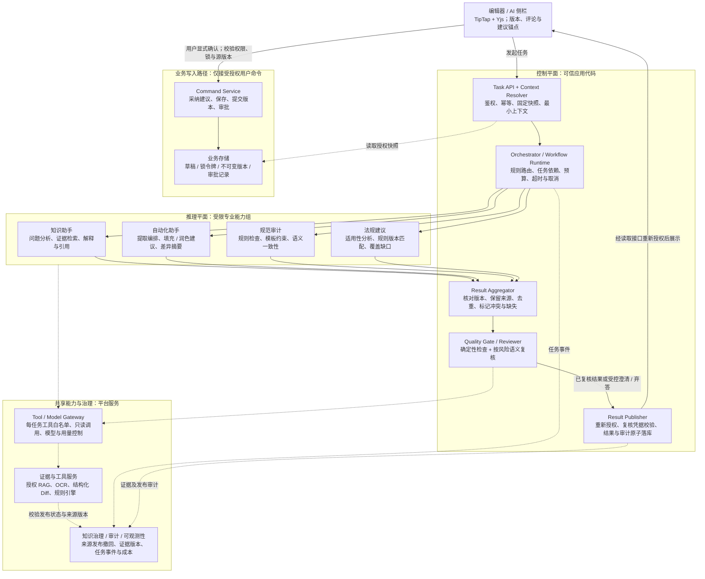
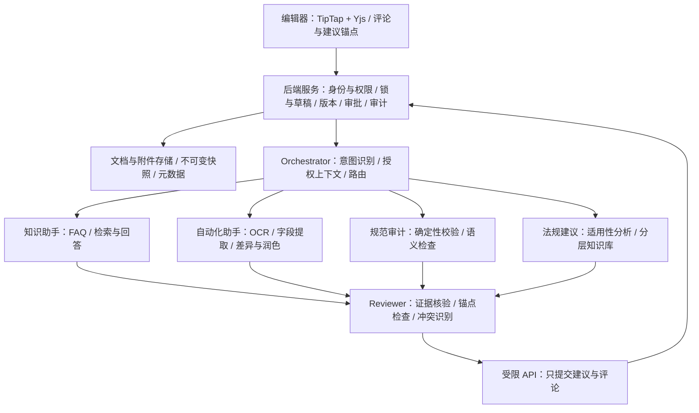

# AI 跨境贸易协作工具需求文档

版本：v0.2（需求评审稿）  
更新日期：2026-11-03  
当前阶段：Phase 1 / Online Document Editor

> 本文基于现有 HTML 演示、原始需求和架构笔记整理。优先级、性能指标和默认工作流均为建议基线，须经产品、Trade Ops、合规及技术团队确认后冻结。演示中的规则、法律表述、置信度、通知及审计提示不代表已验证的业务能力。

## 原始手写基础需求

<!-- 原始手写需求：保留原文供追溯与比较，不删除、不以整理版替换。 -->
> 注：以下为最初的手写需求草稿，保留原始措辞、编号及未完成条目。后续完善内容作为补充，不替代或删除原始记录；原始架构草图保留在“基础层级设计”的 V2 中。

```text
Editor: 
       1. 文本编辑， 合同上传， 多层审批 （分公司/部门）， toolbar && UI 优化
       2. 

知识助手 =》 
       1. FAQ， 
       2. 多种形式的Input， （语音， 截图标明）
       3. 多种形式的output, (PDF, word, 语言)

自动化助手 =》 
       1. 自动比较，（多版本比较）。 
       2. 自动用户输入， 
              2.1. 基于用户上传的初始扫描件版本作为初始template
              2.2. 也可能初始从零编辑
              2.3. 对于某些关键信息， 可以基于一个支持变量话， 以便最终submit再填充真实数值
              2.4. 用户可以通过语音来让AI来修改文本内容
       3. 基于一个预设定好的外部系统API template 文件。助手可以通篇阅读目前该文档， 然后和外部API template 文件的预设值进行匹配. 比如预设template 文件里是application type， 那么查下文档里是不是guarantee 或者是standby DC的问题 
       4. 语音修改文档支持，支持用户可以通过语音来控制AI来修改文档。AI通过用户的语音输入，比如麦克风，操作文档的增删改查。 如果可以，支持实时的选择，比如用户说选择当前页面第几行到几行的某些文本时候，AI会实时出现一个选择框来选择对应的文本，以此来实时显示来告知用户AI的选择框是哪些。 然后再通过语音输入，来配合用户进行文档操作。 甚至进一步操作APP的某些功能，比如调用规范审计助手等等。 

规范审计助手 =》 
       1. 检查字段规范性
       2. 语义性逻辑编辑
       3. 对于客户/银行，支持模板和定制， 通过该模板来查验新文档是否满足模板的硬性 要求。

法规建议组 =》 
       1. 查验该文档，是否满足新的法规要求， 比如出口国/进口国，是否满足新的swift 2026. 
       2. 查验文档是否违反公司对于贸易/流程审计的要求。 （问AI）
       3. 支持自定义一些内部系统要求，比如必须标明合法资金来源， 以防止资金风控。 
```

## 基础层级设计

### V1

<!-- V1：草稿基础设计，保留原始方案供追溯与比较，不作为定稿。 -->
> 注：草稿基础设计。以下保留原始内容，具体职责与边界参见“优化后的二合一版本”。

```text
┌─────────────────────────────────────────────────────┐
│ 编辑器协作层（Editor / CRDT） │
│ TipTap + Yjs，评论/建议锚定在 Y.Doc 中 │
│ 人类编辑 + Agent 建议共存，CRDT 保证并发安全 │
└──────────────────────┬──────────────────────────────┘
                       │ 受限 HTTP API（仅提交建议/评论）
┌──────────────────────▼──────────────────────────────┐
│ 编排层（Orchestrator Agent） │
│ 意图识别 → 路由到对应能力组 → 汇总建议 → 提交 │
│ 简单路由用代码写死，只在模糊意图上用 LLM 判断 │
└──────┬───────────────┼───────────────────────────────┘
       │ │ │
┌──────▼──────┐ ┌──────▼──────┐ ┌──────▼──────────────┐
│ 知识助手组 │ │ 规范审计组 │ │ 法规建议组 │
│ Query分析 │ │ 确定性Lint │ │ 问题抽取 │
│ 检索/生成 │ │ 语义审查 │ │ 法规匹配（分层KB） │
│ 事实核查 │ │ 交叉验证 │ │ 修订历史追踪 │
└──────┬──────┘ └──────┬──────┘ └──────┬──────────────┘
       │ │ │
┌──────▼───────────────▼───────────────▼──────────────┐
│ 共享能力层 │
│ 分层法规知识库 · 规则引擎 · 混合检索(RAG) · 证据链 │
│ 每次 Agent 运行写入 append-only 哈希链，可回放、可审计 │
└────────────────────────────────────────────────
```

### V2

<!-- V2：草稿基础设计，保留原始方案供追溯与比较，不作为定稿。 -->
> 注：草稿基础设计。以下保留原始内容，具体职责与边界参见“优化后的二合一版本”。

```text
┌─────────────────────────────────────────────────────┐
│ 编辑器协作层（Editor / CRDT） │
│ TipTap + Yjs，评论/建议锚定在 Y.Doc 中 │
│ 人类编辑 + Agent 建议共存，CRDT 保证并发安全 │
└──────────────────────┬──────────────────────────────┘
                       │ 受限 HTTP API（仅提交建议/评论）
┌──────────────────────▼──────────────────────────────┐
│ 编排层（Orchestrator Agent） │
│ 意图识别 → 路由 → 汇总建议 → Reviewer 复核 → 提交 │
│ ┌───────────────────────────────────────────────┐ │
│ │ Reviewer Agent（质量闸门） │ │
│ │ 事实/引用核验 · 锚点一致性 · 冲突消解 · 置信度分级 │ │
│ └───────────────────────────────────────────────┘ │
└──────┬───────────────┼───────────────┬──────────────┘
       │ │ │
┌──────▼──────┐ ┌──────▼──────┐ ┌──────▼──────────────┐
│ 知识助手组 │ │ 规范审计组 │ │ 法规建议组 │
│ Query分析 │ │ 确定性Lint │ │ 问题抽取 │
│ 检索/生成 │ │ 语义审查 │ │ 法规匹配（分层KB） │
└─────────────┘ └─────────────┘ └─────────────────────┘
```

### 优化后的二合一版本

**架构定位：受控工作流承载专业 Agent，证据驱动输出，人工授权业务变更。** 保留 V1 的规则优先路由、组内自检与共享证据链，以及 V2 的统一 Reviewer；将原来混合的任务控制、模型推理与业务写入分离。本节是建议实现基线，不改变后文 P0/P1 范围，也不替代原始草稿。

#### A. 关键设计决策

| 决策 | 优化方案 | 理由与边界 |
| --- | --- | --- |
| 编排方式 | Orchestrator 以持久化状态机和预定义工作流为主；LLM 仅辅助意图分类、实体提取及有限计划建议 | 模型不能决定授权、批准例外、增加工具权限或无限递归调度 |
| Agent 粒度 | 四个逻辑能力组复用工具与基础服务，不按每个功能创建一个独立 Agent / 微服务 | OCR、Diff、字段校验是确定性工具；解释、语义审查、建议生成才使用 LLM |
| 写入分离 | AI 结果发布与正文/审批命令采用不同服务接口和权限 | Agent 只能发布获准的回答、发现、候选建议；用户确认仍需后端重新验证 |
| 上下文管理 | 所有组针对同一不可变输入快照，按职责获得最小授权上下文 | CRDT 不承担权限、业务锁或跨组事实一致性；不共享无边界对话记忆 |
| 复核策略 | 代码校验必经，模型复核按内容风险启用；组内与跨组复核职责区分，可复用有效复核凭据 | 不因“多跑一次模型”就认为更可靠，也不把 Reviewer 等同人工审批人 |
| 首期部署 | 模块化单体 API + 独立 Worker + 持久化任务库，外部能力通过 Adapter 接入 | 先完成可靠闭环；达到独立扩缩容、数据驻留或故障隔离需求后再拆服务 |

#### B. 逻辑架构与信任边界



实线表示任务/结果流转或用户业务命令，虚线表示受控服务调用与治理依赖。四条能力组分支表示可选路由，不表示每次调用全部 Agent；模型不可沿图中业务写入路径执行命令。图中省略队列和结果库的物理部署，不能据此省略持久化。

#### C. 能力分工与调用策略

| 能力组 | 负责输出 | 优先复用的工具 | 不承担的职责 |
| --- | --- | --- | --- |
| 知识助手 | 基于证据的解释、引用、澄清或转交建议 | 授权混合检索、来源定位、引用校验 | 不对整笔交易作合规批准，不直接润色写入正文 |
| 自动化助手 | OCR/字段提取结果、带锚点的候选修改、真实差异及语义摘要 | 文档解析、OCR、结构化 Diff、字段映射 | 不自行确认真实金额/主体，不绕过用户采纳 |
| 规范审计 | 确定性规则 Finding 与单独标记的语义 Finding | 版本化规则引擎、模板校验器 | 不让 LLM 替代字符集、长度、必填等确定性校验 |
| 法规建议 | 法域/日期/规则版本适用性、证据与覆盖缺口 | 分层法规库、有效期过滤、替代关系查询 | 不把无命中等同合规，不自行选择冲突法规作为最终结论 |

- 单一意图直接调用一个组；知识助手的 Query Analyzer 只做组内问题处理，不再创建第二个跨组 Orchestrator。
- “运行文档预审”可按已发布工作流并行运行规范审计和法规建议；需要 OCR 时先等待解析并冻结新快照，再启动依赖步骤。不能让一组读取原稿、另一组读取正在修改的内容后合并结论。
- 多步工作流使用预定义 DAG（有向无环图），声明依赖、必需/可选步骤及预算。P0 不允许 Agent 动态创建新 Agent、任意互相调用或自行扩展流程。
- “解释后再修改”等混合请求先澄清或要求用户确认下一项任务；知识助手返回转交建议不等于已获得编辑授权。
- 元数据或依据不足时用结构化澄清结束本轮运行，不让 Worker 长期阻塞等待人；用户补充后新建关联 Run。

#### D. 跨组合同与上下文隔离

以下为平台内部语义合同，不直接新增客户端 API；知识助手对外接口沿用 [AI_assistance_reqirement.md](AI_assistance_reqirement.md) 第 7–10 节，由 Adapter 映射，避免重复维护两套 Session/Run 协议。

| 合同 | 必需信息与约束 |
| --- | --- |
| TaskEnvelope | `task_id`、`run_id`、`request_id`、父任务引用、请求主体引用、工作区/文档/快照引用、意图、工作流版本、deadline、预算、能力白名单；主体和权限字段只能由可信服务生成 |
| ContextSnapshot | 不可变正文/附件引用及摘要、输入版本、选区锚点、用户可见范围、授权版本、适用日期/法域/规则版本；不把客户端提供的身份和 ACL 当作事实 |
| AgentResult | 结果类型 `answer / finding / suggestion`、源快照、结构化 payload、来源依赖、证据引用、适用范围和 coverage；没有执行的检查不得写成已通过 |
| EvidenceRef | 来源 ID/版本、页码/条款/节点定位、摘录摘要、来源类别、生效区间、许可与授权引用；专业事实 Claim 必须可映射至实际支持证据 |
| ReviewReceipt | 输入/结果/证据摘要、复核范围、复核策略与版本、`pass / repair / abstain` 决定、问题代码、时间及复核器身份；不能由生成 Agent 自报“已通过” |
| ProposedChange | 建议 ID、源快照、目标锚点、旧值前置条件、候选新值、理由、证据及 ReviewReceipt 引用；不包含可直接执行的任意脚本或数据库命令 |

任务执行状态与业务结论分开：`succeeded` 仅表示技术流程完成，不表示合规或审批通过。`needs_clarification`、`insufficient_evidence`、`unable_to_assess`、`needs_handoff` 等作为类型化结果；技术错误通过 Run.error 返回。跨组 coverage 显式列出已完成、未覆盖及失败的能力，不能用部分结果合成“审查全部完成”。

会话与草稿/正式版本绑定规则复用各能力规格；多组执行不自动共享全部历史。所有读取过的上下文及来源形成依赖记录，不仅记录最终引用。知识检索前过滤授权、法域、生效期和发布状态；发布结果与再次读取时重验权限，撤权后限制衍生结果访问。共享工具不等于共享租户记忆；跨用户回答缓存默认关闭。

#### E. 质量闸门与人工控制

1. **组内校验：**检查输出 Schema、源版本、规则执行完整性、证据 ID 和锚点；工具输出与 LLM 推断分别记录，禁止模型改写工具失败状态。
2. **统一复核：**检查事实与证据是否真正支持、跨组冲突、适用范围及建议风险。确定性工具结果可由代码复核；包含新生成的专业解释、法律适用推断或条款建议时增加语义复核，疑难项转人工。
3. **避免重复复核：**单组输出已有有效 ReviewReceipt，且结果、证据、策略版本未变时，可复用组内复核；聚合后新增、改写结论或出现冲突的部分必须重新复核。最终发布的权限/来源状态检查永远不能因复用凭据而省略。
4. **有限修复：**最多一次内容修复并重新校验；仍无法支持的内容弃答或返回已复核的缺口摘要，不将原始未核实结论作为可采纳建议。不同模型/多模型投票不能代替证据核验。
5. **人工决定：**用户采纳建议时由 Command Service 原子检查授权、业务状态、持锁令牌、源版本、旧值及当前来源状态；不满足时拒绝并要求重算，不把旧建议自动套用到新正文。审批只能通过第 10 节的独立业务流程完成。

审查严重度、证据支持程度和是否拦截是三个独立维度：严重度沿用 Critical / Warning / Info，知识回答的证据程度沿用 strong / qualified / insufficient / not_applicable；可拦截操作由已批准政策与确定性校验决定，不由模型自评置信度决定。

#### F. 可靠性、治理与部署

- 运行状态使用 `queued / running / succeeded / failed / cancelled / timed_out`；任务与入队事件同事务写入。Worker 租约、递增 fencing token、幂等键及唯一约束防止重试或并发产生重复结果。
- 同一父任务的所有子步骤继承剩余 deadline 和预算，不因转交或重试重新获得完整额度。预算至少包含最大步骤数、模型调用数、输入/输出 Token、工具超时和并发数，由已发布工作流配置约束；模型耗尽预算时明确停止。
- 必需步骤失败则不能宣布完整成功；可选步骤失败时可发布通过复核的部分结果，但必须标明 coverage 缺口，且不能替代审批所需检查。采用何种降级由工作流版本预先规定，不由模型临时决定。
- 取消、超时和成功发布通过原子状态转换竞争，迟到 Worker 结果不得覆盖终态。授权服务或必要持久化不可用时失败关闭；AI 不可用不阻止正常人工编辑，但不绕过强制审批要求。
- 模型、嵌入、重排和联网服务均经批准的 Gateway 接入，按任务限制工具和数据范围；原文中的指令不能扩大权限。模型/工具不持有正文、审批或生产数据库写权限，平台自身持久化运行结果不属于 Agent 业务写入权。
- 知识治理覆盖来源许可、解析、分块、独立审核、版本发布、有效期和撤回；仅已发布且当前授权的来源进入检索。历史适用性按指定日期选择，不能把当前规则套用于历史交易。
- 结果及审计 Outbox 原子落库，审计平台不可用时重试转发。append-only 哈希链用于检测改动，结合受控存储及独立完整性校验；“回放”是还原输入、证据、工具输出及决定，不保证再次调用 LLM 输出相同内容，也不要求保存隐式思维链。
- 每次运行关联工作流、提示词、模型、规则及索引版本，观测耗时、成本、错误、弃答和覆盖率；普通日志不记录客户正文，保留和驻留策略沿用第 12、13 节。
- P0 复用宿主身份、文档、审批与通知服务；Agent Worker 与 API 可以独立扩缩容，但不要求每组独立部署。知识助手的具体技术基线见独立规格；其他组沿用同一合同、任务基础设施和治理机制。

#### G. 架构验收与落地顺序

| 验证点 | 验收证据 |
| --- | --- |
| 路由与最小执行 | FAQ 仅启动知识助手；确定性 Diff 不必调用模型；模糊请求澄清，不能无故扇出全部组 |
| 隔离与撤权 | 外部用户检索、历史结果、附件、内部来源和引用均不可越权；入队后撤权不发布敏感结果 |
| 版本与来源一致 | 同一任务所有组绑定同一快照；旧锚点采纳失败；来源撤回或复核结果变更后不能复用旧凭据 |
| 复核与副作用 | 伪造引用/无依据 Claim 不发布为肯定结论；Agent 无正文写入 API；人工采纳仍通过锁与审批状态检查 |
| 并发与降级 | 重试不重复发布；取消/超时只有一个终态；缺失必需检查不能显示整体通过 |
| 可运维与可追溯 | 任一结果可追溯至输入、证据、模型/规则版本及人工动作；可看到预算耗尽和降级原因 |

建议依次实现：共享合同与身份/快照 Adapter → 持久化任务运行时 → 知识助手单组闭环 → 统一复核与候选建议 → 自动化及审计/法规组的预定义工作流。每步用合成数据和合同测试验证后再接真实服务，不以增加 Agent 数量作为进度指标；第 11 节保留系统集成概览，具体控制边界以本节及经评审的能力规格为准。

## 1. 产品目标与成功指标

打造面向跨境贸易客户与银行 staff 的 AI 辅助协作工具，减少文档往返修改、重复录入和规则查找成本，促进交易推进。Phase 1 聚焦贸易文档的起草、审查、修订、审批和交接，不负责实际交易执行。

- 客户：便捷上传或起草文档，理解修改意见，明确当前版本、责任人与下一步动作。
- Staff：在授权范围内审阅、提出修改意见、完成分层审批，并保留可追溯证据。
- 管理者：统一模板与规则，掌握待办、审批进度、处理时长及异常情况。
- AI：提供可定位、可解释、有出处的辅助意见；人工对文档和业务决定负责。

试点指标应先采集人工流程基线，再确定目标值：文档到可交接版本的中位时长、平均往返版本数、重复录入耗时、AI 建议采纳率、误报率、任务失败率。权限泄漏、版本覆盖丢失和审批错绑版本作为上线阻断问题，不以效率指标抵消。

## 2. 范围与优先级

P0：Phase 1 上线必需；P1：Phase 1 增强项，排期不足时延期；P2：后续阶段。不将 P1/P2 默认纳入首期交付承诺。

| 能力 | P0 | P1 / P2 |
| --- | --- | --- |
| 认证与用户管理 | 注册/登录、邮箱验证、组织选择与加入审核、成员角色管理、外部律师等访客邀请及撤权 | P1：企业目录自动同步、批量邀请及复杂组织委托 |
| 试点文档 | 以 HTML 中的见索即付保函草稿为试点；确认模板、适用规则和目标法域 | P1：更多保函模板；P2：信用证及其他贸易文档 |
| 文档输入 | 从零起草、模板创建、DOCX/PDF/JPG/PNG 上传与 OCR | P1：语音输入、截图圈选提问、批量上传 |
| 编辑协作 | 单人持锁编辑、自动保存、评论建议、版本提交、双版本比较 | P1：同一授权工作区多人实时编辑、多版本演变视图 |
| 数据与输出 | 结构化字段、变量、人工确认填充、DOCX/PDF 导出 | P1：语音输出、多语种对照及辅助翻译 |
| 审批流 | 按组织/分公司/部门配置串行审批、退回、待办和交接 | P1：并行会签、复杂委托及超时升级 |
| AI | 知识问答、自动化建议、规范检查、受限法域的法规建议、Reviewer 复核 | P1：受控联网检索；P2：更多法域与深度业务系统集成 |

### 2.1 非目标

- 不自动签署、开立保函、付款、发送 SWIFT 报文或完成端到端贸易处理。
- 不以 AI 替代法务、合规、制裁筛查、KYC/AML 或人工审批。
- 不承诺覆盖全球所有法规、任意扫描质量或复杂 DOCX 排版的无损转换。
- 不建设完整 CRDT 多人协作产品或通用工作流设计器；优先复用经批准的现有能力。

## 3. 用户、组织与权限

HTML 中的 Non-HSBC Customer、HSBCnet User、HSBC Internal 是身份展示类别，不是完整权限模型。权限必须由组织关系、交易参与关系、文档授权和操作角色共同决定；生产环境不提供任意身份切换。

| 角色 | 默认职责与权限 | 默认限制 |
| --- | --- | --- |
| 组织管理员 | 管理本组织资料、成员加入申请、角色和邀请策略；查看本组织授权的管理记录 | 不能自建银行身份或跨组织授权；成员管理权限不默认赋予交易正文访问权 |
| 外部专业协作者（律师、顾问等） | 注册/登录后接受指定交易/文档邀请，按授权阅读、评论；编辑需单独授予 | 不是邀请方组织员工；默认无编辑、下载、再邀请、审批及银行内部层访问权 |
| 外部参与方编辑者 | 访问被授权交易；查看共享文档、上传、持锁编辑、评论、提交版本 | 不能查看其他交易或银行内部内容；不能执行银行审批 |
| HSBCnet 参与方编辑者 | 通过既有身份体系访问被授权交易；按授权编辑、评论、提交 | HSBCnet 身份本身不授予额外文档权限 |
| 银行经办 staff | 管理授权交易文档、审查、内部备注、发起审批和交接 | 不可超出组织/交易授权；不可审批自己发起的同一审批请求 |
| 部门/分公司审批人 | 查看审批所需快照、意见及审计信息；批准或退回当前节点 | 不直接修改审批快照；需修改时退回重提 |
| 管理员/审计员 | 管理员维护模板、规则、流程配置；审计员只读查询授权审计记录 | 管理配置不默认获得业务正文权限；审计权限单独授予 |

- 组织、交易、文档、版本、附件、评论、搜索、AI 检索及导出均校验访问权限。
- 内容分为参与方共享层、组织私有层和银行内部层；新建评论和附件必须明确可见范围，不能扩大原内容的授权范围。
- 内部备注须服务端隔离，不得通过隐藏 DOM 实现保密；禁止进入外部用户的检索、AI 上下文、差异对比或导出。
- 外部分享需由授权用户显式执行；未提交草稿只对当前获授权编辑工作区可见，其他参与方默认看到最新共享快照。
- 同一文档内发布新版本属于共享行为，提交前显示受众范围；不同参与方的私有附件不得随提交隐式共享。

### 3.1 认证与账号生命周期（Authentication）

新增认证与用户管理模块，为在线编辑器、AI 助手及管理页面提供统一身份入口。账号身份、组织成员身份和文档协作权限分别管理：注册成功不代表已加入组织，加入组织也不代表可查看该组织所有交易。

| 编号 | 优先级 | 需求与完成条件 |
| --- | --- | --- |
| AUTH-01 | P0 | 支持新用户注册、已有用户登录、退出和账号恢复；银行 staff 与 HSBCnet 用户接入批准的身份体系，外部用户采用批准的外部身份服务，不自行实现密码或 Token 签发机制 |
| AUTH-02 | P0 | 注册验证邮箱所有权；未验证用户只能完成认证、组织申请及邀请引导，不得查看交易正文；邀请邮件本身不能替代登录或邮箱验证 |
| AUTH-03 | P0 | 银行 staff、组织管理员及外部敏感文档访问按批准策略强制 MFA；角色提升、邀请外部人员或授予编辑/下载权限时按策略重新认证 |
| AUTH-04 | P0 | 支持账号启用、停用和受控恢复；账号停用后所有组织与文档访问失效，退出当前会话或全部设备可撤销会话；恢复账号不自动恢复已撤销的访客授权 |
| AUTH-05 | P0 | 稳定用户 ID 与身份提供方 subject 绑定；不凭相同姓名或未验证邮箱自动合并账号，邮箱变更须重新验证并检查已有邀请绑定 |
| AUTH-06 | P0 | 注册、登录、恢复和邀请接受提供限流及明确错误引导；未登录响应不暴露某邮箱是否存在、组织成员名单或邀请文档标题；活动会话和认证事件可供用户及授权管理员查看 |

### 3.2 组织选择、加入与切换（Organization）

组织类型至少支持 `bank`（银行）、`company`（公司）、`law_firm`（律师事务所）和 `other`。保存组织 ID、法定/展示名称、注册地区、组织类型、核验状态、管理员及可选分公司/部门；相同名称不能作为同一组织的唯一依据。

| 编号 | 优先级 | 需求与完成条件 |
| --- | --- | --- |
| ORG-01 | P0 | 用户注册后可选择自己所属组织并申请加入；有邀请时预填邀请关联信息，但必须区分“所属组织”和“邀请我的组织”，不得将律师事务所用户自动归入银行 |
| ORG-02 | P0 | 组织目录只展示批准公开/可发现的最小资料；可用组织代码或精确名称发起申请，不提供未授权成员/客户名单。找不到组织时允许提交创建申请，审核前不获得组织管理或业务权限 |
| ORG-03 | P0 | 已核验组织的加入申请由有权组织管理员审核，或由批准的企业身份映射自动确认；企业邮箱域名只能作为辅助证据，不能单独证明任职关系。银行组织创建和 staff 身份须由平台/银行授权管理员或受信身份源核验 |
| ORG-04 | P0 | 创建新组织须核验组织真实性及首位管理员的代表权限，不能由申请人自审；支持拒绝原因和重新申请，避免重复创建同一法律实体 |
| ORG-05 | P0 | 一个账号可有多个经核验的组织成员身份；登录后选择本次活动组织，界面持续显示组织及角色。切换组织由服务端验证成员状态，不合并多个组织的权限或 AI 上下文 |
| ORG-06 | P0 | 切换组织时检查未保存草稿及编辑锁，提示先保存/释放或保留恢复草稿；切换后重新加载授权资源与 AI 会话，旧组织的请求不得通过新组织上下文继续执行；不得静默丢弃草稿 |
| ORG-07 | P0 | 律师可使用其经核验的律所身份，或以获邀独立专业人士身份参与。尚未核验的单位名称仅作自述资料，不赋予组织权限；访客邀请不能代替组织任职审核 |

组织核验状态：`pending_verification / verified / rejected / suspended`。组织成员状态：`pending / active / rejected / suspended / removed`。待核验账号可按已批准的访客策略接受个人文档邀请，但只能获得指定访客权限，不能因此激活其组织成员身份。

### 3.3 成员与角色管理（User Management）

| 编号 | 优先级 | 需求与完成条件 |
| --- | --- | --- |
| UM-01 | P0 | 组织管理员可查看本组织获授权成员列表、审核加入、分配部门及允许的角色、暂停/移除成员；组织角色与交易/文档角色分别配置 |
| UM-02 | P0 | 管理员只能授予策略允许且其有权管理的角色；外部邀请不能授予银行 staff、组织管理员或银行审批人角色；不能通过修改组织类型绕过限制 |
| UM-03 | P0 | 暂停成员或组织时，撤销该身份下的有效访问及编辑令牌，阻止旧会话提交；保留已持久化草稿、历史版本与审计。移除一个组织成员身份不删除该账号在其他组织的合法身份 |
| UM-04 | P0 | 最后一位有效组织管理员不能自行移除/停用而使组织失管；提供经平台核验的管理员移交或恢复流程，不允许任何用户自行接管 |
| UM-05 | P0 | 管理页面分别展示组织成员、待处理申请和外部访客；访客列表显示邀请人、受邀人、有效期、资源范围及权限，可按角色和状态筛选并查看授权变更记录 |

### 3.4 外部邀请、注册登录与授权（Invitation）

典型场景：银行经办或公司用户在获授权文档中点击“邀请协作者”，填写律师邮箱、协作目的、授权文档和有效期；律师通过邮件注册或登录，确认本人身份后接受邀请，在独立访客入口查看指定文档及发表评论。

| 编号 | 优先级 | 需求与完成条件 |
| --- | --- | --- |
| INV-01 | P0 | 具有 `can_invite_external` 权限的用户可发起邀请；不是所有普通成员都可邀请。后端同时验证组织外部分享政策、文档分享权限和可授予角色；必要时经资源负责人批准后发送 |
| INV-02 | P0 | 邀请绑定受邀邮箱、邀请人、发起组织、目的、明确的交易/文档 ID、内容层级、权限及截止日期。默认只授予选中文档的阅读和评论，不自动包含整个交易、未来新增文档、内部备注或私有附件 |
| INV-03 | P0 | 外部律师的编辑、附件访问、下载/导出和 AI 使用分别授权，默认关闭；再邀请及银行审批权限不通过外部邀请授予。编辑获准后仍须获取正常编辑锁，AI 仅能使用该访客可见的内容 |
| INV-04 | P0 | 通过批准的邮件服务发送个人邀请，Token 高熵、单次使用、服务端仅存摘要；建议邀请 72 小时失效，访客授权默认接受后 30 天到期，具体上限按组织政策冻结，两个期限分别显示 |
| INV-05 | P0 | 新用户完成注册与邮箱验证后接受邀请；已有用户登录后接受。已验证邮箱必须与受邀地址匹配，不匹配时要求切换账号或请邀请人重新邀请，不允许转发链接直接授权他人 |
| INV-06 | P0 | 接受时再次校验邀请状态、有效期、邀请人当前授予权限、资源分享政策及受邀身份，并原子消费 Token、创建唯一访客授权及审计记录；重复点击不重复授权，过期/已撤销/已被消费的 Token 不可再用 |
| INV-07 | P0 | 邀请管理支持查看状态、撤销和重发；重发轮换 Token 并使旧链接失效。邮件发送失败可重试，不能显示已送达或已接受；日志、分析和错误信息不得记录原始 Token |
| INV-08 | P0 | 邀请接受后可独立撤销或缩减访客授权；到期立即阻止新读取、编辑、引用和 AI 请求，撤销编辑令牌并保全恢复草稿。邀请人离职/失权后其担保的访客授权默认暂停，由有权资源负责人复核后决定移交或恢复 |
| INV-09 | P0 | 默认外部可见范围遵循参与方共享层，不扩大银行内部层。仅供律师与委托方交流的私有备注需求须另行明确授权双方，不得把“律师可见”误当所有交易参与方可见 |

邀请状态：`pending_approval / pending_acceptance / accepted / rejected / revoked / expired`；无审批要求时直接进入 pending_acceptance。邮件投递状态单独记录。接受后的 `GuestAccessGrant` 使用 `active / suspended / revoked / expired`，邀请链接过期不等同已接受的授权到期。过期授权续期需重新审批/授权并留痕，不通过复用旧 Token 延长。

同一用户可同时具有组织成员身份和访客身份；受邀事项入口显示实际所属组织（或独立人士）及邀请方，不能把邀请方作为可切换的员工身份。访客有效权限取邀请授权、当前资源分享政策和身份限制的交集；新文档/附件须再次显式授权。

### 3.5 服务端集成与管理界面

- 认证采用统一 Identity Provider，应用维护组织成员和资源授权；不将客户端提交的 organization_id、角色或“已认证”标记作为授权依据。每次访问同时校验主体、活动组织/访客上下文、资源和动作。
- 管理界面至少包含注册/登录与恢复入口、组织选择/加入状态、组织资料、成员角色、加入审批、邀请与访客授权管理、个人会话管理；所有状态均有空态、处理中、失败和重试反馈。
- 权限变更应使会话、任务和缓存及时重验；源内容失权后的 AI 衍生回答和引用同步限制访问。租约/访客到期由服务端判断，不依赖用户关闭页面或前端定时器。
- 邀请邮件采用通用措辞，不携带交易正文、内部备注或敏感附件；接受页在完成身份校验前只显示最小信息。跨境邮件和身份数据处理沿用数据治理要求。
- 注册、组织核验、加入审批、角色变更、组织切换、邀请发送/接受/撤销、访客续期和撤权均留痕；历史记录不得因账号注销或成员移除而丢失法定保留信息。

## 4. 主流程与状态

### 4.1 典型路径

前置流程：用户注册或登录 → 验证身份 → 选择已批准的所属组织，或进入已接受的受邀事项 → 服务端加载对应角色与文档授权。尚待组织审核的用户只看到申请状态，不进入该组织的交易列表。

1. 创建交易工作区，填写参与组织、申请人/受益人、文档类型、出口国/进口国、语言及适用规则。
2. 从模板、空白文档或上传文件创建草稿；OCR 和字段提取结果由用户确认。
3. 获取编辑锁，修改正文、填写变量、处理评论；系统自动保存私有工作草稿。
4. 手动运行 AI 审查或在提交流程触发检查；用户处理意见或记录不采纳理由。
5. 提交版本，生成不可变共享快照并释放锁；按配置通知下一责任方。
6. 必要时重复编辑和提交；银行经办选择某一完整版本发起审批。
7. 审批按配置节点流转；退回后修订并重新提交，批准后形成可交接版本。
8. 导出经过授权的文档，或将已批准版本交接至后续业务流程；实际签署/开立不在首期范围。

### 4.2 状态语义

版本提交、审批通过和业务生效是三个不同事件，界面不得统一称为 Submit 后即完成交易。

| 状态维度 | 状态及转换 |
| --- | --- |
| 工作草稿 | 自动保存不生成正式版本；放弃编辑只恢复至已提交内容，不删除正式版本 |
| 编辑锁 | FREE → LOCKED → FREE；与业务审批状态独立，但审批中禁止获得编辑锁 |
| 文档生命周期 | DRAFT → IN_REVIEW → APPROVED → HANDED_OFF；IN_REVIEW 可退回至 CHANGES_REQUESTED |
| 退回重提 | CHANGES_REQUESTED 下允许编辑；新版本提交后回到 DRAFT，重新发起审批 |
| 已批准后修改 | 经授权“重新修订”回到 DRAFT；保留历史批准记录，新版本不继承批准状态 |
| 已交接后修改 | 不可覆盖已交接快照；通过关联修订流程处理，原交接记录保留 |

发起审批必须针对已提交版本，且无活动编辑锁、无未处理的工作草稿、无未填必填变量。审批过程中正文冻结，允许添加有权限的评论。发起人可在审批未结束前撤回至 DRAFT；审批撤回或退回与最后节点批准并发时，后端只接受一个合法状态转换。

## 5. 在线编辑与文档管理

| 编号 | 优先级 | 需求与完成条件 |
| --- | --- | --- |
| ED-01 | P0 | 支持空白、已发布模板及文件导入；模板实例记录模板 ID 和版本，模板更新不静默改写已有文档 |
| ED-02 | P0 | 支持段落、标题、粗体/斜体/下划线、列表、表格、撤销/重做、查找替换；工具栏状态与当前选区和编辑权限一致 |
| ED-03 | P0 | 支持 DOCX/PDF/JPG/PNG；保留原文件用于核对，展示解析进度、错误和不支持元素；不执行宏或嵌入脚本 |
| ED-04 | P0 | 扫描件/照片提取正文及关键字段；金额、币种、主体、日期等关键字段在确认前标为待核实，提供来源页码/区域与置信提示 |
| ED-05 | P0 | OCR 部分失败不伪装成功；用户可重新上传、手工修正或从空白继续；不覆盖已确认字段 |
| ED-06 | P0 | 自动保存建议在停止输入 2 秒后触发；展示保存中、已保存、失败和冲突状态；刷新后恢复已确认持久化草稿 |
| ED-07 | P0 | 评论和 AI 建议绑定文档位置及源版本；支持回复、解决、拒绝和采纳；原文变化后检查锚点，失效时要求重新定位 |
| ED-08 | P0 | 正文与共享/私有/内部备注分开存储和授权；全文搜索、复制和导出遵守同样的内容边界 |
| ED-09 | P0 | 导出 DOCX/PDF，标明文档编号、版本及必要的草稿状态；按导出范围处理评论、内部内容和未填变量；导出动作留痕 |
| ED-10 | P1 | 支持语音转文字、截图圈选提问及语音输出；转写/播报沿用原文权限，金额日期等转写结果需人工确认 |

导入时不承诺完整保留源文件排版。P0 必须保留已确认的正文、段落和基本表格；图片、页眉页脚等不支持项应在用户继续前列出。含密码文件、无法识别文件及超限文件须明确拒绝或引导重新提供。

## 6. 编辑锁、草稿与版本

### 6.1 独占编辑与恢复

- COL-01 / P0：Phase 1 同一文档同一时刻只允许一个具体用户会话持锁，不以 party 名称作为锁所有者。其他用户可查看授权快照及评论。
- COL-02 / P0：锁由服务端原子获取，包含持锁人、会话、获取时间、租约期限和递增令牌；保存/提交必须校验有效锁和基准版本，旧会话不得覆盖新持锁人的内容。
- COL-03 / P0：通过心跳续租；断网后明确显示保存未确认，不静默进入可提交状态。重连后重新校验锁和版本，冲突内容保留为恢复草稿。
- COL-04 / P0：“放弃编辑”前提示未提交变更，允许保留恢复草稿或明确丢弃；恢复草稿不是共享版本，恢复时需要重新获得锁并校验基准版本。
- COL-05 / P0：强制解锁仅限授权 staff，记录原因并由独立授权人员复核后执行；保全可恢复草稿、撤销旧令牌并通知原持锁人，不允许伪造“双人复核已完成”。
- COL-06 / P0：锁租约自动到期与人工强制解锁分别留痕；离开页面不视为可靠释放，服务端租约才是最终依据。

### 6.2 版本与差异

- VER-01 / P0：正式提交在同一事务中完成权限/状态/锁/基准版本校验、快照写入和锁释放；任一步失败均不得产生半完成版本。
- VER-02 / P0：提交使用幂等请求标识，超时重试只生成一个版本。通知通过持久化事件异步发送，通知失败不回滚已成功提交的版本。
- VER-03 / P0：快照记录正文、结构化变量及其值、模板版本、提交人、组织、时间、修改说明和内容摘要；服务端以确定性序列化及 SHA-256 等标准算法生成摘要，不能用随机值代替。
- VER-04 / P0：可选择任意两个有权访问的版本进行比较；按段落/结构对齐后突出字词、数值、条款及表格变化，插入一段不得导致后续全文误报为修改。
- VER-05 / P0：差异统计由真实变更计算；语义摘要标注 AI 生成并可跳转原始差异，不预设“某条款发生变更”。
- VER-06 / P0：历史快照不可修改；基于旧版本恢复须创建新草稿并最终形成新版本，不覆盖历史。
- VER-07 / P1：支持三个及以上版本的演变浏览和按责任方筛选修改记录。

## 7. 结构化字段、变量与自动化助手

| 编号 | 优先级 | 需求与完成条件 |
| --- | --- | --- |
| AUTO-01 | P0 | 从用户上传文件提取申请人、受益人、金额、币种、日期、单据编号等，显示来源、候选值和待确认状态 |
| AUTO-02 | P0 | 从零编辑时支持定义和插入变量，如 `{{guarantee_amount}}`、`{{currency}}`、`{{expiry_date}}`；变量具备类型、是否必填、校验规则、来源及所有出现位置 |
| AUTO-03 | P0 | 同一变量引用统一更新；替换前展示影响范围；金额保留精度和币种，日期使用无歧义格式；不以全文字符串替换处理同名普通文本 |
| AUTO-04 | P0 | 必填变量可在讨论用版本中暂缺，但须明确标记；发起审批、正式导出和交接前必须完成确认与确定性校验；草稿导出显式标注未填项 |
| AUTO-05 | P0 | 用户可请求润色、条款替换或自动填充；以差异建议展示，必须由有编辑权限且持锁的用户确认后才写入草稿，并支持撤销 |
| AUTO-06 | P0 | 文档上下文不足、多个来源冲突或数值不明确时要求补充信息，不猜测真实金额、主体、签署日或适用法律 |

## 8. 知识助手

- KNOW-01 / P0：回答产品 FAQ、操作流程、获授权知识库中的贸易规则及文档问题；支持文字输入、选中文本提问和授权附件上下文。
- KNOW-02 / P0：每条事实性专业回答提供可核查的来源标题、条款/页码、版本、生效日期（适用时）和来源类型；受权限保护的原文链接不得对未授权用户开放。
- KNOW-03 / P0：区分规则原文、企业政策和模型建议。没有充分证据时说明缺失内容及适用范围，不生成虚假引用或固定显示“高置信度”。
- KNOW-04 / P0：对法律/合规问题显示辅助参考属性和需要人工确认的原因；不是仅添加免责声明后仍给出确定性结论。
- KNOW-05 / P0：会话绑定交易/文档访问范围；切换文档时重新验证上下文，避免把其他交易内容带入回答。
- KNOW-06 / P1：受控联网检索仅访问批准来源，记录实际检索时间和来源；默认不向外部搜索发送客户正文、身份及交易敏感信息。失败时不得声称已联网核实。

## 9. 规范审计与法规建议

### 9.1 规范审计助手

- RULE-01 / P0：确定性检查覆盖字段格式、必填项、币种金额、日期顺序、长度及字符集；规则按文档/报文类型、版本和适用条件执行。
- RULE-02 / P0：语义检查覆盖主体不一致、金额前后矛盾、条款冲突、条件缺失及模糊措辞；标记为语义判断，不伪装成系统确定性错误。
- RULE-03 / P0：支持客户及银行模板中的必需条款、受控条款和可选条款；规则维护人配置硬性/建议属性，发布前需独立审核并形成可追溯版本。
- RULE-04 / P0：支持部门/组织内部流程要求，例如声明合法资金来源；区分“缺少声明”和“已验证资金合法”，不得从文档文字推导后者。

### 9.2 法规建议组

- REG-01 / P0：基于出口国、进口国、相关主体、文档类型、适用法及交易时间检索批准的规则来源；缺少适用信息时标为“无法评估”，不能报告整体通过。
- REG-02 / P0：首期覆盖的法域和规则清单必须经业务与合规确认；不支持的地区或规则版本显式列为覆盖缺口。
- REG-03 / P0：法规及 SWIFT 标准保留发布方、版本、生效日、失效/替代关系和适用日期；“SWIFT 2026”必须细化为经验证的具体报文类型及标准版本。
- REG-04 / P0：新法规更新须经内容负责人审核后发布；保留历史版本，关联受影响文档并提示重新审查，不自动改写已批准文档。
- REG-05 / P0：出口管制等需要物项、用途、最终用户证据的问题仅提示补充核实；不能仅凭公司名称或经营范围认定违规。

### 9.3 审查结果与操作闸门

每条 Finding 包含：唯一 ID、源文档版本/内容摘要、Agent/规则来源、严重度、类别、位置锚点、问题说明、规则版本及证据、建议修改、适用范围、置信依据、处理状态和处理人。

- 严重度使用 Critical / Warning / Info；是否拦截由独立的 `gate_type` 及目标操作决定，避免把 HTML 的 blocker 标签误解为自动禁止提交。
- 确定性硬校验可阻止对应操作，例如发起审批时缺少必填变量、正式报文映射时字段格式不符；不符合格式的草稿仍可保存。报文映射规则仅在启用对应模板/输出要求时适用，不意味着首期发报。
- AI 语义及法律意见默认不自动阻止保存或版本提交；进入审批时，关键未解决意见须显式确认或说明处理理由。
- 企业政策可要求指定角色复核或合规豁免；纯技术约束及权限检查不可绕过，AI 自身不得批准例外。
- Finding 支持待处理、已采纳、已拒绝、需人工复核、已过期；不采纳关键意见需填写理由。
- 审查针对固定快照执行；用户修改后旧结果标为过期，不把异步返回结果附到新版本上。审批只使用当前目标版本的审查结果。
- 无命中、无法评估、执行失败、部分完成分别展示；“无命中”不等同于“合法合规”。

## 10. 多层审批、通知与交接

- WF-01 / P0：按组织、分公司、部门、文档类型及金额范围选择预配置串行审批模板；模板版本固定在审批实例中，后续配置修改不影响在途实例。
- WF-02 / P0：每个节点指定有资格的审批人或审批组、必需角色和处理要求；金额条件无匹配、多个流程冲突、无有效审批人时阻止发起并提示配置问题。
- WF-03 / P0：经办人不能审批自己发起的同一请求；节点审批组中由一名合格人员完成即可，多人会签属于 P1，不能隐式视为已覆盖。
- WF-04 / P0：审批页面展示目标版本、相对上一审批基线的差异、AI 及人工意见、未关闭风险和前序意见。批准/退回均记录人员、时间和意见。
- WF-05 / P0：任一节点退回结束本次审批；修改后生成新版本并从首节点重新发起，历史批准不得自动迁移。
- WF-06 / P0：权限撤销或审批人失效时停止对应操作；授权管理员可记录原因后重新分配节点，不得借重分配绕过职责分离。
- WF-07 / P0：站内待办覆盖待审、退回、轮到编辑、锁被撤销和交接；通知不得携带超范围正文，发送失败可重试、同一事件不重复生成待办。
- WF-08 / P0：交接绑定已批准版本及接收方，保留交接回执/状态；首期可人工确认交接，不得在未实现集成时显示已完成外部系统操作。
- WF-09 / P1：支持邮件通知、复杂委托、并行会签及超时升级；委托仍遵守组织授权和经办/审批分离。

## 11. Basic Design

保留 TipTap + Yjs、Orchestrator 与 Reviewer 的分层方向，但 CRDT 仅解决内容合并和锚点问题，不提供业务权限、独占锁、不可变版本或审批一致性保证。



- Phase 1 服务端只接受当前持锁会话的正文写入；Yjs 更新接入也必须受同一校验约束。多人实时编辑作为增强项，不能因接入 CRDT 而默认开放。
- 编排器只传递任务所需且用户有权访问的最小上下文；Agent 不直接持有数据库、正文覆盖、审批或业务执行权限。
- Reviewer 是 AI 输出质量复核环节，不是法定审批人；引用不可核实、锚点失效或建议冲突时，降低结论强度或转人工，不静默执行。
- 确定性规则和 AI 推断分开记录；知识库按共享、组织私有、银行内部层隔离并在检索前过滤权限。
- 用户采纳建议走正常编辑 API，再次校验权限、锁、源版本及原文；审批提交走独立工作流 API。
- AI、OCR、导出任务采用异步任务接口，提供运行中、完成、部分失败、失败及取消状态；任务重试不重复落建议或污染新版本。
- 前端技术选型、持久化方案和后端协议在技术设计阶段确认；本节明确职责边界，不视为部署承诺。

## 12. 核心数据与审计

| 对象 | 最小信息 |
| --- | --- |
| UserIdentity / AuthSession | 稳定用户 ID、身份提供方 subject、已验证邮箱、账号状态、认证强度、会话及撤销信息；不保存身份提供方明文密码 |
| Organization / OrganizationMembership | 组织 ID、类型、法定/展示名称、注册地区、核验状态、管理员；用户与组织的成员关系、角色、部门、审核人及状态 |
| Invitation / GuestAccessGrant | 受邀邮箱、邀请人/发起组织、分享审批、Token 摘要、邀请期限及投递状态；接受后的用户、指定资源、操作权限、授权期限、担保人及状态 |
| TradeWorkspace / Membership | 交易编号、参与组织、成员角色、文档授权、法域与业务元数据 |
| Document / Draft / Lock | 文档类型、业务状态、最新版本、草稿所有者及可见范围、基准版本、锁租约及令牌 |
| DocumentVersion | 不可变内容、结构化字段、模板版本、真实内容摘要、提交说明、提交人及时间 |
| Attachment / ExtractedField | 原文件、文件类型、授权范围、解析状态、来源坐标、候选值和确认记录 |
| Comment / Suggestion / Finding | 内容层级、源版本、锚点、证据、处理状态及人工决定 |
| Template / Rule / KnowledgeSource | 所属组织、发布状态、版本、生效范围、来源及审核人 |
| ApprovalInstance / Decision | 目标版本、流程模板版本、节点、审批人、状态、意见及例外授权 |
| AIJob / AuditEvent / Notification | 请求人、授权上下文、任务版本、模型/规则版本、结果状态、事件与通知回执 |

审计覆盖登录与访问拒绝、上传/导出、锁变化、版本提交、AI 调用及建议处理、模板规则发布、审批和权限变更。记录操作者、组织、UTC 时间、对象、版本、操作结果及关联请求 ID；展示时间按用户时区转换。审计记录采用防篡改机制并限制删除权限，常规日志不记录完整客户正文或密钥。

## 13. 非功能与运行要求

以下为评审用目标，需在试点容量及合规要求确认后冻结。

| 领域 | Phase 1 要求 |
| --- | --- |
| 数据保护 | 传输和存储加密；遵循组织的数据分类、驻留与跨境传输要求；模型服务须获批准，默认不允许用客户数据训练模型 |
| 输入与 AI 边界 | 上传执行类型/大小校验及恶意文件检查；文档和检索内容均视为不可信资料，其中的指令不能提升 Agent 权限或触发工具执行 |
| 身份与访问 | 对接批准的身份体系；外部访问需实名身份和交易邀请；会话过期、权限变化后服务端立即拒绝受限操作 |
| 数据保留 | 原件、草稿、正式版本、审计、AI 会话分别定义保留期、法律保全及删除策略；未批准保留期前不默认无限保存 |
| 导入容量 | 建议单文件不超过 20 MB、PDF 不超过 100 页、可编辑正文不超过 50,000 字符；支持范围和超限处理必须用户可见 |
| 交互性能 | 约定办公网络下、100 个并发活跃会话的基线测试中，普通文档打开 P95 ≤ 3 秒；保存确认 P95 ≤ 2 秒，不含输入防抖时间 |
| AI 与 OCR | 20 页以内文件，建议 OCR P95 ≤ 60 秒；20,000 字符以内审查 P95 ≤ 30 秒；120 秒超时显式结束，可重试且不得重复写入 |
| 可用性与恢复 | 建议月可用性 99.5%；服务故障须能从备份恢复，灾难恢复目标建议 RPO ≤ 15 分钟、RTO ≤ 4 小时，须完成演练并标明潜在数据损失窗口 |
| 人机交互 | 显示当前版本、锁持有人、保存状态、审批状态及下一步动作；AI 面板不得遮挡提交或审查主操作 |
| 兼容与可访问性 | P0 验证受支持的 Edge/Chrome 桌面浏览器、1366×768 及以上视窗；支持键盘操作、焦点可见、不仅靠颜色表达状态；移动完整编辑作为 P1 |
| 语言 | P0 支持中文界面及中英文内容；法律条款翻译不是原文替代；币种、日期和金额不能依赖浏览器地区设置隐式转换 |
| 运维 | 监测保存失败、版本冲突、任务延迟、来源覆盖、调用成本和通知失败；AI 不可用时可继续人工编辑，受强制政策约束的审批仍不得绕过 |

## 14. HTML 原型与正式实现差距

参考文件：[HSBC_Nexus_Document_Editor_Mock_Demo.html](HSBC_Nexus_Document_Editor_Mock_Demo.html)；架构笔记：[GTSTrade_AI_Note.md](GTSTrade_AI_Note.md)。

| 原型行为 | 正式要求 |
| --- | --- |
| 前端切换 party，内存保存全部状态 | 真实身份鉴权、交易授权和后端持久化；不同用户会话隔离 |
| 编辑锁按 party 判断；切换后可见当前草稿 | 按具体会话持锁；服务端校验；未提交草稿按工作区授权隔离 |
| 放弃/强制解锁后清空草稿，但提示草稿保留 | 实现真实恢复草稿及复核记录，或明确告知丢弃；提示必须与结果一致 |
| Submit 生成版本并提示已通知 | 区分提交、审批、交接；事务化版本提交和可重试通知 |
| 固定四条审查意见；原文已改仍报旧问题 | 按当前快照真实执行，过期结果失效；不能固定返回数量和结论 |
| 固定引用、抓取时间、置信度和语义差异摘要 | 使用实际检索证据、任务时间和真实差异；无来源时明确说明 |
| 随机版本 hash、逐行位置比较 | 确定性内容摘要、结构对齐和数值级差异 |
| 内部备注只是前端隐藏 | 服务端隔离，检查 AI、导出、对比、附件及搜索等所有路径 |
| contenteditable 文本编辑 | 结构化富文本编辑、格式保真范围、版本锚点与服务端校验 |
| MT760/URDG 演示内容 | 由专业人员核验正式规则和授权来源后发布，不直接将演示文字作为生产规则 |

## 15. 验收场景与上线门槛

| 场景 | 验收结果 | 关联需求 |
| --- | --- | --- |
| AC-01：两用户同时获取同一文档锁 | 仅一人成功；另一人只读；伪造保存请求仍被后端拒绝 | COL-01/02 |
| AC-02：持锁会话断网、租约失效后重连 | 显示未保存状态；旧会话不能覆盖新草稿；用户可恢复已持久化内容 | ED-06、COL-03/06 |
| AC-03：提交成功但客户端超时并重试 | 只生成一个版本且锁释放；通知失败单独重试，不制造第二版本 | VER-01/02 |
| AC-04：外部用户尝试读取内部备注及其他交易内容 | API、AI 检索、附件、导出、搜索、版本比较均不泄漏受限内容 | 第 3 节、ED-08、KNOW-05 |
| AC-05：OCR 将金额识别错误 | 显示原件位置和待确认状态；人工修正后统一填充，不自动认可错误金额 | ED-04/05、AUTO-01/03 |
| AC-06：存在未填必填变量 | 允许保存讨论版本；发起审批和正式导出被拒绝；草稿导出标注未填项 | AUTO-02/04 |
| AC-07：采纳一条 AI 修改建议 | 仅持锁且有权用户可采纳；原文匹配后修改草稿，可撤销并保留处理记录 | ED-07、AUTO-05 |
| AC-08：审查过程中修改正文或提交新版本 | 结果只关联原快照并显示过期；新版本不能误用旧“审查完成”状态 | 第 9.3 节 |
| AC-09：删除问题文字后重新运行审查 | 对应文本问题消失；无依据的法规问题不捏造结论，无覆盖明确提示 | RULE-01/02、REG-01/02 |
| AC-10：在文档中插入一段并修改金额 | 双版本差异正确定位新增段和金额，不把后文全部标为修改 | VER-04/05 |
| AC-11：部门/分公司多节点审批，第二节点退回 | 绑定固定版本；经办不能自批；修订产生新版本并从首节点重启 | WF-01/03/04/05 |
| AC-12：审批进行中尝试修改正文 | UI 与 API 均拒绝；需先合法退回/撤回；并发批准与撤回只接受一次合法转换 | 第 4.2 节 |
| AC-13：AI 无依据、知识源不可用或文件包含指令 | 不伪造来源/联网成功，不执行文件内指令；显示失败/覆盖缺口并可继续人工工作 | KNOW-03/06、第 13 节 |
| AC-14：放弃编辑或强制解锁 | 恢复/丢弃与选择一致；强制解锁有独立复核及原因记录，旧会话失效 | COL-04/05 |
| AC-15：正式导出与交接 | 正文、表格、变量值与目标批准快照一致，无内部内容泄漏；草稿导出另行标记，交接记录真实 | ED-09、WF-08 |
| AC-16：上传不支持/恶意/超限文件或解析部分失败 | 明确失败原因及可继续路径；不执行嵌入内容、不覆盖现有文档 | ED-03/05、第 13 节 |
| AC-17：模板规则更新或审批人失去权限 | 历史及在途版本不被静默改变；提示受影响文档复查；失权审批拒绝并留痕 | RULE-03、REG-04、WF-01/06 |
| AC-18：完整业务路径回归 | 从导入到编辑、审查、版本往返、审批、导出及交接全程可追溯，通知失败可恢复 | 第 4 节、WF-07/08 |
| AC-19：新用户选择银行或已有公司并申请加入 | 未经核验不能成为 staff/组织成员；邮箱域名及自填 organization_id 不能绕过审核 | AUTH-01/02、ORG-01/03/04 |
| AC-20：用户在多个组织或受邀事项间切换 | 只显示实际有效身份，律师不成为邀请方员工；文档、草稿和 AI 上下文不串用，未保存内容不静默丢失 | ORG-05/06/07、第 3.4 节 |
| AC-21：用户邀请外部律师注册并接受 | 验证受邀邮箱，默认只能阅读/评论指定文档；内部层、其他文档、下载、编辑和 AI 均不能越权 | INV-01/02/03/05/09 |
| AC-22：转发、过期、撤销或重放邀请链接 | 错误身份拒绝，失效 Token 不授权；并发接受至多创建一个授权，重发后旧链接失效 | INV-04/05/06/07 |
| AC-23：访客到期、撤权或邀请人失权 | 旧会话/API/AI/引用及编辑令牌失效，持久化草稿保全；访客担保失效按策略暂停并复核 | INV-08、UM-03、第 3.5 节 |
| AC-24：成员管理员提权或删除最后管理员 | 不可跨组织或授予超出策略的角色；不能通过外部邀请授予 staff/审批权，组织不会失管 | UM-01/02/04 |
| AC-25：组织/账号停用及重新恢复 | 停用身份不能访问受限资源；账号恢复不自动恢复已撤销访客授权；其他合法组织身份按其状态处理 | AUTH-04、UM-03 |
| AC-26：邀请邮件失败、身份恢复或未登录探测 | 明确投递失败并可重试；认证与敏感操作按策略验证；不泄漏账号存在性、文档标题或 Token | AUTH-03/05/06、INV-07、第 3.5 节 |

上线前必须满足：所有 P0 需求可追溯至测试证据；上述关键流程通过多用户会话集成测试；授权与数据隔离测试通过；模型和来源获准使用；法域规则由业务/合规签字；性能基线及恢复演练完成；剩余缺陷及 P1 延期项明确获批。所有含客户数据的演示和试点须使用经批准的数据集。

## 16. 交付顺序与待确认事项

### 16.1 建议交付顺序

1. M0 / 范围冻结：确认试点文档、参与方授权、审批矩阵、法域、规则来源及验收样本。
2. M1 / 编辑闭环：真实身份与权限、导入/OCR、编辑、变量、锁、持久化、版本比较和导出。
3. M2 / AI 与流程闭环：知识助手、规范/法规审查、Reviewer、建议采纳、多层审批、待办和审计。
4. M3 / 试点准入：跨角色端到端验证、隔离和故障测试、容量测试、业务验收及恢复演练。

### 16.2 评审决策表

| 待确认事项 | 建议默认值 / 所需决策 | 建议负责人 |
| --- | --- | --- |
| 组织与账号治理 | 确认银行/公司/律所核验来源、首位管理员审核人、成员加入及多组织身份规则；组织选择不自动授权 | 身份平台 / 产品 / 合规 |
| 外部邀请与访客期限 | 确认谁可邀请、是否需分享审批、邮箱/MFA 方案；建议邀请有效期 72 小时、授权 30 天，默认只读与评论 | 产品 / 资源负责人 / 合规 |
| 律师协作边界 | 确认独立人士入口、律所身份核验、是否需委托方私有讨论层，以及编辑/导出/AI 的单独授权策略 | 产品 / 法务 / 数据治理 |
| 首期交易与单据范围 | 见索即付保函草稿；确认是否包含修改书及合同正文 | 产品 / Trade Ops |
| 参与方可见范围 | 未提交草稿不向其他参与方公开；明确申请人与受益人是否直接互见共享版本 | 产品 / 数据负责人 |
| 编辑方式 | 首期单人独占锁；同方多人实时编辑延期 | 产品 / 技术 |
| 审批矩阵 | 明确分公司/部门节点、金额区间、退回和重新修订权限及无匹配处理 | Trade Ops / 合规 |
| AI 意见与硬性要求 | AI 默认提示；由业务配置可拦截操作、复核角色及可豁免规则清单 | 合规 / 风控 |
| 法域与标准 | 给出首批进出口国、适用法、规则及报文标准精确版本和生效日 | 法务 / 贸易规则专家 |
| 知识来源与模型 | 确认内容许可、内部库接入、模型服务、联网白名单及数据处理边界 | 知识库负责人 / 合规 / 技术 |
| 导入导出范围 | 确认真实样本文档、表格/排版保真范围、单文件限额及 OCR 语言 | 产品 / Trade Ops |
| 身份、通知与交接 | 确认 HSBCnet、staff 及外部身份方案；首期站内待办和人工交接是否足够 | 身份平台 / 产品 |
| 锁和数据生命周期 | 冻结租约/续租参数、草稿保留期、版本审计保留期及跨境驻留要求 | 技术 / 数据治理 |
| 容量与服务目标 | 冻结并发量、响应时间、可用性、备份恢复和模型成本预算 | 技术 / 运维 / 产品 |
| UI 与增强项 | 沿用 HTML 三栏工作区；确认中文/英文、移动端、语音及多版本视图优先级 | 产品 / UX |

主要依赖与风险：知识来源许可与更新时效、复杂文件转换质量、外部身份接入、法域覆盖和多组织审批口径。相关事项未确认时，可使用合成数据及明确标记的模拟服务验证流程，但不得宣称具备生产合规判断或外部系统执行能力。

